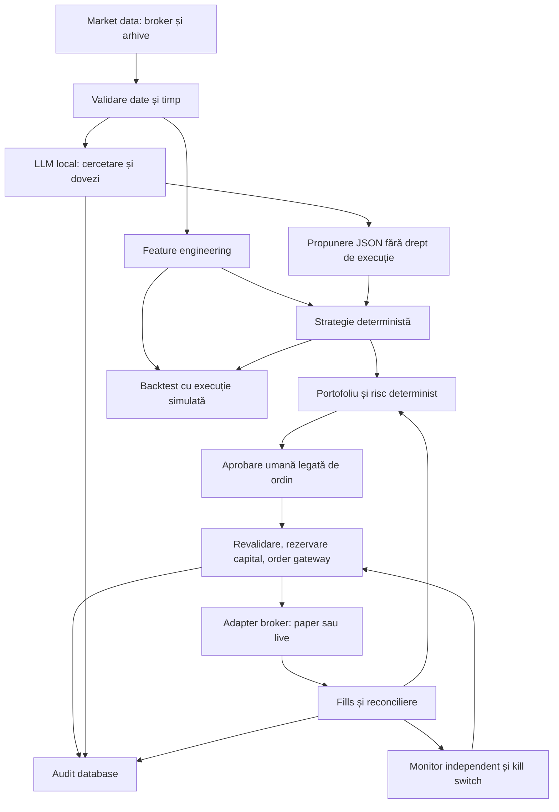

# Agent local de analiză și trading: evaluare tehnică și plan de implementare

**Verificare: 18 septembrie 2026. Context confirmat: România/SEE; MacBook Pro, Apple M2 Max, 32 GB RAM.**

**Actualizare după clarificarea utilizatorului: există deja un cont XTB pentru stocks.** Pentru prima etapă recomand păstrarea acestuia pentru execuție manuală, cu agent local de analiză și simulare. Nu este necesar un cont nou pentru a începe cercetarea. Recomandarea IBKR de mai jos rămâne condiționată de dorința ulterioară de execuție automată prin API oficial. NautilusTrader rămâne baza propusă pentru simulare și viitoarea infrastructură multi-asset, fără integrare live XTB presupusă.

**Concluzie:** aș porni de la **NautilusTrader** pentru infrastructura multi-asset, cu un strat LLM separat, fără acces la ordine. Aș începe cu simulare locală și apoi IBKR paper pentru acțiuni. **Nu aș folosi versiunea NautilusTrader v2 release candidate cu bani reali.** Dacă prioritatea devine un prototip crypto simplu, Freqtrade este alternativa mai practică.

## 1. Rezumat executiv și limitele verificării

Niciun proiect inspectat nu oferă simultan un agent local gata de folosit, execuție verificată stocks–forex–crypto pentru un rezident român, toate controalele de risc cerute și dovezi independente de profitabilitate.

Cele mai bune baze sunt motoare deterministe de trading la care adaugi analiză LLM. Caracterul „agentic” este util pentru cercetare, alegerea instrumentelor de analiză și formularea ipotezelor; nu este o dovadă de calitate a execuției.

**Top 3, pentru roluri diferite:**

| Loc | Opțiune | Rol recomandat | Compromis principal |
|---|---|---|---|
| 1 | NautilusTrader | Nucleu multi-asset: date, simulare, portofoliu, risc de ordine, adaptoare | Complexitate și tranziție v1–v2; v2 este RC |
| 2 | Freqtrade | Prototip complet crypto: backtest, dry-run, live ulterior | Nu este un motor stocks/forex și nu este LLM-agentic nativ |
| 3 | TradingAgents | Cercetare financiară cu agenți și surse verificabile | Nu oferă motor de execuție la broker; backtestul actual măsoară decizii |

Surse: [NautilusTrader](https://github.com/nautechsystems/nautilus_trader), [Freqtrade](https://github.com/freqtrade/freqtrade), [TradingAgents — codul evaluării](https://github.com/TauricResearch/TradingAgents/blob/2d17df8da1536c121e4d7395ac5a5dcec9e96d6f/tradingagents/backtest.py).

**Metodă:** am citit paginile proiectelor, metadatele API GitHub/Hugging Face, istoricul ultimului commit din ramura implicită, arborii de fișiere, module selectate și exemple recente de issues/PR-uri. Am confruntat afirmațiile despre ordine cu API-urile brokerilor. Sursele selectate și metadatele sunt salvate în directorul `evidence/`, cu SHA-uri și un index.

**Nu am instalat sau executat proiectele, rulat suitele lor de teste, conectat conturi, plasat ordine ori reprodus randamente.** Evaluarea calității este statică, nu un audit exhaustiv de securitate sau o certificare operațională. Existența testelor nu înseamnă că trec. Nu am verificat toate dependențele față de baze CVE.

Etichete folosite:

- **F — fapt:** observat direct în cod, metadate sau documentație oficială.
- **I — inferență:** concluzie tehnică din probe, fără validare în execuție.
- **P — presupunere:** condiție încă neconfirmată.
- **R — recomandare:** alegerea mea de arhitectură sau experiment, nu funcție existentă.

Încredere **ridicată** înseamnă dovezi concordante din cod și documentație pentru concluzia respectivă; **medie** înseamnă documentație sau inspecție parțială. Nu exprimă probabilitatea de profit. „Neconfirmat” nu înseamnă demonstrat absent.

**P:** cei 500 EUR sunt tratați inițial drept sold virtual. Nu ai confirmat că accepți pierderea lor. Sumele live de mai jos sunt scenarii condiționate, nu autorizare de tranzacționare.

## 2. Identitate, activitate, licențe și comunitate

„Ultimul commit” este data UTC a commitului din ramura implicită, nu data unei stele și nici simplul `updated_at`. „Push” poate include alte ramuri și actualizări automate. Coloana issues/PR reprezintă totalul deschis returnat de API, nu numărul exclusiv de buguri.

| Proiect / sursă | Ultimul commit inspectat | Ultimul push | Issues + PR deschise | Licență observată | Încredere |
|---|---|---|---:|---|---|
| [fsaavedra / Agentic-AI…](https://github.com/fsaavedra0003/Agentic-AI-Trading-Bot-with-LLM-reasoning-sentiment-analysis/commits/master/) | 2026-03-10, `aca607d` | 2026-03-10 | 0 | Nicio licență identificată în arborele inspectat | Ridicată pentru lipsa execuției în codul inspectat |
| [FriesTrader](https://github.com/YizhiSong/FriesTrader/commits/main/) | 2026-09-11, `4584136` | 2026-09-11 | 0 | MIT | Ridicată static; medie pentru integrarea live |
| [Krexibd/quant-trading](https://github.com/Krexibd/quant-trading/commits/main/) | 2026-09-18, `5866f5c` | 2026-09-18 | 0 | MIT | Ridicată pentru natura de colecție de backtesturi |
| [kweinmeister/agentic-trading](https://github.com/kweinmeister/agentic-trading/commits/main/) | 2026-09-11, `8f6f4b3` | 2026-09-14 | 4 | Apache-2.0 | Ridicată |
| [HKUDS/AI-Trader](https://github.com/HKUDS/AI-Trader/commits/main/) | 2026-06-11, `d03ff6c` | 2026-06-11 | 47 | Fără licență de proiect identificată; server descris ca proprietary | Ridicată pentru această versiune |
| [NautilusTrader](https://github.com/nautechsystems/nautilus_trader/commits/develop/) | 2026-09-18, `5980f36` | 2026-09-18 | 135 | LGPL-3.0; documentația curentă precizează LGPL-3.0-only | Ridicată, cu risc de versiune |
| [Freqtrade](https://github.com/freqtrade/freqtrade/commits/develop/) | 2026-09-18, `2f509e1` | 2026-09-18 | 29 | GPL-3.0 | Ridicată |
| [TradingAgents](https://github.com/TauricResearch/TradingAgents/commits/main/) | 2026-09-18, `2d17df8` | 2026-09-18 | 154 | Apache-2.0 | Ridicată pentru cercetare; fără validare financiară |
| [ai-hedge-fund](https://github.com/virattt/ai-hedge-fund/commits/main/) | 2026-09-03, `fc1bf25` | 2026-09-03 | 162 | MIT; README limitează scopul declarat la educație | Ridicată pentru codul curent |
| [FinRobot Forecaster, HF](https://huggingface.co/spaces/FinGPT/FinRobot_Forecaster/commits/main) | 2025-07-07, `d243303` | HF lastModified: aceeași zi | 4 discuții afișate, nu echivalent GitHub issues | Fără licență explicită în metadata Space inspectată | Ridicată pentru app.py; medie global |
| [FinGPT Llama3-8B LoRA, HF](https://huggingface.co/FinGPT/fingpt-mt_llama3-8b_lora/commits/main) | HF lastModified: 2024-10-06, `5b58505` | Aceeași zi | 2 discuții afișate | Adapter MIT; se aplică separat licența modelului Llama 3 de bază | Ridicată pentru model card; fără benchmark local |

Pagina [GitHub topic quant-trading-bot](https://github.com/topics/quant-trading-bot) este **un index, nu un proiect**. Nu are arhitectură, licență unică, teste sau scor tehnic propriu. La verificare afișa inclusiv Krexibd și repository-uri orientate spre documentație/promovare MT4. Etichetele „live”, „HFT” sau „quant” nu probează existența unui motor corespunzător.

**Comunitate și mentenanță — probe concrete, nu stele:**

- NautilusTrader: problema [#5012](https://github.com/nautechsystems/nautilus_trader/issues/5012) privind burst-ul abonărilor Binance a fost închisă prin [#5014](https://github.com/nautechsystems/nautilus_trader/pull/5014). PR-ul [#5005](https://github.com/nautechsystems/nautilus_trader/pull/5005), despre fallback-ul comisioanelor Kraken, era încă deschis: nu îl consider funcție livrată.
- Freqtrade: [#13572](https://github.com/freqtrade/freqtrade/issues/13572) privește evaluarea soldurilor pentru perechi spot/futures; [#13574](https://github.com/freqtrade/freqtrade/pull/13574) pentru trailing stop Binance era deschis. Un PR nu reprezintă suport deja disponibil.
- TradingAgents: versiunea 0.5.0 a fost integrată în ziua verificării; există teste pentru look-ahead, date lipsă, identitatea instrumentului și prompturi. Mentenanță activă, dar multe probleme/propuneri deschise.
- kweinmeister: ultimele PR-uri inspectate actualizează dependențe, de exemplu [#143](https://github.com/kweinmeister/agentic-trading/pull/143). Aceasta indică întreținere, nu extindere la tranzacționare reală.
- HKUDS: [#285](https://github.com/HKUDS/AI-Trader/pull/285) și [#286](https://github.com/HKUDS/AI-Trader/pull/286), din august, propun corecții ale contractelor/documentației; ramura principală rămâne din iunie.
- ai-hedge-fund: [#711](https://github.com/virattt/ai-hedge-fund/issues/711) raportează probleme cu endpointuri LLM personalizate; [#662](https://github.com/virattt/ai-hedge-fund/pull/662) propune date FX, nu execuție FX implementată.
- Lipsa issues la FriesTrader, fsaavedra și Krexibd nu demonstrează stabilitate. Ultimul commit Krexibd este „LOG”; data recentă singură nu dovedește dezvoltare substanțială.

MIT/Apache permit în general reutilizare comercială cu obligațiile licenței. GPL/LGPL implică obligații diferite la distribuire; trebuie verificată versiunea și forma de integrare. Vizibilitatea publică pe GitHub **nu acordă automat drept de reutilizare** în absența unei licențe. Pentru HKUDS, afirmația explicită „proprietary server” este un impediment important. Acestea sunt constatări de selecție, nu o opinie juridică asupra unui produs comercial final. Surse: fișierele LICENSE ale proiectelor și [HKUDS service/README.md](https://github.com/HKUDS/AI-Trader/blob/d03ff6c056b32ced735adf7c19ed8175adb1c8df/service/README.md).

## 3. Comparația numerică

**R — scoruri orientative, 1–10.** 1 = absent/neprobat pentru cerința unui bot; 3 = prototip limitat; 5 = utilizabil cu lipsuri importante; 7 = funcție substanțială cu teste/documentație; 9 = infrastructură foarte solidă în eșantionul inspectat; 10 ar necesita dovezi pe care acest audit nu le oferă. Incertitudine aproximativă ±1–2 puncte. Nu sunt scoruri de randament și nu includ popularitatea.

Componentele HF primesc scoruri mici la execuție fiindcă nu sunt sisteme de trading. Aceasta nu e o evaluare a calității predicțiilor lor. Nu fac media celor 14 coloane: o lipsă de licență, eligibilitate sau barieră de risc poate exclude proiectul indiferent de medie.

| Proiect | Maturitate | Cod | Agentic | Multi-asset | Broker/exchange | Backtesting | Paper |
|---|---:|---:|---:|---:|---:|---:|---:|
| fsaavedra | 2 | 2 | 2 | 2 | 1 | 1 | 1 |
| FriesTrader | 4 | 5 | 7 | 2 | 4 | 1 | 3 |
| Krexibd | 3 | 3 | 1 | 4 | 1 | 3 | 1 |
| kweinmeister | 4 | 7 | 4 | 1 | 1 | 3 | 3 |
| HKUDS AI-Trader | 5 | 5 | 6 | 5 | 2 | 2 | 6 |
| NautilusTrader | 8 | 9 | 1 | 9 | 8 | 9 | 8 |
| Freqtrade | 9 | 8 | 2 | 3 | 8 | 8 | 9 |
| TradingAgents | 6 | 7 | 9 | 5 | 1 | 4 | 2 |
| ai-hedge-fund | 5 | 7 | 7 | 2 | 1 | 6 | 4 |
| HF FinRobot Forecaster | 3 | 4 | 2 | 2 | 1 | 1 | 1 |
| HF FinGPT LoRA | 3 | 4 | 1 | 2 | 1 | 1 | 1 |

| Proiect | Risc | Securitate | Observabilitate | Documentație | Extensibilitate | Mentenanță | Local |
|---|---:|---:|---:|---:|---:|---:|---:|
| fsaavedra | 1 | 2 | 2 | 2 | 3 | 2 | 4 |
| FriesTrader | 4 | 3 | 6 | 7 | 5 | 5 | 7 |
| Krexibd | 2 | 3 | 3 | 4 | 4 | 3 | 5 |
| kweinmeister | 4 | 5 | 5 | 7 | 6 | 6 | 8 |
| HKUDS AI-Trader | 3 | 4 | 7 | 5 | 4 | 4 | 5 |
| NautilusTrader | 8 | 8 | 9 | 8 | 9 | 9 | 8 |
| Freqtrade | 8 | 7 | 8 | 9 | 8 | 9 | 9 |
| TradingAgents | 3 | 5 | 8 | 8 | 8 | 9 | 8 |
| ai-hedge-fund | 5 | 5 | 7 | 6 | 8 | 7 | 7 |
| HF FinRobot Forecaster | 1 | 3 | 3 | 4 | 4 | 2 | 5 |
| HF FinGPT LoRA | 1 | 4 | 2 | 4 | 5 | 2 | 5 |

**De ce aceste diferențe:** Nautilus/Freqtrade au management efectiv al ordinelor și teste de infrastructură. TradingAgents este mai agentic, însă dezbaterea unui „risk agent” nu înlocuiește un control de broker. FriesTrader are formule utile, dar păstrează orchestrarea și respectarea multor reguli în instrucțiuni către model. kweinmeister are cod și teste relativ bune pentru o demonstrație, însă simulează altă problemă decât execuția reală. Documentația fsaavedra descrie mai mult decât codul livrat.

**Versiunile contează:** scorurile Nautilus și Freqtrade reflectă ramurile implicite inspectate, inclusiv cod de dezvoltare. Nu presupun că toate modificările din aceste SHA-uri sunt deja incluse într-un release distribuit. Înainte de implementare trebuie refăcută matricea de funcții pe tag-ul ales; o corecție integrată pe 18 septembrie nu este automat prezentă într-un RC din 15 septembrie.

## 4. Fișele tehnice

### 4.1. fsaavedra — analizor de sentiment prezentat drept trading bot

**F:** `main.py` citește fișiere cu știri și Reddit, aplică analiză de sentiment și salvează JSON. `llm_analyzer.py` folosește `gpt-4o-mini`, SDK OpenAI și `json.loads`. Arborele propriu include ingestion, sentiment, feature engineering, model ML și price fetcher; nu am găsit directoarele de execuție, agenți, dashboard sau teste de proiect promise de README. Există un `venv/` versionat. Dependențele sunt nefixate.

**Execuție/active/date:** poate extrage simboluri stocks/crypto din text; aceasta nu este integrare multi-asset. Alpaca/Binance sunt menționate în README, fără adapter de ordine identificat. Forex, backtesting complet, paper engine, poziții și kill switch nu sunt confirmate.

**I:** este un pipeline LLM de analiză, nu un agent autonom cu buclă de instrumente și feedback. Apelul `openai.ChatCompletion.create` și dependența OpenAI nefixată introduc risc de incompatibilitate; nu am rulat instalarea. JSON invalid este convertit în „Neutral”, ceea ce poate ascunde defectele. Nu există validare economică a tickerelor returnate.

**Risc/securitate/cost/local:** nu are controalele de trading cerute; textul extern ajunge în prompt. Necesită cheie LLM pentru calea normală și chei pentru unele surse; nu cheie de broker, fiindcă nu execută. Logging minimal, fără audit de tranzacții. Cost API proporțional cu articolele. Extensibilitatea aparent simplă ascunde faptul că motorul trebuie practic construit.

**Verdict R:** nu ca bază. Eventual fragmente de ingestie, după clarificarea licenței; beneficiul probabil nu justifică preluarea proiectului. Surse: [main.py](https://github.com/fsaavedra0003/Agentic-AI-Trading-Bot-with-LLM-reasoning-sentiment-analysis/blob/aca607d9844b78144f4a267e28a971e09bf69990/main.py), [analizor](https://github.com/fsaavedra0003/Agentic-AI-Trading-Bot-with-LLM-reasoning-sentiment-analysis/blob/aca607d9844b78144f4a267e28a971e09bf69990/sentiment/llm_analyzer.py), [dependențe](https://github.com/fsaavedra0003/Agentic-AI-Trading-Bot-with-LLM-reasoning-sentiment-analysis/blob/aca607d9844b78144f4a267e28a971e09bf69990/requirements.txt).

### 4.2. FriesTrader — agent operațional, dar barieră de securitate incompletă

**F:** template Claude Code + Robinhood MCP. Două faze: analiză după închiderea pieței, apoi reverificare și ordine. Scripturi Python standard pentru sizing, stop-loss, take-profit parțial, ranking, re-entry și limite de pierdere. Modul implicit este `dry_run`; sunt cerute minimum 10 cicluri. Există instrucțiuni pentru review, place și confirmarea stării ordinului, plus log JSONL și deduplicare pe propunere.

**Date și ordine:** istorice/quotes/poziții Robinhood, știri pentru teză. Template-ul inspectat execută acțiuni long; API-ul Robinhood are mai multe active, dar asta nu extinde automat FriesTrader la crypto/options. Calea live este reală prin MCP oficial, însă nu a fost testată în acest audit. `dry_run` înseamnă decizii fără submit, nu un simulator complet de fills și cash virtual.

**F:** configurația include 20% maximum per poziție, patru poziții, rezervă cash 10%, stop între 5–15% în modul volatility-scaled, pierdere zilnică 5% și săptămânală 10%. Nu recomand copierea acestor valori pentru experimentul tău.

**I — problema centrală:** scriptul de sizing primește valorile și limitele ca argumente de la orchestrator. Promptul îi interzice agentului să modifice regulile sau să sară verificările, dar repository-ul nu furnizează un serviciu de autorizare izolat care să fie singurul deținător al accesului la broker. Aceasta slăbește afirmația „modelul nu poate ocoli regulile”. Verificarea periodică a stopului nu echivalează cu stop nativ permanent la broker.

**Calitate/local/cost:** cod mic, inspectabil, fără suită automată/CI identificată în cei 15 itemi ai arborelui. Documentație detaliată. Local necesită computer pornit; deployment-ul descris folosește și git pentru stare. Logul explică deciziile, dar „append-only” prin convenție nu este imutabilitate. Costul abonamentului/modelului nu este zero, chiar dacă nu există tarif API per apel.

**Verdict R:** reutilizează ideile de faze și formulele MIT, cu teste noi. Rescrie autorizarea, stocarea, deduplicarea și monitorizarea independentă. Nu îl alege pentru România și nu publica starea contului în git. Surse: [reguli](https://github.com/YizhiSong/FriesTrader/blob/458413627b6934e24b0d8533e56400b18e238c0f/risk_rules.json), [sizing](https://github.com/YizhiSong/FriesTrader/blob/458413627b6934e24b0d8533e56400b18e238c0f/scripts/position_sizing.py), [faza B](https://github.com/YizhiSong/FriesTrader/blob/458413627b6934e24b0d8533e56400b18e238c0f/PHASE_B_TASK.md).

### 4.3. Krexibd/quant-trading — bibliotecă educațională, nu agent

**F:** colecție Python de strategii, VIX, Monte Carlo, pair trading și indicatori. README precizează testare istorică și presupune tranzacții fără slippage, comisioane sau lipsă de lichiditate. Enumeră date Yahoo, Stooq, Bloomberg/Eikon și surse FX istorice. Nu am identificat LLM, orchestrator, broker adapter sau motor live. Există și artefacte Visual Studio/Windows Forms, fără legătură demonstrată cu un sistem de execuție.

**Suport real:** idei aplicabile acțiunilor, valutelor, opțiunilor și mărfurilor în cercetare; nu suport operațional pentru aceste clase. „Forward testing” pe date istorice nu este forward paper cu feed live. Unele strategii au logică de portofoliu, dar nu un OMS comun, limite zilnice sau kill switch.

**Calitate/local/securitate:** documentație explicativă utilă, instalare și reproducibilitate neuniforme; suită de teste de trading neidentificată. Fără chei live pentru scripturi cu date locale, dar unele surse sunt comerciale. Riscul principal este încrederea nejustificată în backtesturi idealizate; nu există expunere LLM nativă la prompt injection.

**Verdict R:** idei și formule, nu infrastructură. Reimplementează numai strategia selectată în motorul ales și verifică proveniența/licența fiecărui fragment. Sursă: [repository și explicațiile metodologice](https://github.com/Krexibd/quant-trading).

### 4.4. kweinmeister/agentic-trading — demonstrație ADK/A2A bine delimitată

**F:** AlphaBot, RiskGuard și UI FastAPI/Plotly; comunicare A2A și Google ADK. AlphaBot extinde `BaseAgent` și calculează SMA; în calea inspectată nu este un model generativ care decide tranzacții. Piața este simulată, cu parametri de trend și volatilitate.

RiskGuard verifică structură, cantități/prețuri pozitive, cash, acțiuni deținute, mărimea ordinului și concentrarea. Nu am confirmat stop-loss, take-profit, max drawdown sau limită zilnică completă. Niciun broker real identificat; portofoliul cash/shares este intern.

**I:** agentic în sensul unor servicii de agenți care colaborează; caracter LLM-agentic redus în strategia livrată. Timpul de comunicare A2A este relevant pentru demonstrație, nu validat pentru execuție bursieră. Limita pe ordin se aplică și vânzărilor, deci o închidere mare poate necesita tratament special dacă refolosești regulile.

**Calitate/local/cost:** teste unitare și de integrare, CI și lockfile; Docker și script local. Logging și grafice, nu registru bursier complet. Simularea nu necesită credențiale reale de broker; calea deterministă inspectată nu justifică presupunerea unui cost LLM. Publicarea serviciilor cere autentificare suplimentară verificată.

**Verdict R:** bun pentru a învăța separarea strategiei de risc; nu construi broker/OMS în jurul lui doar pentru a păstra A2A. Surse: [AlphaBot](https://github.com/kweinmeister/agentic-trading/blob/8f6f4b38792307267437fd9d6860eeb05f680e7a/alphabot/agent.py), [RiskGuard](https://github.com/kweinmeister/agentic-trading/blob/8f6f4b38792307267437fd9d6860eeb05f680e7a/riskguard/rules.py), [teste](https://github.com/kweinmeister/agentic-trading/tree/main/tests).

### 4.5. HKUDS/AI-Trader — platformă de agenți și simulare, nu adapter universal

**F:** versiunea actuală este o platformă FastAPI/React cu baze de date, semnale, copy trading, clasamente și experimente. Nu trebuie confundată cu descrieri mai vechi ale proiectului. Ghidul propriu precizează sold simulat de 100.000 USD și distinge sincronizarea unor tranzacții externe de tranzacționarea simulată pe platformă.

Stocks/crypto/forex și alte piețe sunt promovate; în cod și ghid am confirmat contabilizare/simulare și surse de preț, nu adaptoare live pentru fiecare clasă. Pentru acțiuni documentația menționează Alpha Vantage cu fallback yfinance; Polymarket folosește date reale și execuție simulată.

**Risc/calitate:** există teste pentru autentificare, prețuri, permissions, scoruri și baze de date. Clasamentul cu drawdown nu este același lucru cu o limită care blochează ordine. Stopuri native, limită zilnică globală și kill switch broker nu sunt confirmate. Telemetria de platformă este mai dezvoltată decât dovezile de execuție externă.

**Securitate/licență/local:** agentul extern poate publica/consuma conținut, deci există risc de instrucțiuni malițioase în semnale sau ghiduri. Nu am urmat instrucțiunile de înregistrare din repository. Serverul este numit explicit proprietary în `service/README.md`; nu îl tratez drept bază open-source reutilizabilă fără clarificare. Rularea locală a întregii platforme este mai grea decât un bot single-user; necesită backend, frontend și date externe.

**Verdict R:** util ca idee de benchmark/audit social, nerecomandat ca bază a executorului local. Surse: [ghidul ce distinge sincronizare și simulare](https://github.com/HKUDS/AI-Trader/blob/d03ff6c056b32ced735adf7c19ed8175adb1c8df/skills/ai4trade/SKILL.md), [servicii](https://github.com/HKUDS/AI-Trader/blob/d03ff6c056b32ced735adf7c19ed8175adb1c8df/service/server/services.py), [restricția serverului](https://github.com/HKUDS/AI-Trader/blob/d03ff6c056b32ced735adf7c19ed8175adb1c8df/service/README.md).

### 4.6. NautilusTrader — cea mai bună fundație multi-asset, cu blocaj de versiune

**F:** motor event-driven, Rust/Python; date normalizate, instrumente, ordine, poziții, portofolii și adaptoare. Sunt documentate IBKR pentru piețe tradiționale și Binance, Kraken, Coinbase, OKX etc. pentru crypto. Compatibilitatea unei clase cu modelul de instrument nu înlocuiește testarea adapterului și eligibilitatea contului.

Backtesting, sandbox și live sunt concepte separate. Codul strategiei poate fi comun, dar diferențele de execuție live rămân. RiskEngine validează ordine, mărimi/notional și frecvențe și are stări de oprire/reducere. **Nu presupun că implementează automat politica ta completă de drawdown, pierdere zilnică și expunere agregată**: acestea trebuie configurate sau adăugate deasupra.

**F:** release API raporta v1.231.0 din 2 august ca ultim release ne-marcat prerelease, însă titlul său spune Beta. v2.0.0rc5 este din 15 septembrie; documentația curentă avertizează să nu folosești RC cu bani reali. v1 primește doar backporturi critice în tranziție. Nu am demonstrat prin instalare că toate exemplele și wheels sunt compatibile pe Mac-ul tău.

**Calitate:** arbore amplu de teste, CI și politici de securitate; am inspectat efectiv codul RiskEngine, nu doar un badge. Există `bypass`: în sistemul propus este interzis prin configurație nemodificabilă de agent. Logging și evenimente favorabile auditului, dar nu reprezintă automat istoric imutabil cu toate sursele LLM.

**Local/cost/latency:** macOS ARM64 este suportat; prefer pachete binare verificate. Motorul este potrivit pentru trading real după calificare, însă nu am măsurat latența. Costurile importante sunt datele, brokerul și mentenanța. Nu are nevoie de LLM sau chei live pentru replay local. Adaptoarele facilitează extensia fără a rescrie motorul.

**R:** dezvoltare nouă pe un release v2 fixat, numai research/sandbox/paper, cu poartă explicită „fără RC în live”. Dacă v2 nu se stabilizează în 90 zile, rămâi paper. v1 este opțiune temporară numai după verificarea suportului și a documentației potrivite versiunii, nu soluția implicită pe termen lung. Surse: [release v1](https://github.com/nautechsystems/nautilus_trader/releases/tag/v1.231.0), [RC5](https://github.com/nautechsystems/nautilus_trader/releases/tag/v2.0.0rc5), [migrare](https://github.com/nautechsystems/nautilus_trader/blob/5980f363ae83eb11d0afdfec4c7109246ff511d9/MIGRATION_V2.md), [RiskEngine](https://github.com/nautechsystems/nautilus_trader/blob/5980f363ae83eb11d0afdfec4c7109246ff511d9/crates/risk/src/engine/mod.rs), [adapter IBKR](https://github.com/nautechsystems/nautilus_trader/blob/5980f363ae83eb11d0afdfec4c7109246ff511d9/docs/integrations/interactive_brokers.md).

### 4.7. Freqtrade — alegerea pragmatică pentru crypto

**F:** bot Python pentru crypto, cu CCXT, strategii, backtesting, dry-run, live, bază de date și UI/API/Telegram. FreqAI adaugă ML, nu îl transformă automat într-un agent LLM. Stocks și forex de broker nu sunt suportul său nativ.

Are stoploss, ROI/exit logic, dimensionare, maximum de tranzacții deschise și protecții precum StoplossGuard/MaxDrawdown. Protecțiile trebuie activate și înțelese; nu echivalează automat cu un buget zilnic de pierdere pe toate conturile. Stop pe exchange numai pentru combinațiile documentate de exchange/piață/tip de ordin.

**Backtest/date:** folosește istorice și feed live; dry-run permite forward testing fără chei de trading, unde datele publice sunt accesibile. Backtesturile pe lumânări au ipoteze intrabar; instrumentele lookahead/recursive analysis sunt utile, fără să excludă orice bias. Nu consider fills simulate egale cu execuția reală.

**Calitate/local:** teste pentru bot, backtesting, protecții și stopuri pe exchange; instalare și documentație mature. Extensibilitate bună în ecosistemul crypto. Logging/DB ajută auditul; adaugă separat sursele și versiunile LLM. Protejează UI/API și tokenul Telegram; comenzile de control sunt o suprafață cu putere reală.

**R:** cea mai bună alternativă dacă accepți crypto-only. Integrează LLM ca feature offline sau filtru lent; nu modifica strategia cu cod generat în timpul execuției. Cost redus de software, comisioanele pot domina un cont de 500 EUR. Surse: [proiect](https://github.com/freqtrade/freqtrade), [backtesting](https://www.freqtrade.io/en/stable/backtesting/), [protections](https://www.freqtrade.io/en/stable/plugins/), [stoploss](https://www.freqtrade.io/en/stable/stoploss/), [control](https://www.freqtrade.io/en/stable/telegram-usage/).

### 4.8. TradingAgents — componentă bună de research, nu broker

**F:** LangGraph cu analiști, cercetători bull/bear, trader și evaluatori de risc; mai mulți furnizori LLM, Ollama și endpointuri locale compatibile. Date din yfinance, Alpha Vantage, SEC EDGAR, FRED și surse sociale, în funcție de configurare. Versiunea 0.5.0 adaugă întăriri point-in-time și evaluare pe grile ticker/dată.

**Distincție esențială:** `backtest.py` spune explicit că evaluează calitatea deciziilor și nu este simulator de portofoliu. Afirmația generală din README despre „simulated exchange” nu probează un OMS sau adapter live; în arborele inspectat nu am identificat integrare de ordine la broker. Stocks și crypto sunt moduri de analiză; analiza forex/execuția forex nu sunt confirmate.

**Risc/observabilitate:** dezbaterea riscului este influențată de LLM; nu este autoritate deterministă asupra capitalului. Există checkpointuri SQLite, log de decizii și teste relevante pentru date/prompts; nu există kill switch broker demonstrat. Cu surse fără chei și LLM local poți evita cheile LLM/broker; unele fluxuri de date tot necesită acces extern.

**I:** rulările pot dura mult și pot varia; nu e adecvat unei bucle rapide de ordine. Datele istorice aparent corecte nu elimină informația viitoare memorată la antrenarea modelului. Testele point-in-time ale toolurilor nu rezolvă această contaminare.

**R:** preia un subset mic, de exemplu market + news, cu buget de apeluri. Păstrează toate ieșirile drept propuneri. Nu porni o „echipă” mare de modele fără să demonstrezi beneficiu peste strategia deterministă. Surse: [README fixat](https://github.com/TauricResearch/TradingAgents/blob/2d17df8da1536c121e4d7395ac5a5dcec9e96d6f/README.md), [backtest.py](https://github.com/TauricResearch/TradingAgents/blob/2d17df8da1536c121e4d7395ac5a5dcec9e96d6f/tradingagents/backtest.py), [teste](https://github.com/TauricResearch/TradingAgents/tree/main/tests).

### 4.9. ai-hedge-fund — arhitectură promițătoare, în reconstrucție

**F:** versiunea inspectată are mandate YAML, modele alpha, construcție de portofoliu, backtest, broker simulat și TUI. Nu descriu vechea arhitectură din articole ca și cum ar fi codul actual. README precizează că nu execută tranzacții reale și că sistemul persistent/paper/live este în dezvoltare.

`RiskLimits` impune determinist limita pe ponderea unei poziții și expunerea brută; produce evenimente explicabile pentru ajustări. Nu am confirmat în acel modul stoploss, take-profit, limită zilnică sau drawdown. Brokerul identificat este `sim.py`; integrare stocks de cercetare prin Financial Datasets, nu broker real stocks/forex/crypto.

**Calitate/local:** teste în modulele backtesting, broker, portofoliu și risc; componente mai bune decât un simplu prompt. Datele și modelele pot avea costuri; calea standard cere cheie Financial Datasets și cheie pentru modele LLM. Cheile sunt salvate de aplicație în fișier `.env` local; pentru proiectul tău aș înlocui această cale.

**R:** sursă bună de idei pentru mandate, interfețe broker și ajustări de risc; nu alegerea principală pentru conectare reală acum. Nu presupune suport local LLM funcțional doar din compatibilități istorice, având în vedere issue-ul deschis despre endpointuri. Surse: [README](https://github.com/virattt/ai-hedge-fund/blob/fc1bf250ead209ae5f02c39c3d0062c4bb554505/README.md), [limite](https://github.com/virattt/ai-hedge-fund/blob/fc1bf250ead209ae5f02c39c3d0062c4bb554505/hedge_fund/risk/limits.py), [brokeri](https://github.com/virattt/ai-hedge-fund/tree/main/hedge_fund/brokers).

### 4.10. Hugging Face: FinRobot Forecaster și FinGPT

**FinRobot Forecaster — F:** Space Gradio cu `app.py`, OpenAI, Finnhub și Alpha Vantage; modelul implicit este `gpt-4o-mini`. Produce rezumate și perspectivă de preț la o săptămână. API-ul HF raporta RUNNING la verificare; nu am trimis o cerere de inferență și nu garantez că funcționează end-to-end. Cere chei de date și LLM, nu execută ordine, nu are portofoliu/risc/kill switch sau simulator de tranzacții. Nu este un sistem multi-agent doar pentru că numele conține „Robot”. Codul folosește eșantionare aleatoare a știrilor; pentru reproducibilitate trebuie salvat eșantionul. Funcția de date fundamentale selectează perioada financiară, ceea ce cere audit separat al datei reale de publicare. Nu am identificat teste în Space. **R:** inspirație pentru UI/rapoarte, cu licență de clarificat. [Codul Space](https://huggingface.co/spaces/FinGPT/FinRobot_Forecaster/blob/d2433036bb3bf6f990495f6ca8fab74f11d7eee6/app.py).

**FinGPT LoRA — F:** adapter de fine-tuning Llama-3-8B pentru sentiment, nu bot și nu model complet standalone. Nu are brokeri, date live integrate, backtest/paper, portofoliu sau controale de risc. Exemplul de inferență este CUDA și folosește `trust_remote_code=True`; nu este o rețetă nativă M2 Max. Licența MIT a adapterului nu înlocuiește licența Llama 3. **R:** componentă de comparat pe un set etichetat; nu alegerea implicită pentru primul prototip Mac. Nu activa remote code fără inspecție. [Model card](https://huggingface.co/FinGPT/fingpt-mt_llama3-8b_lora).

## 5. Verificările operaționale cerute, într-un singur loc

**I/R — costuri și latență:** nu am făcut benchmarkuri și nu atribui niciunui proiect latențe garantate. „Local” descrie unde rulează programul, nu faptul că toate datele și modelele sunt offline.

| Proiect | Cost operațional dominant | Potrivire de latență și extensie locală |
|---|---|---|
| fsaavedra | Apeluri LLM per text și eventual date | Batch de sentiment; execuția și portofoliul trebuie construite |
| FriesTrader | Abonament/runtime Claude, date și tranzacții | Două sesiuni zilnice; nepotrivit pentru stopuri ce depind exclusiv de reacție continuă |
| Krexibd | Date istorice, uneori comerciale; timp de adaptare | Cercetare offline; fiecare script cere integrare și normalizare |
| kweinmeister | CPU local; hosting dacă îl publici | Simulare cu overhead HTTP/A2A; extensia la broker înseamnă sistem nou de execuție |
| HKUDS | Backend, DB, workers și API-uri de date | Platformă web și agenți externi; cost de administrare mai mare, reutilizare blocată de licență |
| Nautilus | Date, broker și efort de integrare; LLM separat opțional | Motor pentru execuție, fără benchmark în audit; potrivit strategiilor locale după calificare |
| Freqtrade | Date publice/comerciale, comisioane, eventual FreqAI | Strategii pe lumânări; extensie crypto bună, nu HFT prin LLM |
| TradingAgents | Numărul de agenți, runde LLM și surse | Cercetare în afara căii ordinelor; cache și subset de analiști |
| ai-hedge-fund | Financial Datasets și modele alpha LLM | Cicluri de research/rebalansare; adapter live nou necesar |
| HF FinRobot | OpenAI, Finnhub și Alpha Vantage | Aplicația include pauze pentru rate limits; nu executor cu latență mică |
| HF FinGPT | Inferență locală și adaptare runtime | Sentiment batch; conversia/încărcarea pe Apple Silicon trebuie demonstrată |

Aceste aprecieri derivă din codul și sursele citate în fișele de mai sus. Nu prezint un tarif lunar numeric neverificat pentru proiectele care depind de planul furnizorului.

„Fără chei live” nu înseamnă obligatoriu „fără nicio cheie de date/LLM”.

| Proiect | Ordine reale | Date | Research / backtest / paper / live separate? | Fără chei de broker real | Oprire și limitarea LLM | Audit ulterior |
|---|---|---|---|---|---|---|
| fsaavedra | Neidentificate | Fișiere + ingestie externă | Nu, pipeline de sentiment | Da; LLM cere cheie | Controale neidentificate | JSON sentiment, nu tranzacții |
| FriesTrader | Cale MCP oficială, netestată aici | Istoric + curent | A/B și dry/live; fără backtest complet | Scripturi da; fluxul MCP cere cont | Limite/scripturi + instrucțiuni, fără izolare demonstrată | JSONL, modificabil |
| Krexibd | Neidentificate | Istorice | Cercetare/backtest; fără paper/live | Da pentru date locale | Nu există LLM; fără kill switch comun | Rezultate/scripturi, neuniform |
| kweinmeister | Nu, simulator | Sintetice | Simulare, nu cele patru medii | Da | Risc determinist limitat; fără executor extern | Log + grafice |
| HKUDS | Simulare/sync confirmate | Prețuri curente + evidență istorică | Platformă de simulare; nu pipeline broker complet | Da pentru simulare, cont/chei de serviciu pot fi necesare | Controale broker neconfirmate | DB tranzacții/semnale |
| Nautilus | Adaptoare reale | Istoric + live | Da, cu sandbox/adaptoare distincte | Da pentru replay/sandbox fără auth de trading | RiskEngine; politica financiară suplimentară necesară | Evenimente/ordine/portofoliu |
| Freqtrade | Da, via exchange | Istoric + live | Da, backtest/dry-run/live | Da, în modurile public-data | Stop/protections/control; LLM adăugat trebuie izolat | DB, loguri, UI |
| TradingAgents | Neidentificate | Istoric/curent, după vendor | Research și evaluare; fără broker paper/live | Da; unele date cer chei | Risk agents nu sunt limitatoare de capital | Decizii + checkpointuri |
| ai-hedge-fund | Nu în versiunea inspectată | Date financiare externe/istorice | Backtest/sim; restul parțial sau roadmap | Da; date/LLM cer chei | Limite de ponderi deterministe; kill switch live neaplicabil | Înregistrare ciclu + clamp events |
| HF FinRobot | Nu | Știri/fundamentale/prețuri | Nu | Da, dar chei de analiză obligatorii | Niciun control de trading | Rapoarte, fără audit complet |
| HF FinGPT | Nu | Text furnizat modelului | Nu | Da după obținerea modelului | Fără executor; output de sentiment | De construit |

Pentru cele două motoare reale, „audit ulterior” înseamnă reconstrucția intrărilor, politicii, ordinelor și fills. Niciun text de justificare produs de LLM nu demonstrează singur cauza economică sau adevărul deciziei.

## 6. Robinhood și brokerii potriviți pentru România

### Actualizare: contul XTB existent

**F:** centrul oficial de asistență XTB România, actualizat la 27 aprilie 2026, precizează că accesul API nu mai este disponibil, serviciul fiind dezactivat la **14 martie 2025**. Nu am identificat o relansare oficială pentru contul retail românesc. Vechile biblioteci xAPI nu dovedesc existența unui serviciu funcțional în prezent. [XTB România — automatizare și API](https://www.xtb.com/ro/asistenta-clienti/platformele-noastre-6/oferiti-strategii-automatizate-sau-recomandari-de-investitii).

**R:** în prima etapă păstrezi XTB și construiești un copilot: date externe licențiate → analiză locală → simulare și verificări de risc → propunere cu preț/timestamp/cost → verificare și ordin introdus de tine în XTB. Pozițiile și fills se introduc sau importă din rapoarte furnizate de utilizator; formatul exportului trebuie verificat înainte de a construi importatorul. Agentul trebuie să marcheze momentul ultimei reconcilieri și să refuze dimensionarea pe poziții sau solduri neactualizate. Cotațiile externe nu sunt garantat identice cu cele executabile în XTB.

Această variantă nu oferă execuție automată, stopuri plasate de agent sau verificarea automată continuă a contului. Nu aș construi executorul financiar pe automatizarea interfeței xStation ori pe endpointuri neoficiale: schimbările de UI/autentificare și lipsa unui contract API suportat introduc riscuri suplimentare. Dacă ulterior dorești automatizare completă, poți evalua separat un cont IBKR; nu rezultă de aici necesitatea transferării portofoliului XTB.

### Robinhood: există API oficial, dar eligibilitatea este decisivă

**F:** documentația actuală descrie două căi distincte:

1. **Robinhood Crypto Trading API**, REST cu semnare, pentru clienți din **SUA**; suportă date, cont și ordine crypto, inclusiv versiuni v1/v2. Nu este un API universal de stocks/forex pentru Europa. [Documentație oficială](https://docs.robinhood.com/), [eligibilitate și versiuni](https://robinhood.com/us/en/support/articles/crypto-api/).
2. **Robinhood Trading MCP / Agentic Trading**, serviciu oficial pentru un cont agentic separat. Documentația curentă permite ordine **long equities, options și crypto**; nu am confirmat forex. Are instrumente distincte de review și plasare. [Trading with your agent](https://robinhood.com/us/en/support/articles/trading-with-your-agent/).

Contul agentic presupune un cont individual principal eligibil. Contul american cere în mod obișnuit adresă rezidențială legală în SUA, iar documentele corporative descriu lansarea Agentic Trading pentru clienți americani. **Rezidența în România nu oferă prin ea însăși acces la acest produs.** Existența Robinhood Europe nu transferă automat accesul la API/MCP american. Nu am găsit o documentație oficială care să confirme acces Agentic Trading pentru contul tău românesc. [Condiții cont SUA](https://robinhood.com/us/en/support/articles/what-you-need-to-get-started/), [raport Robinhood Q2 2026](https://investors.robinhood.com/static-files/be86adfc-ab9a-42b1-9473-a3b064b0d98d).

**Limitări F:** agentul poate citi informații despre conturi și poziții, dar ordinele sunt limitate la contul agentic. Operațiunile crypto de transfer/staking/lending nu sunt delegate prin această funcție. Documentația avertizează că ordinele pot fi plasate fără confirmare individuală dacă ai permis asta; responsabilitatea rămâne a utilizatorului. Review-ul ordinului nu este neapărat aprobare umană. [Agentic Trading overview](https://robinhood.com/us/en/support/articles/agentic-trading-overview/).

**R:** nu recomand Robinhood pentru acest proiect din România. Nu folosi API-uri neoficiale care automatizează autentificarea, nu presupune eligibilitate prin VPN/adresă străină și nu confunda tokenuri pe acțiuni cu deținerea acțiunilor. Orice produs european trebuie verificat după entitatea contractuală, natura instrumentului și API-ul efectiv disponibil.

### Alternative

| Utilizare | Recomandare | Ce este verificat | Ce rămâne condiționat |
|---|---|---|---|
| Stocks: destinația principală | **Interactive Brokers, întâi paper** | România în lista de țări; TWS/IB Gateway API; adapter Nautilus pentru date și ordine | Aprobare cont, permisiuni, feeduri, ordine fracționare prin combinația exactă API/adapter |
| Crypto: proiect separat ulterior | **Kraken Spot**, perechi EUR dacă disponibile | API oficial de ordine, servicii SEE, integrare Freqtrade și documentație Nautilus | Pereche, minime, comision real al contului, protecții și versiunea adapterului |
| Stocks paper fără finanțare inițială | **Alpaca Paper Only** | Cont paper disponibil global, API oficial, date IEX | Nu presupun eligibilitate live în România sau adapter Nautilus nativ; integrarea separată are cost |
| Forex | **Amânare; IBKR după validare** | API și instrumente valutare documentate | Conversie cash vs tranzacționare FX cu marjă, permisiuni, mărimi minime și economie |
| OANDA v20 | Numai dacă entitatea contului confirmă acces | REST v20, demo/live și ordine documentate | Documentația exclude OANDA TMS BROKERS și Global Markets; nu îl presupun disponibil unui cont UE |

Surse: [IBKR țări](https://investors.interactivebrokers.com/en/accounts/open-account-country-list.php), [IBKR paper](https://www.interactivebrokers.com/docs/tws-api/doc/notes-limitations/limitations/paper-trading), [adapter IBKR](https://github.com/nautechsystems/nautilus_trader/blob/5980f363ae83eb11d0afdfec4c7109246ff511d9/docs/integrations/interactive_brokers.md), [Kraken SEE](https://support.kraken.com/articles/where-is-kraken-licensed-or-regulated), [Kraken API](https://docs.kraken.com/api-reference/trading/add-order), [Alpaca paper](https://docs.alpaca.markets/us/docs/paper-trading), [OANDA v20](https://developer.oanda.com/rest-live-v20/introduction/).

**Atenție la începutul practic:** documentația IBKR cere cont normal aprobat și finanțat pentru paper-ul asociat. Dacă nu îl ai, primele faze rulează pe date istorice/sandbox local, fără depunere. Alpaca paper este o alternativă de verificare API; nu dovedește comportamentul IBKR. Datele IEX nu reprezintă întreaga piață, iar paper-ul Alpaca nu reproduce impactul de piață, prioritatea în coadă și toate costurile.

**R — separarea brokerilor:** două conexiuni sunt suficiente ca obiectiv final: IBKR pentru stocks și eventual FX; Kraken pentru crypto. Nu aș deschide trei conturi pentru a împărți 500 EUR. Un singur registru de risc trebuie să agregheze expunerea și conversia EUR între toate conturile. Inițial: o clasă de active și un adapter.

**Costuri F:** la verificare, tabelul Kraken Pro Spot afișa pentru primul nivel **0,40% maker / 0,80% taker**. Un round trip de aproximativ 25 EUR costă circa **0,20 EUR maker/maker** sau **0,40 EUR taker/taker**, înainte de spread și slippage, dacă notionalul de ieșire rămâne apropiat. Nu presupune că un ordin limit este maker. IBKR afișa minimum **2 USD/ordin** pentru primul nivel de tranzacționare spot FX; conversia automată are regim separat. Aceste costuri fac tradingul valutar frecvent cu sume mici neatractiv. Verifică întotdeauna tariful aplicabil contului și instrumentului. [Kraken fees](https://www.kraken.com/features/fee-schedule), [IBKR FX fees](https://www.interactivebrokers.com/en/pricing/commissions-spot-currencies.php), [IBKR stocks fees](https://www.interactivebrokers.com/en/pricing/commissions-stocks.php).

**Cadru juridic:** tranzacționarea propriilor bani, prestarea de servicii pentru alții și HFT au încadrări diferite. Nu presupun că toate obligațiile MiFID pentru firme se aplică automat unui experiment retail, dar nici că orice automatizare este exceptată. Contractul brokerului, licențele datelor, regulile de piață și evidența fiscală rămân relevante. Dacă vei administra bani ai altora sau vinde acces/copy trading, refaci analiza juridică înainte de implementare. [MiFID II, art. 2](https://www.esma.europa.eu/publications-and-data/interactive-single-rulebook/mifid-ii/article-2-exemptions), [art. 17](https://www.esma.europa.eu/publications-and-data/interactive-single-rulebook/mifid-ii/article-17-algorithmic-trading).

## 7. Arhitectura propusă și ce reutilizezi

**R — proiectare proprie, fundamentată pe interfețele și limitele observate; nu o funcționalitate livrată integral de vreun repository.**

| Modul | Implementare propusă | Reutilizez / construiesc | Sursa tehnică |
|---|---|---|---|
| Market data | Adaptoare native; un format comun, timestamps UTC și identificatori canonici | Nautilus; provider suplimentar doar dacă necesar | [Integrations](https://nautilustrader.io/docs/latest/integrations/) |
| Validare | Feed expirat, bară neînchisă, duplicate, gapuri, bid/ask, calendar, corporate actions | Cod nou, cu idei din testele TradingAgents | [Market data validator](https://github.com/TauricResearch/TradingAgents/blob/2d17df8da1536c121e4d7395ac5a5dcec9e96d6f/tradingagents/dataflows/market_data_validator.py) |
| Features | Indicatori deterministici, versiune fixată, fără date viitoare | Indicatori motor + strategie mică proprie | [Nautilus](https://github.com/nautechsystems/nautilus_trader) |
| Strategie | Inițial long-only, un univers mic, decizii rare; baseline fără LLM | Strategie nouă, nu motor nou | [Exemple Nautilus](https://github.com/nautechsystems/nautilus_trader/tree/develop/examples) |
| LLM reasoning | Worker izolat, acces numai la citire și propuneri | Subset TradingAgents sau buclă simplă | [TradingAgents](https://github.com/TauricResearch/TradingAgents) |
| Portofoliu/risc | Poziții/fills din motor + limite financiare proprii independente | Motor păstrat, policy manager nou | [Execution/RiskEngine](https://nautilustrader.io/docs/latest/concepts/execution/) |
| Broker adapter | IBKR paper inițial; Kraken separat ulterior | Adapter existent, teste de contract proprii | [IBKR adapter](https://github.com/nautechsystems/nautilus_trader/blob/5980f363ae83eb11d0afdfec4c7109246ff511d9/docs/integrations/interactive_brokers.md) |
| Order execution | Mașină de stări, idempotency, rezervare, reconciliation | Motor păstrat; autorizator/gateway propriu | [Kraken AddOrder](https://docs.kraken.com/api-reference/trading/add-order) |
| Backtest | Replay și costuri; aceeași strategie și aceleași limite | Nautilus, fără apeluri LLM neînregistrate în replay | [Backtesting](https://nautilustrader.io/docs/latest/concepts/backtesting/) |
| Paper engine | Simulator local + ulterior mediul brokerului; conturi separate | Sandbox/replay și adapter paper | [IBKR paper](https://www.interactivebrokers.com/docs/tws-api/doc/notes-limitations/limitations/paper-trading) |
| Monitorizare | Proces separat, heartbeats, data-age, poziții și ordine neconfirmate | Cod nou minimalist | [Nautilus execution](https://nautilustrader.io/docs/latest/concepts/execution/) |
| Audit DB | SQLite tranzacțional, evenimente append-only prin permisiuni; exporturi verificate | Cod nou | [SQLite Python](https://docs.python.org/3/library/sqlite3.html) |
| Human approval | UI local autentificat, afișează ordinele exacte și expirarea | Cod nou | [OWASP Prompt Injection](https://genai.owasp.org/llmrisk/llm01-prompt-injection/) |

**Păstrez:** motorul de ordine, contabilizarea, instrumentele, adaptoarele, formatul evenimentelor, infrastructura de testare și backtesting. **Construiesc:** mandatul, policy managerul, autorizarea manuală, auditul de dovezi, validarea cross-source și monitorul independent. **Nu preiau:** executor comandat direct de LLM, risc numai în prompt, scripturi descărcate și rulate din știri, auto-modificarea strategiei live sau git ca registru al contului.

Nu este necesară o rețea de microservicii pentru început. Trei procese sunt suficiente: ingestie/research, execuție+risc, monitorizare. Separarea trebuie să fie de privilegii, nu doar trei clase Python. Agentul care produce propuneri nu poate scrie fișierele executorului, politica, baza de aprobare sau Keychain-ul executorului. Brokerul/gateway-ul nu este accesibil direct din sandbox-ul LLM. O simplă adresă localhost, accesibilă tuturor proceselor aceluiași utilizator, nu oferă această garanție.

### Modelul local, pe M2 Max cu 32 GB

**R:** pornesc cu **Qwen3-8B cuantizat la 4 biți**, prin Ollama local. Este un baseline compact și verificabil, nu afirmația că ar fi cel mai performant model disponibil în septembrie 2026. Modelul oficial are 8,2B parametri, suport pentru tool use și rulare locală; licență Apache-2.0. Metadata HF: ultima modificare 2025-07-26, SHA `b968826`. [Modelul oficial](https://huggingface.co/Qwen/Qwen3-8B), [API metadata](https://huggingface.co/api/models/Qwen/Qwen3-8B).

**I:** un 8B la 4 biți este rezonabil pentru 32 GB memorie unificată; greutățile brute sunt de ordinul a 4 GB, dar formatul, cache-ul contextului și runtime-ul cresc consumul. Nu am măsurat RAM sau tokens/sec pe computerul tău. Încep cu context 8k, un singur worker, maximum 1–2k tokeni de ieșire și timeout; cresc numai după profilare. Nu aș încărca simultan mai multe modele mari.

**Rol exact:** extrage entități și evenimente, rezumă surse, identifică contradicții, propune o ipoteză și returnează `source_ids`, timestampuri, instrumente din allowlist și motive scurte. Nu calculează cash, sizing, profit/pierdere sau probabilități de succes considerate calibrate. Un scor „confidence=0.9” nu înseamnă 90% probabilitate de profit.

Folosește JSON Schema și validare ulterioară, nu doar „return JSON” în prompt. Schema corectă nu garantează fapte corecte. Pentru extragere începe cu modul fără thinking, salvează versiunea exactă/model digest și parametrii. Evaluează precizia pe exemple proprii înainte de a crește complexitatea. [Ollama structured outputs](https://docs.ollama.com/capabilities/structured-outputs), [Qwen3 model card](https://huggingface.co/Qwen/Qwen3-8B). MLX-LM este o alternativă nativă Apple Silicon pentru o fază ulterioară, nu un al doilea runtime obligatoriu. [MLX-LM](https://github.com/ml-explore/mlx-lm).

**Determinist:** ce active sunt permise, când piața este deschisă, prețul valabil, disponibilul, mărimea ordinului, stop/exit, limitele, autorizarea, trimiterea, retries și reconcilierea.

**Delegabil LLM:** alegerea între unelte read-only permise, lectura știrilor, formularea/criticarea ipotezelor și explicația pentru om. Modelul poate spune „nu există suficiente date”. Nu poate ridica limite, trece din paper în live, instala cod sau crea o nouă strategie executabilă în mers.

### Date, secrete și audit

**R:** datele de piață în Parquet prin catalogul motorului; separat raw și transformate. Înregistrează `event_time`, `received_time`, `available_at`, sursa, ajustările și versiunea. Știrile și fundamentalele trebuie să aibă data când au devenit cunoscute, nu doar data perioadei descrise. Păstrează snapshoturile dacă licența datelor permite; altfel metadate/hash și referințe, acceptând că reproducerea integrală poate fi limitată. [Nautilus persistence](https://github.com/nautechsystems/nautilus_trader/tree/develop/crates/persistence).

SQLite în WAL pentru un singur executor local, cu tranzacții și constrângeri unice pentru `client_order_id`. LLM poate trimite o propunere prin API restrâns, nu scrie direct în tabele de ordine/aprobări. Pentru fiecare ciclu: run ID, strategie/commit, configurație/hash, snapshot de date, model/digest, răspuns final, verificări, aprobări, client ID, broker ID, ack/fills/cancel și reconciliere. Salvează justificări concise și dovezi, nu presupune acces la raționamentul intern al modelului. [SQLite](https://docs.python.org/3/library/sqlite3.html).

Secretele stau în Keychain macOS, accesibile numai serviciului care le folosește; chei separate paper/live, permisiuni minime, fără retrageri crypto, fără chei în git/loguri/prompturi. Configurația conține referințe la secret, nu secretul. Fișierele `.env` sunt cel mult o facilitate pentru development, cu permisiuni restrictive, nu izolarea finală. Tokenurile în memorie, privilegiile macOS și backupurile cer și ele protecție. [Apple Keychain services](https://developer.apple.com/documentation/security/keychain-services), [OWASP secrets](https://cheatsheetseries.owasp.org/cheatsheets/Secrets_Management_Cheat_Sheet.html).

Un log local hash-chained poate detecta modificări numai dacă păstrezi periodic un hash semnat în afara domeniului de scriere al executorului. Nu îl numesc „tamper-proof”. Export zilnic criptat și test de restaurare săptămânal; retenție stabilită după obligații fiscale/licențe de date.

## 8. Controalele tehnice obligatorii

**R — valori inițiale pentru calificare/paper și eventual un pilot live; nu parametri optimi de investiție.** Toate se aplică independent de textul LLM. Nu poți garanta pierderea maximă efectivă prin stopuri, fiindcă prețurile pot sări, piața poate fi suspendată și infrastructura poate eșua.

| Control | Politică inițială propusă | Aplicare și test |
|---|---|---|
| Capital per ordin | Maximum 25 EUR echivalent | Verifică și ordinele în așteptare, taxele și cursul EUR; niciun ordin sub minim nu este „rotunjit în sus” peste limită |
| Poziție | Maximum 25 EUR/instrument | Poziție existentă + fills + notional rezervat; test top-up și concurență |
| Expunere totală | Maximum 50 EUR, long-only, fără împrumut/leverage | Sumă expuneri și ordine rezervate, pe toate conturile; reguli și pentru valute corelate |
| Risc planificat per tranzacție | Maximum 1 EUR inclusiv cost estimat round trip și buffer slippage | Cantitatea vine din cod; dacă nu există cantitate fezabilă, refuz |
| Pierdere zilnică | La 2,50 EUR blochează creșterea riscului și alertează | Equity mark-to-market, comisioane, variație valutară, ajustare depuneri/retrageri; definiție zi în UTC |
| Drawdown | La 10 EUR sub maximul equity ajustat pentru fluxuri: oprire și revizuire | HWM persistent; restartul nu resetează limita |
| Număr ordine | Maximum 2 intrări/zi, 2 poziții; buget separat pentru retries/modificări | Limita intrărilor nu blochează ordinele valide care reduc riscul |
| Circuit breaker | Feed expirat, poziții nereconciliate, 3 erori consecutive ori ordin cu rezultat necunoscut | `HALTED` sau `REDUCING`, după incident; reluare numai manual |
| Preț | Timestamp recent, bid ≤ ask, variație rezonabilă față de snapshot | Exemplu inițial: quote ≤5 secunde și abatere ≤0,5%; calibrare per instrument, nu regulă universală |
| Lichiditate | Spread maximum 0,2% pentru universul inițial, volum/notional executabil | Dacă datele nu permit verificarea, nu presupune lichiditate |
| Stop-loss/ieșire | Stop nativ dacă este suportat și testat; altfel fără poziții nesupravegheate | Testează gap, fill parțial, piață închisă, respingerea stopului; stop-limit poate rămâne neexecutat |
| Take-profit | Regula strategiei, executată determinist; opțional | Nu este mecanism de garantare a profitului și nu înlocuiește stopul |
| Kill switch | Acțiune independentă de LLM, stare persistentă | Oprește intrările, gestionează ordinele deschise, reconciliază și permite ieșiri aprobate |
| Aprobare | Fiecare intrare și modificare care crește riscul în faza live inițială | Token de aprobare one-time legat de ordin și snapshot; TTL 60 secunde; reevaluare la submit |

La un cont live cu numai 50 EUR, limitele de 2,50/10 EUR reprezintă 5%/20% din acel cont, deși sunt 0,5%/2% din anvelopa de 500 EUR. Dashboardul trebuie să arate **ambele denominatoare** și suma absolută; procentele mici calculate pe bani ținuți în afara contului pot ascunde riscul pilotului.

**Sizing propus:** `qty = min(cap_notional / price, budget_risk / (distance_to_stop + estimated_cost_per_unit + slippage_buffer))`, rotunjit în jos conform instrumentului. Verifică separat min notional, lot, tick, cash disponibil și fee model; formula nu acoperă pierderea în gap. Pentru taxe minime fixe, calculează costul complet pentru fiecare cantitate candidată. Surse de capabilități: [RiskEngine](https://nautilustrader.io/docs/latest/concepts/execution/), [Kraken instrument constraints](https://docs.kraken.com/api-reference/market-data/get-tradable-asset-pairs), [Kraken order schema](https://docs.kraken.com/api-reference/trading/add-order). **Pragurile numerice sunt recomandări proprii**, nu ale acestor furnizori.

### Traseul unui ordin și prevenirea duplicatelor

1. Agentul scrie `TradeProposal`, cu un instrument din allowlist și referințe la date. Un instrument inventat nu poate crea automat un contract la broker.
2. Strategia deterministă decide dacă propunerea este admisibilă. Risc calculează cantitate/preț/expunere din starea reconciliată.
3. UI afișează contul și mediul, sensul, instrumentul exact, suma, costurile, stopul, expunerea după ordin, vârsta datelor și sursele.
4. Omul aprobă hash-ul acelui ordin; modificarea oricărui câmp anulează aprobarea. Lipsa răspunsului înseamnă expirare.
5. Gateway revalidează datele și riscul, rezervă cash/expunere și persistă intenția înainte de submit.
6. Folosește un `client_order_id` stabil și unic. La timeout verifică brokerul; **nu retrimite orbește**. Suportul client ID nu înseamnă automat idempotency end-to-end.
7. Procesează stările acceptat/parțial/executat/anulat/respins/necunoscut; recuperează după crash și compară pozițiile cu brokerul.

Acesta este un design de tip outbox + reconciliere. Nu promite „exactly once” peste rețele nesigure; în caz ambiguu, sacrifică progresul și oprește intrările până clarifică ordinul. Fills externe/manuale trebuie detectate. [Nautilus execution](https://nautilustrader.io/docs/latest/concepts/execution/), [Kraken client order ID](https://docs.kraken.com/api-reference/trading/add-order).

### Oprirea de urgență nu înseamnă doar închiderea aplicației

Monitorul independent verifică periodic heartbeatul, conexiunea, datele și ordinele. La incident: blochează noi intrări, anulează ordinele care ar crește expunerea, verifică protecțiile existente și notifică omul. Lichidarea imediată la market este o acțiune distinctă, cu risc de slippage; trebuie definită înainte, nu improvizată de LLM. În faza manuală, ordinele de protecție sunt aprobate odată cu intrarea.

Kraken oferă `CancelAllOrdersAfter` ca dead-man switch, dar acesta **anulează ordine, nu închide poziții** și poate anula și ordine protective. Se adoptă numai după testarea efectului exact asupra contului și a stopurilor. Nu îl activa automat ca „soluție sigură”. [Documentația Kraken](https://docs.kraken.com/api-reference/trading/cancel-all-orders-after-x).

Pe laptop, sleep-ul, închiderea capacului, restarturile și pierderea internetului sunt scenarii normale. Fără protecții native și supraveghere, nu ține poziții pentru care monitorizarea locală continuă este singura apărare.

### Prompt injection și secrete

Știrile, PDF-urile, paginile și postările sunt **date nefiabile**, inclusiv când conțin instrucțiuni pentru agent. Nu expune modelului tooluri de shell, scriere în configurație, autentificare sau submit broker. Allowlist de surse/unelte, limite de mărime, timeout, parsare structurală și verificarea surselor reduc suprafața; filtrarea textului singură nu rezolvă problema.

Testează explicit știri care cer schimbarea contului, dezactivarea limitelor sau trimiterea secretelor. Criteriul este că acestea nu produc acces la bani sau secrete, chiar dacă modelul le crede. [OWASP Prompt Injection](https://genai.owasp.org/llmrisk/llm01-prompt-injection/), [OWASP Secrets Management](https://cheatsheetseries.owasp.org/cheatsheets/Secrets_Management_Cheat_Sheet.html).

## 9. Ce înseamnă realist experimentul cu 500 EUR

„Multiplică banii” nu stabilește orizontul, activele, drawdown-ul, benchmarkul, costurile, riscul sau când trebuie să nu tranzacționeze. Ca obiectiv al unui agent poate recompensa comportamentul riscant și ascunderea pierderilor temporare. **R:** specificația inițială este „produce decizii verificabile și execută corect în simulare, în limite fixe”, apoi „demonstrează dacă aduce valoare peste o regulă simplă”.

**Alocare propusă:**

| Etapă | Simulare | Cash/capital real | Poziții |
|---|---|---|---|
| Research/backtest/paper | Sold virtual 500 EUR; modelează și costurile minime | 500 EUR păstrați în afara botului | 0 EUR real |
| Pilot, numai după acord asupra pierderii acceptabile | Continuă în paralel | Cel puțin 450 EUR rezervați în afara executorului; maximum 50 EUR anvelopă live | 0–50 EUR, maximum 25 EUR/instrument |
| Extindere | Numai după calificare suplimentară | Nu măresc capitalul doar fiindcă au trecut 90 zile | Reaprobare explicită a mandatului |

Cei 50 EUR sunt plafonul posibil al pilotului, nu o sumă care trebuie investită. Poți pierde integral suma depusă chiar dacă limita operațională de drawdown este 10 EUR. Fără împrumut și fără acces la rezerva de 450 EUR reduci consecințele unei erori software. Dacă ordinul minim, fracționarea sau comisioanele fac plafonul de 25 EUR nefezabil, **rămâi paper**.

Bugetul software/date este separat: recomand inițial 0 EUR abonamente noi și un plafon experimental de maximum 10 EUR/lună dacă ulterior accepți servicii plătite. Acesta este un buget ales, nu preț de furnizor. Un cost de 10 EUR/lună reprezintă 120 EUR/an, adică 24% din 500 EUR înaintea oricărei pierderi sau taxe. Rulează puține analize, cache-uiește datele, setează timeout/buget și raportează costul total. Curentul electric, timpul tău și eventualele abonamente existente nu sunt „gratis”.

**Obiective măsurabile R:**

- Zero ordine neautorizate, duplicate, pe cont greșit sau peste limite în testele de acceptanță.
- 100% dintre intenții, respingeri, fills și schimbări de politică au ID, timestamp și explicație verificabilă.
- Reconciliere completă după fiecare sesiune și după fiecare restart; orice diferență neexplicată oprește intrările.
- Feedurile expirate și outputurile invalide sunt respinse; „no trade” este rezultat corect.
- Cost/decizie, latență p50/p95, rată de timeout, rată de JSON invalid și rată de citări nesusținute măsurate.
- Strategia cu LLM este comparată cu aceeași strategie fără LLM, cash și un benchmark potrivit, cu costuri și expuneri comparabile.
- Minimum 30 sesiuni paper relevante și scenarii de eșec testate înainte de a discuta live. Nu confunda acest minim operațional cu suficiența statistică.

**Indicatori financiari:**

| Indicator | Cum îl urmărești | Capcană |
|---|---|---|
| Randament net | Equity incluzând poziții deschise, costuri, FX; elimină efectul depunerilor | Profitul realizat singur ascunde pierderile deschise |
| Sharpe | Media randamentelor excedentare / deviație standard; periodicitate consecventă | Puține observații și autocorelația fac anualizarea nesigură |
| Max drawdown | Cea mai mare scădere față de un maxim equity ajustat pentru fluxuri | Soldul paper resetat șterge tocmai riscul măsurat |
| Win rate | Tranzacții profitabile / total închise, după costuri | Poate fi mare cu pierderi rare foarte mari |
| Expectancy | P(win) × câștig mediu − P(loss) × pierdere medie; net de costuri | Nu scădea comisioanele de două ori; eșantion mic = incertitudine mare |
| Turnover | Notional total tranzacționat / capital mediu; convenție explicită | Crește costurile și face rezultatul dependent de execuție |
| Slippage | Preț fill vs preț de referință la decizie/submit, cu semn pe sens | Compararea cu un preț vechi sau mid favorabil induce în eroare |
| Costuri | Comisioane, spread, slippage, date, LLM, conversii, eventual finanțare | „Broker fără comision” nu înseamnă cost total zero |

Definiția și limitele Sharpe: [William F. Sharpe, 1994](https://web.stanford.edu/~wfsharpe/art/sr/sr.htm). Limitările simulării: [Alpaca paper](https://docs.alpaca.markets/us/docs/paper-trading), [IBKR paper](https://www.interactivebrokers.com/docs/tws-api/doc/notes-limitations/limitations/paper-trading), [Freqtrade backtesting](https://www.freqtrade.io/en/stable/backtesting/).

**Backtesting realist R:** univers stabilit înainte de test, active delistate unde relevante, splituri/dividende, timezone/calendar, date disponibile la momentul deciziei, spread bid/ask, comisioane minime, slippage, volume și fills parțiale. Separare cronologică train/validation/test, walk-forward, perioadă finală neatinsă și inventarul tuturor variantelor încercate. Nu selecta doar varianta câștigătoare fără a raporta încercările.

Repetă testul cu costuri/slippage de 2× și 3× și cu întârzieri/rejecturi. Pentru LLM, arhivează input/output și testează separat efectul de eșantionare. Un model antrenat după perioada testată poate cunoaște evenimente viitoare chiar dacă nu primește date viitoare în prompt: rezultatul istoric nu este probă suficientă de avantaj predictiv. **Forward testing cu date încă necunoscute este indispensabil.** Sursa instrumentelor de detecție a biasului de implementare: [Freqtrade lookahead analysis](https://www.freqtrade.io/en/stable/lookahead-analysis/); recomandările experimentale de mai sus sunt propria metodologie.

**Poarta live:** toate controalele operaționale trec; versiunea motorului este potrivită producției; eligibilitate/permisiuni confirmate; ordinele reale minime sunt fezabile; test out-of-sample și paper fără dependență de fills nerealiste; rezultatele nete și incertitudinea documentate; pierdere maximă acceptată explicit. Un Sharpe aparent >1 pe câteva săptămâni nu este un permis de live. Dacă avantajul economic rămâne neclar, live poate avea cel mult rolul unui test tehnic minuscul, cu buget de pierdere acceptat, nu al validării unei promisiuni de profit.

## 10. Fazele și planul 30/60/90 de zile

**R:** calendar orientativ; condițiile de trecere au prioritate față de date. Pentru frecvență redusă, 90 zile pot fi insuficiente pentru un eșantion financiar convingător.

| Faza | Obiectiv și livrabile | Teste | Criteriu de trecere | Riscuri și condiții de oprire |
|---|---|---|---|---|
| **0 — cercetare/selectare, zilele 1–5** | Mandat: o clasă de active, broker, strategia baseline, buget, licențe, versiuni | Verificare API/entitate, costuri/minime, macOS ARM64 | Proiect și date licențiate; criterii de acceptare scrise | Eligibilitate/API/licență neclare: nu conectezi capital |
| **1 — instalare/audit, zilele 6–12** | Mediu izolat, dependențe fixate, SBOM, secrete separate, zero credențiale live | Testele relevante ale proiectului; scan dependențe/secrete; verificare build; încercări de bypass | Instalare repetabilă; niciun defect critic nerezolvat; LLM fără acces executor | Supply-chain, remote code, chei în repo: izolare și remediere înainte de progres |
| **2 — reproducere, zilele 13–20** | Reproduce un exemplu oficial de backtest și baseline local; arhivă de inputuri/outputuri | Replay, contabilizare cash/fills, seeds, hash-uri; diferențe explicate | Aceleași date + logică deterministă = aceleași rezultate contabile | Rezultate publicate nereproductibile se marchează ca atare; nu le „repari” schimbând perioada |
| **3 — backtest realist, zilele 21–35** | Costuri, slippage, corporate actions, walk-forward; benchmark; ablation fără LLM | Look-ahead, date lipsă, NaN/Inf, latente, costuri 2×/3×, restart | Nicio încălcare de limită; rezultat net și incertitudine explicate; buget risc respectat | Edge dispare după costuri/bias sau depinde de o singură perioadă: revizuire ori stop |
| **4 — paper, zilele 36–75+** | Date live, cont simulat 500 EUR, jurnal zilnic și dashboard; minimum 30 sesiuni relevante | Disconnect, stale data, ordine respinse/parțiale, timeout după submit, duplicate, kill switch | Zero incidente critice; reconciliere integrală; date/costuri apropiate de condițiile țintă | Resetări pentru ascunderea pierderilor, ordine necunoscute sau defecte de risc: reîncepe calificarea după fix |
| **5 — live minim, cel mai devreme zilele 76–90** | Numai dacă trece poarta live: ≤50 EUR expuși, ordine aprobate manual, comparație paper/live | Prima ordine minimă, anulare, fill, stop, comision și recuperare; supraveghere directă | Execuție confirmată; costuri conforme; fără încălcări; revizuire umană | RC necalificat, limită depășită, drawdown 10 EUR, cost disproporționat sau neclaritate cont: oprire |
| **6 — automatizare graduală, de regulă după 90 zile** | Automatizezi numai strategia calificată și intervalul supravegheat; păstrezi limitele | Shadow și canary, comparație cu manual, restaurare, monitor independent | Aprobare nouă pe bază de dovezi; performanță și stabilitate suficiente pentru mandat | Drift, schimbare model/adapter/date, rezultate degradate: înapoi paper; fără auto-creștere capital |

**La 30 zile:** mediu reproductibil, model local evaluat, backtest funcțional și controale testate. Nicio obligație de depunere.

**La 60 zile:** paper în derulare, raport de incidente, profil de costuri/latency, comparație cu și fără LLM. Încă fără autonomie financiară.

**La 90 zile:** decizie documentată „rămân paper / schimb strategia / abandonez / pilot live minim”. Dacă motorul este încă RC sau dovezile sunt insuficiente, rezultatul corect este „rămân paper”.

Testele și pragurile din plan sunt recomandări proprii construite peste [testele și execuția Nautilus](https://github.com/nautechsystems/nautilus_trader), [testarea biasului Freqtrade](https://www.freqtrade.io/en/stable/lookahead-analysis/) și limitările mediilor paper oficiale. Nu sunt rezultate deja obținute de acest audit.

## 11. Riscurile critice, în ordinea impactului

1. **LLM cu acces direct la broker sau la politica de risc.** Separare efectivă de privilegii; promptul nu este o barieră.
2. **Ordine duplicate ori rezultat necunoscut după timeout.** Persistență înainte de submit, client ID, reconciliere și oprire la ambiguitate.
3. **Date expirate, greșite sau cunoscute ulterior.** Validare temporală, corporate actions, proveniență; refuz dacă nu pot fi demonstrate.
4. **Costurile depășesc orice avantaj economic.** Minimum fees și round-trip costs în toate simulările; nu mărești riscul pentru a le „recupera”.
5. **Stopuri doar în aplicație și laptop indisponibil.** Stopuri native verificate, perioade supravegheate și monitor independent.
6. **Versiuni/documentații amestecate.** Pin SHA/package/model; Nautilus v1/v2 separat; nicio promovare automată a release candidates.
7. **Backtest supraoptimizat sau LLM contaminat temporal.** Holdout, inventarul încercărilor, forward test și baseline fără LLM.
8. **Credențiale, modele sau dependențe compromise.** Least privilege, fără retrageri, hashes/provenance și revocare.
9. **Produs sau API indisponibil entității din România.** Verificare directă a contractului și permisiunilor; fără substituții prin API neoficial.
10. **Lipsă de licență și drepturi asupra datelor.** Excluderea codului proprietary/neclar și stocare conform contractului.
11. **Audit fals convingător.** Un raport frumos nu demonstrează execuția, aprobarea sau adevărul surselor; păstrează evenimentele originale.
12. **Leverage, lipsă lichiditate, gap și risc de custodie.** Început spot/cash long-only; suma reală depusă poate fi pierdută integral.

Fundament: [OWASP](https://genai.owasp.org/llmrisk/llm01-prompt-injection/), [Nautilus — avertismente de versiune](https://github.com/nautechsystems/nautilus_trader), [Kraken API](https://docs.kraken.com/api-reference/trading/add-order), [IBKR paper limitations](https://www.interactivebrokers.com/docs/tws-api/doc/notes-limitations/limitations/paper-trading). Ordinea și măsurile constituie evaluarea mea.

## 12. Întrebări rămase înainte de implementare

România și hardware-ul sunt confirmate. Mai trebuie stabilite:

1. Cei 500 EUR sunt exclusiv virtuali sau capital real? Ce pierdere absolută accepți: 0, 10, 25, 50 EUR sau alta?
2. Prima clasă de active: acțiuni sau crypto? Forex rămâne în afara primului experiment?
3. Ai deja cont IBKR/Kraken și, dacă da, la ce entitate și cu ce permisiuni/API?
4. Ce orizont dorești: zilnic, săptămânal sau intraday? Când poți aproba și supraveghea ordine?
5. Mac-ul rămâne pornit și conectat în acele intervale? Ce versiune macOS și cât spațiu liber există?
6. Cât timp poți aloca dezvoltării/mentenanței și ce experiență ai cu Python?
7. Ce buget lunar separat accepți pentru date și modele? Trebuie totul să funcționeze fără servicii plătite?
8. Vrei numai modele locale sau accepți transmiterea unor date către un API LLM?
9. Ce active excluzi, ce benchmark alegi și ce criteriu economic ar justifica păstrarea componentei LLM?
10. Utilizare strict personală sau distribuire comercială/gestionarea banilor altora?
11. Cum vei păstra evidența pentru taxe și exporturile de la broker? Cine validează tratamentul fiscal aplicabil?
12. Cine poate opri sistemul și în cât timp, dacă ești indisponibil?

## 13. Registrul surselor verificate și decizia finală

Linkurile din fișele tehnice trimit la surse primare, multe fixate la commitul inspectat. Următoarele fișiere locale păstrează dovezile:

- `evidence/github-metadata.json`: metadate și ultimul commit pentru cele nouă repository-uri GitHub evaluate.
- `evidence/source-index.json`: corespondența fișierelor sursă selectate și URL-urilor cu SHA.
- `evidence/recent-issues.json`: eșantionul recent de issues/PR-uri, fără a confunda propunerile cu cod integrat.
- `evidence/fsa-tree.txt`, `nt-tree.txt`, `ft-tree.txt`: arborii compleți returnați de API pentru cele trei proiecte respective.
- `evidence/hf-fingpt.json`, `hf-finrobot.json`, `hf-qwen.json`: ultima modificare, model card și starea HF observată.
- `evidence/nt-releases.json`, `nt-stable.txt`: release candidates și ultimul release ne-prerelease din API.

**Repository-uri:** [fsaavedra](https://github.com/fsaavedra0003/Agentic-AI-Trading-Bot-with-LLM-reasoning-sentiment-analysis), [FriesTrader](https://github.com/YizhiSong/FriesTrader), [Krexibd](https://github.com/Krexibd/quant-trading), [kweinmeister](https://github.com/kweinmeister/agentic-trading), [HKUDS](https://github.com/HKUDS/AI-Trader), [NautilusTrader](https://github.com/nautechsystems/nautilus_trader), [Freqtrade](https://github.com/freqtrade/freqtrade), [TradingAgents](https://github.com/TauricResearch/TradingAgents), [ai-hedge-fund](https://github.com/virattt/ai-hedge-fund).

**Hugging Face:** [FinRobot Space](https://huggingface.co/spaces/FinGPT/FinRobot_Forecaster), [FinGPT adapter](https://huggingface.co/FinGPT/fingpt-mt_llama3-8b_lora), [Qwen3-8B](https://huggingface.co/Qwen/Qwen3-8B).

**Execuție și eligibilitate:** [Robinhood MCP](https://robinhood.com/us/en/support/articles/agentic-trading-overview/), [Robinhood tooluri și active](https://robinhood.com/us/en/support/articles/trading-with-your-agent/), [Robinhood Crypto API](https://docs.robinhood.com/), [IBKR țări](https://investors.interactivebrokers.com/en/accounts/open-account-country-list.php), [IBKR paper](https://www.interactivebrokers.com/docs/tws-api/doc/notes-limitations/limitations/paper-trading), [Alpaca paper](https://docs.alpaca.markets/us/docs/paper-trading), [OANDA v20](https://developer.oanda.com/rest-live-v20/introduction/), [Kraken API](https://docs.kraken.com/api-reference/trading/add-order), [Kraken SEE](https://support.kraken.com/articles/where-is-kraken-licensed-or-regulated).

**Securitate și evaluare:** [OWASP prompt injection](https://genai.owasp.org/llmrisk/llm01-prompt-injection/), [OWASP secrete](https://cheatsheetseries.owasp.org/cheatsheets/Secrets_Management_Cheat_Sheet.html), [Sharpe](https://web.stanford.edu/~wfsharpe/art/sr/sr.htm), [MiFID II art. 2](https://www.esma.europa.eu/publications-and-data/interactive-single-rulebook/mifid-ii/article-2-exemptions), [MiFID II art. 17](https://www.esma.europa.eu/publications-and-data/interactive-single-rulebook/mifid-ii/article-17-algorithmic-trading).

**Aș porni de la proiectul NautilusTrader deoarece reutilizează partea dificilă — instrumente, date, ordine, portofoliu, simulare și adaptoare multi-asset — și îmi permite să țin LLM-ul în afara autorității de execuție.** Aș folosi versiunea v2 fixată numai pentru cercetare/paper cât timp este RC, IBKR ca țintă inițială pentru acțiuni și Qwen3-8B local pentru analiză auxiliară. Dacă vrei mai întâi un prototip crypto simplu, aș schimba baza în Freqtrade + Kraken Spot. Nu aș conecta vreuna dintre variante la cei 500 EUR înainte de validarea controalelor și acceptarea explicită a bugetului de pierdere.
