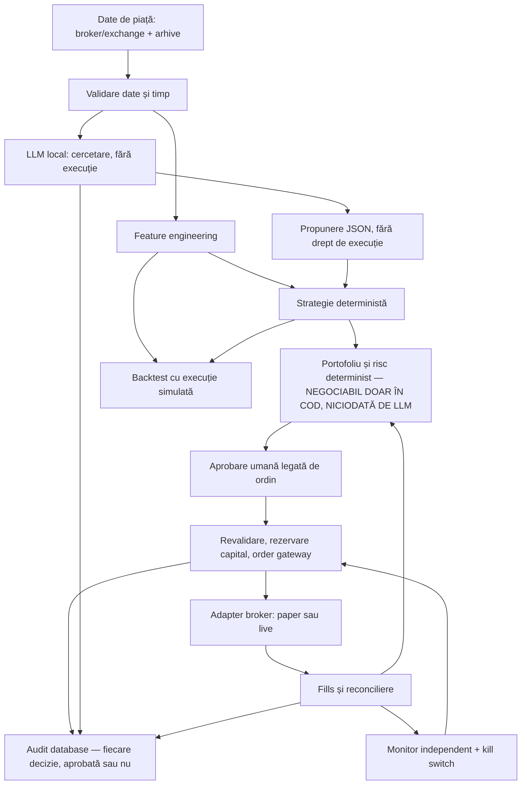

# Brief de proiect — Agent local de analiză și trading (multi-asset)

| | |
|---|---|
| **Status** | Draft pentru revizuire PO — Faza 0 (Cercetare/Selectare) |
| **Data** | 18 septembrie 2026 |
| **Autor** | Gabriel Cruceanu |
| **Versiune** | 1.0 |
| **Document sursă** | Analiză comparativă a două rapoarte tehnice (Raport-agentic-trading-2026-09-18.md, research_agentic_trading_bots.md) |

---

## 1. Rezumat executiv

Proiectul urmărește construirea unui **agent local de analiză și trading**, care combină un motor determinist de execuție/risc/portofoliu cu un strat de raționament LLM ținut strict în afara autorității de execuție. Scopul inițial **nu** este multiplicarea unui capital de 500 EUR, ci construirea unui sistem **robust, auditabil și reproductibil**, validat întâi prin backtesting și paper trading, înainte de a discuta orice bani reali. Baza tehnică aleasă este **NautilusTrader**, cu **Freqtrade** ca alternativă rapidă doar pentru crypto, și cu componente/idei preluate din **TradingAgents**, **FriesTrader** și **FinRL-X**. Nu se folosește Robinhood în faza 1. Prima etapă rulează integral fără capital real și fără chei de broker live.

---

## 2. Obiectivul proiectului

**Obiectiv de business:** obținerea unui sistem local, personal, de analiză și (eventual, ulterior) execuție asistată pe piețe de acțiuni, forex și crypto, cu control strict al riscului.

**Ce NU este acest proiect:**
- Nu este o promisiune sau un plan de „multiplicare a banilor".
- Nu este un produs comercial, nu gestionează bani ai altor persoane (cel puțin nu în faza curentă).
- Nu presupune tranzacționare automată fără aprobare umană în fazele inițiale.

**Definiția succesului pentru Faza 0–4:** sistemul produce decizii verificabile, auditabile, și execută corect în simulare/paper, respectând toate limitele de risc — indiferent de rezultatul financiar simulat.

---

## 3. Context și motivație

- Există deja un cont **XTB** pentru acțiuni. API-ul oficial XTB (xapi.xtb.com / ws.xtb.com) a fost **dezactivat din 14 martie 2025** și nu există relansare oficială — deci integrarea automată directă cu XTB nu este o opțiune tehnică validă azi.
- S-a realizat o cercetare tehnică amplă (două rapoarte independente, verificate încrucișat) asupra proiectelor open-source disponibile pe GitHub/Hugging Face pentru „agentic AI trading bots".
- Concluzia cercetării: **niciun proiect open-source, singur, nu acoperă simultan** raționament LLM, execuție reală multi-asset și management de risc determinist dovedit. De aici, decizia de a construi o arhitectură compusă, pe un nucleu tehnic solid.

---

## 4. Scope

### În scop (Faza 0–4)
- Configurare mediu local (Mac, Apple M2 Max, 32 GB RAM) pentru cercetare, backtesting și paper trading.
- Instalare și calificare **NautilusTrader** (v1 stabil) ca nucleu de date/instrumente/ordine/portofoliu/risc.
- Strat LLM local (Qwen3-8B via Ollama sau echivalent), izolat, fără drept de execuție — doar propuneri.
- Reguli de risc deterministe, necontrolabile de LLM (dimensiune poziție, pierdere zilnică, drawdown, kill switch).
- Backtesting realist (comisioane, slippage, walk-forward, verificare look-ahead bias).
- Paper trading pe cel puțin o clasă de active (recomandat: acțiuni via IBKR paper sau crypto via Kraken/Freqtrade dry-run).

### În afara scopului (deocamdată)
- Orice tranzacționare cu bani reali, până la trecerea explicită a „porții live" (vezi secțiunea 8).
- Integrare Robinhood (eligibilitate neconfirmată pentru un cont din România — vezi secțiunea 9).
- Automatizare completă fără aprobare umană (rezervată pentru o eventuală Fază 6, la mult timp după validare).
- Gestionarea de capital al unor terți sau orice formă de „copy trading"/produs comercial.

---

## 5. Decizia tehnică și justificarea ei

| Element | Decizie | Motivație |
|---|---|---|
| **Nucleu execuție/risc/portofoliu** | NautilusTrader (branch v1.231.0 stabil) | Singurul proiect verificat cu date, instrumente, ordine, portofoliu, motor de risc și adaptoare reale simultan pentru acțiuni (IBKR), forex și crypto (Binance, Kraken, Coinbase, OKX) |
| **Alternativă condiționată** | Freqtrade | Dacă prioritatea devine un prototip crypto rapid; extrem de matur și activ întreținut, dar nu e multi-asset |
| **Raționament LLM** | Tipar inspirat din TradingAgents | Analiști → dezbatere → propunere; execuția implicită a proiectului (spre exchange simulat) NU se folosește — output-ul se conectează la nucleul determinist |
| **Guvernanță/siguranță** | Filozofia FriesTrader + tiparul RiskGuard (kweinmeister/agentic-trading) | Reguli mecanice pe care LLM-ul nu le poate modifica; separare fermă „teză" vs. „execuție"; agent de risc separat, doar aprobă/respinge |
| **Referință suplimentară acțiuni** | FinRL-X (AI4Finance-Foundation) | Singurul proiect din ecosistem cu integrare Alpaca reală (paper+live) documentată — folosit ca sursă de idei pentru adapter, nu ca nucleu |
| **Model local** | Qwen3-8B cuantizat, via Ollama | Compact, verificabil, licență Apache-2.0, rulează local pe M2 Max |
| **De evitat ca fundație** | HKUDS/AI-Trader, fsaavedra0003, topicul GitHub `quant-trading-bot` | Platformă socială găzduită (nu bot local) / licență și execuție neclare / canal de descoperire dominat de proiecte nesigure |

*Detaliile complete ale analizei (scoruri, verificări, surse) sunt disponibile în documentul de analiză comparativă anterior — se recomandă păstrarea lui ca anexă tehnică.*

---

## 6. Arhitectura propusă (vedere de ansamblu)

**Principiu de bază, obligatoriu pentru toată echipa:** stratul LLM **propune**, stratul determinist **decide**. Niciun cod care conectează LLM-ul direct la un order gateway nu trece code review.

---

## 7. Stack tehnic

| Componentă | Alegere | Note |
|---|---|---|
| Hardware | Mac, Apple M2 Max, 32 GB RAM | Confirmat compatibil cu wheel-urile ARM64 NautilusTrader (de verificat prin instalare efectivă) |
| Motor de execuție | NautilusTrader v1.231.0 | Python + Rust; licență LGPL-3.0-or-later |
| Motor alternativ (crypto) | Freqtrade | Licență GPL-3.0; CCXT pentru exchange-uri |
| Model LLM local | Qwen3-8B (4-bit), via Ollama | Licență Apache-2.0 |
| Broker acțiuni (faza 1) | XTB (execuție manuală) → IBKR paper (etapă ulterioară) | XTB nu are API funcțional din martie 2025 |
| Exchange crypto | Kraken Spot | API oficial, servicii SEE, integrare documentată cu Freqtrade/Nautilus |
| Forex | Amânat | IBKR, doar după validarea primelor două clase de active |
| Bază de audit | SQLite / JSONL append-only | Fiecare decizie, propunere, aprobare/respingere, fill |
| Gestionare secrete | Variabile de mediu / vault local, niciodată în git | Conform OWASP Secrets Management |

---

## 8. Faze și porți de decizie (Gate criteria)

| Faza | Perioadă orientativă | Obiectiv | Criteriu de trecere (Gate) |
|---|---|---|---|
| **0 — Cercetare/selectare** | Zilele 1–5 | Decizie de arhitectură, licențe, buget | Document de decizie semnat de PO |
| **1 — Instalare/audit** | Zilele 6–12 | Mediu izolat, dependențe fixate, zero credențiale live | Instalare repetabilă; niciun secret în git |
| **2 — Reproducere** | Zilele 13–20 | Reproducerea unui exemplu oficial de backtest | Aceleași date + logică = aceleași rezultate |
| **3 — Backtest realist** | Zilele 21–35 | Costuri, slippage, walk-forward, benchmark | Niciun bias de look-ahead nedetectat; rezultat net documentat |
| **4 — Paper trading** | Zilele 36–75+ | Date live, cont simulat, minimum 30 sesiuni relevante | Zero incidente critice; reconciliere completă |
| **5 — Live minim** | Cel mai devreme ziua 76+ | Doar dacă Faza 4 trece integral | ≤50 EUR expuși, aprobare manuală pe fiecare ordin |
| **6 — Automatizare graduală** | După minimum 90 zile | Reducerea aprobării manuale | Numai pe bază de dovezi cumulate, nu pe calendar |

**Regulă de guvernanță:** nicio fază nu se scurtează pentru a respecta un calendar. Condițiile de trecere au prioritate față de dată.

---

## 9. Broker/exchange — decizii pentru echipă

- **Acțiuni:** păstrăm contul **XTB** pentru execuție **manuală** (introdusă de om), în timp ce agentul face doar analiză, simulare și propunere. Nu se automatizează interfața XTB și nu se folosesc endpointuri neoficiale.
- **Crypto:** **Kraken Spot**, perechi EUR unde e posibil.
- **Forex:** amânat până la validarea primelor două clase.
- **Robinhood: NU se folosește în faza 1.** Produsul „Agentic Trading" (ordine reale prin MCP) este documentat oficial pentru clienți din SUA. Entitatea europeană (Robinhood Europe, UAB, licențiată în Lituania) oferă clienților din România doar crypto și acțiuni/ETF-uri **tokenizate** (nu acțiuni native), și nu există confirmare oficială că serverul MCP agentic e disponibil pentru acest cont. Orice reconsiderare a Robinhood necesită confirmare scrisă directă de la suportul lor, nu presupuneri.

---

## 10. Managementul riscului (obligatoriu, nu opțional)

**Cod determinist — NEGOCIABIL NICIODATĂ de către LLM:**
- Capital maxim per tranzacție, expunere maximă per instrument/clasă de active.
- Pierdere maximă zilnică → oprire automată a intrărilor noi.
- Drawdown maxim → kill switch complet.
- Număr maxim de ordine/zi (previne overtrading indus de LLM).
- Circuit breaker la N erori/pierderi consecutive sau la ordin cu rezultat necunoscut.
- Trecerea din dry-run/paper în live — **întotdeauna manuală**, niciodată automatizată de agent.

**Ce poate delega echipa către LLM:**
- Interpretarea știrilor/sentimentului, generarea unei teze.
- Selecția de candidați dintr-un univers predefinit (nu definirea universului).
- Propunerea de direcție și nivel de convingere — niciodată mărimea poziției în bani.
- Explicarea deciziei pentru audit.

**Reguli tehnice suplimentare:**
- Order gateway idempotent: `client_order_id` unic, persistență înainte de submit, reconciliere obligatorie, **niciodată retrimitere orbească** la timeout.
- Monitor independent de proces principal, cu heartbeat, verificare date expirate, poziții nereconciliate.
- Kill switch testat manual înainte de orice fază live — „închiderea aplicației" nu este un kill switch valid.
- Alocare capital: 500 EUR tratați inițial ca sold **virtual**; când/dacă se trece la pilot live, maximum 50 EUR expuși, restul rezervat în afara executorului.

---

## 11. Buget

| Categorie | Alocare propusă |
|---|---|
| Capital experiment (virtual, apoi eventual real) | 500 EUR — tratat ca sumă pe care echipa acceptă explicit că poate fi pierdută integral, dacă/când se trece la live |
| Plafon pilot live (doar după Gate Faza 4) | Maximum 50 EUR expuși, maximum 25 EUR/instrument |
| Buget lunar software/date | 0 EUR abonamente noi inițial; plafon experimental maximum 10 EUR/lună dacă se acceptă ulterior servicii plătite |
| Timp echipă | De stabilit cu PO — planul de 30/60/90 zile presupune alocare constantă, nu sporadică |

---

## 12. Roluri și responsabilități (RACI simplificat)

*Notă: rolurile de mai jos sunt generice — se adaptează la componența reală a echipei.*

| Activitate | PO | Dev/Arhitect | Risk owner |
|---|---|---|---|
| Aprobarea trecerii între faze (Gate) | **R/A** | C | C |
| Implementare nucleu execuție (Nautilus) | C | **R/A** | I |
| Definirea limitelor de risc în cod | C | R | **A** |
| Aprobare manuală a ordinelor (Faza 4–5) | C | I | **R/A** |
| Audit loguri și decizii respinse | I | R | **A** |
| Verificare eligibilitate broker/legal | **A** | I | R |

*(R = Responsabil execuție, A = Aprobator final, C = Consultat, I = Informat)*

---

## 13. Riscuri majore și plan de mitigare

| Risc | Impact | Mitigare |
|---|---|---|
| LLM cu acces direct la execuție/risc | Critic | Separare fermă de privilegii, cod review obligatoriu |
| Ordine duplicate / stare necunoscută | Critic | Client-order-id, reconciliere, oprire la ambiguitate |
| Backtesting fals-optimist (look-ahead) | Ridicat | Walk-forward, holdout, baseline fără LLM |
| Chei/secrete compromise | Ridicat | Least privilege, fără chei în git, rotire periodică |
| Eligibilitate broker neconfirmată (Robinhood, IBKR RO) | Mediu-Ridicat | Verificare directă cu furnizorul înainte de orice dependență arhitecturală |
| Costuri (comisioane/spread) depășesc avantajul | Mediu | Calcul cost complet în fiecare backtest/decizie |
| Kill switch netestat | Critic | Test manual obligatoriu înainte de Faza 5 |
| Presiune de a scurta fazele pentru „a vedea profit" | Ridicat | Gate criteria scrise, aprobate de PO, ne-negociabile pe bază de calendar |

---

## 14. Constrângeri legale și fiscale

- Tranzacționarea propriilor bani, prestarea de servicii pentru alții și trading de mare frecvență au încadrări juridice diferite (MiFID II, art. 2 și art. 17).
- Dacă proiectul evoluează spre gestionarea banilor altcuiva sau spre un produs comercial (inclusiv prin Neorimia), analiza juridică trebuie refăcută **înainte** de implementare.
- Evidența pentru taxe și tratamentul fiscal aplicabil (inclusiv eventuale reguli similare wash-sale) trebuie clarificate cu un consultant fiscal înainte de faza live.

---

## 15. Dependențe și necunoscute deschise

- Confirmarea directă de la XTB/IBKR/Kraken privind conturile și permisiunile disponibile pentru un rezident român.
- Testarea efectivă a compatibilității NautilusTrader (v1 și v2 RC) pe Mac M2 Max — neconfirmată prin instalare până acum.
- Stabilizarea NautilusTrader v2 (momentan release candidate) — dacă nu iese din RC în timp util, rămânem pe v1 pentru orice lucru dincolo de cercetare.
- Decizie explicită asupra pierderii maxime acceptate de proiect (sumă absolută, nu doar procent).
- Decizie asupra orizontului de timp dorit (zilnic/săptămânal/intraday) și a disponibilității de supraveghere.

---

## 16. Glosar rapid

- **Nucleu determinist** — motorul de execuție/risc/portofoliu care ia decizia finală, fără raționament LLM.
- **Dry-run / Paper trading** — simulare cu date live, fără bani reali.
- **Kill switch** — mecanism independent care oprește imediat toate operațiunile.
- **Look-ahead bias** — eroare de backtesting în care strategia „vede" din greșeală informație viitoare.
- **Gate** — criteriu de trecere obligatoriu între fazele proiectului.

---

## 17. Anexe recomandate

- Analiza tehnică comparativă completă (cele două rapoarte + verificarea independentă a surselor).
- Documentul de decizie arhitecturală semnat (livrabil al Fazei 0).
- Registrul de riscuri, actualizat pe măsură ce apar incidente în paper trading.

