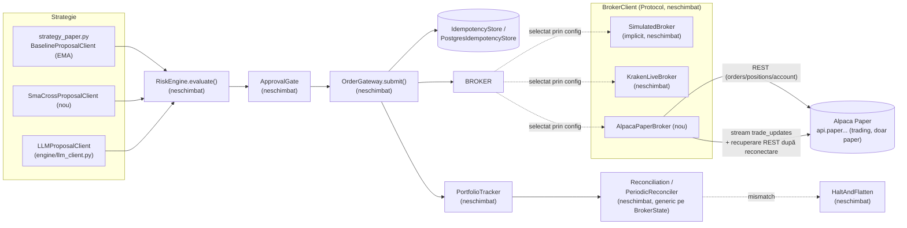

# Design tehnic — Integrare Alpaca Paper Trading

**Scop document:** design de componentă (arhitectură, interfețe, contracte de date, frontiere) pentru cerința din [`Alpaca Paper Trading.md`](Alpaca%20Paper%20Trading.md): agentul existent trebuie să poată trimite ordine simulate către **Alpaca Paper Trading**, păstrând `SimulatedBroker` ca implicit și toate controalele actuale de risc/aprobare/audit. Document de design — **nu conține cod de implementare**; semnăturile de mai jos sunt contracte, nu surse.

**Status:** propunere de design, nerevizuită de PO/Risk owner. Pornește de la starea reală a codului (inspectată direct, nu presupusă) la 2026-09-22.

**Relație cu documentele existente:** extinde [`design-componente-faza-0-4.md`](design-componente-faza-0-4.md) (structura de module) și respectă regulile absolute din §0 al [`CLAUDE-instructiuni-faza-0-4.md`](CLAUDE-instructiuni-faza-0-4.md) — LLM fără acces la execuție/chei, limite de risc imutabile, kill switch independent, order gateway idempotent, audit append-only. Nu le repetă.

---

## 0. Verificare a stării actuale a codului (bază de plecare)

Inspecție directă la data acestui document, prin `graphify query`/`explain` + citire sursă (nu presupunere din brief-uri vechi):

| Element | Fișier | Stare confirmată |
|---|---|---|
| `BrokerClient` (Protocol) | `src/execution/broker.py:35` | `submit(order) -> OrderResult`, `cancel_all(reason) -> None`, `snapshot() -> BrokerState` |
| `SimulatedBroker` | `src/execution/broker.py:43` | Fill local la `last_price`, fără rețea; implementează `BrokerClient` |
| `KrakenLiveBroker` | `src/execution/kraken_live.py:123` | **Al doilea broker real deja existent** — implementează `BrokerClient` peste REST Kraken cu `httpx`, mod `monitor`/`trading`, idempotency prin `cl_ord_id`, redactare secrete. **Acesta e patternul de urmat pentru `AlpacaPaperBroker`**, nu un design de la zero. |
| `OrderGateway` | `src/execution/order_gateway.py:27` | `submit()` rezervă `client_order_id` în `IdempotencyStoreProtocol` **înainte** de `broker.submit()`; `DuplicateClientOrderId` → returnează rezultatul stocat, nu retrimite |
| `IdempotencyStore` / `PostgresIdempotencyStore` | `src/execution/idempotency_store.py`, `src/execution/postgres_store.py:74` | Backend dual (SQLite/Postgres), selectat prin `EXECUTION_STORE_BACKEND` |
| `PaperTradingConfig` | `src/engine/paper_config.py:15` | `venue: Literal["KRAKEN"]`, `dry_run` forțat `True` prin validator — **hard-codat pe un singur venue/instrument, trebuie extins, nu ocolit** |
| `ExecutionVenue` | `src/data/venue_registry.py:17` | `Literal["KRAKEN", "NONE"]` — echitățile azi sunt `execution_venue == "NONE"` (research-only, fără plumbing) |
| `RiskEngine` | `src/risk/risk_engine.py:44` | Generic pe `asset_class_by_instrument: dict[str, str]` — **nu e hard-codat pe crypto**, doar datele de intrare (universe.yaml) sunt azi doar crypto |
| `OrderRequest`/`OrderResult`/`OrderStatus` | `src/execution/types.py` | `OrderStatus` azi: `submitted, filled, partially_filled, rejected, unknown, timeout` — **lipsesc `cancelled`/`expired`**, necesare pentru Alpaca |
| `PaperTradingLoop` | `src/engine/strategy_paper.py:74` | Buclă `bar → proposal → risk → audit → approval → OrderGateway → audit`, reconciliere la fiecare bar + la pornire, halt-and-flatten pe mismatch |
| `BaselineProposalClient` (EMA) | `scripts/paper_trading/run_paper_session.py` | Determinist, dar **cuplat prin parsare de string** la formatul textual produs de `market_summary_from_bars` (`ema_fast=...`) — nu e un pattern reutilizabil ca atare pentru SMA |
| `assert_no_kraken_trading_keys` / `LiveKeyPolicy` | `src/execution/key_policy.py` | Politică de chei **specifică Kraken** (nume de variabile, attestări) — nu se aplică Alpaca direct, dar principiul (attestare explicită, redactare, fără chei în procesul LLM) se reia |
| `BROKER_PAPER_MODE`, `BROKER_NAME`, `BROKER_API_KEY`, `BROKER_API_SECRET`, `BROKER_ACCOUNT_ID` | `.env.engine.example` | **Deja rezervate ca nume generice**, dar azi doar listate în allowlist-ul de excludere din procesul LLM (`src/llm/server.py`) și în redactare — **neconectate la niciun broker real**. Sunt punctul natural de conectare pentru Alpaca. |
| Dependențe instalate | `pyproject.toml` / `requirements.txt` | `httpx==0.28.1`, `websockets==15.0.1` deja prezente; **niciun SDK Alpaca, niciun calendar bursier** (`pandas_market_calendars`/`exchange_calendars`) instalat azi |

**Concluzie de arhitectură:** nu e nevoie de un al treilea "fel" de broker — `KrakenLiveBroker` e deja dovada că `BrokerClient` suportă un client REST real, cu chei, în afara `SimulatedBroker`. `AlpacaPaperBroker` e o a treia implementare a **aceluiași Protocol**, nu o interfață nouă.

---

## 1. Arhitectură de ansamblu

**De ce nu se schimbă `RiskEngine`, `ApprovalGate`, `OrderGateway`, `Reconciliation`, `HaltAndFlatten`:** toate operează pe tipurile generice deja existente (`OrderRequest`, `OrderResult`, `BrokerState`, `RiskDecision`) și pe `BrokerClient` Protocol, nu pe Kraken direct. Diferența Alpaca vs Kraken vs simulator trăiește **exclusiv** în implementarea `BrokerClient` și în datele de configurare/universe — exact separarea pe care Protocol-ul o promite deja.

---

## 2. Configurație și conectare

### 2.1 Selecția explicită broker (cerința §1 din spec)

`PaperTradingConfig` (`src/engine/paper_config.py`) trebuie extins, **nu înlocuit**:

- Câmp nou `broker: Literal["simulator", "alpaca_paper"] = "simulator"` — implicit păstrează comportamentul actual fără schimbare de config existentă.
- `venue: Literal["KRAKEN"]` → generalizat la `Literal["KRAKEN", "ALPACA"]` (nu la un `str` liber — allowlist explicit, ca azi).
- Validator nou: dacă `broker == "alpaca_paper"` atunci `venue == "ALPACA"` (și reciproc) — respinge combinații incoerente la încărcare, nu la runtime.
- `dry_run` **rămâne cum e** (`True` obligatoriu pe Path B) — vezi §2.2 pentru separarea de `broker`.

### 2.2 Separare `dry_run` (simulare locală) de "simulare la broker" (paper la Alpaca)

Cerința explicită din spec: „Nu reutiliza ambiguu `dry_run`". Decizie:

- `dry_run: bool` rămâne strict „nu se trimite nimic în afara procesului" — valabil azi doar pentru `SimulatedBroker`.
- Noul câmp `broker` decide **cine** execută: `simulator` (nimic în afara procesului) vs `alpaca_paper` (rețea reală către contul paper Alpaca, dar fonduri simulate de Alpaca, nu ale utilizatorului).
- Regulă de validare: `broker == "alpaca_paper"` **nu** cere `dry_run == False` — rămân concepte ortogonale. `dry_run` descrie procesul local; `broker` descrie unde ajunge ordinul acceptat.

### 2.3 Chei și endpoint

- Endpoint acceptat: **exclusiv** cel de paper trading Alpaca (`https://paper-api.alpaca.markets` la data scrierii acestui document — **verifică în documentația oficială curentă Alpaca înainte de implementare**, nu presupune valoarea e stabilă). Orice altă valoare de bază URL (inclusiv live `https://api.alpaca.markets`) trebuie respinsă la pornire, nu doar documentată — analog cu `assert_live_key_policy` din `key_policy.py`, care respinge configurații live neconforme la startup.
- Chei citite din variabile de mediu, refolosind convenția deja rezervată în `.env.engine.example`:
  - `BROKER_NAME=ALPACA_PAPER`
  - `BROKER_API_KEY` / `BROKER_API_SECRET` → cheile paper Alpaca (`APCA-API-KEY-ID` / `APCA-API-SECRET-KEY` la transport HTTP)
  - Variabilă nouă `ALPACA_PAPER_BASE_URL` (cu valoare implicită paper, dar suprascriere respinsă dacă nu conține `paper` — vezi §2.4)
- Documentare în `.env.engine.example` (secțiunea `# --- Broker / venue ---` deja există — se extinde, nu se duplică).
- **Nicio cheie în cod, loguri, mesaje de eroare, teste sau rezultate** — reia funcția `redact_secrets()` din `key_policy.py`, extinsă cu `BROKER_API_KEY`/`BROKER_API_SECRET` (deja în lista redactată azi) — de verificat că mesajele de eroare HTTP din `AlpacaPaperBroker` trec prin acest filtru înainte de audit/log, exact cum face `KrakenLiveBroker._private_post` → `redacted = redact_secrets(...)`.
- Procesul LLM (`src/llm/server.py`) **nu primește** `BROKER_API_KEY`/`BROKER_API_SECRET` — deja garantat de allowlist-ul existent (`ENGINE_ONLY_KEYS`/echivalent), de verificat că include și eventualele variabile noi specifice Alpaca dacă se adaugă altele în afara `BROKER_*`.

### 2.4 Gate de startup — respinge endpoint live

Analog cu `assert_live_key_policy`:

- Funcție nouă `assert_alpaca_paper_endpoint(base_url: str) -> None` (sau echivalent) care respinge orice bază URL ce nu corespunde paper trading — verificare pe conținutul URL-ului cunoscut din documentația oficială, **nu** pe un flag din config care ar putea fi setat greșit.
- Apelată necondiționat la construcția `AlpacaPaperBroker`, înainte de orice request HTTP.

### 2.5 Alegerea API/SDK — decizie deschisă, de validat la implementare

Nu instalăm azi niciun SDK Alpaca (`pyproject.toml` confirmă). Două opțiuni:

| Opțiune | Argument pro | Argument contra |
|---|---|---|
| REST direct cu `httpx` (pattern `KrakenLiveBroker`) | Consistent cu singurul broker real existent în cod; zero dependențe noi; control total pe redactare/erori | Reimplementează semnare/paginare/parsare pe care un SDK oficial le are deja |
| SDK oficial (`alpaca-py` la data acestei inspecții) | Contract de tip mai sigur, mai puțin cod de întreținut | Dependență nouă, suprafață mai mare de verificat pentru „nicio cheie în loguri" (loggingul intern al SDK-ului trebuie auditat) |

**Recomandare:** REST direct cu `httpx`, mirror pe `kraken_live.py` — păstrează codul omogen și auditul de secrete sub control direct. **Decizie finală rămâne condiționată de verificarea documentației oficiale curente Alpaca** (cerință explicită din spec) înainte de a începe implementarea — inclusiv dacă `trade_updates` (§3.3) e disponibil doar prin WebSocket sau are și echivalent REST pollabil.

---

## 3. Broker și ciclul ordinelor — `AlpacaPaperBroker`

### 3.1 Contract (implementează `BrokerClient` din `src/execution/broker.py`)

- `submit(order: OrderRequest) -> OrderResult`
- `cancel_all(reason: str) -> None`
- `snapshot() -> BrokerState`

Plus metode proprii (nu parte din Protocol, ca la `KrakenLiveBroker.load_asset_pairs`):
- `load_account()` — citește cash/buying power/status cont.
- `load_positions()` — poziții curente.
- `load_open_orders()` — ordine administrate de agent (filtrate, vezi §3.6).
- `reconcile_from_trade_updates(events)` — aplică evenimente `trade_updates` peste starea internă.

### 3.2 Trimitere ≠ execuție

`submit()` întoarce `status="submitted"` la acceptare de către Alpaca (analog `KrakenLiveBroker.submit` care întoarce `submitted` la `AddOrder` acceptat). **Fill-ul e un eveniment separat**, primit prin `trade_updates` sau recuperat prin REST — nu se presupune fill sincron la `submit()`.

### 3.3 `trade_updates` + recuperare după reconectare

- Canal principal: stream `trade_updates` (WebSocket la Alpaca) — procesat asincron, mapat pe `client_order_id` propriu.
- La (re)pornire sau după pierderea conexiunii: recuperare prin API (`load_open_orders()` + istoricul recent de ordine) pentru evenimentele posibil ratate — **nu se presupune că stream-ul livrează tot ce s-a întâmplat cât a fost deconectat**.
- Evenimente țintă de gestionat explicit: `new`, `fill`, `partial_fill`, `canceled`, `expired`, `rejected`, `done_for_day` (mapare exactă de verificat în documentația curentă Alpaca la implementare).

### 3.4 Fără dublă contabilizare

- Fiecare eveniment de fill trebuie identificat unic (Alpaca oferă un id de eveniment/execuție distinct de `order_id`) — `AlpacaPaperBroker` trebuie să dedupe pe acest id înainte de a aplica `filled_quantity` incremental, **nu** pe `order_id` (un ordin poate avea mai multe fill-uri parțiale).
- `OrderResult.filled_quantity` trimis către `OrderGateway`/`PaperTradingLoop` trebuie să reflecte **cantitatea cumulativă corectă la momentul evenimentului**, nu suma brută a tuturor evenimentelor primite (risc de dublare la replay după reconectare).

### 3.5 Identificatori — persistență și regulă de retransmitere

- `client_order_id` (UUID local, generat de `OrderGateway`/`PaperTradingLoop` **înainte** de `submit`, ca azi) e trimis la Alpaca ca `client_order_id` propriu Alpaca (Alpaca suportă câmp `client_order_id` la creare — de confirmat lungime/format admis în doc curentă, posibil truncat ca la Kraken `to_cl_ord_id`).
- `broker_order_id` (id-ul Alpaca) persistat alături de `client_order_id`, în `IdempotencyStore`/`PostgresIdempotencyStore` — schema deja suportă `broker_order_id` prin `OrderResult.broker_order_id` (`src/execution/types.py:40`), nicio migrare de schemă nouă necesară pe acest punct.
- După timeout (client-side, ex. HTTP timeout la `submit`): **înainte de orice retransmitere**, `AlpacaPaperBroker` caută ordinul la Alpaca după `client_order_id` (endpoint de tip "get order by client order id", de confirmat în doc curentă) — pattern deja prezent parțial în `KrakenLiveBroker.submit` (`except httpx.TimeoutException: self._remember_open(cl_ord_id)`, deși acolo fără căutare activă încă).
- **Nu se generează niciodată un `client_order_id` nou pentru aceeași intenție de tranzacționare** — regulă deja impusă structural de `OrderGateway.submit()` (rezervare în `IdempotencyStore` înainte de `broker.submit`), reutilizată neschimbată.

### 3.6 Concurență și ordine externe

- Prevenirea procesării simultane a aceleiași intenții de către două instanțe: deja acoperită de `IdempotencyStore.reserve()` (`INSERT` unic pe `client_order_id`, eșuează la duplicat) — **niciun cod nou necesar**, doar verificare că `AlpacaPaperBroker` nu ocolește `OrderGateway` (nu trebuie apelat niciodată direct din `strategy_paper.py`, ca și `SimulatedBroker`/`KrakenLiveBroker` azi).
- Detectarea ordinelor/pozițiilor externe (plasate manual în contul paper, în afara agentului): `load_open_orders()`/`load_positions()` returnează tot ce vede Alpaca; `AlpacaPaperBroker.snapshot()` trebuie să **separe** ordinele proprii (filtrate după prefixul/formatul `client_order_id` generat de agent) de restul — cele externe se raportează (ex. în `BrokerState`/log de reconciliere) dar **nu se preiau și nu se anulează automat** (cerință explicită din spec).

### 3.7 Anulare

- `cancel_all(reason)` trimite cerere de anulare pentru ordinele proprii deschise, apoi **așteaptă confirmarea** (poll pe status sau consumă `trade_updates` până la `canceled`/`filled`) înainte de a considera operația încheiată — tratează explicit cazul în care ordinul s-a executat între timp (rezultatul final e `filled`, nu o eroare de anulare).

### 3.8 Scop v1 — doar market, cantitate explicită

- `AlpacaPaperBroker.submit()` respinge explicit (status `rejected`, motiv `order_type_not_supported`) orice `order.order_type != "market"` — tipul `limit` există deja în `OrderType` (`src/execution/types.py:14`) dar rămâne neimplementat pentru Alpaca în v1, respins **cu motiv explicit**, nu ignorat silențios.

### 3.9 Gap de schemă identificat: `OrderStatus`

`OrderStatus` azi (`src/execution/types.py:15-22`) **nu are** `cancelled`/`expired`. Alpaca produce ambele ca stări terminale distincte de `rejected`. Două opțiuni:

1. Extinde `OrderStatus` cu `"cancelled"` și `"expired"` (schimbare mică, aditivă — `Literal` extins, restul codului care face `match`/`if status ==` pe valorile existente nu se rupe).
2. Mapează `cancelled`/`expired` Alpaca pe `rejected` cu `reason` distinct — pierde informație, nu recomandat.

**Recomandare:** opțiunea 1. E o schimbare de schemă aditivă, afectează `PaperTradingLoop._apply_order_result` (care azi tratează explicit doar `unknown/timeout/rejected/filled/partially_filled` — branch nou necesar pentru `cancelled`/`expired`, altfel cad silențios prin toate condițiile fără efect, ceea ce ar fi incorect pentru un ordin anulat de agent prin `cancel_all`).

---

## 4. Portofoliu, risc și recuperare

### 4.1 Ce rămâne neschimbat

`RiskEngine`, `ApprovalGate`, `PortfolioTracker`, `Reconciliation`, `PeriodicReconciler`, `HaltAndFlatten`, `KillSwitch`, `CircuitBreaker` — toate generice pe `BrokerState`/`OrderRequest`/`OrderResult`/`RiskDecision`, niciuna cuplată la Kraken. Se reutilizează **fără modificare** pentru fluxul Alpaca.

### 4.2 Reconciliere

`Reconciliation.reconcile()` (`src/execution/reconciliation.py:46`) compară deja generic `positions` și `open_client_order_ids` din `BrokerState` — `AlpacaPaperBroker.snapshot()` trebuie doar să populeze `BrokerState` corect (poziții AAPL, ordine proprii deschise filtrate ca la §3.6). Punctele de reconciliere rămân aceleași ca azi: pornire (`reconcile_startup`), la fiecare bar (`PeriodicReconciler.run` în `run_bar`), și după reconectare (nou: trigger explicit de reconciliere la reconectarea stream-ului `trade_updates`, nu doar la următorul bar).

### 4.3 Stare incertă → blocare

Deja implementat generic: `report.matched == False` → `HaltAndFlatten.trigger()` (oprire ordine noi + `cancel_all`) + `audit.record(reconciliation_mismatch)`. Se aplică neschimbat.

### 4.4 Kill switch — fără lichidare automată

`HaltAndFlatten.trigger()` (`src/execution/safety.py:27`) deja face exact ce cere spec-ul: `watchdog.set_halt()` + `cancel_all()` — **nu** lichidează poziții. Niciun cod nou necesar; de verificat doar că `AlpacaPaperBroker.cancel_all` respectă contractul §3.7 (așteaptă confirmare).

### 4.5 Levier / short — deja imposibil structural

`RiskEngine` nu are cale de decizie pentru `sell` fără poziție existentă (`_evaluate_exit` respinge cu `no_open_position` dacă `open_qty <= 0`) și nu calculează niciodată `quantity` peste `cap_notional`/`risk_budget` configurate. Niciun cod nou necesar pe acest punct — regula existentă acoperă și AAPL.

---

## 5. Acțiuni și date de piață

### 5.1 Config separată AAPL

Fișier nou `config/paper_trading_aapl.yaml` (analog cu cel existent pentru ETHUSD), folosind `PaperTradingConfig` extins (§2.1): `broker=alpaca_paper`, `venue=ALPACA`, `instrument=AAPL`, `timeframe=1d` — **fără să atingă** configul/strategia ETHUSD existente.

„Maximum o acțiune deținută": nu e un concept generic în `RiskLimits` azi (limitele sunt pe notional/expunere, nu pe cantitate de unități). Decizie: constraint suplimentar la nivel de `InstrumentConstraints` pentru AAPL (§5.2) — `max_quantity=1` verificat în `validate_order_constraints` (extindere mică, funcția e deja generică pe `InstrumentConstraints`) sau verificare dedicată în `AlpacaPaperBroker.submit` înainte de trimitere. **De decis la implementare** care punct e mai corect (preferabil `order_validation.py`, ca să fie testabil pur, fără rețea).

### 5.2 Elimină presupunerile crypto/Kraken

| Presupunere azi (crypto/Kraken) | Generalizare necesară pentru AAPL/Alpaca |
|---|---|
| `ExecutionVenue = Literal["KRAKEN", "NONE"]` (`venue_registry.py:17`) | Adaugă `"ALPACA"` |
| `_INSTRUMENTS` conține doar `ETHUSD`/`BTCUSD`, cu `lot_size` fracționar (`0.0001`) | Adaugă `AAPL` cu `lot_size=Decimal("1")`, `min_quantity=Decimal("1")` (acțiuni întregi — Alpaca suportă și fracționare, dar **v1 rămâne cantitate explicită întreagă**, conform §3.8 din spec) |
| Comision `BASE_TAKER_FEE` (`src/engine/cost_models.py`) — model taker/maker crypto | Alpaca paper: verifică în doc curentă dacă simulează comision (istoric, Alpaca a fost zero-comision pe equity) — dacă da, `fee=Decimal("0")` explicit în `OrderResult`, nu import al `BASE_TAKER_FEE` |
| `max_spread_bps`/`min_bar_volume` în `RiskLimits` — praguri calibrate pe crypto 24/7 | Set de limite separat pentru echități (fișier `risk_limits` distinct sau secțiune per-venue) — **de decis la implementare**, nu reutiliza implicit pragurile ETHUSD |
| Precizie cantitate: `size_precision=5` (ETH) | `size_precision=0` pentru AAPL (fără fracții în v1) |
| Program piață: niciuna azi (crypto 24/7, `PaperTradingLoop` pollază continuu) | Bursă cu program limitat (§5.3) — bucla trebuie să știe să nu aștepte/tranzacționeze în afara ședinței |

### 5.3 Calendar bursier și fus orar

- Sursă calendar: **de ales la implementare** (`pandas_market_calendars` sau `exchange_calendars` — niciuna instalată azi, dependență nouă necesară) sau interogare directă a endpoint-ului de calendar Alpaca (dacă expune ședințe/holidays — de verificat în doc curentă; ar evita o dependență nouă).
- Fus orar: `America/New_York`, folosit **doar** pentru alinierea ședinței de piață (deschidere/închidere), nu pentru stocarea internelor de timp — `Bar.timestamp` rămâne UTC (convenție deja existentă în `src/data/sources.py:43`, „lookahead-safe").
- Semnale calculate **exclusiv din bare zilnice încheiate** — pattern deja existent (`Bar.timestamp` = close-time), dar bucla trebuie să respingă/ignore bara zilei curente înainte de închiderea sesiunii (nu exista azi verificare de „bară încheiată" specifică programului bursier, doar timeframe generic).

### 5.4 Sursă de date AAPL

- `AlpacaBarDataSource` nou, implementează `DataSource` Protocol existent (`src/data/sources.py:54`, `fetch_bars(instrument, start, end, timeframe) -> list[Bar]`) — **zero schimbare la Protocol**, pattern identic cu `BinanceKlinesSource`/`CsvBarDataSource` deja existente.
- Documentare obligatorie (cerință explicită spec): sursa exactă de date (Alpaca Market Data API vs alt furnizor), drepturile necesare (plan gratuit vs plătit pentru date istorice/live, de verificat în doc curentă), tratarea splitărilor/dividendelor (ajustare sau nu a seriei istorice — decizie care afectează backtestul SMA, trebuie documentată explicit, nu presupusă).
- Date lipsă/învechite → **nu tranzacționa**: extinde verificarea deja existentă `Watchdog.check_stale_data` (folosită azi în `strategy_paper.py:321`) — reutilizabilă neschimbată dacă pragul de vechime e calibrat pentru bare zilnice (azi calibrat implicit pentru bare orare ETHUSD; `stale_data_threshold_s` e deja parametru de config per-sesiune, deci setabil per fișier YAML AAPL fără cod nou).

---

## 6. Strategie demonstrativă SMA 20/50

### 6.1 De ce nu poate reutiliza `BaselineProposalClient` (EMA) ca atare

`BaselineProposalClient` (`scripts/paper_trading/run_paper_session.py`) e cuplat prin **parsare de text** la formatul `market_summary_from_bars` (`ema_fast=...`, `ema_slow=...`) și la `ema_cross_direction`, care e **bazat pe nivel** (`fast >= slow → long`, la fiecare bar), nu pe **eveniment de intersecție** (tranziție între bare). Cerința SMA e explicit pe intersecție („SMA20 anterioară ≤ SMA50 anterioară, iar SMA20 curentă > SMA50 curentă") — semantică diferită, nu doar altă perioadă.

### 6.2 Componente noi

- `sma(values, period) -> Decimal | None` — funcție pură nouă în `src/engine/signals.py`, analog `ema()`.
- `sma_cross_direction(closes, fast_period, slow_period) -> Literal["buy","sell","none"]` — **necesită starea bar anterior**, nu doar bara curentă (spre deosebire de `ema_cross_direction`). Implementare pură: primește seria completă până la T, calculează SMA la T și la T-1, compară semnul diferenței.
  - Prima pornire: dacă la primul bar evaluabil SMA20 e deja peste SMA50, întoarce `"none"` (nu există „anterior" cu relație inversă cunoscută) — cerință explicită din spec §5.
  - `"sell"` doar dacă există poziție deschisă (verificare la nivel de `RiskEngine`/`PortfolioTracker`, nu în funcția pură de semnal — funcția de semnal rămâne agnostică de portofoliu, ca `ema_cross_direction`).
- `SmaCrossProposalClient` nou (implementează `ProposalClient` Protocol din `src/engine/proposal_cache.py:19`) — **nu** reface parsarea de text a `BaselineProposalClient`; calculează direct din `context` + istoricul de bare deținut intern, similar cu ce face deja `BaselineProposalClient` pentru propriul istoric (`self._history`), dar cu logică de cross, nu de nivel.
- `PaperTradingConfig`: câmpurile `fast_ema_period`/`slow_ema_period` sunt azi numite specific EMA. **Decizie de design:** fie (a) se adaugă câmpuri paralele `fast_sma_period`/`slow_sma_period` opționale (aditiv, zero risc pentru configul EMA existent), fie (b) se redenumesc generic `fast_period`/`slow_period` cu migrare de config. **Recomandare: (a)** — spec cere explicit „fără a modifica implicit strategia EMA existentă".

### 6.3 Prevenirea repetării ordinului pentru același semnal

- `sma_cross_direction` întoarce `"none"` pe orice bar fără tranziție reală — bucla (`PaperTradingLoop`/echivalent pentru SMA) nu generează `ParsedProposal` de tip `buy`/`sell` repetat pe bare consecutive cu aceeași stare de nivel, doar la tranziție. Aceasta e diferența structurală față de EMA (care re-propune „long" la fiecare bar cât timp `fast>=slow`, dar e absorbit azi de faptul că `RiskEngine`/`PortfolioTracker` nu recumpără dacă poziția e deja deschisă — **de verificat explicit** că același mecanism nu ar produce un ordin nou la fiecare bar de nivel SMA menținut, dacă `SmaCrossProposalClient` ar genera totuși `"buy"` continuu; de aceea returnarea `"none"` din funcția de semnal e mecanismul primar, nu doar un fallback).

### 6.4 Execuție „în următoarea ședință eligibilă" + semnale ratate în oprire

- Dacă bucla e oprită (halt/kill switch/restart) exact când apare un semnal, semnalul nu se pierde silențios: la următoarea pornire, dacă bara care a generat semnalul e încă „ultima bară încheiată eligibilă" (nu a fost deja procesată — verificabil prin `last_bar_path`/`_last_processed_bar_ts`, mecanism deja existent), semnalul se reevaluează normal la reluare. Dacă a trecut deja o ședință eligibilă peste semnalul respectiv, **comportamentul trebuie definit explicit** (spec cere asta): recomandare — semnalul expiră (nu se execută retroactiv un cross vechi), logat explicit ca `signal_expired_during_halt`, nu doar tăcut. Această regulă e specifică SMA (spec o cere doar pentru strategia demonstrativă) — nu schimbă comportamentul EMA existent.

### 6.5 Consistență semnal backtest vs paper

Backtestul azi rulează prin NautilusTrader (`src/engine/strategy_baseline.py`, `BaselineEMACross`), separat de `strategy_paper.py`. Pentru SMA:
- Fie se adaugă o strategie Nautilus `SmaCross` echivalentă (folosind aceeași funcție pură `sma_cross_direction` din `signals.py`, ca sursă unică de adevăr pentru semnal — evită duplicarea logicii de cross în două locuri),
- fie se documentează explicit limita: dacă backtesterul Nautilus nu poate rula ușor pe date de acțiuni/AAPL în starea curentă (verificare la implementare — `nautilus_trader==1.231.0` fără adaptor Alpaca, confirmat în inspecția `Alpaca Paper Trading.md` §Context), se raportează limita clar în loc să se pretindă echivalență netestată. Spec cere explicit una din cele două, nu tăcere.

---

## 7. Testare și criterii de acceptare

### 7.1 Scenarii de test (răspunsuri controlate, fără rețea reală)

Pattern de test deja stabilit în `tests/unit/test_kraken_live.py` (injectare `httpx.MockTransport`) — reutilizabil identic pentru `AlpacaPaperBroker`:

| Scenariu | Verifică |
|---|---|
| Ordin acceptat, executat ulterior (`submitted` → `fill` prin `trade_updates`) | `OrderResult` final are `filled_quantity`/`fill_price` corecte, fără dublă aplicare |
| Execuție parțială | Cantitate rămasă corectă, poziție/portofoliu actualizate incremental, nu la final |
| Evenimente duplicate (`trade_updates` retransmite) | Dedupe pe id de eveniment (§3.4) — nicio dublare de poziție/cash |
| Respingere | `status=rejected`, motiv propagat, fără efect pe portofoliu |
| Anulare | `cancel_all` așteaptă confirmare; caz „executat între timp" tratat explicit (§3.7) |
| Timeout după acceptare | Căutare prin `client_order_id` înainte de orice retransmitere (§3.5); niciun `client_order_id` nou generat |
| Restart | `restore_persisted_state()` + `reconcile_startup()` (mecanism existent în `strategy_paper.py`) — nicio retransmitere nejustificată |
| Reconectare (stream) | Recuperare prin REST a evenimentelor ratate (§3.3), reconciliere declanșată explicit |
| Numerar insuficient | `RiskEngine`/`AlpacaPaperBroker` resping înainte de trimitere (cash disponibil verificat, §4) |
| Piață închisă | Bucla nu tranzacționează în afara programului bursier (§5.3) |
| Date învechite | `Watchdog.check_stale_data` blochează (mecanism existent, recalibrat pentru bare zilnice) |
| Kill switch | `cancel_all` fără lichidare de poziții (§4.4) |

### 7.2 Criterii de acceptare (din spec, mapate pe verificare concretă)

- **Simulatorul existent continuă să funcționeze** → teste existente pe `SimulatedBroker`/`PaperTradingConfig` (config ETHUSD implicit) trec neschimbate; niciun test existent modificat pentru a acomoda Alpaca.
- **Endpointurile live sunt respinse** → test dedicat pe `assert_alpaca_paper_endpoint` (§2.4) cu URL live → excepție la construcție, nu la primul request.
- **Același semnal nu produce ordine duplicate** → test pe `IdempotencyStore.reserve()` (mecanism deja existent, neschimbat) + test specific SMA pe non-repetarea la nivel menținut (§6.3).
- **Pozițiile și numerarul reflectă execuțiile confirmate** → test de reconciliere `AlpacaPaperBroker.snapshot()` vs `PortfolioTracker` după fill parțial/complet.
- **Restartul recuperează starea fără retransmiteri nejustificate** → test de restart cu `IdempotencyStore` populat + `client_order_id` deja rezervat, fără apel nou la `broker.submit`.
- **Configurația și logurile nu expun secrete** → test pe `redact_secrets` extins (§2.3) + verificare că mesajele de eroare `AlpacaPaperBroker` trec prin redactare înainte de `audit.record`.
- **Verificările relevante ale proiectului trec** → suite existente (`tests/unit/`, `tests/integration/`) plus suita nouă pentru `AlpacaPaperBroker`/`SmaCrossProposalClient`.

### 7.3 Explicit în afara scopului acestei implementări

Conform spec: nu se cer chei pentru dezvoltare/teste automate (mock-uri `httpx.MockTransport`, ca la Kraken), nu se pornesc automatizări persistente, nu se trimit ordine reale către Alpaca în această sarcină. O verificare manuală paper (cu cont Alpaca real) rămâne un pas **separat**, activat explicit de operator — nu parte din suita automată.

---

## 8. Puncte deschise pentru decizie PO/Arhitect

| # | Decizie | Impact dacă amânată |
|---|---|---|
| 1 | REST `httpx` vs SDK oficial Alpaca (§2.5) | Alege înainte de a scrie `AlpacaPaperBroker` — schimbarea ulterioară reface tot fișierul |
| 2 | `trade_updates` prin WebSocket vs polling REST (§3.3) — de confirmat disponibilitate/limite în doc curentă | Afectează dependența `websockets` (deja instalată) vs pur `httpx` |
| 3 | Extinderea `OrderStatus` cu `cancelled`/`expired` (§3.9) | Fără ea, `PaperTradingLoop._apply_order_result` nu are branch pentru anulări Alpaca — risc de stare locală incorectă tăcută |
| 4 | Sursă calendar bursier: librărie nouă vs endpoint Alpaca (§5.3) | Dependență nouă sau nu — decizie de buget de dependențe |
| 5 | Limită „maximum o acțiune" — în `order_validation.py` vs în `AlpacaPaperBroker` (§5.1) | Preferabil `order_validation.py` (testabil fără rețea), dar necesită acordul asupra formei `InstrumentConstraints` |
| 6 | Config SMA: câmpuri paralele vs redenumire generică (§6.2) | Recomandat păstrare aditivă — redenumirea ar cere migrare de YAML-uri existente |
| 7 | Backtest SMA: strategie Nautilus echivalentă vs limită documentată (§6.5) | Spec cere explicit unul din cele două — nu poate rămâne nedefinit |
| 8 | Set separat de `RiskLimits` pentru echități vs reutilizare praguri crypto (§5.2) | Pragurile ETHUSD (spread/volum) nu au sens calibrate identic pentru AAPL |

---

## 9. Livrabile așteptate (pentru faza de implementare, `/sc:implement`)

- Cod: `AlpacaPaperBroker` (`src/execution/alpaca_paper.py` sau echivalent), `SmaCrossProposalClient` + `sma`/`sma_cross_direction` (`src/engine/signals.py`), `AlpacaBarDataSource` (`src/data/`), extinderi la `venue_registry.py`/`paper_config.py`/`types.py` conform §2–6.
- Config: `config/paper_trading_aapl.yaml`, extinderi `.env.engine.example`.
- Teste: unit (mock HTTP, ca `test_kraken_live.py`) + integrare (flux complet, ca `test_paper_trading_flow.py`) pentru fiecare scenariu din §7.1.
- Ghid operator: pornire/oprire sesiune Alpaca paper, reconciliere manuală, revenire la `SimulatedBroker` (schimbare de config, nu de cod).
- Raport final (cerință explicită spec): ce s-a schimbat, ce a fost verificat efectiv (cu mock-uri, nu cont real), ce necesită cont Alpaca real pentru verificare manuală, ce limite rămân (ex. dacă backtestul SMA rămâne doar documentat ca limitare, nu implementat). **Fără a prezenta teste simulate drept validare cu brokerul real și fără afirmații de profitabilitate a strategiei.**

---

*Document generat pe baza inspecției directe a codului la 2026-09-22 (`graphify query`/`explain` + citire sursă `src/execution/`, `src/engine/`, `src/data/`, `src/risk/`). Nu presupune stare din brief-uri anterioare fără verificare.*
