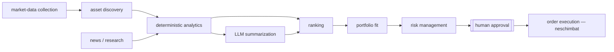

# Design — Asset Discovery & Research Agent

**Scop document:** design tehnic pentru un sistem de descoperire și cercetare autonomă a activelor (crypto + acțiuni), care generează **candidați explicați** pentru research/watchlist, fără să plaseze ordine și fără să ocolească strategia deterministă, `RiskEngine` sau aprobarea umană existente în repo.

**Status:** propunere de design, nerevizuită încă. Nu conține și nu presupune modificări de cod — vezi `graphify-out/GRAPH_REPORT.md` și fișierele citate pentru starea reală, verificată, a repo-ului la 2026-09-19.

**Relație cu documentele existente:** extinde `design-componente-faza-0-4.md` (principiile de izolare proces LLM / risk / execuție rămân neschimbate) și reutilizează infrastructura de research ToS-gated din `design-research-financiar.md` / `config/research_sources.yaml`. Nu le repetă.

---

## 0. Root cause — de ce data layer-ul poate accesa doar 2 perechi crypto de la Kraken

Verificat direct în repo (nu presupus). Nu e o singură constantă — sunt **patru puncte independente**, plus un fișier de config orfan:

| # | Locație | Ce face | Impact |
|---|---|---|---|
| 1 | `src/data/venue_registry.py:67-86` — `_INSTRUMENTS` | Dict hardcodat cu exact 2 intrări: `ETHUSD`, `BTCUSD`. E singura sursă de adevăr pentru `UNIVERSE_TO_KRAKEN`, `UNIVERSE_TO_BINANCE`, `constraints_for()`. | Orice simbol în afara acestor 2 nu are `kraken_pair`, `binance_symbol`, nici `InstrumentConstraints`. |
| 2 | `src/data/kraken.py:55-57` — `KrakenPublicOHLCSource.fetch_bars()` | Caută instrumentul în `UNIVERSE_TO_KRAKEN`; dacă lipsește, `raise ValueError("no Kraken mapping for instrument ...")`. | AAPL (sau orice alt simbol) eșuează la fetch, nu doar la execuție. |
| 3 | `src/control/server.py:98-109` — `_fetch_kraken_bars` | **Un singur closure global**, legat direct de `KrakenPublicOHLCSource`, injectat ca `ctx.fetch_bars` în *toate* endpoint-urile control-plane (`build_market`, `build_bars`, `build_signal`, session-plan). Nu există dispatch pe `venue`/`asset_class`. | Chiar dacă `venue_registry.py` ar avea AAPL, nu există niciun mecanism care să rutească AAPL către altă sursă de date (IBKR, un vendor de equity data etc.) — totul trece prin Kraken. |
| 4 | `src/control/runtime_state.py:383-423` — `build_market()` | Iterează *toate* rândurile din `config/universe.yaml` (inclusiv `asset_class: equity`), apelează `fetch_bars(symbol, ...)` într-un `try/except Exception: bars = []` care **înghite eroarea silențios**. | Rândul AAPL apare în UI (`market.page.ts`) cu `price: null`, `stale: true`, fără mesaj de eroare vizibil — pare "nu vine date" în loc de "eroare de mapping". |
| 5 | `config/universe.yaml:14-25` | Listează `AAPL` și `MSFT` cu `asset_class: equity`, `venue: NASDAQ`, cu comentariu explicit: *"Placeholder-uri pentru Faza 2 ... Cale A — acțiuni (IBKR paper)"*. | Config orfan: trece de allowlist-ul LLM (`load_universe()` din `src/llm/service.py`), dar nu e conectat la nicio sursă de date reală — calea IBKR nu a fost niciodată implementată. |
| — | `config/paper_trading.yaml:10` | `instrument: ETHUSD` hardcodat — bucla de paper trading rulează pe un singur simbol. | Nu blochează AAPL direct, dar arată că nici runtime-ul de trading nu are noțiune de universe multi-simbol activ. |
| — | `src/research/connectors.py:34` — `_CRYPTO_SYMBOLS` | Al treilea set hardcodat (`BTCUSD, ETHUSD, BTC, ETH`), folosit invers — pentru a filtra *equity* CIK-uri eligibile pentru SEC EDGAR. | Nu cauzează bug-ul, dar confirmă pattern-ul: fiecare strat (data, control, research) își ține propria listă hardcodată, fără o sursă unică. |

**Verificat și exclus ca fiind cauza:**
- **Kraken WebSocket API** — nu există deloc integrare WS pentru date de piață în `src/data/` sau `src/execution/`. Singurul WebSocket din repo e `/v1/ws/events` (evenimente control-plane, nu prețuri).
- **Caching** (`src/data/cache.py`) — generic, cheie pe `instrument|timeframe|start|end`, funcționează pentru orice simbol; nu e un blocaj.
- **Bază de date** — nu există (nici SQLite, nici Postgres). Starea e fișiere JSON (`runtime_state.py`, `src/research/store.py`, `src/execution/idempotency_store.py`).
- **Watchlist** — există doar client-side, `localStorage` (`apps/console/.../market.page.ts:17` — `WATCH_KEY = 'console_watchlist'`), peste rândurile deja întoarse de backend. Nu influențează fetch-ul.
- **Strategy configuration** (`config/strategies.yaml`) — nu conține simboluri; simbolul vine din `paper_trading.yaml`.
- **Frontend filters** — `market.page.ts` doar filtrează text pe ce a primit deja de la backend; nu impune restricția.
- **Instrument discovery** — nu există niciun mecanism de descoperire automată; `universe.yaml` e curatoriat manual.

**Concluzie root cause:** universul de instrumente e definit static în 3 locuri diferite, neconsistente (`venue_registry.py` = execuție reală, `universe.yaml` = allowlist LLM, `paper_trading.yaml` = simbolul activ), iar stratul de date nu are dispatch pe venue/asset_class — presupune peste tot că "singura sursă e Kraken spot crypto". Kraken oferă AAPL ca **tokenized equity (xStocks)**, un produs diferit de perechile spot crypto (`/0/public/OHLC`) folosite azi; simbolul Kraken exact pentru xStocks trebuie confirmat din `/0/public/AssetPairs` înainte de orice integrare (nu presupune `AAPLUSD`).

---

## 1. Arhitectură recomandată — principii



**Invariant arhitectural (răspunde direct cerinței "LLM nu decide tranzacții"):** discovery/LLM produc **candidați**, niciodată ordine. Singura cale spre execuție rămâne cea deja existentă: `engine/strategy_baseline.py` / `strategy_paper.py` → `risk/risk_engine.py` → `execution/human_approval.py::ApprovalGate` → `execution/order_gateway.py`. Discovery poate propune doar **adăugarea unui simbol în universul activ** (o intrare nouă în `universe.yaml`/un `watchlist.yaml` nou), nu poate trimite un proposal de tranzacție direct. Asta reutilizează exact mecanismul de `RejectedProposal`/`ApprovalGate` deja construit pentru stratul LLM-assisted, nu inventează unul paralel.

**De ce module noi, nu extinderea celor existente:**
- `src/data/` rămâne "cum aducem bare pentru un simbol deja cunoscut" (neschimbat conceptual, doar generalizat la dispatch multi-venue — vezi §10.1).
- `src/research/` rămâne infrastructura ToS-gated de surse (RSS/API) — discovery o **reutilizează**, nu o duplică.
- `src/engine/` rămâne stratul de semnale/strategie determinist care acționează pe universul activ — discovery nu îl modifică, doar îi lărgește input-ul (prin universe.yaml), sub aprobare umană.
- Un modul nou, `src/discovery/`, ține logica specifică descoperirii/scoring-ului/ranking-ului — izolat, testabil independent, fără import din `risk/`/`execution/` (aceeași regulă de izolare ca la LLM).

Layout propus:

```
src/discovery/
├── models.py            # AssetCandidate, CandidateFactors, CandidateStatus (schema §5)
├── interfaces.py        # Protocols: AssetUniverseProvider, MarketMetadataProvider (per asset class)
├── filters.py           # pipeline configurabil de eligibilitate (§2)
├── scoring.py           # scoruri deterministe, funcții pure (§4)
├── ranking.py           # combină scorurile fără să le colapseze (§4)
├── crypto/
│   ├── kraken_universe.py   # instrument discovery Kraken (AssetPairs + Ticker)
│   └── crypto_factors.py    # tokenomics/on-chain/TVL — adaptoare opționale, pluggable
├── stocks/
│   ├── stock_universe.py    # universul de simboluri equity — sursă separată de Kraken
│   └── stock_factors.py     # fundamentale — reutilizează src/research/connectors.py (SEC EDGAR)
├── news/
│   └── sentiment.py         # wrapper peste src/research (surse ToS-gated existente + noi)
├── llm_summary.py       # DOAR narativ — consumă factori/scoruri deja calculate, nu calculează nimic
├── scheduler.py         # cadențe + detectare "nimic nu s-a schimbat" (§6)
├── store.py             # snapshot-uri append-only ale candidaților (§5, §7)
└── evaluation.py        # backtesting research (§7)
```

---

## 2. Descoperirea activelor eligibile

### 2.1 Crypto — sursă: Kraken

Interfață comună (`interfaces.py`):

```python
class AssetUniverseProvider(Protocol):
    def discover(self) -> list[DiscoveredInstrument]: ...

class InstrumentMetadataProvider(Protocol):
    def metadata(self, symbol: str) -> InstrumentMetadata: ...
```

`crypto/kraken_universe.py` implementează `AssetUniverseProvider` folosind:
- `GET /0/public/AssetPairs` — universul complet de perechi (inclusiv `status` per pereche: `online`/`cancel_only`/`post_only`/`limit_only` → mapează direct pe filtrul "status indisponibil").
- `GET /0/public/Ticker` (batch) — preț curent, volum 24h, `b`/`a` (bid/ask) pentru spread.
- `GET /0/public/OHLC` (deja existent, `kraken.py`) — pentru vechimea listării (prima bară disponibilă) și disponibilitatea istoricului.

Metrici calculate determinist (nu de LLM):
- **volum** — din Ticker (`v[1]`, 24h).
- **lichiditate** — volum × preț (notional 24h) + adâncimea din orderbook (`Depth`, opțional, endpoint separat `/0/public/Depth`).
- **spread** — `(ask - bid) / mid`, din Ticker.
- **volatilitate** — deviație standard a log-return-urilor pe bare OHLC (reutilizează `_change_and_vol()` deja existent în `runtime_state.py:367-380`, generalizat).
- **vechimea listării** — prima bară disponibilă la interval zilnic (call OHLC cu `since` foarte vechi, o singură dată, cache-uit).
- **disponibilitatea datelor istorice** — `len(bars)` returnat vs. fereastra cerută; scor de completitudine.
- **minimum order size** — `ordermin`/`costmin` din `AssetPairs`.
- **statusul activului** — câmpul `status` din `AssetPairs`.
- **riscul de delistare** — euristică deterministă: status ≠ `online` de N zile consecutive, sau volum în scădere continuă sub un prag (nu predicție LLM).
- **concentrarea lichidității** — dacă Kraken nu e singura sursă de preț pentru simbol, raport volum-Kraken / volum-agregat (opțional, doar dacă există sursă secundară, ex. Binance deja folosit pentru istoric în `sources.py`).
- **corelația cu BTC/ETH** — coeficient Pearson pe return-uri, fereastră rulantă (funcție pură nouă în `scoring.py`, reutilizabilă și pentru factorul similar la stocks — SPY drept "piață").
- **funding/open interest** — doar dacă produsul e derivate (Kraken Futures, API separat); pentru spot xStocks/crypto marcat explicit `not_applicable`, nu `null` ambiguu.

### 2.2 Stocks — adapter separat, NU Kraken

Kraken **nu** oferă un API de fundamentale/piață equity comparabil cu spot crypto; `stocks-aapl` e produsul de tokenized equities (xStocks), cu simbol și disponibilitate de date proprii, de verificat separat (`/0/public/AssetPairs`, căutare xStocks) — nu se presupune compatibilitate cu research-ul fundamental.

`stocks/stock_universe.py` — interfață identică (`AssetUniverseProvider`), implementare complet diferită:
- **universul de simboluri + exchange** — sursă dedicată de listing (ex. un feed NASDAQ/NYSE symbol directory; alegerea exactă a vendor-ului rămâne decizie deschisă, vezi §10.11).
- **sector, market cap** — de la același vendor sau completat via SEC EDGAR `companyfacts` (deja parțial folosit în `connectors.py` pentru `config/sec_cik.yaml`).
- **volum, volatilitate, lichiditate, disponibilitate istoric** — calculate determinist, aceleași funcții din `scoring.py` ca la crypto (interfața de calcul e comună, doar sursa de bare diferă).
- **earnings, filings** — reutilizează `src/research/connectors.py::_fetch_sec_edgar` + `config/sec_cik.yaml` (deja existent, doar pentru simbolurile din `_equity_ciks()`).
- **valuation, growth** — derivate din `companyfacts` (XBRL) — cod determinist de calcul rapoarte (P/E, revenue growth), nu LLM.

**Separare explicită de interfețe:** `AssetUniverseProvider`/`InstrumentMetadataProvider` sunt Protocol-uri comune; `KrakenAssetUniverseProvider` și `StockAssetUniverseProvider` sunt implementări independente, fără cod partajat forțat. Un `DiscoveryOrchestrator` le rulează pe ambele și le unește doar la nivelul de `AssetCandidate` (schema comună din §5), nu la nivel de implementare.

---

## 3. Filtrare inițială — pipeline configurabil

Fișier nou `config/discovery_filters.yaml` (pattern identic cu `config/research_sources.yaml` — declarativ, nu hardcodat):

```yaml
filters:
  - id: min_liquidity
    kind: min_notional_volume_24h
    threshold_usd: 500000
  - id: max_spread
    kind: max_spread_bps
    threshold_bps: 50
  - id: min_history
    kind: min_history_days
    threshold_days: 90
  - id: no_price_anomaly
    kind: max_price_zscore
    threshold: 4.0
  - id: no_volume_anomaly
    kind: max_volume_zscore
    threshold: 5.0
  - id: tradable_status
    kind: status_in
    allowed: [online]
  - id: operational_risk
    kind: max_operational_risk_score
    threshold: 0.7
  - id: portfolio_limit
    kind: max_portfolio_concentration_pct
    threshold_pct: 20
  - id: executable_venue
    kind: has_execution_venue
```

`filters.py`:

```python
@dataclass(frozen=True)
class FilterResult:
    rule_id: str
    passed: bool
    reason: str          # mereu populat, și la passed=True (audit)
    observed_value: str | None

class FilterRule(Protocol):
    def evaluate(self, candidate_input: CandidateInput) -> FilterResult: ...
```

Fiecare regulă e o funcție pură, testabilă izolat. Un activ respins **nu dispare silențios** — rezultatul (`rejected`, motiv, valoare observată) se păstrează, mirror la pattern-ul deja existent `RejectedProposal` din `src/engine/proposal_types.py`. Asta rezolvă direct antipatternul găsit la root cause (§0, punctul 4: `except Exception: bars = []` care înghite eroarea).

`has_execution_venue` verifică explicit dacă simbolul are o mapare reală în (noul, generalizat) venue registry — un candidat equity fără broker configurat trece filtrele de piață dar rămâne `candidate_status: "research"`, niciodată `"trade_setup"`.

---

## 4. Research multi-factor, scoring, ranking

**Regulă strictă:** tot ce e număr/scor/eligibilitate = cod determinist în `scoring.py`/`filters.py`. LLM-ul (`llm_summary.py`) primește factorii și scorurile deja calculate ca input read-only și produce doar text explicativ + rezumat comparativ — nu recalculează, nu inventează cifre.

### 4.1 Factori comuni (ambele clase de active)
Reutilizează infrastructura existentă în loc s-o dubleze:
- **trend multi-timeframe, moving averages, ATR** — `src/engine/indicators.py` (deja are EMA); se adaugă ATR/support-resistance ca funcții noi în același modul (indicatori tehnici generici, nu discovery-specifici).
- **momentum, drawdown** — `src/engine/portfolio_tracker.py` are deja logică de drawdown (peak/current) reutilizabilă pentru un singur activ.
- **volatilitate, volume anomalies** — extensie a `_change_and_vol()` din `runtime_state.py`.
- **liquidity_score, spread_score, data_quality_score** — noi, în `scoring.py`, funcții pure pe baza metricilor din §2.
- **correlation_score** — funcție pură nouă (Pearson pe return-uri vs. BTC/ETH sau SPY, în funcție de clasă).
- **news sentiment, catalyst_score** — `news/sentiment.py`: sentiment = clasificare deterministă simplă (lexicon/regulă) pe titluri deja colectate de `src/research/connectors.py`, NU generat de LLM (LLM poate rezuma ulterior, nu poate fi singura sursă a scorului). `catalyst_score` = funcție de tip eveniment (earnings apropiate, unlock crypto apropiat, filing recent) × recency, determinist.
- **risk_score** — agregă `operational_risk` (status, vechime, concentrare lichiditate) + volatilitate normalizată; formulă configurabilă în `config/discovery_filters.yaml` sau un fișier de weights separat.

### 4.2 Factori specifici stocks
`stocks/stock_factors.py`, din `companyfacts` XBRL (SEC EDGAR, deja parțial cablat): venituri, profitabilitate, debt, cash flow, earnings growth, valuation (P/E etc.), guidance (din filings text — extras determinist de câmpuri structurate unde există, restul rămâne text pentru LLM summary), insider activity (Form 4, dacă sursa SEC EDGAR e extinsă și ToS-reviewed pentru acel endpoint — vezi §10.9), evenimente corporative (din `sec_press_rss`, deja în registry).

### 4.3 Factori specifici crypto
`crypto/crypto_factors.py`: tokenomics/unlock-uri/governance — surse noi, fiecare **trebuie** adăugată în `config/research_sources.yaml` cu `tos_reviewed_at` înainte de a fi fetchabilă (regulă deja impusă de `src/research/registry.py::require_fetchable`, nu se ocolește). On-chain activity/TVL/protocol revenue/dev activity/stablecoin flows/whale activity — **doar dacă există sursă verificată și ToS-reviewed**; altfel factorul rămâne în `missing_data`, nu se aproximează.

### 4.4 Ranking — fără colaps într-un singur număr
`ranking.py` produce `RankedCandidate` care păstrează **toate** componentele (`opportunity_score`, `liquidity_score`, `volatility_score`, `momentum_score`, `catalyst_score`, `risk_score`, `data_quality_score`, `portfolio_fit_score`, `confidence_score`) plus un `composite_rank` documentat explicit ca **doar pentru sortare/afișare**, niciodată input pentru risk gates sau execuție. Formula compozitului (weighted sum) e configurabilă și inspectabilă, nu un black box.

---

## 5. Output standard — schema

`src/discovery/models.py` (dataclass/Pydantic, serializare JSON identică cu schema cerută):

```python
@dataclass(frozen=True)
class AssetCandidate:
    asset: str
    asset_class: Literal["crypto", "equity"]
    exchange: str
    timestamp: datetime
    research_horizon: str
    candidate_status: Literal["research", "watchlist", "trade_setup"]
    opportunity_score: float
    risk_score: float
    confidence_score: float
    data_quality_score: float
    factors: CandidateFactors           # trend/momentum/volatility/liquidity/news/catalysts, fiecare cu sub-câmpuri + sursă
    bullish_case: list[str]
    bearish_case: list[str]
    neutral_case: list[str]
    invalidation_conditions: list[str]
    missing_data: list[str]
    sources: list[SourceRef]            # source_id + url + fetched_at, trasabil la config/research_sources.yaml
    expires_at: datetime
    requires_human_review: bool = True  # implicit True, nu se poate seta False dintr-un output LLM
```

Validare la graniță (mirror pe `src/llm/schema.py::parse_proposal` deja existent):
- **filtru de formulări interzise** — respinge/rescrie orice text din `bullish_case`/`bearish_case`/rezumat LLM care conține "sigur", "garantat", "va crește" (și variante) — funcție determinist testabilă, nu instrucțiune de prompt fără verificare.
- `requires_human_review` nu poate fi setat pe `False` de output-ul LLM — e hardcodat `True` la construcție și doar un flux separat (promovare manuală, §8) îl poate schimba în starea persistată.

Persistență: append-only, un fișier JSONL per zi (pattern identic cu `src/research/store.py`/`cache.py` — reproductibil, hash-uibil cu aceeași tehnică din `canonical_dataset_hash()`).

---

## 6. Research schedule

Scripturi separate (pattern identic cu `scripts/paper_trading/run_paper_session.py` / `scripts/monitor/run_broker_monitor.py` — procese independente, nu thread-uri într-un monolit):

| Script | Cadență | Notă |
|---|---|---|
| `scripts/discovery/run_daily_discovery.py` | zilnic | refresh univers (AssetPairs / symbol directory) |
| `scripts/discovery/run_market_data_refresh.py` | la N minute | doar pentru simbolurile deja eligibile (post-filtrare) |
| `scripts/discovery/run_news_refresh.py` | conform `min_request_interval_s`/`rate_limit_per_min` per sursă | reutilizează throttling-ul deja în `connectors.py` |
| `scripts/discovery/run_ranking_recalc.py` | după fiecare refresh de market-data/news | ieftin, pur funcție de scoruri deja calculate |
| `scripts/discovery/run_deep_research.py` | doar top-N candidați | singurul job care apelează LLM — cel mai scump, cel mai rar |
| trigger pe eveniment major | ad-hoc | agățat de watchdog/heartbeat existent (`src/monitor/`), nu poll separat |
| `scripts/discovery/run_invalidation_sweep.py` | la fiecare rulare de discovery | elimină candidați cu `expires_at` depășit |
| `scripts/discovery/run_weekly_review.py` | săptămânal | alimentează `evaluation.py` (§7) |

**Evitarea recalculării costisitoare:** hash de conținut per input brut (aceeași tehnică din `cache.py::canonical_dataset_hash`) — dacă hash-ul nu s-a schimbat față de ultima rulare, job-ul de research aprofundat/LLM se sare, doar market-data refresh (ieftin) rulează normal.

---

## 7. Backtesting și evaluarea research-ului

`src/discovery/evaluation.py`:
- **Snapshot imutabil** la momentul selecției (append-only, ca în §5) — nu se suprascrie niciodată retroactiv.
- **Fără date ulterioare**: outcome tracking la 1h/4h/1d/7d se face citind bare *după* `computed_at`, cu aceeași disciplină UTC/no-lookahead deja impusă în `src/data/sources.py::require_utc` și testată explicit în `tests/adversarial/test_lookahead_bias.py` — reutilizează exact acel pattern de test pentru discovery.
- **Research accuracy ≠ profitabilitate strategie**: metrici separate — hit-rate direcție, calibrare `confidence_score` vs. outcome real — calculate independent de orice P&L de strategie (`PortfolioTracker` rămâne un consumator separat, nu sursa metricii de research).
- **False positive/negative**: candidat cu `opportunity_score` mare care nu a mișcat = FP; candidat filtrat/ignorat care ulterior a mișcat semnificativ = FN (tracking explicit, nu doar "ce am tranzacționat").
- **Turnover, slippage, comisioane**: doar pentru candidații care au ajuns efectiv tranzacționați — surse deja existente (`src/execution/reconciliation.py`).
- **Survivorship bias**: fiecare rulare de discovery salvează *tot* universul evaluat (inclusiv respinșii), nu doar lista finală — la fel pentru delistări (statusul Kraken/exchange se salvează, nu se șterge din istoric).
- **Anti-optimizare pe profit istoric**: `evaluation.py` raportează metrici de acuratețe a research-ului ca prim-clasă; nu există buclă de auto-tuning a scorurilor pe baza P&L istoric — orice recalibrare de weights e manuală, revizuită de om, nu automată.

---

## 8. Risk gates — obligatorii înainte de orice ordin

Niciun candidat nu devine ordin automat, indiferent de scor. Reutilizează aproape integral infrastructura deja existentă, nu o duplică:

| Gate | Sursă existentă reutilizată |
|---|---|
| Lichiditate minimă, spread maxim, date complete, confidence minim, risc maxim | `filters.py` (§3) — pre-gate, înainte ca risk engine să vadă candidatul |
| Limită de expunere, verificare portofoliu, verificare corelații | `src/risk/risk_engine.py`, `src/risk/portfolio_state.py` (`_ALLOWED_ASSET_CLASSES` deja există) |
| Confirmarea prețului live, confirmarea statusului exchange-ului | preluate din `build_health()`/`stale` deja implementat în `runtime_state.py` |
| Aprobare umană (prima versiune) | `src/execution/human_approval.py::ApprovalGate` — extins să acopere și "activare simbol nou în universe", nu doar "aprobare ordin" |

**Flux exact:** `AssetCandidate` (status `watchlist`) → om aprobă adăugarea simbolului în universul activ (`ApprovalGate`, nou tip de aprobare) → strategia determinist existentă (`strategy_baseline.py`) începe să evalueze semnale pe simbol → dacă strategia generează un proposal, acesta trece prin `RiskEngine` → `ApprovalGate` (aprobare per-ordin, deja existentă) → `OrderGateway`. Discovery nu are niciun path direct spre `OrderGateway`.

---

## 9. Interfață (consolă Angular)

Extinde `apps/console`, nu o aplicație nouă — reutilizează componentele existente (`page-header.ts`, `page-skeleton.ts`, `stale-badge.ts`, `metric-card.ts`, `candle-chart.ts`, tabel PrimeNG ca în `market.page.ts`):

- **`discovery.page.ts`** — listă candidați, filtre (asset class, status, scor minim), coloane pentru fiecare scor (nu un singur număr agregat vizibil implicit — compozitul e opțional, componentele sunt default).
- **Detaliu candidat** — bullish/bearish/neutral case, `invalidation_conditions`, `missing_data`, `sources` (linkuri + `fetched_at`), `expires_at` cu countdown vizual (extensie a `stale-badge.ts`), chart de preț (`candle-chart.ts` deja existent).
- **Comparație activelor** — tabel side-by-side pe scoruri, nu pe compozit.
- **Buton "Adaugă în watchlist"** — la MVP poate rămâne pe mecanismul `localStorage` existent (`market.page.ts:17`); recomandare pe termen mediu: mutare server-side (necesar oricum ca input pentru `run_deep_research.py`, care trebuie să știe ce e pe watchlist indiferent de dispozitivul din care s-a apăsat butonul).
- **Buton "Aprobă pentru paper trading"** — apelează exact fluxul de `ApprovalGate` din §8, nu un shortcut separat.
- **Istoric predicții/rezultate** — `discovery-history.page.ts`, citește direct din `evaluation.py` (§7).

---

## 10. Plan de implementare

### 10.1 Modificări necesare în data layer (prerechizit, rezolvă și root cause-ul din §0)
- Generalizează `venue_registry.py` de la 2 constante hardcodate la un registry populat din config (`config/instruments.yaml` sau extensia lui `universe.yaml`), cu `execution_venue` per instrument (poate fi `"KRAKEN"`, `"NONE"` pentru research-only, sau alt broker viitor).
- Înlocuiește closure-ul global `_fetch_kraken_bars` din `server.py` cu un `MarketDataAdapterRegistry.get(venue) -> DataSource`, dispatch pe `venue`/`asset_class`. Pentru echities fără venue de execuție, adapter-ul e explicit "research-only" (nu aruncă `except Exception: bars = []` silențios — întoarce un rezultat tipat `NoExecutionVenue`).
- `build_market()` nu mai înghite excepția generic — propagă un status tipat (`data_unavailable`, `no_venue_mapping`, `stale`) vizibil în UI.

### 10.2 Interfețe pentru asset discovery
`src/discovery/interfaces.py` — Protocol-uri `AssetUniverseProvider`, `InstrumentMetadataProvider`, per clasă de active (§1, §2).

### 10.3 Schema de date
`src/discovery/models.py` (§5) + persistare JSONL append-only (§5, §6).

### 10.4 API endpoints (control-plane, extensie `server.py`)
- `GET /v1/discovery/candidates?asset_class=&status=&min_score=`
- `GET /v1/discovery/candidates/{id}` — detaliu complet
- `POST /v1/discovery/candidates/{id}/watchlist` — adaugă/scoate din watchlist (server-side, §9)
- `POST /v1/discovery/candidates/{id}/approve` — trimite la `ApprovalGate` (§8)
- `GET /v1/discovery/history` — outcome tracking (§7)

### 10.5 Joburile programate
Vezi tabelul din §6.

### 10.6 Integrarea cu Kraken
- REST: `AssetPairs`, `Ticker`, `Depth` (opțional), `OHLC` (deja existent) — toate publice, fără chei (consistent cu `KrakenPublicOHLCSource` actual, "Interzis în procesul llm/").
- WebSocket: **nu există azi**; dacă se adaugă (pentru refresh mai rapid decât polling REST), trebuie un modul nou `src/data/kraken_ws.py`, izolat, cu aceeași regulă "zero chei, doar market data publică" — decizie separată, nu obligatorie pentru MVP (REST polling e suficient pentru cadențele din §6).

### 10.7 Integrarea viitoare pentru stocks
Rămâne **research-only** până există un broker de execuție equity real (calea IBKR menționată ca placeholder în `universe.yaml` nu a fost implementată niciodată). Nu se conectează la Kraken pentru fundamentale/preț equity — xStocks e un produs separat, de evaluat independent dacă/când devine relevant pentru execuție.

### 10.8 Test plan
- Unit: fiecare regulă din `filters.py` și fiecare funcție din `scoring.py` — funcții pure, ușor de testat izolat.
- Contract: `KrakenAssetUniverseProvider` (mock HTTP, ca în `test_data_sources.py` existent), `StockAssetUniverseProvider` (mock vendor).
- Schema/graniță LLM: teste "golden file" pentru `llm_summary.py`, inclusiv teste care verifică respingerea formulărilor interzise ("sigur", "garantat", "va crește").
- No-lookahead: extensie a `tests/adversarial/test_lookahead_bias.py` pentru `evaluation.py`.
- Regresie explicită root cause: test care verifică că un simbol equity (ex. AAPL) fie e complet cablat (returnează date), fie eșuează cu eroare tipată vizibilă — niciodată `except Exception: bars = []` silențios.

### 10.9 Plan MVP (fazare recomandată)

| Fază | Conținut | De ce în această ordine |
|---|---|---|
| **0** | Fix data layer (§10.1) — generalizare venue registry + adapter dispatch | Rezolvă bug-ul raportat, prerechizit tehnic pentru tot restul |
| **1** | Crypto-only discovery: instrument discovery Kraken + filtre + scoruri deterministe, output JSON, fără LLM, fără UI (script/CLI) | Validează plumbing-ul pe singurul venue deja executabil — risc minim |
| **2** | LLM summarization (graniță strictă + filtru formulări interzise) + `discovery.page.ts` read-only | Adaugă valoarea "explicat", încă fără acțiuni din UI |
| **3** | Scheduling + staleness + `evaluation.py` + review săptămânal | Sistemul devine autonom și auto-evaluabil |
| **4** | Stock adapter (research-only, fără execuție) | Extindere la a doua clasă de active, izolată de risc de execuție |
| **5** | Butoane "watchlist"/"aprobă" cablate la `ApprovalGate` real | Ultimul pas — încă zero plasare automată de ordine |

### 10.10 Riscuri
- **Rate limits** pe surse noi (crypto on-chain, vendor equity) — mitigat prin extinderea pattern-ului deja existent `config/research_sources.yaml` (ToS-review obligatoriu înainte de fetch).
- **Halucinație LLM** peste factorii determinist calculați — mitigat prin schema strictă + filtrul de formulări interzise + cerința ca fiecare afirmație să aibă `sources` trasabile.
- **Scope creep** spre "LLM decide" — mitigat structural (§1, invariantul de flux), nu doar prin politică.
- **Cost research aprofundat** la scară — mitigat prin scheduling pe niveluri (§6) + hash de conținut care sare recalculul.
- **Alegerea vendor-ului de date equity** — decizie deschisă, netratată în acest document (cere comparație cost/licențiere separată înainte de Faza 4).

### 10.11 Criterii de succes
1. Un simbol nou (ex. AAPL, odată confirmat mapping-ul Kraken corect sau alt venue) fie returnează date reale, fie eșuează cu eroare tipată — niciodată silențios.
2. 100% din candidații care ajung la `OrderGateway` trec prin `RiskEngine` + `ApprovalGate` neschimbate.
3. Acuratețea research-ului (hit-rate, calibrare) e raportată separat de P&L de strategie.
4. Zero apariții ale formulărilor interzise în output-ul LLM (testat).
5. Niciun candidat `trade_setup` nu ocolește aprobarea umană în prima versiune.

---

## Recomandare finală

Sistemul de Asset Discovery trebuie construit ca un **strat consultativ, read-only și explicabil**, complet separat arhitectural de execuție: calculele numerice, scorurile și eligibilitatea rămân cod determinist testabil (`filters.py`, `scoring.py`), iar LLM-ul contribuie exclusiv narativ (rezumat, comparație, explicație), sub o graniță de schemă strictă care interzice formulări de certitudine. Singura cale spre o tranzacție reală rămâne cea deja existentă în repo — strategie determinist → `RiskEngine` → `ApprovalGate` → `OrderGateway` — iar discovery poate cel mult propune extinderea universului activ, sub aprobare umană explicită. Recomand pornirea cu **Faza 0 (fix data layer)** — care rezolvă și bug-ul AAPL raportat inițial — urmată de **Faza 1 crypto-only** (singurul venue deja executabil, deci risc minim), și tratarea stocks strict ca research-only până când (și dacă) apare un broker de execuție equity real.
