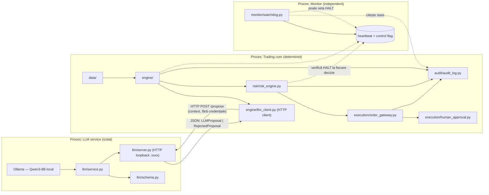
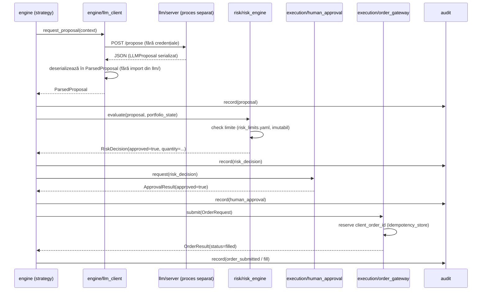
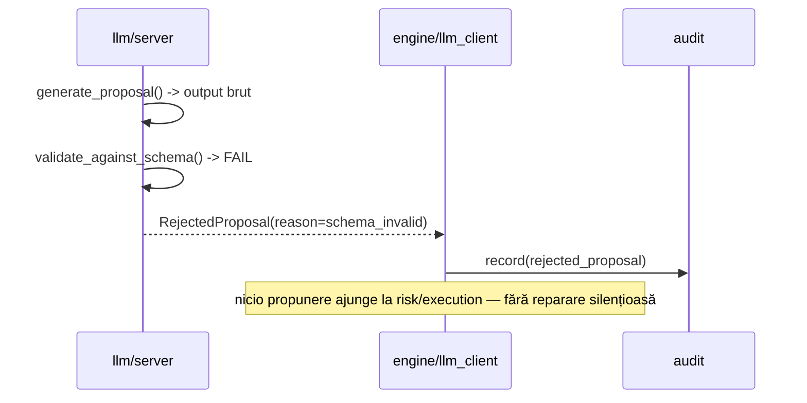
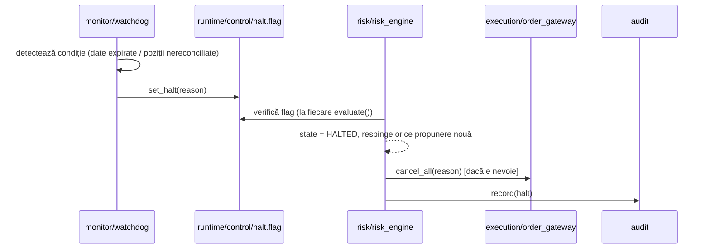
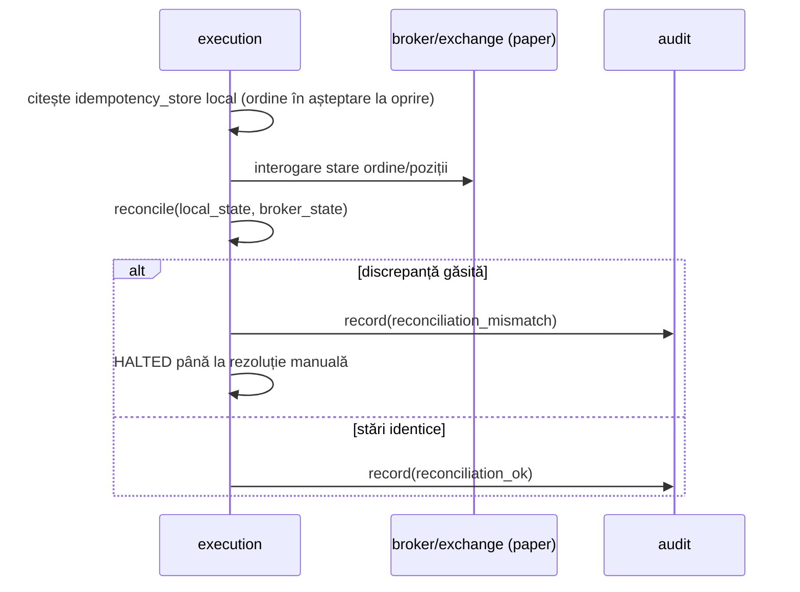

# Design de componente — Agent local de trading, Faza 0–4

**Scop document:** design tehnic la nivel de componentă pentru structura de repository din [`CLAUDE-instructiuni-faza-0-4.md#1`](CLAUDE-instructiuni-faza-0-4.md#1-structura-recomandată-a-repository-ului). Traduce arhitectura de ansamblu din [`brief-proiect-agent-trading-local.md#6`](brief-proiect-agent-trading-local.md#6-arhitectura-propusă-vedere-de-ansamblu) în module, interfețe, contracte de date și frontiere de proces — fără cod de implementare.

**Status:** propunere de design, nerevizuită încă de PO/Risk owner. Nu creează cod sursă.

**Relație cu documentele existente:** acest document nu repetă regulile absolute (secțiunea 0 din instrucțiuni) sau task-urile (secțiunile 2–7) — le presupune cunoscute și proiectează structura care le satisface.

---

## 1. Principii de design derivate din regulile absolute

Fiecare decizie de mai jos există ca răspuns direct la o regulă din secțiunea 0 a instrucțiunilor:

| Regulă absolută | Decizie de design |
|---|---|
| LLM fără acces la execuție, nici măcar indirect | LLM rulează ca **proces OS separat**, comunicare exclusiv prin HTTP loopback (`127.0.0.1`), contract JSON fix (`llm/schema.py`), fără shared memory, fără import de cod din `risk/`/`execution/`/`engine/` |
| Limitele de risc nemodificabile de output LLM | `RiskLimits` e încărcat o singură dată la pornire, imutabil pe durata rulării; `RiskEngine` nu acceptă niciun parametru de limită din `LLMProposal` |
| Niciun secret în procesul LLM | Procesul LLM pornește cu un `.env.llm` propriu, care **nu conține** deloc variabile de broker/exchange — nu „le ignoră", pur și simplu nu există în acel mediu |
| Kill switch independent de restul aplicației | Semnalul de halt e o stare externă partajată (fișier/DB de control), nu o variabilă în memoria procesului de strategie — verificabilă și declanșabilă și din procesul `monitor/` |
| Order gateway idempotent, fără retrimitere oarbă | `client_order_id` generat și persistat **înainte** de submit, într-un store separat de starea în memorie |
| Audit append-only | `audit/` expune un singur verb (`record`), fără `update`/`delete` în interfața publică |

---

## 2. Frontiere de proces



**De ce trei procese, nu module în același proces:** un `import` e reversibil printr-o refactorizare accidentală; o frontieră de proces cu contract HTTP fix și `.env` separat nu poate fi „ocolită" fără o schimbare explicită, vizibilă în code review. Monitorul e separat pentru că trebuie să poată declanșa oprirea chiar dacă procesul principal e blocat/nerăspunzător — un watchdog în același proces cu ce supraveghează nu e un watchdog.

**Deschis pentru decizie PO/Arhitect:** dacă `monitor/` are nevoie de propriul client de broker (doar citire poziții + cancel-all), pentru cazul în care procesul principal e complet blocat și nu mai citește flag-ul de control. Fără el, kill switch-ul independent e parțial — depinde totuși ca procesul principal să mai fie capabil să citească un fișier. Recomandare: implementează întâi varianta cu flag de control (mai simplă, suficientă pentru Faza 0–4 paper trading); reevaluează clientul de broker separat pentru monitor înainte de Faza 5.

---

## 3. Structură de directoare (extinde secțiunea 1 din instrucțiuni)

```
trading-agent/
├── .env.example                    # șablon combinat, doar placeholder-uri
├── .env.engine.example             # variabile pt. procesul trading core (poate include broker paper)
├── .env.llm.example                # variabile pt. procesul LLM — ZERO variabile de broker, by design
├── config/
│   ├── risk_limits.yaml
│   └── universe.yaml
├── src/
│   ├── data/
│   │   ├── sources.py               # interfață DataSource + implementări (fișier local, feed paper)
│   │   ├── validation.py            # gap/duplicate/timestamp-viitor checks
│   │   └── cache.py                 # cache local + hash al datasetului (reproductibilitate Task 4)
│   ├── engine/
│   │   ├── strategy_llm_assisted.py # orchestrare: data -> llm_client -> risk -> execution
│   │   ├── llm_client.py            # client HTTP către procesul llm/ — ZERO import din llm/
│   │   ├── proposal_types.py        # ParsedProposal — duplicat structural al llm.schema.LLMProposal
│   │   └── adapters/                # adaptoare NautilusTrader per venue
│   ├── risk/
│   │   ├── config_schema.py         # RiskLimits (pydantic), validare la pornire
│   │   ├── position_sizing.py       # funcție pură: formula din Task 3
│   │   ├── risk_engine.py           # evaluate(proposal, portfolio_state) -> RiskDecision
│   │   ├── kill_switch.py           # trigger() independent, testabil manual
│   │   └── circuit_breaker.py       # stare RUNNING/HALTED
│   ├── llm/
│   │   ├── schema.py                # LLMProposal / RejectedProposal — pure data, ZERO I/O, importat doar în interiorul llm/
│   │   ├── service.py               # logică model + validare + allowlist (proces izolat)
│   │   └── server.py                # HTTP loopback, singurul punct de intrare extern al procesului
│   ├── execution/
│   │   ├── order_gateway.py         # submit idempotent, cancel_all
│   │   ├── idempotency_store.py     # persistă client_order_id înainte de submit
│   │   ├── reconciliation.py        # reconciliere la pornire + periodic
│   │   └── human_approval.py        # gate de aprobare, identic în paper și live
│   ├── monitor/
│   │   ├── heartbeat.py             # scriere/citire heartbeat
│   │   └── watchdog.py              # stale data, poziții nereconciliate, poate seta HALT
│   └── audit/
│       ├── events.py                # AuditEvent (schema)
│       └── audit_log.py             # record() — singurul verb public
├── runtime/                         # stare locală generată, în .gitignore integral
│   ├── control/halt.flag
│   ├── idempotency.db
│   └── heartbeat.json
├── backtests/reports/
├── tests/
│   ├── unit/
│   ├── integration/
│   │   └── test_proposal_contract.py   # llm.schema vs. engine.proposal_types, aceleași exemple (secțiunea 7)
│   ├── fixtures/
│   │   └── llm_proposals.json          # cazuri valide + invalide, sursă comună pt. ambele scheme
│   └── adversarial/
│       └── test_process_isolation.py   # test static de dependențe (secțiunea 6)
└── docs/
    └── qualification-report.md
```

Diferențe față de arborele din instrucțiuni: `llm/server.py` + `engine/llm_client.py` (frontiera HTTP explicită), `.env.engine.example` / `.env.llm.example` separate în loc de un singur `.env.example`, și `runtime/` pentru stare locală (control flag, idempotency store, heartbeat) — necesară pentru kill switch și idempotență, dar niciodată în git.

---

## 4. Contracte de date

Toate ca modele pure (ex. Pydantic), fără metode cu efecte secundare. `llm.schema` definește contractul în procesul LLM; `engine.proposal_types` definește un duplicat structural, folosit exclusiv pe partea `engine/` (izolare totală, decizie secțiunea 7) — cele două sunt ținute sincronizate printr-un test de contract, nu printr-un import comun.

### 4.1 `LLMProposal` (ieșirea validă a stratului LLM)

```yaml
instrument: str          # trebuie să existe în config/universe.yaml — verificat independent, nu doar de llm/
direction: enum[long, avoid, exit]
confidence: float        # 0.0–1.0
rationale: str           # text liber, pentru audit — NU e folosit ca input executabil
# absent intenționat: orice câmp de mărime poziție, preț, sau limită de risc
```

### 4.2 `RejectedProposal`

```yaml
reason: enum[schema_invalid, instrument_not_in_universe, timeout, model_error]
raw_output: str           # păstrat pentru audit/debug, niciodată reparat automat
```

### 4.3 `RiskDecision` (ieșirea `risk_engine.evaluate`)

```yaml
approved: bool
instrument: str
side: enum[buy, sell]
quantity: Decimal          # calculat de position_sizing, niciodată preluat din LLM
reject_reason: str | null  # ex. "peste expunere maximă per instrument", "HALTED"
requires_human_approval: bool   # true în toate fazele 0–4, per regulă
```

### 4.4 `OrderRequest` / `OrderResult`

```yaml
OrderRequest:
  client_order_id: uuid    # generat și persistat înainte de submit
  instrument: str
  side: enum[buy, sell]
  quantity: Decimal
  order_type: enum[market, limit]

OrderResult:
  client_order_id: uuid
  status: enum[submitted, filled, partially_filled, rejected, unknown, timeout]
  broker_order_id: str | null
```

### 4.5 `AuditEvent`

```yaml
timestamp: datetime (UTC)
correlation_id: uuid       # leagă propunere -> decizie risc -> aprobare -> ordin -> fill
event_type: enum[proposal, rejected_proposal, risk_decision, human_approval, order_submitted, fill, halt]
payload: object            # conținutul evenimentului respectiv, serializat complet
```

### 4.6 `config/risk_limits.yaml` — schema minimă (Task 3, pas 1)

```yaml
max_notional_per_order: float
max_exposure_per_instrument: float
max_exposure_per_asset_class: float
max_daily_loss: float
max_drawdown: float
max_orders_per_day: int
circuit_breaker:
  max_consecutive_errors: int
  max_consecutive_losses: int
  halt_on_unknown_order_result: bool  # trebuie true
```

Validare la pornire: schema completă + valori sane (toate pozitive unde are sens, `max_drawdown` și `max_daily_loss` exprimate explicit ca sumă absolută sau procent — nu ambiguu). Config lipsă sau invalid → aplicația refuză pornirea, fără fallback la valori implicite.

### 4.7 `config/universe.yaml` — schema minimă

```yaml
instruments:
  - symbol: str
    venue: str
    asset_class: enum[equity, crypto, fx]
```

---

## 5. Interfețe pe modul

Semnături, nu implementări — fiecare intrare listează și dependențele **interzise** explicit, pentru a putea fi verificate static (secțiunea 6).

### `data/`
```
DataSource.fetch_bars(instrument, start, end, timeframe) -> Iterable[Bar]
DataValidator.validate(bars) -> ValidationReport   # gap-uri, duplicate, timestamp în viitor
MarketDataCache.get_or_fetch(...) -> tuple[Bars, dataset_hash]
```
Interzis: import din `llm/`, `execution/` (fără acces la credențiale broker live).

### `engine/`
```
ParsedProposal(BaseModel): instrument, direction, confidence, rationale   # duplicat structural, definit local
LLMProposalClient.request_proposal(context: ProposalContext, timeout_s: float) -> ParsedProposal | RejectedProposal
LLMAssistedStrategy.on_decision_point(...) -> None   # orchestrează data -> llm_client -> risk -> execution
```
Permis: `data`, `risk` (interfețe), `execution` (interfețe), `audit`.
Interzis: orice import din `llm/` (inclusiv `llm.schema`) — izolare totală, vezi secțiunea 7. `llm_client.py` deserializează JSON-ul HTTP direct în `ParsedProposal`, fără să treacă prin niciun tip definit în `llm/`.

### `risk/`
```
load_risk_limits(path) -> RiskLimits              # eșuează hard dacă invalid/lipsă
size_position(cap_notional, price, risk_budget, stop_distance, cost_estimate, slippage_buffer, instrument_rules) -> Decimal
RiskEngine.evaluate(proposal: ParsedProposal, portfolio_state: PortfolioState) -> RiskDecision
KillSwitch.trigger(reason: str) -> KillSwitchResult
CircuitBreaker.record_event(event) -> None
CircuitBreaker.state -> Literal["RUNNING", "HALTED"]
```
Interzis: orice import din `llm/` — `RiskEngine.evaluate` primește `ParsedProposal`, tipul definit în `engine/` (izolare totală, secțiunea 7). Interzis: import din `execution/` — risk-ul decide, nu execută.

### `llm/`
```
# schema.py — pure, zero I/O, singurul submodul importabil din afara llm/
LLMProposal(BaseModel): instrument, direction, confidence, rationale
RejectedProposal(BaseModel): reason, raw_output

# service.py — proces izolat
generate_proposal(context, model_config) -> LLMProposal | RejectedProposal
validate_against_universe(proposal, universe) -> LLMProposal | RejectedProposal

# server.py — singurul I/O extern al procesului
POST /propose  (loopback 127.0.0.1 only) -> JSON LLMProposal | RejectedProposal
```
Interzis (verificat static): import din `risk/`, `execution/`, `engine/`; orice pachet client de broker/exchange (`ib_insync`, `krakenex`, `nautilus_trader.adapters.*`); citire de variabile de mediu care nu sunt în `.env.llm.example`.

### `execution/`
```
OrderGateway.submit(order: OrderRequest) -> OrderResult    # idempotent pe client_order_id
OrderGateway.cancel_all(reason: str) -> None
IdempotencyStore.reserve(client_order_id) -> None          # scris ÎNAINTE de submit
Reconciliation.reconcile(local_state, broker_state) -> ReconciliationReport
ApprovalGate.request(order_intent: RiskDecision) -> ApprovalResult
```
Interzis: import din `llm/` (execution nu vede niciodată output LLM brut, doar `RiskDecision` deja aprobat).

### `monitor/`
```
Heartbeat.write(process_id, timestamp) -> None
Heartbeat.is_stale(threshold_s) -> bool
Watchdog.check_stale_data() -> bool
Watchdog.check_unreconciled_positions() -> bool
Watchdog.set_halt(reason: str) -> None    # scrie flag-ul de control citit de risk_engine
```
Rulează ca proces separat de `engine/`; citește doar din `audit/` și din fișierele de stare din `runtime/`, nu importă `engine/` sau `llm/`.

### `audit/`
```
AuditLog.record(event: AuditEvent) -> None   # singurul verb public — fără update/delete
```

---

## 6. Verificare statică a izolării (acceptance criteriu Task 2)

Design pentru testul cerut explicit în instrucțiuni ("verificat printr-un test static de dependențe, nu doar afirmat"):

```
tests/adversarial/test_process_isolation.py:
  1. parcurge src/llm/**/*.py cu ast, colectează toate Import/ImportFrom
  2. assert: niciun import nu referă src.risk, src.execution, src.engine
  3. assert: niciun import nu referă pachete client de broker cunoscute
     (listă explicită: ib_insync, krakenex, ccxt, nautilus_trader.adapters.*)
  4. parcurge src/risk/**/*.py, src/execution/**/*.py și src/engine/**/*.py cu ast
  5. assert: ZERO import-uri, în oricare din aceste module, care referă src.llm
     (fără excepții — inclusiv src.llm.schema; izolare totală, secțiunea 7)
  6. assert: fișierul .env.llm.example nu conține niciuna dintre cheile
     definite în .env.engine.example care conțin "BROKER", "API_KEY", "SECRET"
```

Acest test rulează în CI la fiecare commit (per checklist global, secțiunea 9 din instrucțiuni) și eșuează tare dacă cineva adaugă accidental un import de conveniență peste frontiera de izolare — regula e „zero import-uri din `src.llm` în afara procesului `llm/`", fără condiții și fără liste de excepții de întreținut.

Sincronizarea celor două scheme (`llm.schema` vs. `engine.proposal_types`) e verificată separat, prin `tests/integration/test_proposal_contract.py` (secțiunea 7) — nu prin acest test de izolare, care rămâne astfel o regulă mecanică simplă.

---

## 7. Decizie de design — cuplarea `engine/` ↔ `llm/`: Opțiunea B, izolare totală

**Decis:** `engine/` nu importă **nimic** din `llm/`, nici măcar `schema.py`. `engine/proposal_types.py` definește propriul tip `ParsedProposal` (identic structural cu `llm.schema.LLMProposal`) și parsează JSON-ul primit prin HTTP direct, fără nicio dependență de cod pe pachetul `llm/`.

**De ce nu Opțiunea A (schema comună):** un import „doar de date" e o excepție în regula de izolare — și regula de izolare a acestui proiect (secțiunea 0, regula 2) e explicit fără nuanțe: „nu are, sub nicio formă, acces direct sau indirect". O excepție documentată azi ca „doar tipuri, fără logică" e ușor de erodat mâine de cineva care adaugă o metodă de conveniență în `schema.py` fără să realizeze că acel fișier e singura punte peste o frontieră de siguranță — și testul static ar continua să treacă, pentru că excepția era deja acolo. Costul real al Opțiunii A nu e riscul de azi, e faptul că testul din secțiunea 6 nu mai poate fi „zero excepții, punct" — trebuie să știe și să verifice *ce anume* conține excepția permisă, ceea ce mută garanția din regulă mecanică în revizuire umană continuă.

**Costul acceptat al Opțiunii B:** două definiții de schemă (`llm/schema.py` și `engine/proposal_types.py`) care trebuie ținute sincronizate manual. Acoperit printr-un test de contract dedicat (nu prin disciplină): `tests/integration/test_proposal_contract.py` ia un fișier fix de exemple JSON (`tests/fixtures/llm_proposals.json`, cu cazuri valide și invalide) și verifică că `llm.schema.LLMProposal` și `engine.proposal_types.ParsedProposal` acceptă/resping exact aceleași exemple. Orice divergență între cele două scheme eșuează acest test, nu doar „se observă la revizuire".

**Consecință pentru `engine/llm_client.py`:** primește JSON brut de la `llm/server.py` prin HTTP, îl deserializează direct în `ParsedProposal` (fără a trece prin niciun tip din `llm/`), și doar rezultatul (`ParsedProposal` sau `RejectedProposal` local) circulă mai departe către `risk/`.

---

## 8. Fluxuri principale (sequence diagrams)

### 8.1 Flux normal — propunere → aprobare → execuție



### 8.2 Propunere respinsă (schema invalidă sau adversarial)



### 8.3 Kill switch



### 8.4 Reconciliere după restart



---

## 9. Trasabilitate — componente afectate per task

| Task | Module principale afectate |
|---|---|
| Task 0 (mediu) | `.env.engine.example`, `.env.llm.example`, `.gitignore`, `runtime/` |
| Task 1 (Nautilus) | `engine/adapters/`, `docs/qualification-report.md` |
| Task 2 (LLM izolat) | `llm/*`, `engine/llm_client.py`, `tests/adversarial/test_process_isolation.py` |
| Task 3 (risc determinist) | `risk/*`, `config/risk_limits.yaml`, `tests/unit/` + `tests/adversarial/` |
| Task 4 (backtesting) | `data/*`, `backtests/`, `engine/strategy_llm_assisted.py` (mod backtest) |
| Task 5 (paper trading) | `execution/*`, `monitor/*`, `audit/*` |

---

## 10. Ce nu acoperă acest document

- Alegerea concretă a mecanismului de transport HTTP (framework server — ex. FastAPI vs. un server minimal fără dependențe) — decizie de implementare, nu de design.
- Schema exactă a tabelelor SQLite pentru `audit/` și `idempotency_store` — DDL-ul se scrie la implementare, pe baza contractelor din secțiunea 4.
- Cod. Următorul pas, după revizuirea acestui design de PO/Dev-Arhitect, este `/sc:implement` pe Task 0.
