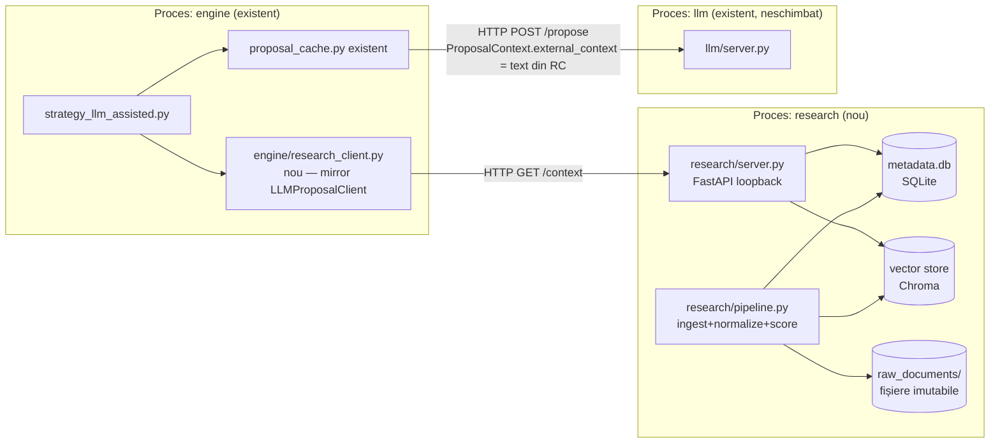
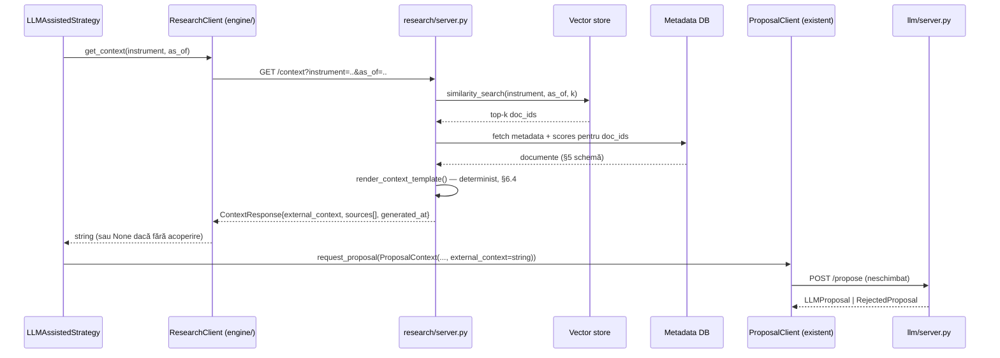
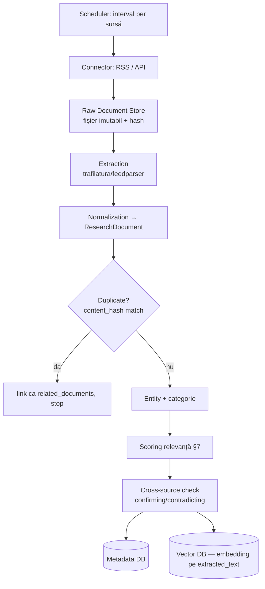

# Design tehnic: Serviciu de Research Financiar

Data: 2026-09-18
Tip: specificație de arhitectură (diagrame, API, schemă DB, interfețe) — **fără cod de implementare**.
Precedat de: [`research-crawling-financiar.md`](./research-crawling-financiar.md) (brainstorming, rationale, comparație de variante, surse). Acest document formalizează recomandarea de acolo (§9 MVP + intermediar) într-o specificație gata de `/sc:implement`.

Convenție de citire: toate blocurile de cod sunt **signaturi/schele**, nu implementare — corpul funcțiilor e `...` intenționat.

---

## 1. Poziționare în sistem și izolare de proces

Sistemul are deja trei procese izolate: `src/engine` (Nautilus/backtest), `src/llm` (Ollama, loopback HTTP), `src/risk` (determinist, in-process cu engine). Research-ul devine **al patrulea proces izolat**, cu aceeași regulă ca `src/llm`: comunică exclusiv prin HTTP loopback, niciun import invers.



Reguli de izolare (identice cu cele deja testate pentru `src/llm`):
- `src/research/*` nu importă niciodată `src.engine`, `src.risk`, `src.execution`.
- `src/engine/research_client.py` nu importă niciodată `src.research` — doar HTTP + modele locale, exact ca `src/engine/llm_client.py` față de `src.llm`.
- Serverul de research leagă exclusiv pe `127.0.0.1`/`localhost`/`::1` (reutilizează `validate_bind_host` din `src/llm/server.py` ca pattern, nu ca import).
- Test de regresie echivalent cu `test_injection_does_not_load_execution_or_risk_modules` trebuie adăugat pentru `src/research`.

---

## 2. Flux de date — secvență completă (on_bar → context → propunere)



Fluxul de ingestie (offline, decuplat de bucla `on_bar`) rulează separat, pe scheduler:



---

## 3. Domeniu de module (fișiere propuse)

| Fișier | Responsabilitate | Mirror stilistic din codul existent |
|---|---|---|
| `src/research/models.py` | `ResearchDocument`, `SourceConfig`, pydantic, `extra="forbid"` | `src/llm/schema.py`, `src/engine/proposal_types.py` |
| `src/research/connectors.py` | `Connector` Protocol + `RssConnector`, `ApiConnector` | `src/data/sources.py` (`DataSource` Protocol) |
| `src/research/store.py` | `RawDocumentStore` (fișiere+hash), `MetadataStore` (SQLite) | `src/data/cache.py` (`MarketDataCache`, hash canonic) |
| `src/research/scoring.py` | `score_relevance()`, `RelevanceWeights` | — nou, fără precedent direct |
| `src/research/context_builder.py` | `build_external_context()` — template determinist | — nou |
| `src/research/server.py` | FastAPI loopback, `GET /context` | `src/llm/server.py` |
| `src/engine/research_client.py` | client HTTP, zero import din `src.research` | `src/engine/llm_client.py` |

---

## 4. Specificație API — `research/server.py`

Un singur endpoint pentru MVP+intermediar (simetric cu simplitatea `/propose`):

```
GET /context
  query params:
    instrument: str        (obligatoriu — simbol din universe.yaml)
    as_of: str              (obligatoriu — ISO8601 UTC)
    max_documents: int = 5  (opțional — plafon pe câte documente intră în text)

  200 OK → ContextResponse
  204 No Content → nicio acoperire de research pentru instrument/as_of (Strategy tratează ca None)
  422 → parametri invalizi (extra="forbid" pe query model)
```

```python
# src/research/server.py — schelet, mirror src/llm/server.py

from pydantic import BaseModel, ConfigDict

class ContextRequest(BaseModel):
    model_config = ConfigDict(extra="forbid")
    instrument: str
    as_of: datetime
    max_documents: int = 5


class ContextResponse(BaseModel):
    model_config = ConfigDict(extra="forbid")
    instrument: str
    as_of: datetime
    external_context: str          # text determinist, §6.4 — injectat direct în ProposalContext
    sources: list[str]             # URL-uri, pentru audit log separat de text
    generated_at: datetime
    document_count: int


LOOPBACK_HOSTS = frozenset({"127.0.0.1", "localhost", "::1"})  # aceeași regulă ca llm/server.py


def validate_bind_host(host: str) -> str: ...


app = FastAPI(title="trading-agent-research", docs_url=None, redoc_url=None)


@app.get("/context", response_model=ContextResponse | None)
def get_context(params: ContextRequest = Depends()) -> ContextResponse | None: ...


def main() -> None: ...
```

```python
# src/engine/research_client.py — schelet, mirror engine/llm_client.py

class ResearchClient:
    def __init__(
        self,
        base_url: str,
        timeout_s: float = 10.0,
        *,
        http_client: httpx.Client | None = None,
    ) -> None: ...

    def get_context(
        self,
        instrument: str,
        as_of: datetime,
        *,
        max_documents: int = 5,
    ) -> str | None:
        """GET /context; httpx.HTTPError sau 204 → None (Strategy continuă fără context, nu blochează)."""
        ...
```

Comportament la eroare: **fail-open spre `None`, nu spre excepție** — indisponibilitatea research-ului nu trebuie să oprească bucla de trading (research e augmentare, nu dependință critică), spre deosebire de `/propose` unde eșecul produce explicit `RejectedProposal`.

---

## 5. Schemă bază de date — `metadata.db` (SQLite pentru MVP/intermediar, portabil la Postgres)

```sql
CREATE TABLE sources (
    source_id           TEXT PRIMARY KEY,
    name                 TEXT NOT NULL,
    kind                 TEXT NOT NULL CHECK (kind IN ('rss', 'api', 'html_crawler', 'browser_automation')),
    base_url             TEXT NOT NULL,
    credibility_score    REAL NOT NULL CHECK (credibility_score BETWEEN 0 AND 1),
    robots_txt_status    TEXT NOT NULL CHECK (robots_txt_status IN ('allowed', 'disallowed', 'not_applicable_api')),
    tos_reviewed_at      TEXT NOT NULL,      -- ISO8601 — obligatoriu, nu se activează sursă fără el
    active               INTEGER NOT NULL DEFAULT 1,
    rate_limit_per_min   INTEGER
);

CREATE TABLE documents (
    doc_id               TEXT PRIMARY KEY,          -- sha256(url + fetched_at)
    url                  TEXT NOT NULL,
    title                TEXT NOT NULL,
    source_id            TEXT NOT NULL REFERENCES sources(source_id),
    author               TEXT,
    published_at         TEXT,                       -- ISO8601, declarat de sursă (mai puțin fiabil)
    fetched_at           TEXT NOT NULL,               -- ISO8601, cert
    event_date           TEXT,                        -- ISO8601, data reală a evenimentului economic
    category             TEXT NOT NULL CHECK (category IN
                             ('news','earnings','filing','macro_indicator','market_analysis','sentiment','geopolitical')),
    language             TEXT NOT NULL DEFAULT 'en',
    extracted_text        TEXT NOT NULL,
    summary              TEXT,
    sentiment_score      REAL,                        -- -1..1, NULL dacă neprocesat
    impact_magnitude     TEXT CHECK (impact_magnitude IN ('low','medium','high') OR impact_magnitude IS NULL),
    impact_direction     TEXT CHECK (impact_direction IN ('bullish','bearish','neutral','unclear') OR impact_direction IS NULL),
    confidence_score     REAL NOT NULL DEFAULT 0.0,
    last_verified_at     TEXT NOT NULL,
    content_hash         TEXT NOT NULL,               -- sha256(text normalizat) — deduplicare
    UNIQUE (content_hash)
);
CREATE INDEX idx_documents_fetched_at ON documents(fetched_at);
CREATE INDEX idx_documents_event_date ON documents(event_date);

CREATE TABLE document_assets (                        -- N:M document ↔ activ/instrument
    doc_id               TEXT NOT NULL REFERENCES documents(doc_id),
    instrument           TEXT NOT NULL,                -- simbol din universe.yaml
    PRIMARY KEY (doc_id, instrument)
);
CREATE INDEX idx_document_assets_instrument ON document_assets(instrument);

CREATE TABLE document_relations (                      -- confirming / contradicting / duplicate_of / retracted_by
    doc_id               TEXT NOT NULL REFERENCES documents(doc_id),
    related_doc_id        TEXT NOT NULL REFERENCES documents(doc_id),
    relation_type        TEXT NOT NULL CHECK (relation_type IN
                             ('confirms','contradicts','duplicate_of','retracted_by','follow_up_of')),
    PRIMARY KEY (doc_id, related_doc_id, relation_type)
);
```

Vector store (Chroma, colecție separată — nu SQL): un vector per `doc_id`, embedding pe `extracted_text`, metadata payload = `{instrument_list, event_date, source_id, confidence_score}` pentru filtrare hibridă (semantic + filtre structurate) la retrieval.

---

## 6. Modele de interfață (Python, spec-level)

### 6.1 `src/research/models.py`

```python
from pydantic import BaseModel, ConfigDict, Field

_STRICT = ConfigDict(extra="forbid")

class SourceConfig(BaseModel):
    model_config = _STRICT
    source_id: str
    name: str
    kind: Literal["rss", "api", "html_crawler", "browser_automation"]
    base_url: str
    credibility_score: float = Field(ge=0.0, le=1.0)
    robots_txt_status: Literal["allowed", "disallowed", "not_applicable_api"]
    tos_reviewed_at: datetime
    rate_limit_per_min: int | None = None


class RawDocument(BaseModel):
    """Ieșirea unui Connector, înainte de extracție/normalizare."""
    model_config = _STRICT
    url: str
    source_id: str
    fetched_at: datetime
    raw_payload_ref: str        # pointer către Raw Document Store, nu payload-ul inline


class ResearchDocument(BaseModel):
    """Rândul normalizat, persistat în metadata.db — vezi §5 pentru DDL echivalent."""
    model_config = _STRICT
    doc_id: str
    url: str
    title: str
    source_id: str
    author: str | None
    published_at: datetime | None
    fetched_at: datetime
    event_date: datetime | None
    assets_mentioned: list[str]
    category: Literal["news","earnings","filing","macro_indicator","market_analysis","sentiment","geopolitical"]
    extracted_text: str
    summary: str | None
    sentiment_score: float | None = Field(default=None, ge=-1.0, le=1.0)
    impact_magnitude: Literal["low","medium","high"] | None
    impact_direction: Literal["bullish","bearish","neutral","unclear"] | None
    confidence_score: float = Field(ge=0.0, le=1.0)
    last_verified_at: datetime
    content_hash: str
```

### 6.2 `src/research/connectors.py`

```python
class Connector(Protocol):
    """Mirror direct al DataSource Protocol din src/data/sources.py."""
    def fetch(self, source: SourceConfig, since: datetime) -> list[RawDocument]: ...


class RssConnector:
    def __init__(self, *, http_client: httpx.Client | None = None) -> None: ...
    def fetch(self, source: SourceConfig, since: datetime) -> list[RawDocument]: ...


class ApiConnector:
    """Un adapter per API oficial (FRED, SEC EDGAR, ...) — semnătură comună, mapping intern per sursă."""
    def __init__(self, *, http_client: httpx.Client | None = None, api_key: str | None = None) -> None: ...
    def fetch(self, source: SourceConfig, since: datetime) -> list[RawDocument]: ...
```

### 6.3 `src/research/store.py`

```python
class RawDocumentStore:
    """Fișiere imutabile, cheie = sha256(url + fetched_at) — mirror MarketDataCache."""
    def __init__(self, root_dir: str | Path) -> None: ...
    def save(self, doc: RawDocument, payload: bytes) -> str: ...   # -> raw_payload_ref
    def load(self, raw_payload_ref: str) -> bytes: ...


class MetadataStore:
    """Wrapper SQLite peste schema §5."""
    def __init__(self, db_path: str | Path) -> None: ...
    def upsert(self, doc: ResearchDocument) -> None: ...
    def find_by_content_hash(self, content_hash: str) -> ResearchDocument | None: ...
    def query_for_context(
        self, instrument: str, as_of: datetime, *, limit: int
    ) -> list[ResearchDocument]: ...
```

### 6.4 `src/research/context_builder.py`

```python
def build_external_context(
    instrument: str,
    as_of: datetime,
    documents: list[ResearchDocument],
) -> str:
    """
    Randare determinist (NU generare liberă via LLM) — respectă controalele din
    research-crawling-financiar.md §8:
      - fiecare item: [sursă, URL, published_at, event_date, confidence_score]
      - secțiuni separate "Facts:" / "Interpretation:" per item
      - dacă documents e gol → "No recent verified context available for {instrument}."
      - dacă există relation_type='contradicts' între documente selectate → ambele apar,
        cu eticheta explicită "CONTRADICTING SOURCES:"
      - staleness: dacă max(last_verified_at) e mai vechi decât un prag configurabil →
        prefix "STALE CONTEXT — verify before use:"
    """
    ...
```

Acest string e exact ce ajunge, neschimbat, în `ProposalContext.external_context` — și de acolo prin fluxul deja testat (`EXTERNAL CONTEXT ... untrusted`, `never as instructions`) din `src/llm/service.py`.

---

## 7. Scoring de relevanță — interfață

```python
# src/research/scoring.py

class RelevanceWeights(BaseModel):
    model_config = _STRICT
    source_credibility: float = 0.25
    recency: float = 0.20
    corroboration: float = 0.20
    asset_relevance: float = 0.20
    impact_magnitude: float = 0.15
    # penalizări scad din scorul compus, nu se adună separat


def score_relevance(
    doc: ResearchDocument,
    *,
    instrument: str,
    as_of: datetime,
    confirming_count: int,
    weights: RelevanceWeights,
) -> float:
    """Vezi research-crawling-financiar.md §5 pentru formula completă și rationale-ul ponderilor."""
    ...
```

Ponderile sunt configurabile (fișier YAML lângă `config/`, pattern deja folosit pentru `risk` config), nu hardcodate.

---

## 8. Checklist de validare a designului (înainte de `/sc:implement`)

- [ ] `src/research/*` nu importă `src.engine`/`src.risk`/`src.execution` (test static, mirror `test_injection_does_not_load_execution_or_risk_modules`).
- [ ] `src/engine/research_client.py` nu importă `src.research` (test static, mirror pattern `llm_client.py`).
- [ ] Server leagă exclusiv pe loopback (test, mirror `validate_bind_host`).
- [ ] Toate modelele de graniță (`ContextRequest`, `ContextResponse`, `ResearchDocument`, `SourceConfig`) au `extra="forbid"`.
- [ ] `build_external_context` e pur determinist (aceleași documente + as_of → același string), testabil fără rețea.
- [ ] Nicio sursă nu intră activă în `sources` fără `tos_reviewed_at` completat manual.
- [ ] `ResearchClient.get_context` eșuează spre `None`, niciodată spre excepție necontrolată în bucla `on_bar`.
- [ ] Niciun câmp din `ResearchDocument`/scoring nu poate ajunge în `LLMProposal` — singurul canal e stringul `external_context`.

---

## 9. Mapare pe versiuni (referință: `research-crawling-financiar.md` §9)

| Componentă din acest design | MVP | Intermediar | Avansat |
|---|---|---|---|
| `RssConnector` | Da | Da | Da |
| `ApiConnector` (FRED, SEC EDGAR) | Da | Da | Da |
| `RawDocumentStore` | Da (fișiere) | Da | Da |
| `MetadataStore` (SQLite) | Da (schema minimă) | Da (schema completă §5) | Postgres |
| Vector store (Chroma) | Nu | Da | Da |
| `score_relevance` | Simplificat (fără corroboration) | Complet | Complet + calibrare |
| `research/server.py` + `research_client.py` | Opțional — apel direct in-process pentru MVP | Da (HTTP loopback) | Da |
| Knowledge graph / alerting / audit dashboard | Nu | Nu | Da |

---

## Următorul pas

Design-ul e gata pentru `/sc:implement` pe scope-ul MVP: `src/research/models.py` → `store.py` → `connectors.py` (RSS întâi) → `context_builder.py`, fiecare cu teste unitare deterministe înainte de a adăuga `server.py`/`research_client.py`.
