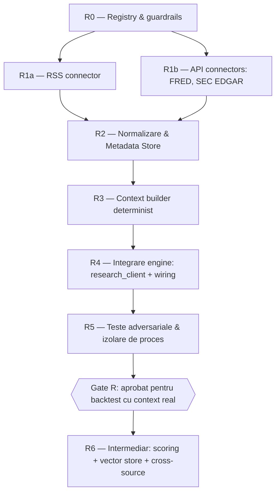

# Workflow de implementare: Serviciu de Research Financiar

Data: 2026-09-18
Strategie: systematic, depth normal, faze secvențiale cu paralelizare limitată în R1.
Intrări: [`research-crawling-financiar.md`](./research-crawling-financiar.md) (rationale, comparație variante, surse) și [`design-research-financiar.md`](./design-research-financiar.md) (arhitectură, API, schemă DB, interfețe).

**Acest document e doar planul.** Niciun fișier de cod nu se creează aici — vezi secțiunea 9 pentru pasul următor (`/sc:implement`).

---

## 1. Poziționare față de fazele existente ale proiectului

Fazele 0-4 din `README.md` (cercetare → instalare → reproducere → backtest → paper trading) sunt despre nucleul de execuție/risc și rulează deja. Acest feature e **ortogonal** — un al patrulea proces izolat (`src/research/`) care augmentează `ProposalContext.external_context`, fără a atinge `src/execution`/`src/risk`. Se poate dezvolta în paralel cu Faza 3/4 existentă, dar **nu intră în bucla live până nu trece prin Gate R4** (§4).

Reguli absolute pentru acest feature (mirror stilistic pe „Reguli absolute (Fazele 0–4)" din README):

1. Nicio sursă nu devine `active=1` în registry fără `tos_reviewed_at` completat manual (nu implicit, nu presupus).
2. `src/research/*` nu importă niciodată `src.engine`, `src.risk`, `src.execution`.
3. `src/engine/research_client.py` nu importă niciodată `src.research`.
4. Indisponibilitatea serviciului de research nu oprește niciodată bucla `on_bar` — fail-open spre `None`.
5. `build_external_context()` e determinist — aceleași documente + `as_of` → același string, verificabil fără rețea.
6. Niciun câmp din research (sentiment, scor, entități) nu poate ajunge în schema `LLMProposal` altfel decât ca text în `external_context`.

---

## 2. Graf de dependențe între faze



R1a și R1b sunt paralelizabile (ambele depind doar de R0, nu una de alta). Restul e secvențial — fiecare fază depinde de artefactele testate ale celei anterioare.

---

## 3. Faze — task-uri, dependențe, teste

### R0 — Registry & guardrails (fundație, blocantă pentru tot restul)

| Task | Dependință | Fișier vizat |
|---|---|---|
| Definire `SourceConfig`, `RawDocument`, `ResearchDocument` (pydantic, `extra="forbid"`) | design §6.1 | `src/research/models.py` |
| Registry inițial cu 3 surse verificate manual (FRED, SEC EDGAR, 1 RSS de presă) | verificare manuală robots.txt + ToS pentru fiecare | `config/research_sources.yaml` |
| Test: orice sursă fără `tos_reviewed_at` e respinsă la load | — | `tests/unit/test_research_models.py` |

**Checkpoint R0**: registry încarcă doar surse cu `tos_reviewed_at` valid; modelele resping câmpuri necunoscute (test `extra="forbid"`, mirror `test_injected_extra_fields_are_rejected_not_executed`).

### R1a — RSS connector (paralel cu R1b)

| Task | Dependință |
|---|---|
| `Connector` Protocol + `RssConnector.fetch()` | R0 |
| Fixture: feed RSS local (XML static) pentru teste fără rețea | R0 |
| Test: parsare feed → `list[RawDocument]`, câmpuri obligatorii populate | fixture de mai sus |

**Checkpoint R1a**: `RssConnector` produce `RawDocument` valide dintr-un fixture local, zero apel de rețea în CI.

### R1b — API connectors: FRED + SEC EDGAR (paralel cu R1a)

| Task | Dependință |
|---|---|
| `ApiConnector` pentru FRED (macro: dobânzi, inflație, șomaj) | R0 |
| `ApiConnector` pentru SEC EDGAR (filings pe universul din `universe.yaml`) | R0 |
| Respectare explicită rate limit (FRED 120/min, SEC EDGAR 10/s + User-Agent) — throttling testabil, nu doar documentat | research-crawling-financiar.md §11 |
| Test: mock HTTP (httpx.MockTransport, pattern deja folosit în `test_llm_prompt_injection.py`) → `RawDocument` valide | — |

**Checkpoint R1b**: ambii connectori funcționează pe fixture-uri mock HTTP; niciun test nu depinde de rețea reală în CI.

### R2 — Normalizare & Metadata Store

| Task | Dependință |
|---|---|
| `RawDocumentStore` (fișiere imutabile + hash) — mirror `MarketDataCache` | R1a, R1b |
| `MetadataStore` (SQLite, schema design §5) | R1a, R1b |
| Extracție conținut (boilerplate removal) + normalizare → `ResearchDocument` | R0 modele |
| Deduplicare pe `content_hash` (unique constraint + test explicit de coliziune) | schema §5 |
| Test: ingestie același document de 2 ori → un singur rând în `documents`, al doilea apare doar ca `related_documents` | dedup |

**Checkpoint R2**: pipeline RSS/API → `MetadataStore` complet, deduplicare verificată, reproductibil (rerun pe același input → stare identică, în spiritul `canonical_dataset_hash` deja folosit pentru bare).

### R3 — Context builder determinist

| Task | Dependință |
|---|---|
| `build_external_context()` — template determinist (design §6.4) | R2 |
| Randare secțiuni „Facts:"/„Interpretation:", citare sursă+timestamp obligatorie | control §8 din research-crawling-financiar.md |
| Randare explicită a contradicțiilor (`relation_type='contradicts'`) | schema `document_relations` |
| Randare „STALE CONTEXT" când `last_verified_at` depășește prag configurabil | — |
| Randare „No recent verified context available" pe listă goală | — |
| Test: aceleași documente + `as_of` → string identic (determinism), pentru fiecare ramură de mai sus | — |

**Checkpoint R3**: `context_builder` complet testat unitar, fără rețea, fără LLM — funcție pură documente→text.

### R4 — Integrare engine

| Task | Dependință |
|---|---|
| `src/research/server.py` (FastAPI loopback, `GET /context`) — sau apel in-process direct pentru MVP (design §9) | R3 |
| `src/engine/research_client.py` (fail-open spre `None`) | R3 |
| Wiring în `strategy_llm_assisted.py`: `ProposalContext.external_context = research_client.get_context(...)` înainte de `request_proposal()` | `src/engine/strategy_llm_assisted.py:84-90` (existent) |
| Test integrare: strategy cu research indisponibil → comportament identic cu azi (context `None`, fără crash) | — |

**Checkpoint R4**: `LLMAssistedStrategy` rulează neschimbat quand research e down; rulează cu context injectat quand research e up — ambele căi testate.

### R5 — Teste adversariale & izolare de proces (gate final înainte de backtest cu context real)

| Task | Dependință | Mirror pe |
|---|---|---|
| Test: `src/research` nu importă `src.engine`/`src.risk`/`src.execution` | R4 | `test_injection_does_not_load_execution_or_risk_modules` |
| Test: `src/engine/research_client.py` nu importă `src.research` | R4 | pattern `llm_client.py` |
| Test: conținut cu injecție de prompt într-un document sursă → `build_external_context` îl include ca text citat, niciodată ca instrucțiune, iar `LLMProposal` rezultat respectă tot schema strictă | R3, R4 | `test_external_context_is_passed_as_untrusted_data` |
| Test: server leagă doar pe loopback | R4 | `validate_bind_host` |

**Gate R (obligatoriu înainte de backtest cu context real sau paper trading)**: toate testele din R0-R5 trec, review manual al registry-ului de surse (ToS + robots.txt), niciun secret/API key în git.

### R6 — Intermediar (după Gate R, opțional/stretch)

- `score_relevance()` complet (design §7) + calibrare pe set de validare manual.
- Vector store (Chroma) + retrieval semantic în `MetadataStore.query_for_context`.
- Cross-source confirmation automată (populare `document_relations` din suprapunere de entități+fereastră de timp).

Nu se începe R6 înainte ca R0-R5 să fie stabile în backtest — evită optimizarea prematură a scoring-ului pe un pipeline de ingestie incomplet testat.

---

## 4. Ordine de execuție recomandată

```
R0 → (R1a ‖ R1b) → R2 → R3 → R4 → R5 → [Gate R] → R6
```

Fiecare săgeată = dependență hard (faza următoare nu începe fără checkpoint-ul celei anterioare bifat). `‖` = paralelizabil.

---

## 5. Mapare pe structura de teste existentă

| Fază | Fișier(e) de test nou | Director |
|---|---|---|
| R0 | `test_research_models.py` | `tests/unit/` |
| R1a/R1b | `test_rss_connector.py`, `test_api_connectors.py` | `tests/unit/` |
| R2 | `test_metadata_store.py`, `test_dedup.py` | `tests/unit/` |
| R3 | `test_context_builder.py` | `tests/unit/` |
| R4 | `test_research_client.py`, `test_strategy_research_wiring.py` | `tests/unit/`, `tests/integration/` |
| R5 | `test_research_prompt_injection.py`, `test_research_process_isolation.py` | `tests/adversarial/` |

Convenție păstrată din restul repo-ului: teste adversariale nu importă `src.engine`/`src.risk` direct (izolare simetrică cu `tests/adversarial/test_llm_prompt_injection.py`).

---

## 6. Riscuri per fază

| Fază | Risc principal | Mitigare |
|---|---|---|
| R0 | Sursă activată fără verificare reală de ToS | Câmp obligatoriu `tos_reviewed_at`, fără default |
| R1a/R1b | Rate limit real diferit de cel documentat (planurile se schimbă) | Config extern (`rate_limit_per_min`), nu hardcodat; test de throttling, nu doar de fetch |
| R2 | Deduplicare falsă (documente diferite cu text similar) | Hash pe text normalizat, nu pe titlu; prag de similaritate separat de dedup exact |
| R3 | Template care "rezolvă" silențios contradicții | Test explicit care verifică ambele fețe apar în output |
| R4 | Latență de research blochează bucla de trading | `ResearchClient` cu timeout scurt + fail-open, testat explicit |
| R5 | Regresie de izolare (import accidental) netestată | Test static de `sys.modules`, rulat în CI la fiecare PR |

---

## 7. Criterii de succes (Gate R)

- Toate checkpoint-urile R0-R5 bifate.
- Zero credențiale/API key în git (consistent cu Regula absolută 5 din README).
- `build_external_context` verificat determinist pe minim 5 cazuri (gol, un document, contradicție, staleness, multi-activ).
- Backtest existent (Faza 3) rulează identic bit-cu-bit când `ResearchClient` e absent/dezactivat — feature-ul e strict aditiv.

## 8. Ce nu intră în acest workflow

- Knowledge graph, alerting event-driven, dashboard de audit — rămân în R6+/versiunea avansată din `research-crawling-financiar.md` §9.
- Orice conexiune a scorului de relevanță la `RiskEngine` sau la execuție — rămâne explicit în afara scopului (research = context, nu decizie).
- Traducere automată — nu e nevoie cât timp sursele MVP sunt în engleză.

---

## 9. Pasul următor

Plan gata pentru execuție secvențială. Rulează `/sc:implement` pornind de la **R0**, cu checkpoint-urile de mai sus ca definiție de "done" per fază — nu se trece la faza următoare fără testele fazei curente verzi.
