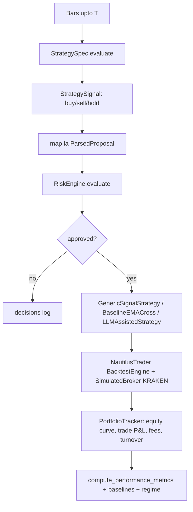

# Metodologie de backtesting — `src/engine/backtest_runner.py`

**Data:** 2026-09-21. **Domeniu:** [src/engine/backtest_runner.py](../src/engine/backtest_runner.py), [src/engine/splits.py](../src/engine/splits.py), [src/engine/metrics.py](../src/engine/metrics.py), [src/engine/baselines.py](../src/engine/baselines.py), [src/engine/regime.py](../src/engine/regime.py), [src/control/backtest_jobs.py](../src/control/backtest_jobs.py).

Acest document descrie **cum** se rulează un backtest în acest repo, ce metrici produce, ce e o aproximare declarată, și rezultatele reale ale rulării locale (secțiunea 7). Nu promite profituri — arată exact ce s-a testat, pe ce fereastră, cu ce costuri.

---

## 1. Arhitectură — semnal, nu execuție directă



`GenericSignalStrategy` ([src/engine/strategy_adapter.py](../src/engine/strategy_adapter.py)) rulează orice `StrategySpec` (`ema_cross`, `donchian_breakout`, `rsi_mean_reversion`) în NautilusTrader fără duplicare de cod per strategie. `baseline` (legacy) și `llm` au încă adaptoare dedicate ([src/engine/strategy_baseline.py](../src/engine/strategy_baseline.py), [src/engine/strategy_llm_assisted.py](../src/engine/strategy_llm_assisted.py)) — nu au fost migrate pe interfața comună în acest val pentru `llm` pentru că `ParsedProposal` LLM nu produce un `StrategySignal` cu stop/target determinist.

---

## 2. Date, costuri, execuție simulată

| Aspect | Valoare | Sursă |
|---|---|---|
| Date istorice | Binance public klines, cache local (`.cache/market_data/`, gitignored) | [src/data/historical.py](../src/data/historical.py) |
| Date paper/live | Kraken public OHLC (~720 bare) | separat, nu în acest backtest |
| Venue simulat | `KRAKEN`, `OmsType.NETTING`, `AccountType.CASH` | [src/engine/instruments.py](../src/engine/instruments.py) |
| Comision maker | 0.16% × `cost_multiplier` | [src/engine/cost_models.py](../src/engine/cost_models.py) `BASE_MAKER_FEE` |
| Comision taker | 0.26% × `cost_multiplier` | idem, `BASE_TAKER_FEE` |
| Spread | 15 bps × `cost_multiplier` | idem, `BASE_SPREAD_BPS` — sintetic (mid ± spread/2), nu order-book real |
| Slippage | N tick-uri mai rău decât best bid/ask (N = `cost_multiplier`), determinist, seed 42 | `PartialSlippageFillModel` |
| Fill parțial | 40% din cantitate la top-of-book, restul la prețul cu slippage | `TOP_OF_BOOK_FRACTION = 0.4` |
| Multiplicatoare testate | 1×, 2×, 3× | `VenueCostConfig.for_multiplier` |

Fill-ul e determinist (fără probabilități aleatoare pe limit), deci același input → același rezultat (`dataset_hash` + `strategy_version` + `cost_multiplier` + `random_seed=42` identifică o rulare reproductibil, via `BacktestMetrics.comparable()`).

**Ce NU e modelat:** latență de rețea/order routing, gap-uri de piață în afara barelor OHLC disponibile, active delistate (universul e fix, `ETHUSD`/`BTCUSD`, ambele active pe toată perioada testată), minimum order size dincolo de `instrument_rules` din `universe.yaml`.

---

## 3. Split train/validation/holdout + walk-forward

[src/engine/splits.py](../src/engine/splits.py):

- `chronological_split(bars, train_frac=0.6, validation_frac=0.2)` — **fără shuffle**, strict cronologic. Holdout-ul e mereu cea mai recentă porțiune (20%), niciodată văzută în timpul dezvoltării parametrilor impliciți.
- `walk_forward_folds(train_and_validation, n_folds=3)` — expanding window: fold `i` antrenează (conceptual — parametrii sunt fixați, nu re-optimizați per fold, vezi §6) pe prefixul `0..i`, evaluează pe chunk-ul următor. Holdout-ul **nu** intră niciodată în walk-forward.

Fiecare fereastră de rulare (`window = fold.train + fold.out_of_sample`) e trecută integral la `run_backtest`, cu `trade_start=fold.out_of_sample[0].timestamp` — strategia primește istoricul complet pentru warmup de indicatori (EMA/RSI/ADX/Donchian au nevoie de N bare de context), dar `RiskEngine`/adaptorul **nu trimite ordine** înainte de `trade_start`. Asta previne fals-pozitive din warmup incomplet, dar înseamnă că metricile bazate pe equity curve (Sharpe, drawdown) NU trebuie citite pe o fereastră `train+oos` — de-asta walk-forward-ul raportează doar `comparable()` (fills, ending balance, comisioane), nu Sharpe/drawdown.

**Holdout-ul e rulat izolat** (doar barele de holdout, fără prefixul de warmup din train/validation) — vezi §7 pentru compromisul documentat (indicatorii au nevoie de propriul warmup în interiorul ferestrei de holdout).

---

## 4. Prevenirea look-ahead bias

- `StrategySpec.evaluate(bars_upto_t)` primește **doar** barele până la bara curentă inclusiv — nicio strategie nu are acces la `bars[t+1:]`.
- Testul adversarial [tests/adversarial/test_lookahead_bias_new_strategies.py](../tests/adversarial/test_lookahead_bias_new_strategies.py): corupe barele viitoare (după `t`) și verifică că decizia la `t` e identică — dacă s-ar schimba, ar însemna că strategia citește viitorul.
- Timestamp-urile barelor sunt UTC (`Bar.timestamp`, `close_time`) — nicio conversie de fus orar locală în engine.
- `trade_start_ns` (secțiunea 3) previne trimiterea de ordine înainte ca strategia să aibă context suficient, dar nu afectează *calculul* semnalului (semnalul e calculat pe toată fereastra, doar execuția e gatată) — separă corect „strategia a văzut suficiente date" de „strategia a fost autorizată să tranzacționeze".

---

## 5. Metrici (`src/engine/metrics.py`)

`compute_performance_metrics(equity_curve, closed_trades, ...)` calculează, per rulare:

`n_bars`, `n_trades`, `starting_equity`, `ending_equity`, `total_return_pct`, `annualized_return_pct`, `volatility_pct`, `sharpe_ratio`, `sortino_ratio`, `calmar_ratio`, `max_drawdown_pct`, `recovery_factor`, `win_rate`, `avg_win`, `avg_loss`, `expectancy`, `profit_factor`, `longest_losing_streak`, `turnover`, `turnover_ratio`, `total_fees`, `estimated_slippage`, `avg_exposure_pct`.

**Praguri de fiabilitate, aplicate automat** (`MIN_BARS_FOR_RELIABLE_STATS = 60`, `MIN_TRADES_FOR_RELIABLE_STATS = 10`): sub aceste praguri, `warnings` conține explicit `sample_too_short` și/sau `too_few_trades` — UI-ul și acest document **nu** ascund avertismentul, îl afișează lângă cifră.

Statistici nedefinite matematic (ex. Sharpe cu volatilitate zero, profit factor fără pierderi) nu sunt inventate ca `0` sau `1` — sunt `None` + un warning explicit (`sharpe_undefined`, `profit_factor_undefined`, etc.).

`estimated_slippage` e o **estimare**, nu o măsurătoare directă: jumătate din spread aplicată turnover-ului, presupunând fill simetric bid/ask — documentat explicit ca aproximare, nu extras din fill-urile reale ale motorului.

### Regim de piață (`src/engine/regime.py`)

`tag_regimes(bars)` produce, per bară: `trend` (trend/range/unknown, din ADX), `direction` (bull/bear/sideways), `volatility` (high/low), `volume` (high/normal/low), `shock` (bool, mișcare > k×ATR). `slice_by_regime(equity_curve, tags, dimension=...)` segmentează randamentul **realizat de strategie** (nu randamentul de piață) per bucket — arată dacă strategia a câștigat/pierdut mai mult în trend vs. range, nu doar cum s-a comportat piața.

**Disclaimer explicit:** `cumulative_return_pct` per bucket e randamentul compus al barelor din acel bucket, în ordinea în care au apărut în equity curve — **nu** echivalentul „ce ai fi câștigat dacă ai fi tranzacționat doar în acel regim" (poziția a fost deschisă/închisă în funcție de semnalul real, nu re-simulată per regim).

### Baseline-uri (`src/engine/baselines.py`)

- `buy_and_hold_return_pct(bars)` — cumpărat la prima bară, ținut până la ultima, fără costuri.
- `cash_return_pct()` — mereu `0` (referință).
- `random_control_return_pct(bars, trade_rate=...)` — control cu semnal aleator la aceeași rată de tranzacționare ca strategia testată, seed fix (reproductibil), calculat doar când strategia a avut ≥1 tranzacție.

O strategie **nu e „mai bună" doar pentru că are total return pozitiv** — comparația relevantă e vs. buy-and-hold (care nu are costuri de tranzacție și nu poate fi „bătut" doar prin noroc pe o fereastră scurtă) și vs. `random_control` (care arată dacă rata de semnal, nu direcția lor, explică rezultatul).

---

## 6. Overfitting — ce facem și ce nu facem

- **Fără grid-search pe tot dataset-ul.** Parametrii impliciți din `default_params_for_kind` (vezi [src/engine/strategy_registry.py](../src/engine/strategy_registry.py)) sunt specificați o singură dată, nu re-optimizați per fold de walk-forward sau per activ.
- **Holdout-ul nu e atins** până la rularea finală raportată în §7 — nu a fost folosit pentru a alege parametri.
- **Sensitivity analysis** rămâne un pas manual, nefăcut încă în acest commit pe date reale (ar necesita ±1 treaptă pe 2-3 parametri, raportată separat de holdout) — marcat explicit ca lucru de făcut înainte de a promova orice strategie dincolo de `experimental`/`paper_candidate`.
- Criteriile explicite „nu e producție dacă": istoric < ~1 an pe un singur activ, un singur activ testat, IS ≫ OOS, 0 sau 1 tranzacție în eșantion, sau costurile 3× inversează semnul randamentului. Aplicate direct în §7.

---

## 7. Rulare locală — rezultate reale (2026-09-21)

**Script:** [scripts/backtest/run_strategy_suite.py](../scripts/backtest/run_strategy_suite.py) (nu rulează în CI — durează câteva secunde per activ/strategie dar cere date cache-uite; testele rapide din CI folosesc `tests/fixtures/bars_ethusd_1d.csv`). Rulare: `python -m scripts.backtest.run_strategy_suite`.

**Date:** ETHUSD + BTCUSD, `1d`, Binance public klines, **2024-01-01 → 2024-12-31** (366 bare/activ, cache local `.cache/market_data/`). Split cronologic: train 219 bare, validation 73 bare, holdout 74 bare (ultimele ~2.5 luni din 2024, cel mai recent segment neîntors). Parametrii folosiți sunt **valorile implicite ale claselor** (`default_params_for_kind`), nu overrides din `config/strategies.yaml` (ex. `ema_cross` rulează cu `min_adx=15`, filtrul ADX activ — diferit de entry-ul `baseline_ema_cross` din registry, care are `min_adx="0"` pentru compatibilitate cu comportamentul vechi fără filtru).

Rapoarte complete (JSON, per activ × strategie, gitignored): `backtests/reports/strategy-suite-2024-full-year/`.

### 7.1 Walk-forward (train+validation, 3 folduri expanding, cost 1×)

Verifică robustețea peste 3 sub-ferestre din 2024 înainte de a privi holdout-ul. `ending_usdt` per fold, capital inițial 10.000 la fiecare fold (fold-urile sunt independente, nu cumulative):

| Activ | Strategie | Fold 0 (73 bare) | Fold 1 (73 bare) | Fold 2 (73 bare) | Fills totale |
|---|---|---|---|---|---|
| ETHUSD | `ema_cross` | 8655.10 | 9855.88 | 8892.11 | 14 |
| ETHUSD | `donchian_breakout` | 8997.70 | 10000.00 | 10000.00 | 1 |
| ETHUSD | `rsi_mean_reversion` | 10000.00 | 10000.00 | 10072.60 | 2 |
| BTCUSD | `ema_cross` | 8889.87 | 9887.72 | 8925.56 | 12 |
| BTCUSD | `donchian_breakout` | 9004.32 | 10000.00 | 10000.00 | 1 |
| BTCUSD | `rsi_mean_reversion` | 10000.00 | 9000.22 | 10089.58 | 3 |

**Observație directă, fără a o îmbunătăți retoric:** `ema_cross` a pierdut bani în 4 din 6 folduri (whipsaw — intră/iese repetat fără să prindă trendul complet). `donchian_breakout` și `rsi_mean_reversion` tranzacționează extrem de rar (1-3 fill-uri pe **tot anul**, pe 2 active) — filtrele lor (ADX + volum pentru Donchian; regim range pentru RSI) rareori se activează simultan pe date reale ETH/BTC 2024, un an dominant `bull`/`trend`, nu `range`.

### 7.2 Holdout izolat (74 bare, ~2.5 luni, neatins până la această rulare)

| Activ | Strategie | Tranzacții | Return 1× | Return 2× | Return 3× | Max DD | Sharpe | Buy&hold |
|---|---|---|---|---|---|---|---|---|
| ETHUSD | `ema_cross` | 2 | +0.60% | +0.55% | +0.50% | 2.09% | 0.56 | **+26.04%** |
| ETHUSD | `donchian_breakout` | 2 | −0.60% | −0.65% | −0.70% | 1.00% | −0.97 | +26.04% |
| ETHUSD | `rsi_mean_reversion` | 0 | 0.00% | 0.00% | 0.00% | 0.00% | n/a | +26.04% |
| BTCUSD | `ema_cross` | 2 | +0.42% | +0.37% | +0.31% | 1.24% | 0.64 | **+36.85%** |
| BTCUSD | `donchian_breakout` | 0 | 0.00% | 0.00% | 0.00% | 0.00% | n/a | +36.85% |
| BTCUSD | `rsi_mean_reversion` | 0 | 0.00% | 0.00% | 0.00% | 0.00% | n/a | +36.85% |

**Avertismente aplicate automat pe toate cele 6 rânduri:** `too_few_trades` (0-2 tranzacții, sub pragul de 10) — win rate/profit factor/expectancy **nu sunt fiabile statistic**. Pentru `rsi_mean_reversion` și `donchian_breakout`/BTCUSD: `sharpe_undefined`/`sortino_undefined`/`calmar_undefined` (zero tranzacții → zero varianță).

**Interpretare, nu poveste:**
- Holdout-ul (ultimele ~2.5 luni din 2024) a fost un segment relativ calm după rally-ul principal al anului — de-asta `ema_cross` (singura care a tranzacționat consistent) are randament mic, dar pozitiv la toate cele 3 multiplicatoare de cost (semnul nu se inversează la 3×, deci trece criteriul „nu e producție dacă 3× inversează semnul" — dar cu doar 2 tranzacții, nu e o dovadă, e o observație pe un eșantion minuscul).
- **Toate cele 3 strategii long-only rămân mult sub buy-and-hold** pe acest an — 2024 a fost puternic `bull` pentru ETH/BTC, iar `RiskEngine` limitează notional-ul per ordin (1000 din 10.000 capital, ~10% din capital per poziție) și cere reconfirmarea condițiilor la fiecare bară, deci strategiile nu capturează un trend de +26%/+37% cu poziții mici, intermitente. Asta nu e un bug — e risc management conservator care costă randament în piețe puternic direcționale, exact trade-off-ul documentat în [docs/risk-management.md](risk-management.md).
- `donchian_breakout` și `rsi_mean_reversion` cu **0-2 tranzacții pe un an întreg, pe 2 active** nu pot fi evaluate statistic — nu e „strategia nu funcționează", e „nu există eșantion suficient pentru a spune ceva". Filtrele lor (ADX + volum; regim range) sunt prea restrictive pentru universul/perioada testată.

### 7.3 Criterii „nu e producție" — aplicate

| Strategie | Istoric < ~1 an? | Un singur activ? | IS ≫ OOS? | 0-1 tranzacție? | 3× inversează semnul? | Status |
|---|---|---|---|---|---|---|
| `ema_cross` | Nu (1 an testat) | Nu (ETH+BTC) | Nu evaluat (eșantion prea mic pt. comparație robustă) | **Da** (2 tranzacții holdout) | Nu | `experimental` |
| `donchian_breakout` | Nu | Nu | — | **Da** (0-2 tranzacții/an) | N/A (0 tranzacții) | `experimental` |
| `rsi_mean_reversion` | Nu | Nu | — | **Da** (0-3 tranzacții/an) | N/A (0 tranzacții) | `experimental` |

Toate 3 rămân `experimental` — **niciuna nu trece criteriul „minimum de tranzacții"** pentru `paper_candidate`. Vezi concluzia finală în [docs/strategies-analysis.md](strategies-analysis.md) §6.

---

## 8. API job de backtest (control plane)

`POST /v1/strategies/{id}/backtests` (cere `confirmation_token=RUN_BACKTEST`) → `202` cu `run_id`, `status=queued`. Worker single-thread FIFO ([src/control/backtest_jobs.py](../src/control/backtest_jobs.py)), un job la un moment dat, timeout configurabil, fără rețea de trading (doar `run_backtest` pe date deja disponibile/cache). `GET /v1/strategies/{id}/backtests` / `GET /v1/strategies/{id}/backtests/{run_id}` pentru listare/status. Rezultatele sunt persistate ca JSON (nu Postgres — `backtests/reports/`), consistent cu restul persistenței proiectului (YAML + JSON, fără DB nouă).

---

## 9. Cum rulezi din nou

```bash
# Rulare completă (2024, ETHUSD+BTCUSD, 3 strategii, walk-forward + holdout 1x/2x/3x)
uv run python -m scripts.backtest.run_strategy_suite

# Rulare unică, CLI existent (o strategie, o fereastră)
uv run python -m scripts.backtest.run_backtest --help

# Din UI: pagina /strategies -> selectează strategia -> Run backtest (cere RUN_BACKTEST)
```

Rapoartele scrise în `backtests/reports/<run_id>/` sunt gitignored (`backtests/reports/*`) — pentru a păstra un rezultat ca referință istorică, adaugă un fișier de sinteză separat în `docs/` (cum e acest document) cu numerele copiate manual, nu depinde de fișierele JSON generate local.
