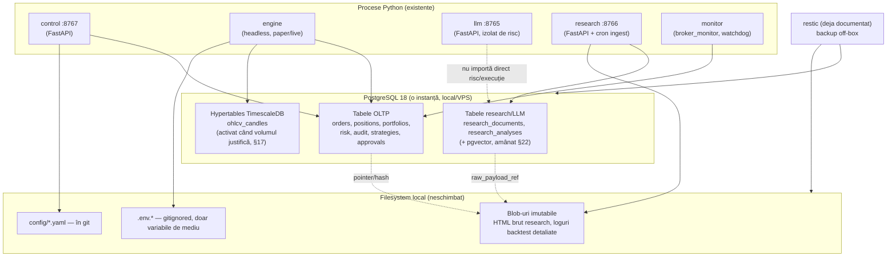
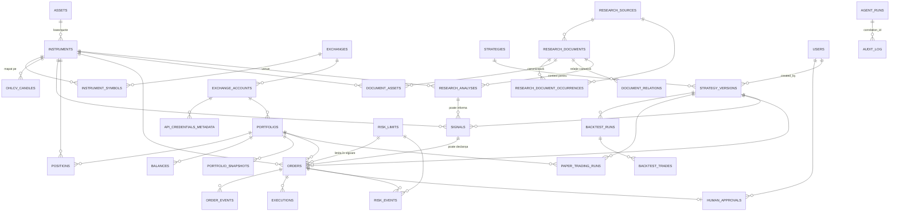
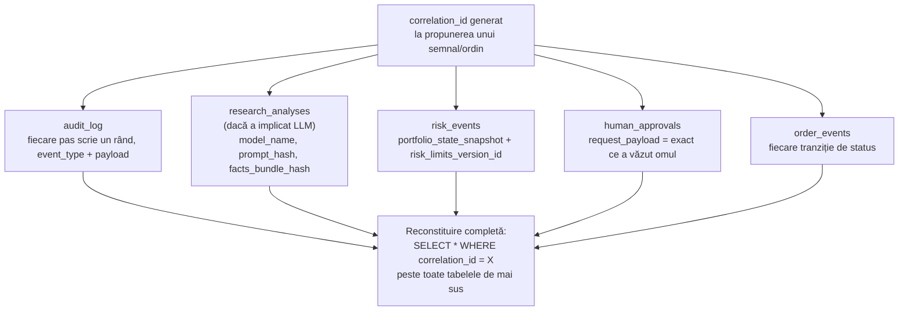

# Design bază de date — trading agent

**Status:** design aprobat, implementat pentru fundația PostgreSQL și cutover-ul reversibil al domeniilor: research; Faza 2 (market data — TimescaleDB, `ohlcv_candles`, backend `files`/`postgres` comutabil; `order_book_snapshots`/`trades` create dar neingerate); Faza 3+4 (portofoliu/execuție/risc — `orders`/`order_events`/`executions`/`risk_events`/`signals`/`positions`/`balances`, backend `files`/`postgres` comutabil via `EXECUTION_STORE_BACKEND`, `deploy/postgres/create_roles.sql` `execution_writer`); Faza 6 (backtesting/paper trading ca entități — `backtest_runs`/`backtest_trades`/`paper_trading_runs`, backend `files`/`postgres` comutabil via `BACKTEST_STORE_BACKEND` (control) și `EXECUTION_STORE_BACKEND` (paper), rol `backtest_writer`, importer idempotent `scripts/db/import_backtests.py`); și Faza 7 (audit/agent/aprobări/alerte/system-events — `agent_runs`, `audit_log`, `agent_actions` (view), `system_events`, `human_approvals`, `alerts`, backend `files`/`postgres` comutabil via `AUDIT_STORE_BACKEND` (control + engine, rol partajat `audit_writer`), importer idempotent `scripts/db/import_audit.py`). Niciun switch de producție a fost comutat pe `postgres` — default rămâne `files`/JSON pentru toate domeniile implementate. Toate cele 7 faze din planul de implementare (§20) sunt acum implementate, nu comutate — Faza 8 ("tăiere fir", comutarea efectivă a căilor de citire) rămâne viitoare.

**Autor:** research + design arhitectural, 2026-09-21.
**Bază de cod analizată:** commit `7006a27a` (branch `main`).

---

## 1. Rezumat executiv

Trading agent-ul are deja, împrăștiată, o bună parte din logica pe care o cere o bază de date reală: contracte Pydantic stricte (`extra="forbid"`), bani ca `Decimal`/string niciodată `float`, timestamp-uri UTC explicite, hash-uri de reproductibilitate (`dataset_hash`, `universe_sha256`, `content_hash`, `prompt_hash`), un jurnal de audit append-only și un flux de aprobare umană. Ce lipsește nu e disciplina — e **un singur loc unde toate astea trăiesc împreună, interogabil, care supraviețuiește unui restart și unei comparații între rulări**.

Astăzi starea e împrăștiată în **6 mecanisme de persistență diferite**: 3 baze SQLite separate și necorelate (`audit.sqlite`, `idempotency.sqlite`, `metadata.db`), fișiere JSON suprascrise atomic (poziții, sold simulat, reconciliere, ultimul bar), fișiere JSONL append-only (discovery), fișiere JSON per-fereastră pentru candles, și directoare de rapoarte per backtest fără index. Niciuna nu vorbește cu celelalte. Nu poți răspunde astăzi, cu o interogare, la „ce poziții am avut acum 3 luni în `runtime/paper-kraken`” — fișierul e suprascris în loc, istoricul nu există.

**Recomandare:** PostgreSQL 18 (auto-găzduit, o singură instanță, local sau pe VPS-ul existent) ca bază de date principală și unică sursă de adevăr, cu extensia **TimescaleDB** (Community Edition, gratuită pentru auto-găzduire) activată pentru tabelele de serii de timp (`ohlcv_candles` în primul rând) când volumul o justifică — nu neapărat din prima zi. Fișierele imutabile mari (HTML brut, loguri de backtest) rămân pe disc, indexate din DB prin pointer — exact pattern-ul deja folosit de `RawDocumentStore`/`MetadataStore` din `src/research/store.py`, generalizat la tot sistemul.

Acest document acoperă research-ul tehnic, decizia arhitecturală, schema logică/fizică pentru **38 de tabele și un view la MVP**, plus 2 tabele de referință amânate (`news_events`, `news_event_documents`), convențiile de bani/timp, idempotență, audit, securitate, retenție și rollout-ul pe faze. Implementarea curentă acoperă fundația și research-ul; restul tabelelor rămân etapizate.

---

## 2. Contextul proiectului

### 2.1 Ce există azi (inspecție de cod)

| Zonă | Tehnologie | Observație |
|---|---|---|
| Backend | Python 3.12, FastAPI 0.141, Pydantic 2.13, `uv` | 4 procese separate: `control` (:8767), `llm` (:8765), `research` (:8766), engine-ul de trading (fără port, headless) |
| Frontend | Angular 21 + PrimeNG 21, TypeScript ~5.9 | consolă operator, consumă contractele din `src/control/models.py` (oglindite manual în `apps/console/src/app/core/models.ts`) |
| Backtesting | `nautilus_trader` 1.231, motor propriu (`src/engine/backtest_runner.py`) | rapoarte scrise ca JSON pe disc, un director per rulare |
| Paper trading | `SimulatedBroker` + `PaperTradingLoop` | stare persistată ca JSON-uri individuale în `runtime/paper*/control/` |
| Live trading | `KrakenLiveBroker` (`src/execution/kraken_live.py`) | doar cont spot Kraken; live e blocat în spate la `LIVE_TRADING_ENABLED` + `LiveKeyPolicy` (subcont, IP whitelist, fără withdraw) |
| Exchange/broker | **Kraken** (singurul venue de execuție azi) | Binance = doar backfill istoric opțional (`DEFAULT_HISTORICAL_SOURCE`), IBKR = placeholder în `universe.yaml` pentru Faza 2 (echități), niciun cod de execuție încă |
| Market data | REST public Kraken OHLC, poll, fără WebSocket | cache local ca fișier JSON per `(instrument, timeframe, start, end)` (`src/data/cache.py`) |
| Research/LLM | Ollama local (`qwen3:8b`), SQLite (`data/research/metadata.db`) | schema SQLite deja bine proiectată (dedup pe `content_hash`, relații `contradicts`/`duplicate_of`) |
| Audit | SQLite append-only, `src/audit/audit_log.py` | un singur tabel generic `audit_events(id, timestamp, correlation_id, event_type, payload)` |
| Idempotență ordine | SQLite (`src/execution/idempotency_store.py`) | rezervare `client_order_id` înainte de submit |
| Config | YAML în git (`config/*.yaml`) | `strategies.yaml`, `risk_limits.yaml`, `universe.yaml`, `discovery_filters.yaml`, `research_sources.yaml`, `sec_cik.yaml` |
| Secrete | doar variabile de mediu (`.env.*`, gitignored) | `redact_secrets()`, separare explicită chei paper/live/monitor (`src/execution/key_policy.py`) — **niciun secret în cod sau în vreo bază de date azi** |
| Joburi programate | un singur cron (`deploy/cron/research-ingest.cron`, la 6h) | fără APScheduler/Celery; conform `docs/SERVER_DEPLOYMENT_AUDIT.md`, nu există alt scheduler |
| Deploy | systemd units + nginx + restic (README în `deploy/backup/`) | recent adăugate, netestate încă în producție |

### 2.2 Ce date sunt deja stocate (persistă la restart)

Din `docs/SERVER_DEPLOYMENT_AUDIT.md` §Persistence (audit independent, confirmat prin citirea codului sursă):

- **Audit trail** — `runtime/.../audit/audit.sqlite` (SQLite WAL, INSERT-only)
- **Idempotență ordine** — `runtime/.../execution/idempotency.sqlite`
- **Halt/kill switch** — `runtime/.../control/halt.flag` (JSON atomic)
- **Heartbeat, last bar, poziții locale, broker simulat, tracker portofoliu, reconciliere** — fișiere JSON individuale, rescrise complet la fiecare update (`write_text_atomic`, temp+`os.replace`)
- **Aprobări umane** — fișiere JSON per cerere/decizie în `control/approvals/`
- **Research metadata** — `data/research/metadata.db` (SQLite, schema relațională reală)
- **Research blobs** — fișiere HTML/text brute, imutabile, cheie = hash
- **Discovery** — `data/discovery/YYYY-MM-DD.jsonl`, append-only
- **Market data cache** — `.cache/`, JSON per fereastră, gitignored, reconstruibil
- **Config** — `config/*.yaml`, în git

### 2.3 Ce se pierde sau e inconsistent (răspunsul explicit la cerința din research)

1. **Poziții și stare de portofoliu istorice se pierd.** `local_positions.json`, `simulated_broker.json`, `paper_tracker.json` sunt suprascrise complet la fiecare actualizare — nu există istoric de poziții, doar starea curentă. Nu poți reconstitui „ce poziție aveam acum 2 săptămâni”.
2. **Contoarele circuit-breaker (erori/pierderi consecutive) sunt in-memory, per proces** — resetate la orice restart, chiar dacă flag-ul de halt persistă separat (`src/risk/circuit_breaker.py`, confirmat în audit-ul de deployment).
3. **4 directoare `runtime/paper*` necorelate** (`paper`, `paper-kraken`, `paper-csv`, `paper-faza5`) reprezintă de fapt 4 rulări/scenarii diferite de paper trading, dar nu există niciun tabel care să le lege — sunt foldere izolate, comparabile doar manual.
4. **Rapoartele de backtest** sunt directoare JSON separate (`backtests/reports/<run_id>/*.json`), fără index — a găsi „toate rulările pe ETHUSD din ultima lună” înseamnă parcurgere de fișiere.
5. **6 mecanisme de persistență diferite** pentru date conceptual similare (stare append-only): SQLite (audit, idempotență, research), JSON suprascris (poziții, broker, reconciliere), JSONL append (discovery), JSON per-fereastră (cache market data). Fiecare are propriile reguli de atomicitate, fără tranzacții comune — o eroare la jumătatea unui update poate lăsa `local_positions.json` și `paper_tracker.json` needincronizate (nicio tranzacție care le leagă).
6. **Fereastra `reserve` → `store_result` în idempotența de execuție** (`src/execution/idempotency_store.py`) nu e închisă printr-o confirmare de la exchange dacă procesul moare exact în acel interval — semnalat deja ca risc HIGH în auditul de deployment.
7. **`research_documents` nu are `data_quality_score`** (cerut explicit de research), nici `raw_payload_ref` persistat lângă metadata — blob-ul brut există pe disc, dar SQLite-ul nu ține un pointer explicit către el.
8. **Limitele de risc (`risk_limits.yaml`) nu au istoric.** Dacă un ordin a fost aprobat cu o anumită limită, iar limita se schimbă ulterior, nu poți reconstitui retroactiv „ce limită era în vigoare la momentul deciziei” — doar valoarea curentă din YAML.
9. **Prompt-urile LLM nu sunt versionate explicit** — `prompt_hash` există în `AnalysisAuditMetadata`, dar nu și un `prompt_version` legat de un registru de prompt-uri; hash-ul singur nu spune „ce s-a schimbat față de rularea trecută”.

Aceste 9 puncte sunt exact gap-urile pe care schema propusă (secțiunea 8) le închide.

---

## 3. Obiective și non-obiective

### Obiective
- O singură sursă de adevăr, interogabilă, pentru: piață, instrumente, portofolii, ordine, execuții, strategii, backtesting, paper trading, semnale, research/LLM, risc, audit, aprobări.
- Diferențiere explicită și la nivel de schemă (nu doar de convenție) între: historical/live data, paper/live trading, research/signal/proposed/approved/submitted/executed/cancelled/rejected order.
- Idempotență garantată prin constrângeri UNIQUE, nu prin disciplină de cod.
- Reproductibilitate: orice decizie a agentului (semnal, analiză LLM, ordin) trebuie să poată fi „retrăită” — ce date avea, ce prompt, ce limite de risc, ce preț.
- Auditabilitate completă, append-only pentru evenimente istorice.
- Extensibilitate la stocks/forex și la alte exchange-uri/brokeri fără redesign.
- Rulare 100% locală/pe un singur VPS, fără servicii cloud gestionate obligatorii.

### Non-obiective (explicit, pentru acest document)
- Nu proiectăm pentru scală multi-tenant sau multi-utilizator concurent masiv — un singur operator, eventual câțiva colaboratori.
- Nu proiectăm pentru trading de înaltă frecvență (sub-secundă) — cadența actuală e de ordinul minutelor/orelor.
- Nu alegem un furnizor cloud gestionat (RDS, Cloud SQL etc.) — rularea locală/VPS e cerință explicită.
- Nu proiectăm încă order book L2 la rezoluție completă tick-cu-tick — tabelul există în schemă, dar ingestia e amânată (secțiunea 22).
- Nu implementăm migrațiile, nu instalăm dependențe, nu scriem cod — doar design.

---

## 4. Cerințe funcționale

FR1. Stocare OHLCV crypto azi, extensibilă la stocks/forex fără schimbare de schemă (doar rânduri noi în `assets`/`instruments`).
FR2. Registru de exchange-uri/brokeri și conturi, cu metadate de credențiale, niciodată secretul propriu-zis.
FR3. Portofolii, solduri, poziții — atât „ce crede sistemul local”, cât și „ce raportează exchange-ul”, reconciliabile.
FR4. Ciclul complet al unui ordin: propus → aprobat/respins → trimis → executat (parțial sau complet) → anulat, cu istoric complet de tranziții.
FR5. Execuții (fill-uri) legate 1:N de ordin, cu fee, slippage, preț.
FR6. Strategii versionate; fiecare backtest/paper run/ordin referă o versiune exactă de strategie.
FR7. Backtesting reproductibil: hash de dataset, seed, universul de instrumente folosit, parametri.
FR8. Paper trading ca entitate de prim rang (nu foldere), comparabil între rulări.
FR9. Semnale normalizate, separate de propunerile brute LLM și de analizele de research.
FR10. Documente de research cu proveniență completă (sursă, URL, autor, dată publicare vs. dată colectare), deduplicate pe hash de conținut, cu ocurențe/aliasuri pentru fetch-uri duplicate și relații canonice de contrazicere/confirmare.
FR11. Analize LLM cu metadate de audit complete: model, hash prompt, versiune prompt, hash bundle de fapte, temperatură, versiune schemă, expirare.
FR12. Limite de risc versionate în timp, nu doar valoarea curentă.
FR13. Evenimente de risc (acceptare/respingere ordin, întrerupător de circuit, halt) legate de limita în vigoare la momentul respectiv.
FR14. Aprobări umane cu tot ce a văzut omul la momentul deciziei.
FR15. Alerte cu stare (activă/confirmată/rezolvată).
FR16. Jurnal de audit append-only, imuabil, pentru orice decizie a agentului.
FR17. Evenimente de sistem (operaționale) separate de jurnalul de audit (de tranzacționare).
FR18. Watchlist-uri (implicit prin `assets`/`instruments` + un flag de urmărire — vezi secțiunea 22, amânat ca tabel dedicat).

## 5. Cerințe non-funcționale

NFR1. **Rulare locală** — trebuie să pornească pe un laptop de dezvoltator sau pe VPS-ul curent (2–8 vCPU, 4–16 GB RAM conform `docs/SERVER_DEPLOYMENT_AUDIT.md` §Server Sizing), fără cont cloud.
NFR2. **ACID** pentru orice scriere legată de bani (ordine, execuții, solduri, poziții).
NFR3. **Concurență multi-proces** — control, engine, monitor, research (cron) și eventual backtesting paralel scriu simultan; motorul de bază de date trebuie să tolereze asta fără blocări prelungite.
NFR4. **Precizie zecimală exactă** — niciodată `float`/`double` pentru bani sau cantități.
NFR5. **Interogări analitice** rezonabile pe milioane de rânduri OHLCV (backtesting) fără infrastructură separată de tip data warehouse.
NFR6. **Backup/restore testabil** — restic există deja ca unealtă (`deploy/backup/README.md`); baza de date trebuie să fie backup-abilă cu ea (fișier/volum, nu cluster distribuit).
NFR7. **Migrații versionate**, aplicabile fără downtime lung (sistemul rulează local, downtime scurt e acceptabil, dar migrațiile trebuie să fie reversibile/documentate).
NFR8. **Observabilitate minimă** — health check simplu, dimensiune bază de date, latență query vizibile din `/v1/health` existent.
NFR9. **Cost zero de licență** pentru operare locală.
NFR10. **Portabilitate** — trebuie să poată rula identic pe macOS (dev) și Linux (VPS de producție, conform `deploy/systemd/`).

---

## 6. Opțiunile analizate

Evaluate pe: rulare locală, instalare/mentenanță, time-series, volume mari OHLCV, query-uri analitice, tranzacții ACID, concurență, backtesting, paper/live trading, extensibilitate, vector search, full-text search, backup, migrații, observabilitate, recuperare după erori, cost, complexitate, portabilitate, compatibilitate cu stack-ul actual (Python/FastAPI/SQLite deja folosit).

| Opțiune | Rulare locală | ACID/OLTP | Time-series | Query analitice | Concurență scriitori | Vector/FTS | Complexitate operare | Verdict |
|---|---|---|---|---|---|---|---|---|
| **PostgreSQL** | Excelentă (un singur binar/serviciu) | Da, matur | Ok nativ (partiționare), fără compresie/agregări continue | Bune (planner cost-based, window functions) | Multi-proces, MVCC real | pgvector (extensie), FTS nativ (`tsvector`) | Medie — un serviciu de administrat | **Bază solidă, dar singură nu ține pasul cu volumul OHLCV pe termen lung** |
| **PostgreSQL + TimescaleDB** | Excelentă (extensie peste același Postgres) | Da (moștenit din Postgres) | Nativ: hypertables, compresie 10-20x, agregări continue, politici de retenție | Foarte bune, optimizate pentru serii de timp | La fel ca Postgres | pgvector rulează pe același cluster | Medie — o extensie în plus, upgrade-uri coordonate cu Postgres | **Recomandat** |
| **SQLite** | Cea mai simplă (fișier, zero servicii) | Da, dar **un singur writer la un moment dat, chiar și în WAL** — scriitorii se pun în coadă | Slab — fără partiționare/compresie nativă | Ok pentru volume mici-medii | **Limitată** — sistemul are deja 4+ procese care scriu concurent | Fără nativ, doar prin extensii externe | Minimă | Bun pentru un singur proces (research metadata rămâne aici pe termen scurt), **nu pentru tot sistemul** — exact problema actuală |
| **DuckDB** | Excelentă, embedded | Slab pentru OLTP (nu e gândit pentru multe tranzacții mici concurente) | Bun pentru analytics columnar, nu pentru ingestie continuă | **Excelent** — vectorizat, cel mai rapid pentru backtesting ad hoc | Un writer, mai restrictiv decât SQLite pentru scriere multi-proces | Nu | Minimă ca motor, dar al doilea sistem de administrat | Bun ca **motor satelit read-only** pentru analytics peste export din Postgres, nu ca sistem de înregistrare |
| **InfluxDB** | Da, dar al doilea serviciu | Slab pentru date relaționale (ordine, portofolii) | Foarte bun | Bun pentru time-series pure | Bun pentru scriere de metrici | Nu | Al doilea motor de administrat, model de date diferit (tag/field) | Ar forța o a doua bază pentru tot ce nu e OHLCV — complexitate fără beneficiu clar față de Timescale |
| **ClickHouse** | Posibil, dar greu pentru un singur operator | **Nu** — fără tranzacții ACID reale, UPDATE/DELETE sunt mutații asincrone în fundal, inserțiile recomandate în batch-uri de 1000+ rânduri | Excelent la scară mare | Excelent | Nepotrivit pentru scriere rând-cu-rând (ordine, aprobări) | Nu nativ | Ridicată — de obicei cere infrastructură dedicată | Nepotrivit ca sistem principal; volumul actual/estimat (§17) nu-l justifică |
| **Redis** | Da, foarte simplu | Nu — durabilitate opțională, nu e sistem de înregistrare | Nu | Nu | Excelent pentru stări efemere | Nu | Minimă | Util opțional pentru pub/sub WebSocket sau cache de preț curent, **niciodată sursă de adevăr** |
| **pgvector** | N/A (extensie) | — | — | Vector similarity search | — | Da | Minimă peste Postgres deja instalat | Nu e o bază separată — activăm pe Postgres când research RAG devine cerință reală (amânat, §22) |
| **Arhitectură hibridă (aleasă)** | Da | Da (Postgres e nucleul) | Da (Timescale pe candles) | Da | Da | Da (pgvector, amânat) | Cea mai mică dintre variantele „mai mult decât Postgres singur” | Vezi §7 |

### 6.1 Surse și note de versiune (verificate 2026-09-21)

| Tehnologie | Versiune/compatibilitate relevantă | Limită/risc important | Sursă |
|---|---|---|---|
| PostgreSQL | 18.6 (18 GA din 2025-09-25; 19 în beta) | Upgrade major cere `pg_upgrade`/replicare logică; suportat până ~2030-11 | [postgresql.org/about/news/postgresql-18-released](https://www.postgresql.org/about/news/postgresql-18-released-3142/), [postgresql.org/support/versioning](https://www.postgresql.org/support/versioning/) |
| TimescaleDB | 2.23+ pentru suport PG18 complet (lansat 2025-10-29) | Community Edition = Timescale License (TSL): gratuit pentru auto-găzduire și modificare, **interzis** ca DBaaS revândut; nu instala pe minor-versiuni Postgres cu breaking ABI (17.1/16.5/15.9 etc., corectate în release-ul următor) | [tigerdata.com/legal/licenses](https://www.tigerdata.com/legal/licenses), [github.com/timescale/timescaledb/releases](https://github.com/timescale/timescaledb/releases) |
| pgvector | 0.8.6 (2026-07-29) | Folosește minim 0.8.2 — 0.8.0/0.8.1 au un buffer overflow la HNSW parallel build (CVE-2026-3172) | [postgresql.org/about/news/pgvector-082-released](https://www.postgresql.org/about/news/pgvector-082-released-3245/) |
| DuckDB | 1.5.5 stable / 1.4.5 LTS | API C în schimbare rapidă înainte de 2.0 (așteptat toamna 2026) — dacă e adoptat ca motor satelit, preferă linia LTS | [duckdb.org/2026/06/17/announcing-duckdb-145](https://duckdb.org/2026/06/17/announcing-duckdb-145) |
| SQLite | (versiunea din `python-dotenv`/stdlib, deja în uz) | Un singur writer chiar și în WAL — scriitorii concurenți se serializează sau primesc `SQLITE_BUSY` | [sqlite.org/wal.html](https://www.sqlite.org/wal.html) |
| ClickHouse | — | Fără tranzacții multi-rând reale; UPDATE/DELETE sunt mutații async, nepotrivite pentru stare de ordine/poziții mutabilă frecvent | [clickhouse.com/docs/guides/developer/transactional](https://clickhouse.com/docs/guides/developer/transactional) |

---

## 7. Decizia arhitecturală

**PostgreSQL 18, auto-găzduit, o singură instanță, ca sursă unică de adevăr pentru tot ce e relațional/tranzacțional (ordine, portofolii, risc, audit, strategii, research, LLM).**

**TimescaleDB (Community Edition) activat ca extensie pe același Postgres**, doar pentru tabelele de tip serie-de-timp cu volum mare (`ohlcv_candles`, eventual `order_book_snapshots`/`trades`) — hypertable + compresie + agregări continue pentru downsampling (1m → 5m/15m/1h/1d), în loc să stocăm fiecare granularitate separat.

**Fișierele mari, imutabile, rămân pe disc** (HTML brut de research, loguri detaliate de backtest) — DB ține doar metadate + pointer (hash/cale), exact ca `RawDocumentStore` de azi. Backup-ul le tratează separat (restic, deja documentat).

**Nu introducem al doilea motor de bază de date pentru MVP.** Redis, DuckDB, ClickHouse, InfluxDB rămân opțiuni amânate (§22), nu componente ale arhitecturii inițiale — fiecare ar rezolva o problemă pe care volumul actual/estimat (§17) nu o are încă, la costul unui al doilea sistem de backup/monitorizare/upgrade.

### De ce nu variantele alternative

- **Doar SQLite (status quo generalizat)** — ar fixa exact problema pe care vrem s-o rezolvăm: un singur writer la un moment dat, în timp ce sistemul are deja 4+ procese (control, engine, monitor, research cron) care scriu concurent. Bun pentru un singur proces izolat (poate rămâne așa pentru cache-uri locale efemere), nepotrivit ca sistem central.
- **DuckDB ca principal** — excelent pentru interogări analitice ad hoc, slab pentru multe tranzacții mici concurente (aprobare ordin, fill, actualizare poziție) — exact tipul de scriere pe care sistemul îl face cel mai des.
- **ClickHouse/InfluxDB ca principal** — optimizate pentru inserții masive append-only, dar fără tranzacții ACID reale pe rânduri individuale; ar forța o a doua bază (Postgres) pentru ordine/portofolii oricum, deci nu simplifică nimic.
- **Redis ca sursă de adevăr** — nu e conceput pentru durabilitate garantată; util opțional ca strat efemer (pub/sub pentru WebSocket-urile consolei), niciodată ca sistem de înregistrare pentru bani.
- **Arhitectură complet hibridă (Postgres + ClickHouse + Redis + …)** — complexitate operațională nejustificată pentru un singur operator, volum estimat de ordinul zecilor-sutelor de milioane de rânduri pe 5 ani (§17), nu miliarde.

### Responsabilitatea fiecărei componente (arhitectura aleasă)



---

## 8. Schema entităților

Convenții aplicate uniform (detaliate în §10):
- Bani/cantități: `NUMERIC` (fără scală fixă unde instrumentele diferă mult — crypto poate cere până la 18 zecimale; niciodată `FLOAT`/`DOUBLE PRECISION`).
- Timp: `TIMESTAMPTZ`, întotdeauna UTC.
- Chei: `UUID` pentru entități tranzacționale (ordine, execuții, rulări), `TEXT` pentru chei naturale deja stabile în cod (`doc_id` = sha256 hex, `strategy_id` = slug), `BIGSERIAL`/`IDENTITY` pentru jurnale append-only de volum mare.
- `extra=forbid` la nivel Pydantic se traduce în DB prin `CHECK` pe enumerări (TEXT + CHECK, nu `ENUM` nativ — la fel ca `src/research/store.py` deja, pentru migrare fără `ALTER TYPE`).

Tabelele marcate **(nou)** nu au corespondent direct azi; restul generalizează o structură deja existentă în cod/SQLite/JSON.

### 8.1 Identitate, exchange-uri, credențiale

**`users`** — operatori umani. Azi sistemul are un singur operator (`CONTROL_OPERATOR_TOKEN` static); tabelul există pentru ca `decided_by`/`created_by` să lege de o persoană reală, nu doar de un string liber.

```sql
CREATE TABLE users (
    user_id      UUID PRIMARY KEY DEFAULT gen_random_uuid(),
    username     TEXT NOT NULL UNIQUE,
    role         TEXT NOT NULL CHECK (role IN ('operator', 'observer')),
    is_active    BOOLEAN NOT NULL DEFAULT true,
    created_at   TIMESTAMPTZ NOT NULL DEFAULT now()
);
```
Retenție: permanent. Mutabil (`is_active`, `role`). Relații: referit de `human_approvals`, `agent_runs.created_by`, `risk_limits.changed_by`.

**`exchanges`** — registru de exchange-uri/brokeri, indiferent dacă au execuție azi.

```sql
CREATE TABLE exchanges (
    exchange_id              SERIAL PRIMARY KEY,
    code                     TEXT NOT NULL UNIQUE,        -- 'KRAKEN', 'BINANCE', 'IBKR'
    name                     TEXT NOT NULL,
    kind                     TEXT NOT NULL CHECK (kind IN ('crypto_exchange', 'broker')),
    supports_execution       BOOLEAN NOT NULL DEFAULT false,
    supports_historical_data BOOLEAN NOT NULL DEFAULT false,
    api_base_url             TEXT,
    status                   TEXT NOT NULL DEFAULT 'active' CHECK (status IN ('active', 'disabled')),
    created_at               TIMESTAMPTZ NOT NULL DEFAULT now()
);
```
Seed inițial: `KRAKEN` (execuție+istoric), `BINANCE` (doar istoric, conform `DEFAULT_HISTORICAL_SOURCE`), `IBKR` (placeholder, `supports_execution=false` până la Faza 2 echități). Retenție: permanent, rar modificat.

**`exchange_accounts`** — un cont = exchange + mod de tranzacționare + scop (spot/futures), oglindește distincțiile deja făcute în `src/execution/key_policy.py` (`KRAKEN_SPOT_*` vs `KRAKEN_FUTURES_*` vs `KRAKEN_FUTURES_DEMO_*`).

```sql
CREATE TABLE exchange_accounts (
    exchange_account_id   UUID PRIMARY KEY DEFAULT gen_random_uuid(),
    exchange_id           INT NOT NULL REFERENCES exchanges(exchange_id),
    label                 TEXT NOT NULL,
    trading_mode          TEXT NOT NULL CHECK (trading_mode IN ('paper', 'live')),
    scope                 TEXT NOT NULL CHECK (scope IN ('spot', 'futures', 'futures_demo')),
    subaccount            BOOLEAN NOT NULL DEFAULT false,
    ip_whitelist_configured BOOLEAN NOT NULL DEFAULT false,
    withdraw_enabled      BOOLEAN NOT NULL DEFAULT false,
    is_active             BOOLEAN NOT NULL DEFAULT true,
    created_at            TIMESTAMPTZ NOT NULL DEFAULT now(),
    UNIQUE (exchange_id, trading_mode, scope, label)
);
```
`withdraw_enabled=true` pentru un cont `live` ar trebui blocat de aceeași politică deja implementată în `assert_live_key_policy` — regula rămâne în cod (aplicație), tabelul doar înregistrează atestarea. Retenție: permanent.

**`api_credentials_metadata`** — **niciodată secretul**. Doar numele variabilei de mediu unde trăiește secretul, scopul, și metadate de rotație. Secretul propriu-zis rămâne exact unde e azi: în `.env.*`, citit de proces, niciodată scris în DB.

```sql
CREATE TABLE api_credentials_metadata (
    credential_id        UUID PRIMARY KEY DEFAULT gen_random_uuid(),
    exchange_account_id  UUID NOT NULL REFERENCES exchange_accounts(exchange_account_id),
    env_var_name          TEXT NOT NULL,        -- 'KRAKEN_SPOT_API_KEY', pointer, nu valoare
    key_scope             TEXT NOT NULL CHECK (key_scope IN ('read_only', 'paper_trading', 'live_trading')),
    last_rotated_at        TIMESTAMPTZ,
    last_verified_present_at TIMESTAMPTZ,   -- ultima dată când procesul a confirmat că env var e setat
    created_by            UUID REFERENCES users(user_id),
    created_at             TIMESTAMPTZ NOT NULL DEFAULT now(),
    revoked_at             TIMESTAMPTZ
);
```

**`secret_access_log`** — **(nou, adăugat față de lista inițială, justificat explicit de cerința §5 "audit pentru accesarea secretelor")**. Append-only, minim: cine/ce proces a confirmat prezența unei chei și când — nu loghează niciodată valoarea.

```sql
CREATE TABLE secret_access_log (
    id            BIGSERIAL PRIMARY KEY,
    credential_id UUID NOT NULL REFERENCES api_credentials_metadata(credential_id),
    accessed_by   TEXT NOT NULL,     -- nume proces: 'engine', 'control', 'monitor'
    accessed_at   TIMESTAMPTZ NOT NULL DEFAULT now(),
    purpose       TEXT NOT NULL      -- 'startup_check', 'live_order_submit', ...
);
```
Retenție: 1 an, apoi arhivat (nu e critic pentru investigații pe termen lung, dar util pentru incident response imediat).

### 8.2 Active și instrumente

**`assets`** — activul de bază, agnostic de venue (`BTC`, `ETH`, `AAPL`, `USD`).

```sql
CREATE TABLE assets (
    asset_id     SERIAL PRIMARY KEY,
    symbol       TEXT NOT NULL UNIQUE,     -- 'BTC', 'AAPL', 'USD'
    asset_class  TEXT NOT NULL CHECK (asset_class IN ('crypto', 'equity', 'fx', 'cash')),
    name         TEXT NOT NULL,
    decimals     SMALLINT,                  -- precizie nativă (ex. 18 pentru multe token-uri ERC-20)
    created_at   TIMESTAMPTZ NOT NULL DEFAULT now()
);
```

**`instruments`** — perechea/instrumentul tranzacționabil, agnostic de venue de execuție. Mirroring direct pentru `InstrumentRules` din `src/risk/portfolio_state.py` și `universe.yaml`.

```sql
CREATE TABLE instruments (
    instrument_id     UUID PRIMARY KEY DEFAULT gen_random_uuid(),
    base_asset_id      INT NOT NULL REFERENCES assets(asset_id),
    quote_asset_id      INT REFERENCES assets(asset_id),   -- NULL pt. echități cu quote implicit USD
    asset_class        TEXT NOT NULL CHECK (asset_class IN ('crypto', 'equity', 'fx')),
    canonical_symbol    TEXT NOT NULL UNIQUE,   -- 'ETHUSD', 'AAPL'
    min_notional        NUMERIC NOT NULL DEFAULT 1,
    lot_size             NUMERIC NOT NULL DEFAULT 1,
    tick_size            NUMERIC NOT NULL DEFAULT 0.01,
    status               TEXT NOT NULL DEFAULT 'active' CHECK (status IN ('active', 'inactive')),
    created_at           TIMESTAMPTZ NOT NULL DEFAULT now()
);
```
Sursa acestor rânduri la MVP: import din `config/universe.yaml` (§18 — script de seed, nu migrație de schemă).

**`instrument_symbols`** — mapare per-venue, generalizează `UNIVERSE_TO_KRAKEN` din `src/data/venue_registry.py` și distincția `execution_venue` (`KRAKEN`) vs. `historical_source` (`BINANCE`).

```sql
CREATE TABLE instrument_symbols (
    instrument_symbol_id SERIAL PRIMARY KEY,
    instrument_id         UUID NOT NULL REFERENCES instruments(instrument_id),
    exchange_id            INT NOT NULL REFERENCES exchanges(exchange_id),
    venue_symbol           TEXT NOT NULL,       -- 'XETHZUSD' sau 'ETHUSD', cum raportează venue-ul
    role                   TEXT NOT NULL CHECK (role IN ('execution', 'historical_backfill', 'both')),
    is_primary             BOOLEAN NOT NULL DEFAULT true,
    UNIQUE (instrument_id, exchange_id, role)
);
CREATE INDEX idx_instrument_symbols_venue ON instrument_symbols(exchange_id, venue_symbol);
```

### 8.3 Market data

**`market_data_sources`** — de unde vine OHLCV-ul (distinct de sursele de research/știri, care rămân sub `research_documents`).

```sql
CREATE TABLE market_data_sources (
    source_id      SERIAL PRIMARY KEY,
    name           TEXT NOT NULL UNIQUE,        -- 'kraken_public_ohlc', 'binance_public_klines'
    exchange_id     INT REFERENCES exchanges(exchange_id),
    kind            TEXT NOT NULL CHECK (kind IN ('rest_public', 'rest_authenticated', 'websocket', 'vendor_bulk')),
    requires_auth    BOOLEAN NOT NULL DEFAULT false,
    rate_limit_per_min INT,
    active           BOOLEAN NOT NULL DEFAULT true
);
```

**`ohlcv_candles`** — nucleul volumului. Sursă de adevăr e granularitatea cea mai fină ingerată (ex. 1m); timeframe-urile mai mari sunt agregări continue TimescaleDB, nu rânduri separate stocate manual (vezi §11).

```sql
CREATE TABLE ohlcv_candles (
    source_id       INT NOT NULL REFERENCES market_data_sources(source_id),
    instrument_id    UUID NOT NULL REFERENCES instruments(instrument_id),
    timeframe        TEXT NOT NULL,             -- '1m', '5m', '1h', '1d' — vezi §11 pt. ce se stochează efectiv
    open_time        TIMESTAMPTZ NOT NULL,
    open             NUMERIC NOT NULL,
    high             NUMERIC NOT NULL,
    low              NUMERIC NOT NULL,
    close            NUMERIC NOT NULL,
    volume           NUMERIC NOT NULL,
    trade_count      INT,
    is_final         BOOLEAN NOT NULL DEFAULT true,   -- false = candela curentă, încă deschisă
    ingested_at      TIMESTAMPTZ NOT NULL DEFAULT now(),
    updated_at       TIMESTAMPTZ NOT NULL DEFAULT now(),
    PRIMARY KEY (source_id, instrument_id, timeframe, open_time)
);
SELECT create_hypertable('ohlcv_candles', 'open_time', chunk_time_interval => INTERVAL '7 days');
CREATE INDEX idx_candles_instrument_tf_time ON ohlcv_candles (instrument_id, timeframe, open_time DESC);
```
**Idempotență:** `UPSERT ... ON CONFLICT (source_id, instrument_id, timeframe, open_time) DO UPDATE` — o candelă re-ingerată (ex. corecție late-arriving) actualizează în loc, nu duplică (§13). Mutabil doar cât `is_final=false`; o dată închisă, se schimbă doar printr-un flux explicit de corecție logat în `system_events`, nu silențios. Append-mostly.

**`order_book_snapshots`** — proiectat, **fără ingestie azi** (sistemul face doar poll REST pe OHLC, fără WebSocket L2). Tabelul există pentru când se adaugă un feed L2; până atunci rămâne gol.

```sql
CREATE TABLE order_book_snapshots (
    id               BIGSERIAL PRIMARY KEY,
    source_id         INT NOT NULL REFERENCES market_data_sources(source_id),
    instrument_id      UUID NOT NULL REFERENCES instruments(instrument_id),
    captured_at        TIMESTAMPTZ NOT NULL,
    best_bid            NUMERIC,
    best_ask            NUMERIC,
    bids                JSONB NOT NULL,     -- [[price, size], ...] top-N nivele
    asks                JSONB NOT NULL,
    sequence_number      BIGINT
);
SELECT create_hypertable('order_book_snapshots', 'captured_at', chunk_time_interval => INTERVAL '1 day');
```
Retenție propusă: 7–30 zile la rezoluție completă (volum mare), apoi doar `best_bid`/`best_ask` păstrat în agregări.

**`trades`** — trade tape public al exchange-ului (tranzacții de piață, **nu** tranzacțiile proprii ale agentului — acelea sunt `executions`). Fără ingestie azi (strategiile curente au nevoie doar de candles); tabelul e mic-cost de a include acum, ingestia e amânată (§22).

```sql
CREATE TABLE trades (
    id               BIGSERIAL PRIMARY KEY,
    source_id         INT NOT NULL REFERENCES market_data_sources(source_id),
    instrument_id      UUID NOT NULL REFERENCES instruments(instrument_id),
    traded_at          TIMESTAMPTZ NOT NULL,
    price               NUMERIC NOT NULL,
    quantity            NUMERIC NOT NULL,
    side                TEXT CHECK (side IN ('buy', 'sell')),
    venue_trade_id       TEXT,
    UNIQUE (source_id, instrument_id, venue_trade_id)
);
SELECT create_hypertable('trades', 'traded_at', chunk_time_interval => INTERVAL '1 day');
```

### 8.4 Portofolii, solduri, poziții

**`portfolios`** — un portofoliu = un container de capital, paper sau live. Cele 4 directoare `runtime/paper*` de azi devin 4 rânduri comparabile.

```sql
CREATE TABLE portfolios (
    portfolio_id        UUID PRIMARY KEY DEFAULT gen_random_uuid(),
    name                 TEXT NOT NULL UNIQUE,      -- 'paper-kraken', 'paper-csv', 'live-kraken-spot'
    trading_mode          TEXT NOT NULL CHECK (trading_mode IN ('paper', 'live')),
    exchange_account_id    UUID REFERENCES exchange_accounts(exchange_account_id),
    base_currency          TEXT NOT NULL DEFAULT 'USD',
    starting_cash           NUMERIC NOT NULL,
    is_active                BOOLEAN NOT NULL DEFAULT true,
    created_at               TIMESTAMPTZ NOT NULL DEFAULT now()
);
```

**`portfolio_snapshots`** — istoric al curbei de echitate, append-only. Înlocuiește lipsa de istorie a `paper_tracker.json`/`simulated_broker.json` de azi (care țin doar starea curentă).

```sql
CREATE TABLE portfolio_snapshots (
    id                        BIGSERIAL PRIMARY KEY,
    portfolio_id               UUID NOT NULL REFERENCES portfolios(portfolio_id),
    as_of                       TIMESTAMPTZ NOT NULL,
    equity                       NUMERIC NOT NULL,
    cash                         NUMERIC NOT NULL,
    realized_pnl                 NUMERIC NOT NULL,
    unrealized_pnl                NUMERIC NOT NULL,
    drawdown                      NUMERIC NOT NULL,
    peak_equity                    NUMERIC NOT NULL,
    exposure_per_instrument         JSONB NOT NULL DEFAULT '{}',
    exposure_per_asset_class         JSONB NOT NULL DEFAULT '{}',
    orders_today                     INT NOT NULL,
    incomplete                        BOOLEAN NOT NULL DEFAULT false,
    UNIQUE (portfolio_id, as_of)
);
SELECT create_hypertable('portfolio_snapshots', 'as_of', chunk_time_interval => INTERVAL '30 days');
```
Cadență propusă: un snapshot la fiecare bar închis (aliniat cu polling-ul existent), plus unul la fiecare eveniment de ordin/execuție.

**`balances`** — sold per activ, per portofoliu — **atât local, cât și raportat de exchange**, exact distincția „sold local vs. sold raportat” cerută explicit; corespunde direct `reconciliation.json` de azi, dar istoric în loc de valoare unică.

```sql
CREATE TABLE balances (
    portfolio_id     UUID NOT NULL REFERENCES portfolios(portfolio_id),
    asset_id          INT NOT NULL REFERENCES assets(asset_id),
    source             TEXT NOT NULL CHECK (source IN ('local_ledger', 'exchange_reported')),
    quantity            NUMERIC NOT NULL,
    reserved_quantity    NUMERIC NOT NULL DEFAULT 0,   -- blocat în ordine deschise
    updated_at            TIMESTAMPTZ NOT NULL DEFAULT now(),
    PRIMARY KEY (portfolio_id, asset_id, source)
);
```
Mutabil (stare curentă). Reconcilierea = query care compară `local_ledger` vs. `exchange_reported` pe aceeași cheie — orice mismatch devine un rând în `risk_events`.

**`positions`** — poziția curentă **și istoricul pozițiilor închise**, spre deosebire de `local_positions.json` care e suprascris.

```sql
CREATE TABLE positions (
    position_id       UUID PRIMARY KEY DEFAULT gen_random_uuid(),
    portfolio_id        UUID NOT NULL REFERENCES portfolios(portfolio_id),
    instrument_id         UUID NOT NULL REFERENCES instruments(instrument_id),
    quantity                NUMERIC NOT NULL,     -- semnat; strategiile curente sunt long-only, schema permite short
    avg_entry_price          NUMERIC,
    last_price                NUMERIC,
    unrealized_pnl              NUMERIC,
    stop_loss                    NUMERIC,
    take_profit                   NUMERIC,
    stop_source                    TEXT NOT NULL DEFAULT 'engine_default_2pct',
    opened_at                       TIMESTAMPTZ NOT NULL DEFAULT now(),
    updated_at                       TIMESTAMPTZ NOT NULL DEFAULT now(),
    closed_at                         TIMESTAMPTZ    -- NULL = poziție deschisă
);
CREATE UNIQUE INDEX uq_positions_open_per_instrument
    ON positions (portfolio_id, instrument_id) WHERE closed_at IS NULL;
CREATE INDEX idx_positions_portfolio_closed ON positions (portfolio_id, closed_at);
```
Poziții închise parțial: `quantity` scade prin UPDATE pe rândul deschis (nu se creează rând nou până la `closed_at`); fiecare schimbare de `quantity` e corelată cu o `executions.execution_id` prin `order_events` (audit-ul complet al „de ce” trăiește acolo, nu în `positions`).

### 8.5 Ordine și execuție

**`orders`** — starea curentă (materializată) a unui ordin; istoricul complet de tranziții trăiește în `order_events`.

```sql
CREATE TABLE orders (
    order_id             UUID PRIMARY KEY,             -- = correlation_id generat la propunere
    client_order_id        TEXT UNIQUE,                 -- cheie de idempotență trimisă la exchange
    portfolio_id             UUID NOT NULL REFERENCES portfolios(portfolio_id),
    instrument_id              UUID NOT NULL REFERENCES instruments(instrument_id),
    strategy_version_id          UUID REFERENCES strategy_versions(strategy_version_id),
    signal_id                      UUID REFERENCES signals(signal_id),
    risk_limits_version_id           UUID REFERENCES risk_limits(risk_limits_version_id),
    side                              TEXT NOT NULL CHECK (side IN ('buy', 'sell')),
    order_type                         TEXT NOT NULL DEFAULT 'market' CHECK (order_type IN ('market', 'limit')),
    requested_quantity                   NUMERIC NOT NULL,
    limit_price                            NUMERIC,
    trading_mode                            TEXT NOT NULL CHECK (trading_mode IN ('paper', 'live')),
    status                                   TEXT NOT NULL CHECK (status IN
        ('proposed', 'approved', 'rejected', 'submitted', 'partially_filled', 'executed', 'cancelled')),
    reason                                    TEXT,      -- motiv respingere/anulare
    requested_at                               TIMESTAMPTZ NOT NULL,
    decided_at                                  TIMESTAMPTZ,
    submitted_at                                 TIMESTAMPTZ,
    closed_at                                     TIMESTAMPTZ
);
CREATE INDEX idx_orders_portfolio_status ON orders (portfolio_id, status, requested_at DESC);
CREATE INDEX idx_orders_instrument_time ON orders (instrument_id, requested_at DESC);
```
Statusurile `status` acoperă exact taxonomia cerută (`proposed/approved/rejected/submitted/executed/cancelled`), plus `partially_filled` — adăugare justificată de suportul explicit pentru fill-uri parțiale cerut în §5. **Append pentru istoricul de tranziții** (vezi `order_events`); `orders.status` e o proiecție curentă, actualizată, nu sursa de adevăr a „de ce”.

**`order_events`** — jurnalul real, append-only, al fiecărei tranziții.

```sql
CREATE TABLE order_events (
    id               BIGSERIAL PRIMARY KEY,
    order_id           UUID NOT NULL REFERENCES orders(order_id),
    event_type          TEXT NOT NULL CHECK (event_type IN
        ('proposed', 'risk_checked', 'approval_requested', 'approved', 'rejected',
         'submitted', 'ack', 'partial_fill', 'filled', 'cancel_requested', 'cancelled', 'error')),
    occurred_at            TIMESTAMPTZ NOT NULL DEFAULT now(),
    payload                  JSONB NOT NULL,     -- decizia de risc completă, răspunsul brut al broker-ului etc.
    correlation_id             UUID NOT NULL
);
CREATE INDEX idx_order_events_order ON order_events (order_id, occurred_at);
```
Imutabil, niciodată UPDATE/DELETE. `payload` conservă exact ce a văzut sistemul (ex. `PortfolioState` folosit de `RiskEngine.evaluate()`), pentru reproducibilitate.

**`executions`** — fill-uri individuale (1 ordin → N execuții pentru fill parțial).

```sql
CREATE TABLE executions (
    execution_id         UUID PRIMARY KEY DEFAULT gen_random_uuid(),
    order_id               UUID NOT NULL REFERENCES orders(order_id),
    instrument_id            UUID NOT NULL REFERENCES instruments(instrument_id),
    trading_mode               TEXT NOT NULL CHECK (trading_mode IN ('paper', 'live')),
    fill_price                   NUMERIC NOT NULL,
    fill_quantity                  NUMERIC NOT NULL,
    fee                             NUMERIC NOT NULL DEFAULT 0,
    fee_asset                        TEXT,
    slippage                          NUMERIC,
    venue_execution_id                  TEXT UNIQUE,   -- idempotență la reconciliere cu exchange-ul
    executed_at                          TIMESTAMPTZ NOT NULL,
    created_at                             TIMESTAMPTZ NOT NULL DEFAULT now()
);
CREATE INDEX idx_executions_order ON executions (order_id);
```
Strict append-only. `venue_execution_id UNIQUE` (nullable) e mecanismul de idempotență pentru „duplicate executions” (§13) — pentru paper, unde exchange-ul nu dă un id, dedup-ul se face la nivel de aplicație pe `(order_id, executed_at, fill_quantity)`.

### 8.6 Strategii, backtesting, paper trading

**`strategies`** — registru, oglindă a `config/strategies.yaml`.

```sql
CREATE TABLE strategies (
    strategy_id     TEXT PRIMARY KEY,      -- 'baseline_ema_cross', slug existent deja
    name              TEXT NOT NULL,
    kind               TEXT NOT NULL CHECK (kind IN ('ema_cross', 'llm')),
    enabled              BOOLEAN NOT NULL DEFAULT true,
    created_at            TIMESTAMPTZ NOT NULL DEFAULT now(),
    updated_at             TIMESTAMPTZ NOT NULL DEFAULT now()
);
```

**`strategy_versions`** — parametrii sunt versionați separat de identitatea strategiei, ca orice backtest/paper run/ordin să poată referi exact ce parametri au fost folosiți (cerința „indicatori versionați împreună cu strategia”).

```sql
CREATE TABLE strategy_versions (
    strategy_version_id     UUID PRIMARY KEY DEFAULT gen_random_uuid(),
    strategy_id                TEXT NOT NULL REFERENCES strategies(strategy_id),
    version                      INT NOT NULL,
    params                         JSONB NOT NULL,     -- {"fast_ema_period": 10, "slow_ema_period": 20}
    change_note                     TEXT,
    is_active                        BOOLEAN NOT NULL DEFAULT true,
    created_by                        UUID REFERENCES users(user_id),
    created_at                          TIMESTAMPTZ NOT NULL DEFAULT now(),
    UNIQUE (strategy_id, version)
);
```
Imutabil odată creat (o schimbare de parametri = versiune nouă, nu UPDATE).

**`backtest_runs`** — mirror direct al `manifest.json` deja existent (`dataset_hash`, `universe_sha256`, `random_seed`), plus metrici.

```sql
CREATE TABLE backtest_runs (
    backtest_run_id      UUID PRIMARY KEY DEFAULT gen_random_uuid(),
    strategy_version_id     UUID NOT NULL REFERENCES strategy_versions(strategy_version_id),
    instrument_id              UUID NOT NULL REFERENCES instruments(instrument_id),
    data_source_id                INT REFERENCES market_data_sources(source_id),
    timeframe                       TEXT NOT NULL,
    period_start                      TIMESTAMPTZ NOT NULL,
    period_end                          TIMESTAMPTZ NOT NULL,
    dataset_hash                          TEXT NOT NULL,     -- canonical_dataset_hash existent
    universe_sha256                          TEXT NOT NULL,
    random_seed                                INT,
    status                                       TEXT NOT NULL DEFAULT 'running'
                                                    CHECK (status IN ('running', 'completed', 'failed')),
    metrics                                        JSONB,     -- sharpe, max_drawdown, win_rate — schema liberă, evoluează
    report_path                                      TEXT,     -- pointer către backtests/reports/<run>/ pe disc
    started_at                                         TIMESTAMPTZ NOT NULL DEFAULT now(),
    finished_at                                          TIMESTAMPTZ,
    created_by                                             UUID REFERENCES users(user_id)
);
```
Imutabil odată `status='completed'`. O rulare greșită se re-rulează cu un `backtest_run_id` nou, niciodată editată — la fel ca filosofia deja aplicată în `src/research/store.py` („niciodată mutat retroactiv”).

**`backtest_trades`** — tranzacțiile simulate din interiorul unei rulări.

```sql
CREATE TABLE backtest_trades (
    id                BIGSERIAL PRIMARY KEY,
    backtest_run_id      UUID NOT NULL REFERENCES backtest_runs(backtest_run_id),
    instrument_id           UUID NOT NULL REFERENCES instruments(instrument_id),
    side                       TEXT NOT NULL CHECK (side IN ('buy', 'sell')),
    entry_time                   TIMESTAMPTZ NOT NULL,
    entry_price                    NUMERIC NOT NULL,
    exit_time                        TIMESTAMPTZ,
    exit_price                         NUMERIC,
    quantity                             NUMERIC NOT NULL,
    pnl                                    NUMERIC,
    fees                                     NUMERIC NOT NULL DEFAULT 0,
    exit_reason                               TEXT
);
CREATE INDEX idx_backtest_trades_run ON backtest_trades (backtest_run_id);
```
Append-only, legat 1:N de `backtest_runs`.

**`paper_trading_runs`** — cele 4 directoare `runtime/paper*` devin rânduri comparabile.

```sql
CREATE TABLE paper_trading_runs (
    paper_run_id         UUID PRIMARY KEY DEFAULT gen_random_uuid(),
    portfolio_id            UUID NOT NULL REFERENCES portfolios(portfolio_id),
    strategy_version_id        UUID NOT NULL REFERENCES strategy_versions(strategy_version_id),
    instrument_id                 UUID NOT NULL REFERENCES instruments(instrument_id),
    config_snapshot                 JSONB NOT NULL,   -- paper_trading.yaml + risk_limits la momentul pornirii
    status                            TEXT NOT NULL DEFAULT 'running'
                                         CHECK (status IN ('running', 'stopped', 'halted')),
    halt_reason                        TEXT,
    sessions_count                        INT NOT NULL DEFAULT 0,
    summary                                 JSONB,     -- metrici finale, echivalent paper_run_summary.json
    started_at                                TIMESTAMPTZ NOT NULL DEFAULT now(),
    stopped_at                                  TIMESTAMPTZ
);
```

### 8.7 Semnale

**`signals`** — output-ul normalizat (`src/engine/signal_normalize.py`), distinct de propunerea LLM brută și de analiza de research.

```sql
CREATE TABLE signals (
    signal_id            UUID PRIMARY KEY DEFAULT gen_random_uuid(),
    instrument_id           UUID NOT NULL REFERENCES instruments(instrument_id),
    strategy_version_id        UUID REFERENCES strategy_versions(strategy_version_id),
    source                       TEXT NOT NULL CHECK (source IN ('ema_cross', 'llm', 'none')),
    direction                      TEXT,
    confidence                       NUMERIC CHECK (confidence BETWEEN 0 AND 1),
    rationale                          TEXT,
    sources                               JSONB NOT NULL DEFAULT '[]',  -- referințe research_documents/research_analyses
    is_proposal                            BOOLEAN NOT NULL DEFAULT true,
    generated_at                             TIMESTAMPTZ NOT NULL DEFAULT now()
);
CREATE INDEX idx_signals_instrument_time ON signals (instrument_id, generated_at DESC);
```
Append-only. `orders.signal_id` leagă înapoi „ce semnal a dus la acest ordin”.

### 8.8 Research și LLM

**`research_sources`** — registrul surselor și al stării lor de conformitate. Se creează **înainte de** `research_documents`, deoarece documentele au FK către el. Contractul include întregul lifecycle din `SourceConfig` (`src/research/models.py`), inclusiv stările încă nerevizuite; prezența unui rând sau `active=true` nu înseamnă automat că sursa poate fi ingerată.

```sql
CREATE TABLE research_sources (
    source_id                 TEXT PRIMARY KEY,
    name                      TEXT NOT NULL,
    kind                      TEXT NOT NULL CHECK (kind IN ('rss', 'api', 'html_crawler', 'browser_automation')),
    base_url                  TEXT NOT NULL,
    credibility_score         NUMERIC NOT NULL CHECK (credibility_score BETWEEN 0 AND 1),
    robots_txt_status         TEXT NOT NULL CHECK (robots_txt_status IN
                                  ('allowed', 'disallowed', 'not_applicable_api', 'pending')),
    tos_reviewed_at           TIMESTAMPTZ,       -- NULL cât timp review-ul nu a fost finalizat
    rate_limit_per_min        INT CHECK (rate_limit_per_min > 0),
    min_request_interval_s    NUMERIC CHECK (min_request_interval_s > 0),
    review_status             TEXT NOT NULL DEFAULT 'pending' CHECK (review_status IN
                                  ('pending', 'pending_manual_tos_review', 'docs_reviewed_terms_pending',
                                   'reviewed', 'reviewed_with_dynamic_limit')),
    docs_url                  TEXT,
    terms_url                 TEXT,
    robots_url                TEXT,
    rate_limit_source         TEXT,
    rate_limit_notes          TEXT,
    last_verified_at          TIMESTAMPTZ,
    attribution_required      BOOLEAN NOT NULL DEFAULT false,
    redistribution_allowed    TEXT NOT NULL DEFAULT 'unknown' CHECK (redistribution_allowed IN
                                  ('yes', 'no', 'unknown')),
    retention_policy          TEXT NOT NULL DEFAULT 'metadata_and_summary_only',
    notes                     JSONB NOT NULL DEFAULT '[]',
    active                    BOOLEAN NOT NULL DEFAULT true,
    CHECK (jsonb_typeof(notes) = 'array')
);
```

Eligibilitatea de ingestie rămâne logică de aplicație: filtrul operațional `active` se combină cu `SourceConfig.is_fetchable()`, deci sursa trebuie să aibă `tos_reviewed_at IS NOT NULL` și `review_status IN ('reviewed', 'reviewed_with_dynamic_limit')`; pentru `reviewed_with_dynamic_limit`, registry-ul validează și `min_request_interval_s`. Schema păstrează intenționat stările `pending`/review intermediar și nu încearcă să le excludă printr-un `CHECK` cross-field sau prin ștergerea rândului.

**`research_documents`** — documente **canonice**, deduplicate pe `content_hash`; port al schemei SQLite din `src/research/store.py`, cu `data_quality_score` și `raw_payload_ref`. `doc_id` este ID-ul primei ocurențe alese drept canonice. Alte ID-uri calculate pentru același conținut nu devin documente și nu sunt folosite ca FK spre această tabelă.

```sql
CREATE TABLE research_documents (
    doc_id             TEXT PRIMARY KEY,        -- sha256(url|fetched_at) pentru ocurența canonică
    url                  TEXT NOT NULL,
    title                  TEXT NOT NULL,
    source_id                TEXT NOT NULL REFERENCES research_sources(source_id),
    author                     TEXT,
    published_at                TIMESTAMPTZ,      -- data evenimentului/publicării
    fetched_at                    TIMESTAMPTZ NOT NULL,   -- data colectării — distincția cerută explicit
    event_date                      TIMESTAMPTZ,
    category                          TEXT NOT NULL CHECK (category IN
        ('news','earnings','filing','macro_indicator','market_analysis','sentiment','geopolitical',
         'protocol_upgrade','token_unlock','governance','listing','onchain_alert','funding_regime','regulatory')),
    language                            TEXT NOT NULL DEFAULT 'en',
    extracted_text                        TEXT NOT NULL,
    content_hash                            TEXT NOT NULL UNIQUE,
    raw_payload_ref                          TEXT,   -- poate fi NULL doar pentru import legacy, vezi §18
    summary                                    TEXT,
    sentiment_score                              NUMERIC,
    impact_magnitude                               TEXT CHECK (impact_magnitude IN ('low','medium','high')),
    impact_direction                                 TEXT CHECK (impact_direction IN ('bullish','bearish','neutral','unclear')),
    confidence_score                                   NUMERIC NOT NULL DEFAULT 0,
    data_quality_score                                   NUMERIC CHECK (data_quality_score BETWEEN 0 AND 1),
    last_verified_at                                       TIMESTAMPTZ NOT NULL
);
CREATE INDEX idx_research_documents_fetched_at ON research_documents(fetched_at DESC);
CREATE INDEX idx_research_documents_event_date ON research_documents(event_date);

CREATE TABLE research_document_occurrences (  -- toate fetch-urile/aliasurile, inclusiv canonicul
    occurrence_id     TEXT PRIMARY KEY,        -- sha256(url|fetched_at) calculat la fiecare fetch
    canonical_doc_id  TEXT NOT NULL REFERENCES research_documents(doc_id),
    source_id         TEXT REFERENCES research_sources(source_id),
    url               TEXT,
    fetched_at        TIMESTAMPTZ,
    raw_payload_ref   TEXT,                    -- NULL permis pentru import legacy
    legacy_metadata_incomplete BOOLEAN NOT NULL DEFAULT false,
    UNIQUE (source_id, url, fetched_at),
    CHECK (legacy_metadata_incomplete OR
           (source_id IS NOT NULL AND url IS NOT NULL AND fetched_at IS NOT NULL))
);
CREATE INDEX idx_research_occurrences_canonical
    ON research_document_occurrences(canonical_doc_id, fetched_at DESC);

CREATE TABLE document_assets (       -- N:M documente ↔ instrumente menționate
    doc_id       TEXT NOT NULL REFERENCES research_documents(doc_id),
    instrument_id UUID NOT NULL REFERENCES instruments(instrument_id),
    PRIMARY KEY (doc_id, instrument_id)
);

CREATE TABLE document_relations (    -- numai relații semantice între documente canonice
    doc_id            TEXT NOT NULL REFERENCES research_documents(doc_id),
    related_doc_id       TEXT NOT NULL REFERENCES research_documents(doc_id),
    relation_type           TEXT NOT NULL CHECK (relation_type IN
        ('confirms','contradicts','retracted_by','follow_up_of')),
    PRIMARY KEY (doc_id, related_doc_id, relation_type),
    CHECK (doc_id <> related_doc_id)
);
```
Regula de dedup păstrează un singur rând canonic în `research_documents`, dar fiecare fetch nou primește un rând complet în `research_document_occurrences`. La un hash nou, inserția documentului canonic și a primei ocurențe se face în aceeași tranzacție; la un hash existent, se inserează doar ocurența cu `canonical_doc_id` al documentului existent. Astfel, ID-ul duplicat rămâne interogabil fără a pretinde că există în `research_documents` și fără a încălca FK-uri. Excepția nullable este limitată la aliasurile istorice pentru care SQLite a păstrat numai ID-ul în `document_relations`; acestea sunt marcate explicit `legacy_metadata_incomplete=true`. `document_relations` este rezervat relațiilor semantice dintre două documente canonice; `duplicate_of` nu mai este un tip valid acolo.

**`research_analyses`** — cea mai importantă tabelă pentru reproducibilitate. Câmpurile de audit din `AnalysisAuditMetadata` devin coloane directe (interogate des); restul conținutului (cazuri bullish/bearish/neutral, liste) rămâne `JSONB` pentru că schema LLM evoluează (`ANALYSIS_SCHEMA_VERSION`).

```sql
CREATE TABLE research_analyses (
    analysis_id             UUID PRIMARY KEY DEFAULT gen_random_uuid(),
    instrument_id              UUID NOT NULL REFERENCES instruments(instrument_id),
    strategy_version_id           UUID REFERENCES strategy_versions(strategy_version_id),
    analysis_type                   TEXT NOT NULL CHECK (analysis_type IN
        ('priced_in','technical','news_impact','stress','backtest','trade_review','daily_plan','discovery')),
    requested_by                       TEXT NOT NULL CHECK (requested_by IN ('agent', 'operator')),
    model_name                            TEXT NOT NULL,
    prompt_hash                             TEXT NOT NULL,
    prompt_version                            TEXT,        -- (nou) leagă de un registru de prompt-uri, §22
    facts_bundle_hash                           TEXT NOT NULL,   -- ce date avea agentul — hash-ul exact al bundle-ului
    temperature                                   NUMERIC NOT NULL,
    schema_version                                  TEXT NOT NULL,
    timeframe                                         TEXT NOT NULL,
    confidence_score                                    NUMERIC NOT NULL CHECK (confidence_score BETWEEN 0 AND 1),
    data_quality_score                                    NUMERIC NOT NULL CHECK (data_quality_score BETWEEN 0 AND 1),
    recommended_action                                      TEXT NOT NULL,
    action_type                                               TEXT NOT NULL DEFAULT 'research_only',
    required_human_approval                                     BOOLEAN NOT NULL DEFAULT true,
    body                                                          JSONB NOT NULL,  -- factual_summary, bullish/bearish/neutral, riscuri...
    rejected                                                        BOOLEAN NOT NULL DEFAULT false,
    reject_reason                                                     TEXT,
    raw_output                                                          TEXT,       -- păstrat brut dacă rejected — niciodată reparat
    generated_at                                                          TIMESTAMPTZ NOT NULL DEFAULT now(),
    expiry_time                                                             TIMESTAMPTZ NOT NULL
);
CREATE INDEX idx_research_analyses_instrument_time ON research_analyses (instrument_id, generated_at DESC);
CREATE INDEX idx_research_analyses_model ON research_analyses (model_name, generated_at DESC);
```
Strict append-only — o analiză greșită nu se corectează, se înlocuiește printr-una nouă (aceeași filosofie ca `RejectedAnalysis` din cod: „păstrată brută, niciodată reparată”).

**`news_events`** — **decizie amânată pentru MVP** (detaliat în §22). `research_documents.category`/`event_date` acoperă deja nevoia de bază („ce s-a întâmplat și când a devenit cunoscut”); un strat separat de evenimente normalizate (agregând mai multe documente sub un singur eveniment de piață) aduce valoare reală abia când volumul de research justifică deduplicarea la nivel de eveniment, nu de document. Schema minimă propusă pentru când va fi activat:

```sql
-- amânat — schemă de referință, nu se creează la MVP
CREATE TABLE news_events (
    news_event_id      UUID PRIMARY KEY DEFAULT gen_random_uuid(),
    event_type            TEXT NOT NULL,
    title                    TEXT NOT NULL,
    event_date                 TIMESTAMPTZ NOT NULL,
    impact_magnitude              TEXT,
    impact_direction                TEXT,
    summary                            TEXT,
    created_at                            TIMESTAMPTZ NOT NULL DEFAULT now()
);
CREATE TABLE news_event_documents (
    news_event_id  UUID NOT NULL REFERENCES news_events(news_event_id),
    doc_id           TEXT NOT NULL REFERENCES research_documents(doc_id),
    PRIMARY KEY (news_event_id, doc_id)
);
```

### 8.9 Risc

**`risk_limits`** — **versionat în timp**, nu doar valoarea curentă din `risk_limits.yaml` — închide gap-ul #8 din §2.3.

```sql
CREATE TABLE risk_limits (
    risk_limits_version_id      UUID PRIMARY KEY DEFAULT gen_random_uuid(),
    effective_from                 TIMESTAMPTZ NOT NULL,
    effective_to                     TIMESTAMPTZ,          -- NULL = în vigoare acum
    max_notional_per_order              NUMERIC NOT NULL,
    max_exposure_per_instrument           NUMERIC NOT NULL,
    max_exposure_per_asset_class            NUMERIC NOT NULL,
    max_daily_loss                            NUMERIC NOT NULL,
    max_drawdown                                NUMERIC NOT NULL,
    max_orders_per_day                            INT NOT NULL,
    max_consecutive_errors                          INT NOT NULL,
    max_consecutive_losses                            INT NOT NULL,
    halt_on_unknown_order_result                        BOOLEAN NOT NULL,
    changed_by                                            TEXT NOT NULL,   -- operator sau 'system'
    confirmation_token_used                                 TEXT,          -- RISK_CONFIRMATION_TOKEN, deja în cod
    created_at                                                TIMESTAMPTZ NOT NULL DEFAULT now()
);
CREATE UNIQUE INDEX uq_risk_limits_one_open ON risk_limits (effective_to) WHERE effective_to IS NULL;
```
O schimbare de limite = `UPDATE effective_to = now()` pe rândul curent + `INSERT` rând nou — niciodată `UPDATE` pe valorile unei versiuni deja active. `orders.risk_limits_version_id` fixează exact ce limită era în vigoare la fiecare ordin.

**`risk_events`** — evenimentele de decizie ale motorului de risc, inclusiv snapshot-ul complet al `PortfolioState` folosit — piesa centrală pentru „de ce a fost acceptat/respins ordinul”.

```sql
CREATE TABLE risk_events (
    id                    BIGSERIAL PRIMARY KEY,
    occurred_at              TIMESTAMPTZ NOT NULL DEFAULT now(),
    order_id                    UUID REFERENCES orders(order_id),
    event_type                    TEXT NOT NULL CHECK (event_type IN
        ('order_accepted','order_rejected','circuit_breaker_tripped',
         'max_drawdown_halt','max_daily_loss_halt','kill_switch','manual_halt')),
    reason                          TEXT,
    portfolio_state_snapshot           JSONB NOT NULL,   -- input exact al RiskEngine.evaluate()
    risk_limits_version_id                UUID NOT NULL REFERENCES risk_limits(risk_limits_version_id),
    correlation_id                          UUID NOT NULL
);
CREATE INDEX idx_risk_events_order ON risk_events (order_id);
```
Append-only.

### 8.10 Agent, audit, aprobări

**`agent_runs`** — lifecycle-ul unui proces engine, cu bundle complet de reproductibilitate la pornire.

```sql
CREATE TABLE agent_runs (
    agent_run_id           UUID PRIMARY KEY DEFAULT gen_random_uuid(),
    portfolio_id               UUID REFERENCES portfolios(portfolio_id),
    trading_mode                  TEXT NOT NULL CHECK (trading_mode IN ('paper', 'live')),
    strategy_version_id              UUID NOT NULL REFERENCES strategy_versions(strategy_version_id),
    git_commit                          TEXT,       -- ce versiune de cod a rulat
    config_snapshot                       JSONB NOT NULL,   -- risk_limits + universe + paper_trading la start
    host                                     TEXT,
    pid                                       INT,
    started_at                                 TIMESTAMPTZ NOT NULL DEFAULT now(),
    stopped_at                                   TIMESTAMPTZ,
    stop_reason                                    TEXT
);
```

**`audit_log`** — păstrat aproape identic cu implementarea SQLite deja existentă (`src/audit/audit_log.py`), doar mutat pe Postgres. **Fără UPDATE/DELETE la nivel de rol DB**, nu doar de convenție de cod.

```sql
CREATE TABLE audit_log (
    id               BIGSERIAL PRIMARY KEY,
    "timestamp"         TIMESTAMPTZ NOT NULL DEFAULT now(),
    correlation_id        UUID NOT NULL,
    event_type              TEXT NOT NULL CHECK (event_type IN
        ('proposal','rejected_proposal','risk_decision','human_approval','order_submitted',
         'fill','halt','reconciliation_ok','reconciliation_mismatch','run_bar_error',
         'operator_action','analysis','signal_normalized','discovery_summary')),
    payload                    JSONB NOT NULL
);
CREATE INDEX idx_audit_log_correlation ON audit_log (correlation_id);
CREATE INDEX idx_audit_log_time ON audit_log ("timestamp" DESC);
REVOKE UPDATE, DELETE ON audit_log FROM app_writer;   -- vezi §15
```

**`agent_actions`** — **implementat ca VIEW peste `audit_log`, nu ca tabel separat**, decizie explicită de design (justificare mai jos), filtrat pe tipurile de eveniment care reprezintă decizii narative ale agentului (nu evenimente tehnice generice).

```sql
CREATE VIEW agent_actions AS
SELECT id, "timestamp", correlation_id, event_type, payload
FROM audit_log
WHERE event_type IN ('proposal', 'rejected_proposal', 'risk_decision',
                      'order_submitted', 'halt', 'operator_action');
```
**De ce view, nu tabel:** `AgentEventRow`/`AgentEventsResponse` din `src/control/models.py` citesc deja azi din `audit_log` (`list_event_rows`), nu dintr-un tabel separat. Un al doilea tabel `agent_actions` scris în paralel cu `audit_log` ar introduce risc de dual-write inconsistency (cele două se pot dezincroniza dacă o scriere eșuează la jumătate) pentru zero beneficiu — `audit_log` conține deja tot. Dacă performanța pe acest view devine o problemă reală (nu e cazul la volumul din §17), se poate transforma ulterior într-un `MATERIALIZED VIEW` reîmprospătat periodic, fără să schimbe contractul.

**`system_events`** — **(nou)** evenimente operaționale/infrastructură, audiență diferită (SRE, nu audit de tranzacționare): servicii up/down, heartbeat stale, backup rulat, migrație aplicată, restart. Separat explicit de `audit_log` (care e despre decizii de trading, nu despre operarea sistemului).

```sql
CREATE TABLE system_events (
    id             BIGSERIAL PRIMARY KEY,
    occurred_at       TIMESTAMPTZ NOT NULL DEFAULT now(),
    severity            TEXT NOT NULL CHECK (severity IN ('info', 'warning', 'error', 'critical')),
    component             TEXT NOT NULL,     -- 'control', 'engine', 'llm', 'research', 'monitor', 'backup', 'migration'
    event_type              TEXT NOT NULL,
    message                    TEXT NOT NULL,
    payload                      JSONB
);
CREATE INDEX idx_system_events_time ON system_events (occurred_at DESC);
```

**`human_approvals`** — mirror al `ApprovalResult` + fișierele `approvals/*.json`, cu tot ce a văzut omul la momentul deciziei.

```sql
CREATE TABLE human_approvals (
    approval_id        UUID PRIMARY KEY,     -- = order_id / correlation_id
    order_id              UUID NOT NULL UNIQUE REFERENCES orders(order_id),
    user_id                 UUID REFERENCES users(user_id),
    decided_by                TEXT NOT NULL,    -- text liber pentru operatori scriptați ('paper-operator')
    requested_at                 TIMESTAMPTZ NOT NULL,
    expires_at                     TIMESTAMPTZ NOT NULL,
    decided_at                       TIMESTAMPTZ,
    approved                           BOOLEAN,     -- NULL = în așteptare/expirat
    reason                               TEXT NOT NULL,
    request_payload                        JSONB NOT NULL   -- notional estimat, ultimul preț, rationale — snapshot complet
);
```

**`alerts`** — mutabil (spre deosebire de tot ce e mai sus), pentru că are stare de ack/rezolvare.

```sql
CREATE TABLE alerts (
    alert_id           UUID PRIMARY KEY DEFAULT gen_random_uuid(),
    severity               TEXT NOT NULL CHECK (severity IN ('warning', 'error')),
    title                     TEXT NOT NULL,
    detail                      TEXT NOT NULL,
    persistent                    BOOLEAN NOT NULL DEFAULT true,
    created_at                       TIMESTAMPTZ NOT NULL DEFAULT now(),
    acknowledged_at                     TIMESTAMPTZ,
    acknowledged_by                        UUID REFERENCES users(user_id),
    resolved_at                               TIMESTAMPTZ
);
```

---

## 9. Relațiile dintre entități



---

## 10. Convenții pentru timestamp-uri și bani

- **Timestamp-uri:** `TIMESTAMPTZ`, întotdeauna scrise/citite în UTC. Bi-temporalitate explicită unde există distincția „când s-a întâmplat” vs. „când am aflat”: `research_documents.event_date`/`published_at` (evenimentul) vs. `fetched_at` (colectarea) — deja implementat, generalizat la `news_events`, `ohlcv_candles.ingested_at` vs. `open_time`.
- **Bani și cantități:** `NUMERIC` PostgreSQL (precizie/scală arbitrară), **niciodată** `FLOAT`/`DOUBLE PRECISION`. Continuă direct practica deja aplicată în tot codul Python (`Decimal`, format string `"f"` la serializare JSON) — Postgres `NUMERIC` mapează 1:1 pe `decimal.Decimal` prin `psycopg`/`asyncpg`, fără pierdere de precizie.
- **Rotunjire:** aplicată o singură dată, la graniță (ex. la formarea cantității finale de ordin, folosind `lot_size`/`tick_size` din `instruments`), nu repetat în lanț — regulă deja urmată în `src/risk/portfolio_state.py`.
- **Monedă/quote asset:** orice sumă e implicit exprimată în `portfolios.base_currency` sau în `instruments.quote_asset_id`; nu se amestecă unități fără conversie explicită (nu există încă conversie valutară în cod — cerință amânată, §22, dar `assets` include `'cash'` ca `asset_class` tocmai pentru a nu bloca extinderea).
- **Fees/slippage:** coloane separate (`executions.fee`, `.slippage`), niciodată netate în `fill_price` — păstrează reconstituibil P&L brut vs. net.
- **Fill-uri parțiale:** un ordin cu `status='partially_filled'` are N rânduri în `executions`; `SUM(fill_quantity)` per `order_id` trebuie să fie `<= requested_quantity` — verificat de aplicație (nu practic ca `CHECK` cross-row în Postgres fără trigger; dacă devine critic, se adaugă un trigger `AFTER INSERT` — amânat, nu blocant pentru MVP).
- **Ordine respinse:** rămân în `orders` (`status='rejected'`) cu `reason`, niciodată șterse.
- **Fus orar operator (UI):** conversia din UTC în fusul local al operatorului se face în frontend (Angular), niciodată în DB.

---

## 11. Strategie pentru market data

- **Sursă de adevăr = granularitatea cea mai fină ingerată** (azi 1h pentru paper, dar sistemul poate ingera 1m). Timeframe-urile derivate (5m, 15m, 1h, 4h, 1d) **nu se stochează separat** — se generează prin **continuous aggregates** TimescaleDB peste candela de bază, recalculate automat la fiecare inserare nouă. Motiv: evită triplarea volumului de stocare și, mai important, evită bug-uri de tip „candela de 1h nu s-a recalculat după corecția candelei de 1m care o compune”.
- **Date brute vs. normalizate:** `ohlcv_candles` e deja normalizat (OHLCV standard); nu există un tabel separat de „date brute” pentru market data — payload-ul brut al răspunsului Kraken nu are valoare de păstrat dincolo de câmpurile extrase (spre deosebire de research, unde HTML-ul brut contează pentru re-extracție).
- **Indicatori tehnici (EMA etc.):** **calculați la cerere, nu stocați**, pentru MVP — motorul deja calculează EMA in-memory din bar history (`src/engine/indicators.py`); persistarea lor separată ar introduce un al doilea loc unde pot fi inconsistenți cu recalcularea. Dacă un indicator devine costisitor de recalculat (ex. pe ferestre foarte lungi) sau trebuie comparat istoric exact cum a fost văzut de o strategie la momentul respectiv, se persistă **legat de `strategy_versions`** (nu global) — un indicator calculat cu parametri diferiți per versiune de strategie nu trebuie să coincidă.
- **Backfill:** cerere explicită per `(instrument, source, timeframe, range)`; idempotent prin `UPSERT` pe cheia primară compusă — re-rularea unui backfill nu duplică.
- **Gap detection:** query pe `ohlcv_candles` care caută discontinuități în `open_time` față de pasul așteptat al `timeframe`-ului; rulat periodic (job, nu trigger DB) — rezultatul devine un rând în `system_events` dacă un gap trece de un prag.
- **Late-arriving data / corecții:** `UPSERT ... DO UPDATE` pe cheia `(source_id, instrument_id, timeframe, open_time)` — o corecție suprascrie valorile, dar `updated_at` marchează că a fost atinsă după prima scriere; dacă diferența e semnificativă (>x%), aplicația loghează un `system_events` cu tipul `candle_correction`, nu doar suprascrie silențios.
- **Duplicate detection:** garantată de constrângerea `PRIMARY KEY`/`UNIQUE`, nu de disciplină de cod.
- **Compresie:** politică TimescaleDB `add_compression_policy('ohlcv_candles', compress_after => INTERVAL '30 days')` — candelele mai vechi de 30 zile (rar modificate) se comprimă automat, tipic 10-20x reducere de spațiu pentru date OHLCV columnar-friendly.
- **Retenție/agregare:** candela brută (1m) păstrată integral pentru backtesting cu precizie maximă; nu se șterge automat — volumul estimat (§17) nu justifică ștergerea pe termen de 5 ani. Dacă apare presiune de spațiu, prima măsură e compresia (de mai sus), nu ștergerea.

---

## 12. Strategie pentru research și LLM

Fluxul e separat explicit în straturi, fiecare cu propriul tabel — cerința „separă document brut / rezumat / analiză / semnal / recomandare / decizie / ordin” aplicată direct:

```mermaid
flowchart LR
    RAW["Blob brut (disc)<br/>RawDocumentStore"] --> OCC["research_document_occurrences<br/>un rând per fetch/alias"]
    OCC --> DOC["research_documents<br/>canonic, UNIQUE content_hash"]
    DOC --> AN["research_analyses<br/>model, prompt_hash, facts_bundle_hash"]
    AN --> SIG["signals<br/>normalizat, cu sources[]"]
    SIG --> PROP["LLMProposal / RejectedProposal<br/>(în engine, nu persistat separat —<br/>vezi order_events.payload)"]
    PROP --> RISK["risk_events<br/>PortfolioState snapshot"]
    RISK --> APPR["human_approvals"]
    APPR --> ORD["orders → order_events → executions"]

    DOC -.->|"citat în"| AN
    AN -.->|"contrazice/confirmă"| DOC
```



- **`research_document_occurrences`** = identitatea și proveniența fiecărui fetch (`occurrence_id`, sursă, URL, `fetched_at`, `raw_payload_ref`), mapate prin FK la documentul canonic. Este stratul de alias/dedup și singurul loc unde trăiesc ID-urile fetch-urilor duplicate.
- **`research_documents`** = document brut normalizat **canonic** + proveniența primei ocurențe (sursă, URL, autor, `published_at` vs. `fetched_at`, `category`, `content_hash`, `raw_payload_ref`). Blob-ul HTML propriu-zis rămâne pe disc.
- **`research_analyses`** = analiza LLM asupra unuia sau mai multor documente (`body.data_sources` citează `doc_id`-uri), cu metadate complete de audit (`model_name`, `prompt_hash`, `prompt_version`, `facts_bundle_hash`, `temperature`, `schema_version`) — răspunde direct la „ce prompt și ce model au fost folosite”.
- **`signals`** = ce a decis motorul să facă din analiză (normalizat, `source='llm'`), nu analiza propriu-zisă.
- **Recomandare/decizie/ordin** = `orders` + `order_events` (decizia risk engine-ului e în `risk_events.portfolio_state_snapshot`, decizia umană e în `human_approvals`).
- **Expirarea analizei:** `research_analyses.expiry_time` — o analiză expirată nu se șterge (rămâne pentru audit), dar aplicația nu o mai oferă drept context viu pentru decizii noi; filtrul `expiry_time > now()` e responsabilitatea query-ului de citire, nu al schemei.
- **Contradicții și alte relații:** `document_relations` leagă exclusiv documente canonice (`confirms`, `contradicts`, `retracted_by`, `follow_up_of`). Două documente pot coexista contrazicându-se, niciunul nu e șters; e responsabilitatea `research_analyses` să noteze contradicția în `body.uncertainty`. Duplicate fetch-uri sunt aliasuri în `research_document_occurrences`, nu relații semantice.
- **Vector search (RAG peste corpusul de research):** amânat explicit (§22) — `pgvector` se activează pe același Postgres când există un caz de utilizare real (ex. „găsește documente similare semantic cu X”, nu doar full-text/keyword ca azi în `find_mentioned_assets`).
- **Full-text search:** Postgres nativ (`tsvector`/`GIN` index pe `extracted_text`) e suficient pentru căutare pe cuvinte-cheie — nu justifică Elasticsearch/altă infrastructură separată la acest volum.

---

## 13. Idempotency și reconciliation

| Risc de duplicare | Mecanism |
|---|---|
| Candele duplicate | `PRIMARY KEY (source_id, instrument_id, timeframe, open_time)` + `UPSERT` |
| Trade-uri duplicate (public tape) | `UNIQUE (source_id, instrument_id, venue_trade_id)` |
| Execuții duplicate | `UNIQUE (venue_execution_id)` pe `executions`; pentru paper (fără id de venue), dedup aplicație pe `(order_id, executed_at, fill_quantity)` |
| Trimiteri duplicate de ordin | `client_order_id` rezervat **înainte** de submit (păstrează exact fluxul `reserve()`→`store_result()` din `src/execution/idempotency_store.py`, mutat ca tabel `orders` cu `client_order_id UNIQUE`, plus un index parțial `WHERE status IN ('submitted','partially_filled')` pentru interogare rapidă „ce e încă în zbor”) |
| Procesare repetată a aceluiași webhook/eveniment extern | `UNIQUE` pe cheia naturală a evenimentului extern (ex. `venue_execution_id` de mai sus); pentru research, `research_documents.content_hash UNIQUE` alege canonicul, iar `research_document_occurrences.occurrence_id` păstrează fiecare ID de fetch ca alias valid |
| Rulare duplicată a aceluiași job | `backtest_runs`/`paper_trading_runs` au `UUID` generat de aplicație la pornire, dar pentru joburile cron (ex. `research-ingest.cron`), se adaugă o cheie de rulare: `system_events` cu `event_type='job_started'` + un `UNIQUE` parțial pe `(component, DATE(occurred_at))` dacă jobul trebuie să ruleze cel mult o dată pe zi — detaliu de implementare, nu de schemă |

**Reconciliere:** `balances` cu `source IN ('local_ledger','exchange_reported')` pe aceeași cheie primară — un job periodic compară cele două rânduri; orice diferență peste prag produce un rând `risk_events(event_type='reconciliation_mismatch'...)` (păstrează denumirea deja folosită în `AuditEventType`). Fereastra critică semnalată deja în audit (`reserve` → `store_result` fără confirmare de la exchange) **nu se închide doar prin schemă** — rămâne responsabilitatea aplicației să interogheze `QueryOrders` la restart pentru orice `orders.status='submitted'` fără `executions` corespunzătoare mai vechi de X secunde; schema oferă însă interogarea necesară pentru asta (`orders LEFT JOIN executions`).

---

## 14. Audit și reproducibilitate

Pentru orice decizie, lanțul de reconstituire e:



- **„Ce date avea agentul la momentul deciziei”** → `research_analyses.facts_bundle_hash` (hash-ul exact al bundle-ului de fapte trimis modelului) + `risk_events.portfolio_state_snapshot` (input-ul exact al `RiskEngine.evaluate()`).
- **„Ce prompt și model”** → `research_analyses.model_name`, `.prompt_hash`, `.prompt_version`, `.schema_version`.
- **„Ce a generat agentul”** → `research_analyses.body` (sau `raw_output` dacă a fost respins).
- **„Ce reguli au fost aplicate”** → `risk_events.risk_limits_version_id` → JOIN pe `risk_limits` pentru valorile exacte în vigoare.
- **„Cine a aprobat”** → `human_approvals.decided_by`/`.user_id`.
- **„Ce preț și timestamp erau disponibile”** → `human_approvals.request_payload` (snapshot complet, inclusiv `last_price`) + `ohlcv_candles` la `as_of`.
- **„De ce a fost acceptat/respins”** → `risk_events.reason` + `order_events` cu `event_type IN ('risk_checked','approved','rejected')`.
- **„Ce s-a întâmplat ulterior”** → `order_events` → `executions` → `positions`/`portfolio_snapshots`.

**Time-travel pentru backtesting fără look-ahead bias:** orice query de research/analiză folosit într-un backtest trebuie filtrat pe `fetched_at <= as_of` (nu `published_at`) — exact regula deja implementată în `MetadataStore.query_for_context()` din codul actual, păstrată neschimbată ca principiu în noua schemă.

---

## 15. Securitate

- **Niciun secret în DB, niciodată.** `api_credentials_metadata` ține doar numele variabilei de mediu, scopul și metadate de rotație — secretul rămâne exact unde e azi (`.env.*`, gitignored, citit direct de proces). Această decizie **nu schimbă practica actuală**, doar o face auditabilă (`secret_access_log`) și interogabilă (ce chei există, cât de vechi sunt, ce scop au).
- **Separare paper/live/read-only** deja implementată în cod (`paper_child_env`, `monitor_child_env`, `assert_no_kraken_trading_keys`) — `api_credentials_metadata.key_scope` doar înregistrează ce politică se aplică fiecărei credențiale, nu o reimplementează.
- **Rotația cheilor:** `last_rotated_at` pe `api_credentials_metadata`; procesul de rotație în sine rămâne manual (schimbi în `.env.*`), dar un query poate semnala „chei nerotite de >90 zile”.
- **Redactare în loguri:** funcția `redact_secrets()` existentă rămâne neschimbată; se extinde ideal ca orice `payload JSONB` scris în `audit_log`/`order_events`/`system_events` să treacă prin aceeași redactare înainte de INSERT — regulă de aplicație, nu de schemă DB.
- **Permission scopes:** rolul de bază de date `app_writer` (folosit de control/engine/monitor/research) **nu** primește `UPDATE`/`DELETE` pe `audit_log`, `order_events`, `executions`, `research_analyses`, `research_documents`/`research_document_occurrences` (după inserare), `backtest_runs`/`backtest_trades` (după `status='completed'`) — impus la nivel de `GRANT`/`REVOKE` Postgres, nu doar prin convenție de cod (`src/audit/audit_log.py` spune azi „fără UPDATE/DELETE expuse public” doar prin API-ul Python; DB-ul ar trebui să impună asta indiferent de cine se conectează).
- **Auditul accesării secretelor:** `secret_access_log` — cine (ce proces) a confirmat prezența unei chei și când, fără să logheze vreodată valoarea.
- **Operator token/auth:** rămâne `CONTROL_OPERATOR_TOKEN` (env var), nu se mută în DB — e un secret de proces, nu o entitate de business.
- **Conexiune DB:** local prin socket Unix sau `127.0.0.1` (consecvent cu politica deja aplicată porturilor 8765-8767, „loopback only”, `validate_bind_host` din `src/control/settings.py`); dacă serverul Postgres ascultă pe rețea (multi-mașină, nu e cazul azi), impune TLS + `scram-sha-256`.

---

## 16. Indexare și performanță

Indexuri deja incluse în DDL-urile de mai sus, rezumat al principiilor:

- **Time-series (`ohlcv_candles`, `portfolio_snapshots`, `order_book_snapshots`, `trades`):** hypertable TimescaleDB, index implicit pe coloana de timp + index compus `(instrument_id, timeframe, open_time DESC)` pentru interogarea „ultimele N candele pentru un instrument” — cel mai frecvent query din engine (`get_or_fetch`).
- **Lookup-uri de stare curentă (`orders`, `positions`):** index pe `(portfolio_id, status)` / index parțial `WHERE closed_at IS NULL` — evită scanarea istoricului complet pentru „ce e deschis acum”.
- **Jurnale append-only (`audit_log`, `order_events`, `risk_events`):** index pe `correlation_id` (reconstituire) și pe timp descrescător (paginare/cursor, cum face deja `list_event_rows(after_id=...)`).
- **Research:** `research_documents.content_hash UNIQUE` (identitate canonică), index pe `research_documents.fetched_at` (query-uri „ce a apărut recent”), index pe `(canonical_doc_id, fetched_at DESC)` pentru istoricul tuturor fetch-urilor/aliasurilor, index `GIN` opțional pe `extracted_text` (full-text) dacă devine necesară căutarea liberă.
- **Query-uri principale anticipate** (din contractul API existent, `src/control/server.py`): starea curentă a portofoliului, ultimele bare pentru un instrument, ordinele zilei, aprobările în așteptare, evenimentele de audit paginate — toate acoperite de indexurile de mai sus.
- **Partiționare:** hypertables TimescaleDB (partiționare automată pe timp) pentru tabelele de volum mare; restul tabelelor (ordine, portofolii, strategii) nu justifică partiționare la volumul din §17.

---

## 17. Retention și backup

### Estimări de volum (presupuneri marcate explicit — nu date măsurate)

| Tabel | 1 lună | 1 an | 5 ani | Presupunere |
|---|---|---|---|---|
| `ohlcv_candles` (crypto, 1m, ~20 instrumente) | ~860k rânduri | ~10.5M | ~52M | 20 instrumente × 1440 candele/zi |
| `ohlcv_candles` (+ stocks, 1m, ~500 tickere, 6.5h/zi) | ~5.9M | ~71M | ~355M | ipoteza Faza 2, nu azi |
| `order_book_snapshots` (dacă activat) | zeci de milioane | — | — | volum mare — motiv pentru retenție scurtă la rezoluție completă |
| `research_documents` | 1.5k–15k | 18k–180k | 90k–900k | 50–500 documente/zi, interval larg pt. incertitudine |
| `research_document_occurrences` | ≥ documente canonice | ≥ documente canonice | ≥ documente canonice | un rând per fetch; raportul depinde de rata de duplicate/re-fetch |
| `research_analyses` | sute | 1k–10k | 5k–50k | depinde de frecvența de trigger a analizelor LLM |
| `orders`/`order_events`/`executions` | zeci–sute | sute–mii | mii–zeci de mii | paper trading cu bare orare, câteva instrumente |
| `audit_log` | sute–mii | mii–zeci de mii | zeci-sute de mii | un rând per pas al fluxului, nu per bar |
| `backtest_runs`/`backtest_trades` | zeci de rulări | sute | mii | ritm de dezvoltare activă |

Concluzie: **chiar cu stocks/forex adăugate, volumul pe 5 ani e de ordinul sutelor de milioane de rânduri pentru `ohlcv_candles`, nu miliarde** — confortabil pentru Postgres+Timescale cu compresie pe o singură mașină, fără să justifice ClickHouse/InfluxDB.

### Retenție

- `ohlcv_candles`: fără expirare automată (spațiu redus prin compresie, nu prin ștergere).
- `order_book_snapshots`: 30-90 zile la rezoluție completă, apoi șters (dacă/când activat) — volum mare, valoare analitică scade rapid.
- `audit_log`, `order_events`, `executions`, `risk_events`: **fără expirare** — sunt exact datele pe care „nu poți răspunde ulterior” dacă lipsesc; păstrate permanent (volumul e mic, per tabel de mai sus).
- `system_events`: 1-2 ani, apoi arhivare (nu are valoare de business pe termen lung, doar operațională).
- `secret_access_log`: 1 an.
- Restul (`orders`, `positions`, `research_documents`, `research_document_occurrences`, `research_analyses`, `backtest_*`, `paper_trading_runs`): permanent — costul de stocare e neglijabil față de valoarea de audit/reproductibilitate.

### Backup

Continuă unealta deja documentată (`deploy/backup/README.md`, restic) — se extinde, nu se înlocuiește:
- `pg_dump`/`pg_basebackup` (sau volumul de date al Postgres) intră în lista de căi backup-uite de restic, alături de `runtime/` (ce mai rămâne acolo — flag-uri de halt, PID-uri) și blob-urile de research.
- Politica de retenție restic deja propusă (`--keep-daily 14 --keep-weekly 8 --keep-monthly 6`) rămâne valabilă.
- **Restore drill** deja documentat ca practică (`deploy/backup/README.md` §Restore drill) — se extinde să includă `pg_restore`/verificare `SELECT count(*)` pe tabelele critice după restore.
- WAL archiving (Postgres) opțional pentru point-in-time recovery, dacă live trading 24/7 devine realitate — amânat până atunci (§22).

---

## 18. Migrații

- Unealtă: **Alembic**, instalată și fixată în `pyproject.toml`; migrațiile folosesc SQL revizuit prin `op.execute`.
- Fiecare migrație = un fișier versionat în `migrations/`, aplicat secvențial; tabelul standard `alembic_version` ține versiunea curentă.
- **Seed data (nu migrație de schemă):** import inițial din `config/universe.yaml` → `assets`/`instruments`/`instrument_symbols`, din `config/strategies.yaml` → `strategies`/`strategy_versions`, din `config/risk_limits.yaml` → primul rând `risk_limits`. Scripturi separate, idempotente (`UPSERT`), nu parte din migrațiile de schemă.
- **Import legacy research (`data/research/metadata.db`):** se execută după seed-ul `instruments` și după crearea `research_sources`, într-o tranzacție/staging verificabilă, cu următoarele reguli contractuale:
  1. **`raw_payload_ref` absent:** schema SQLite legacy nu are coloana. Importul scrie `NULL` atât pe documentul canonic, cât și pe ocurența importată; nu inventează o cale și nu pretinde că blob-ul există. Un import ulterior poate completa referința numai după verificarea fizică a blob-ului.
  2. **Sursă necunoscută:** importul eșuează explicit și raportează toate valorile `source_id` care lipsesc din registry; nu inventează surse sau proveniență. Registry-ul trebuie corectat și seed-ul rerulat înainte de reîncercarea importului.
  3. **Instrument nemapat:** simbolul legacy nu generează automat un `instrument` placeholder și nu se inserează în `document_assets`, deoarece asta ar afirma o identitate financiară neverificată. Asocierea este scrisă într-un artefact de reconciliere al importului (de exemplu `legacy_unmapped_research_assets.jsonl`, cu `doc_id` și simbolul original) pentru mapare/reimport ulterior; documentul canonic rămâne importat.
  4. **Duplicate legacy:** fiecare `doc_id` din `documents` devine `occurrence_id`, iar `content_hash` alege documentul canonic. Un ID de alias prezent numai într-o relație `duplicate_of` primește o ocurență cu `legacy_metadata_incomplete=true`, deoarece SQLite nu mai conține URL-ul, sursa sau `fetched_at` aferente; ID-ul și maparea canonică sunt păstrate fără date inventate. `duplicate_of` nu se copiază în `document_relations`. Relațiile semantice care indică aliasuri se rescriu la ID-urile canonice; self-relations rezultate după canonizare se omit și se raportează.
- **Reproducerea mediului local:** `compose.postgres.yml` pornește doar PostgreSQL 18 pe loopback; aplicația rămâne pe host. TimescaleDB se activează abia în slice-ul market data. Producția folosește PostgreSQL administrat de OS conform `deploy/RUNBOOK.md`.
- Migrația inițială pentru fundație și research este `migrations/versions/0001_foundation_research.py`.

---

## 19. Testare

- **Test data / fixtures:** `tests/fixtures/llm_analyses.json` există deja și mapează aproape direct pe `research_analyses.body` — reutilizabil ca seed pentru teste de integrare.
- **Bază de test:** o instanță Postgres+Timescale efemeră (container sau instanță locală dedicată `trading_agent_test`), recreată la fiecare rulare de suite — testele actuale deja izolează starea per test (`tmp_path` pentru SQLite-urile curente); același pattern se aplică schemei noi (schema Postgres per test sau `TRUNCATE` între teste).
- **Teste de constrângeri, nu doar de logică aplicație:** verifică explicit că `UNIQUE`/`CHECK`-urile resping duplicate/valori invalide la nivel de DB, nu doar că aplicația le respinge (constrângerile sunt ultima linie de apărare dacă un cod nou ocolește validarea Pydantic).
- **Teste de idempotență:** re-rulare a aceleiași ingestii de candele/backfill trebuie să producă exact același număr de rânduri (nu duplicate) — extensie directă a testelor deja existente (`test_dedup.py`, `test_ingest.py`).
- **Teste de reproducibilitate:** un backtest rulat de două ori cu același `dataset_hash`/`random_seed`/`strategy_version_id` trebuie să producă `backtest_trades` identice.

---

## 20. Plan de implementare (faze)

Ordinea reflectă dependențele reale (nu se poate versiona `orders` fără `instruments`, nu se poate face audit complet fără `risk_limits` versionat). Contractul repetabil de migrare, reconciliere, cutover și rollback pentru fiecare domeniu este în `docs/database-cutover-playbook.md`.

1. **Faza 0 — infrastructură (implementată).** PostgreSQL 18 local fără Timescale, Alembic, owner separat de migrare, `research_writer` și `control_reader` cu permisiuni restrânse (§15).
2. **Faza 1 — nucleul de referință.** `users`, `exchanges`, `exchange_accounts`, `api_credentials_metadata`, `assets`, `instruments`, `instrument_symbols`, `market_data_sources`. Seed din `config/universe.yaml`.
3. **Faza 2 — market data.** `ohlcv_candles` (activare TimescaleDB aici, nu mai devreme — nu are sens o extensie de serii de timp fără tabelul care o folosește), migrare cache-ul JSON existent sau re-backfill. `order_book_snapshots`/`trades` create dar neingerate.
4. **Faza 3 — portofoliu și execuție (implementată).** `portfolios`, `balances`, `positions`, `orders`, `order_events`, `executions` — importer idempotent `scripts/db/import_execution.py` din `runtime/paper*/{control,audit,execution}/*` (frozen copy, nu directorul live).
5. **Faza 4 — strategii, risc, semnale (implementată).** `strategies`, `strategy_versions`, `risk_limits` (seed din `risk_limits.yaml`), `risk_events`, `signals`.
6. **Faza 5 — research/LLM (primul slice implementat).** `research_sources`, `research_documents`, `research_document_occurrences`, `document_assets`, `document_relations`, `research_analyses` — migrare din `data/research/metadata.db` după regulile legacy din §18 (schema țintă separă explicit canonicul de fiecare fetch/alias).
7. **Faza 6 — backtesting/paper trading ca entități (implementată, nu comutată).** `backtest_runs`, `backtest_trades`, `paper_trading_runs`. Scriere going-forward opt-in (`BACKTEST_STORE_BACKEND=postgres` pentru `BacktestJobManager`/CLI suite, `EXECUTION_STORE_BACKEND=postgres` pentru `paper_trading_runs`), fișierele JSON rămân scrise necondiționat (target de rollback). Importer idempotent `scripts/db/import_backtests.py` din `backtests/jobs/*.json`, `backtests/reports/*/manifest.json` și `runtime/paper*/paper_run_summary.json` (frozen copies), cu raport de reconciliere + quarantine (simboluri nemapate, `dataset_hash` lipsă, istoric PnL-only fără tranzacții structurate reconstructibile).
8. **Faza 7 — audit/agent/aprobări (implementată, nu comutată).** `agent_runs`, `audit_log`, `agent_actions` (view), `system_events`, `human_approvals`, `alerts` — migrare `0005_audit_agent_approvals.py`. Scriere going-forward opt-in (`AUDIT_STORE_BACKEND=postgres`, egal în `.env.control` și `.env.engine` — control și engine scriu în același `audit_log` printr-un singur rol partajat `audit_writer`), `audit.sqlite`/fișierele JSON de aprobare rămân scrise necondiționat (target de rollback). `human_approvals.order_id`/`decided_by`/`reason` sunt nullable (deviație documentată în migrare — o aprobare respinsă/expirată nu produce niciodată un rând `orders`, iar decizia nu e cunoscută la momentul cererii). `human_approvals` are un singur scriitor: `ApprovalGate.request()` (engine), care observă atât cererea cât și decizia finală, oricare proces ar fi scris fișierul `.decision.json`. `system_events`/`agent_runs`/`alerts` nu au sursă istorică pe disc — instrumentare nouă, nu migrare. Importer idempotent `scripts/db/import_audit.py` pentru `audit_log`/`human_approvals` din `runtime/paper*/audit/audit.sqlite` + `control/approvals/*.json` (frozen copies), cu raport de reconciliere + quarantine (`order_id` nerezolvabil, `event_type` necunoscut).
9. **Faza 8 — tăiere fir.** Codul aplicației trece efectiv de pe SQLite/JSON pe Postgres, modul-cu-modul (research primul — schema e deja aproape identică, risc minim; audit ultimul — cel mai sensibil).
10. **Faza 9 (viitor, nu în acest plan) — TimescaleDB compresie/agregări continue, pgvector, `news_events`, `trades`/`order_book_snapshots` ingestie reală.**

Fiecare fază e independent testabilă și reversibilă (codul vechi continuă să funcționeze pe SQLite/JSON până când fazele respective sunt tăiate explicit) — nu big-bang.

---

## 21. Riscuri

| Risc | Severitate | Mitigare |
|---|---|---|
| Migrarea datelor istorice din 4 directoare `runtime/paper*` + `audit.sqlite` + `metadata.db` introduce inconsistențe dacă se face manual | Medie | Scripturi de import idempotente, testate pe copie înainte de tăiere fir; păstrare fișiere originale ca backup până la validare |
| Un singur Postgres = single point of failure (față de fișiere replicate per proces azi) | Medie | Backup zilnic (restic, deja documentat) + restore drill; pentru un singur operator, downtime scurt e acceptabil (NFR1) |
| Introducerea unui server DB persistent crește suprafața de operare (proces în plus de pornit/monitorizat) față de fișiere | Mică-Medie | `systemd` unit dedicat (pattern deja folosit pentru celelalte servicii), health check simplu |
| TimescaleDB Community Edition e legată de licența Timescale (TSL), nu Apache pur | Mică | Acceptabil pentru auto-găzduire (gratuit); dacă devine problemă, fallback la Postgres nativ cu partiționare manuală (hypertables nu sunt obligatorii pentru corectitudine, doar pentru performanță/compresie) |
| Fereastra idempotenței `reserve`→`store_result` la live trading rămâne deschisă indiferent de schema DB | **Critică pentru live**, nu pentru paper | Deja semnalată în `docs/SERVER_DEPLOYMENT_AUDIT.md`; schema oferă interogarea de reconciliere necesară, dar închiderea completă cere logică aplicație (`QueryOrders` la restart) — rămâne blocantă pentru live indiferent de DB |
| Volumul de `ohlcv_candles` la 1m pe multe instrumente poate crește mai repede decât estimările din §17 dacă strategia cere granularitate mai fină | Mică | Compresie TimescaleDB activă din prima lună de producție (nu amânată), monitorizare dimensiune |

---

## 22. Decizii amânate

Explicit, nu implicit — fiecare cu motivul și condiția de reactivare:

- **`news_events` ca tabel separat de `research_documents`** — activat când volumul de research justifică deduplicarea la nivel de eveniment (mai multe articole despre același eveniment), nu de document individual.
- **`order_book_snapshots`/`trades` — ingestie reală** — amânat până când o strategie chiar are nevoie de L2/trade tape (azi strategiile folosesc doar OHLCV); tabelele există în schemă ca să nu ceară migrare de schemă când vine momentul.
- **pgvector / semantic search pe `research_documents`** — activat când există un caz de utilizare real de similaritate semantică (RAG), nu doar full-text keyword matching (suficient azi).
- **Conversii valutare multi-currency** — `assets.asset_class='cash'` lasă loc, dar tabelul de rate de schimb și logica de conversie nu sunt proiectate — activat când portofolii în monede diferite de `USD` devin reale (stocks non-USD, forex).
- **Trigger DB pentru `SUM(fill_quantity) <= requested_quantity`** — verificare rămasă la nivel de aplicație pentru MVP; adăugat dacă apar discrepanțe reale.
- **`prompt_version` ca registru separat de prompt-uri** (nu doar coloană pe `research_analyses`) — util când prompt-urile ajung să fie gestionate ca artefacte versionate cu diff, nu doar hash-uite.
- **WAL archiving / point-in-time recovery Postgres** — amânat până la live trading 24/7 real (azi backup zilnic + restore drill e suficient pentru paper).
- **Watchlist-uri ca tabel dedicat** — azi orice instrument din `instruments` e implicit „urmărit”; un tabel `watchlists`/`watchlist_items` separat (per operator, cu praguri de alertă proprii) e amânat până când există mai mult de un operator sau nevoia de liste multiple, distincte de universul de tranzacționare.
- **Multi-tenant / multi-utilizator concurent** — `users` există, dar autorizarea rămâne cea existentă (un `CONTROL_OPERATOR_TOKEN`); RBAC real per utilizator e amânat.

---

## 23. Surse consultate

- [PostgreSQL 18 Released](https://www.postgresql.org/about/news/postgresql-18-released-3142/), [Versioning Policy](https://www.postgresql.org/support/versioning/) — verificat 2026-09-21.
- [Tiger Data — Timescale License (TSL)](https://www.tigerdata.com/legal/licenses), [TimescaleDB releases](https://github.com/timescale/timescaledb/releases) — verificat 2026-09-21.
- [pgvector 0.8.2 Released (CVE-2026-3172)](https://www.postgresql.org/about/news/pgvector-082-released-3245/) — verificat 2026-09-21.
- [DuckDB 1.4.5 LTS announcement](https://duckdb.org/2026/06/17/announcing-duckdb-145) — verificat 2026-09-21.
- [SQLite — Write-Ahead Logging (single writer)](https://www.sqlite.org/wal.html) — verificat 2026-09-21.
- [ClickHouse — Transactional (ACID) support](https://clickhouse.com/docs/guides/developer/transactional) — verificat 2026-09-21.
- `docs/SERVER_DEPLOYMENT_AUDIT.md` (acest repo) — audit intern deja existent, secțiunile Persistence, 24/7 Reliability, Security Audit.
- `deploy/backup/README.md` (acest repo) — strategia de backup restic deja documentată.
- Cod sursă inspectat direct: `src/control/models.py`, `src/control/settings.py`, `src/control/runtime_state.py`, `src/audit/audit_log.py`, `src/audit/events.py`, `src/research/store.py`, `src/research/models.py`, `src/execution/idempotency_store.py`, `src/execution/key_policy.py`, `src/execution/human_approval.py`, `src/data/cache.py`, `src/data/venue_registry.py`, `src/data/kraken.py`, `src/risk/portfolio_state.py`, `src/llm/schema.py`, `src/discovery/store.py`, `config/*.yaml`, `.env.*.example`, `apps/console/src/app/core/models.ts`.

---

## 24. Întrebări deschise

1. Câte instrumente crypto simultane sunt realist urmărite când discovery-ul (Faza 1, deja în cod) devine activ 24/7? Estimările din §17 presupun ~20; dacă sunt 200+, compresia devine prioritate din Faza 2, nu opțională.
2. Când e planificată efectiv integrarea IBKR/stocks (Faza 2 menționată în comentariile din `universe.yaml`)? Afectează dacă `instrument_symbols`/`exchanges` au nevoie de câmpuri suplimentare specifice brokerilor de equity (ex. contract ID, exchange MIC) pe care Kraken nu le cere.
3. Live trading 24/7 e un obiectiv pe termen scurt sau paper rămâne modul principal încă multe luni? Răspunsul schimbă urgența WAL archiving și a închiderii ferestrei `reserve`→`store_result`.
4. Există vreo cerință de acces concurent al mai multor operatori umani (nu doar procese) în viitorul apropiat? Afectează cât de repede `users`/RBAC trec de la „tabel existent, neutilizat activ” la funcționalitate reală.
5. `news_events` — merită efortul de normalizare separată de `research_documents`, sau volumul de research rămâne suficient de mic încât un query pe `category`/`event_date` e mereu suficient?
6. Pentru migrarea datelor istorice (Faza 8, §20): valoarea de business a păstrării istoricului din cele 4 directoare `runtime/paper*` actuale justifică efortul de scriere a scripturilor de import, sau e acceptabil să pornim „curat” de la activarea noii scheme și să arhivăm fișierele vechi doar ca backup rece?

---

## Concluzie

Recomand să folosim **PostgreSQL 18, auto-găzduit local/pe VPS-ul existent, cu extensia TimescaleDB activată pentru tabelele de serii de timp** ca bază de date principală, deoarece este singura opțiune din cele evaluate care oferă simultan tranzacții ACID reale pentru bani (cerute de ordine/poziții/solduri), concurență multi-proces sigură (sistemul are deja 4+ procese care scriu simultan — exact ce SQLite nu susține bine), performanță analitică suficientă pentru backtesting la volumul estimat pe 5 ani, și o cale de extindere (compresie, agregări continue, pgvector) fără să schimbăm motorul de bază de date când volumul crește sau se adaugă stocks/forex.

Pentru MVP vom stoca: registrul de active/instrumente/exchange-uri, market data OHLCV (fără Timescale activat până la Faza 2, dacă volumul o cere mai devreme), portofolii/solduri/poziții/ordine/execuții cu istoric complet, strategii versionate, limite de risc versionate, semnale, documente și analize de research/LLM cu metadate complete de audit, aprobări umane, alerte, și jurnalul de audit — migrate pe faze din SQLite-urile și fișierele JSON existente, nu rescrise de la zero.

Vor fi amânate: `news_events` ca tabel normalizat separat, ingestia reală de `order_book_snapshots`/`trades`, `pgvector`/căutare semantică, conversii valutare multi-currency, WAL archiving pentru point-in-time recovery, și orice formă de RBAC multi-utilizator real — toate au un loc rezervat în schemă (nu cer redesign ulterior), dar niciuna nu e necesară pentru ca sistemul actual de paper trading și backtesting să funcționeze mai bine decât azi.

Nicio bază de date sau arhitectură nu garantează profitabilitatea agentului de trading — acest design rezolvă consistența financiară, auditabilitatea, securitatea și reproductibilitatea datelor, nu calitatea deciziilor de trading în sine.
