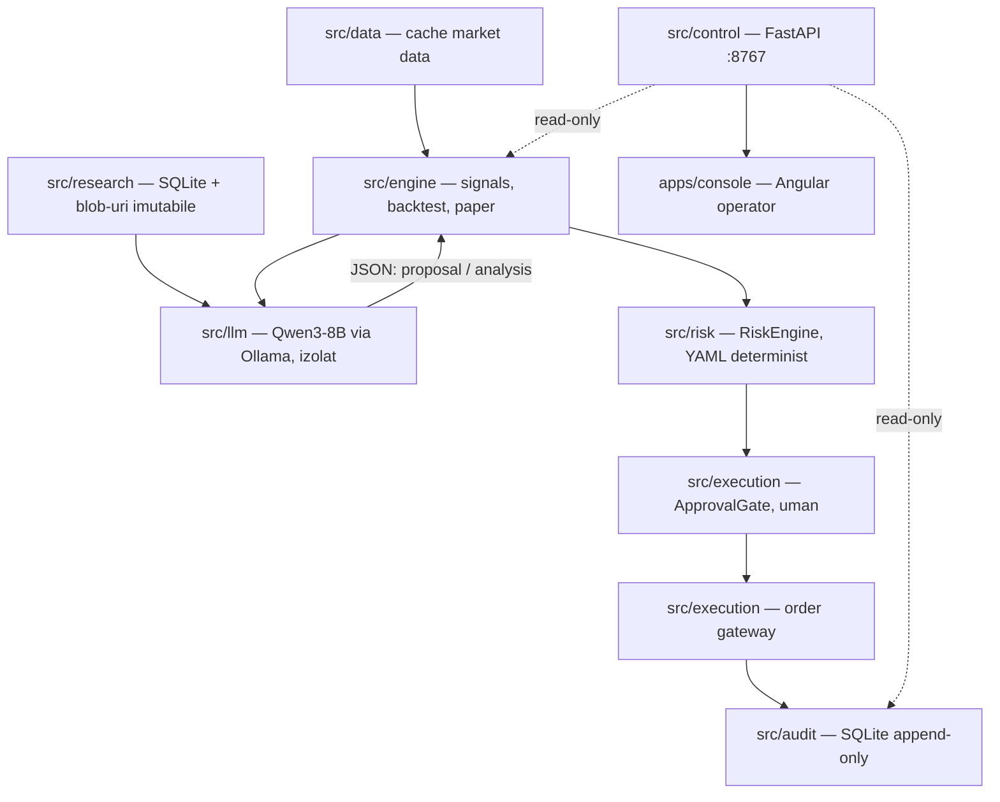
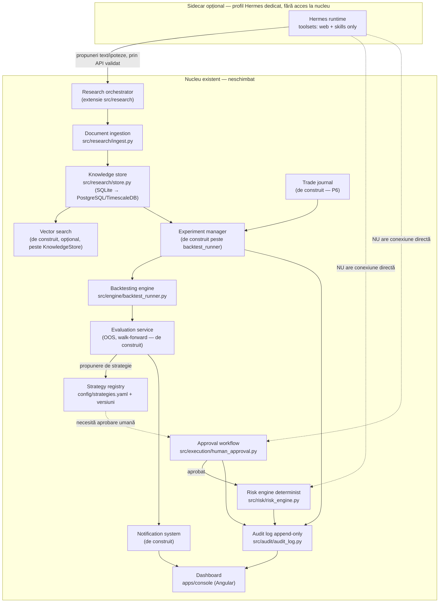
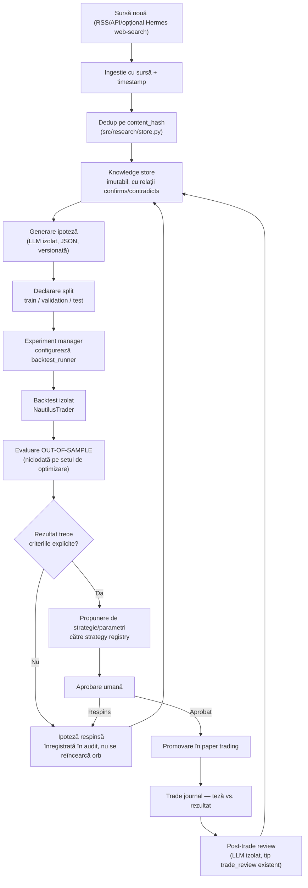
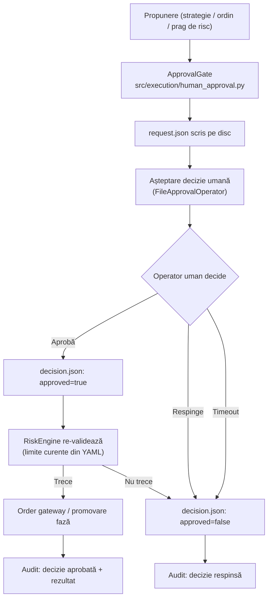
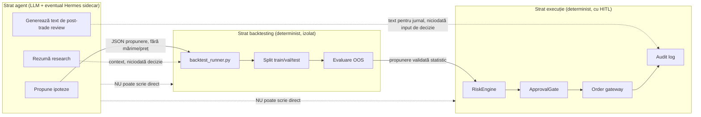

# Evaluare Hermes Agent (Nous Research) pentru auto-educare controlată

**Status:** analiză și recomandare. Niciun cod, dependență sau fișier de configurare nu a fost modificat pentru a produce acest document. Nu s-a instalat Hermes, nu s-a rulat niciun binar Hermes, nu s-a executat nicio tranzacție.

**Autor:** research + analiză arhitecturală.
**Data verificării surselor:** 21 septembrie 2026.
**Bază de cod analizată:** repository `trading-agent`, branch `main`, stare la 21 septembrie 2026 (Fazele 0–2 complete, conform [`README.md`](../README.md)).

---

## 1. Rezumat executiv

Hermes Agent este un agent AI generalist, open-source (MIT), construit de Nous Research, cu terminal, browser, fișiere, tool-calling extins și o buclă de auto-îmbunătățire la nivel de **memorie scurtă + skills procedurale**. Nu este un instrument de cercetare cantitativă, nu are noțiune de walk-forward, out-of-sample, look-ahead bias sau risc de portofoliu, și implicit rulează cu acces larg la shell și fișiere.

Proiectul de trading agent local are deja, verificat în cod, exact disciplina care lipsește la Hermes: separare fermă LLM/execuție ([`src/llm/server.py`](../src/llm/server.py) refuză cheile de broker), risc determinist necontrolabil de LLM ([`src/risk/risk_engine.py`](../src/risk/risk_engine.py)), aprobare umană explicită ([`src/execution/human_approval.py`](../src/execution/human_approval.py)), audit append-only ([`src/audit/audit_log.py`](../src/audit/audit_log.py)) și un store de research cu proveniență și deduplicare ([`src/research/store.py`](../src/research/store.py)).

**Recomandarea:** nu se integrează Hermes Agent în nucleul agentului de trading. Dacă se dorește totuși un experiment, Hermes poate rula izolat, ca sidecar de research fără scriere în sistemul de bază, abia după ce jurnalul de tranzacții (P6, deja notat ca lipsă în [`docs/analysis-integration.md`](analysis-integration.md)) și un experiment manager determinist există. Prima implementare de auto-educare controlată nu folosește Hermes — este un pipeline propriu peste motorul de backtest existent.

---

## 2. Contextul proiectului

Din [`README.md`](../README.md) și [`claudedocs/brief-proiect-agent-trading-local.md`](../claudedocs/brief-proiect-agent-trading-local.md):

- Agent local de analiză și trading multi-asset (crypto azi, acțiuni/forex ulterior), pe un nucleu determinist NautilusTrader v1.231.0 + un strat de raționament LLM (Qwen3-8B, local, via Ollama) ținut strict în afara autorității de execuție.
- Principiu de bază: **LLM-ul propune, codul determinist decide.** Niciun cod care conectează LLM-ul direct la un order gateway nu trece code review.
- Faze 0–2 complete: mediu local calificat, LLM izolat (proces separat, loopback, fără import din `risk/`/`execution/`/`engine/`), fără conexiune la broker/exchange live.
- Reguli absolute (Fazele 0–4): nicio cheie live; LLM fără acces la plasarea de ordine; limitele de risc doar în cod/config, validate la pornire; nimic nu trece automat din dry-run/paper în live; niciun secret în git.
- Hardware: Mac Apple M2 Max, 32 GB RAM — deja alocat rulării simultane Ollama (Qwen3-8B) + NautilusTrader + 4 procese proprii (LLM `:8765`, research `:8766`, control `:8767`, Angular `:4200`).

---

## 3. Ce înseamnă auto-educare în acest proiect

Auto-educare **nu** înseamnă: modelul își schimbă singur promptul de producție, modelul își modifică singur codul, modelul își schimbă regulile de risc, autonomie nesupravegheată.

Auto-educare **înseamnă**, pentru acest proiect:

1. Colectare de date cu sursă și timestamp explicit (deja parțial în [`src/research/store.py`](../src/research/store.py): `fetched_at`, `published_at`, `content_hash`).
2. Memorare imutabilă, niciodată suprascriere silențioasă — fiecare fapt nou e un rând nou, nu un update al unui rând vechi.
3. Generare de ipoteze explicite, versionate, atribuibile unei rulări.
4. Rulare de experimente izolate (backtest/paper), pe date declarate explicit ca train/validation/test.
5. Evaluare pe date **out-of-sample**, niciodată pe setul folosit la optimizare.
6. Propunere de modificare — text + parametri, niciodată aplicare directă.
7. Aprobare umană explicită înainte de orice schimbare de strategie, prompt de producție sau limită.
8. Promovare graduală: research-only → paper → (eventual) live, cu criterii explicite, nu calendaristice — regulă deja formalizată în brief-ul de proiect (secțiunea 8, Gate criteria).

Orice componentă — Hermes sau altceva — este evaluată strict prin acest filtru, nu prin câte funcționalități are.

---

## 4. Analiza Hermes Agent

### 4.1 Ce este, verificat oficial

Surse primare: [site oficial](https://hermes-agent.nousresearch.com/), [documentație](https://hermes-agent.nousresearch.com/docs/), [repository GitHub](https://github.com/NousResearch/hermes-agent), GitHub API, fișier `LICENSE`.

Hermes Agent este descris oficial ca „the self-improving AI agent built by Nous Research” — un agent terminal-native, cu buclă de învățare bazată pe: memorie curatoriată (`MEMORY.md`/`USER.md`), creare autonomă de skills din experiență, auto-îmbunătățirea skills-urilor în timpul utilizării, căutare full-text în sesiuni trecute (FTS5) și, opțional, modelare de utilizator prin Honcho (dialectic user modeling).

**Licență:** MIT, copyright 2025 Nous Research — verificat direct din fișierul `LICENSE` al repo-ului. Fără restricții de utilizare comercială sau derivată.

**Activitate repository (verificat via GitHub API, 21 septembrie 2026):**
- 247.603 stars, 52.093 forks, 43.112 open issues, 955 subscribers.
- Creat 22 iulie 2025; ultim push 21 septembrie 2026 (activ zilnic).
- Ultima versiune documentată în pagina de releases: **v0.21.0** (31 august 2026, "The Pantheon Release" — Bot Mode, cron cu memorie, MCP command center). Între v0.20.0 și v0.21.0: ~5.800 commits, ~2.475 PR-uri merged, 760+ contributori — ritm de dezvoltare foarte mare, tipic unui produs viral cu comunitate largă, nu unui nucleu financiar cu suprafață mică și stabilă.

**Platforme suportate (Tier 1, verificat):** macOS Apple Silicon, Windows 10/11, Linux/WSL2 — exact hardware-ul proiectului (M2 Max) e Tier 1.

**Instalare:** `curl -fsSL https://hermes-agent.nousresearch.com/install.sh | bash` sau Hermes Desktop. Ca bibliotecă Python (`AIAgent`), documentația spune explicit că nu există wheel/sdist publicat pentru `pip install` sau `requirements.txt` — necesită clonarea completă a repo-ului și `uv sync`, adică ~1 GB+ de cod terț adus în mediul de dezvoltare, cu suprafață mare de dependențe (browser automation, TTS, 20+ integrări de mesagerie).

### 4.2 Arhitectură (verificat din documentația developer)

Din pagina oficială de arhitectură: proces central `AIAgent` cu prompt builder, provider resolution (18+ provideri), tool dispatch (70+ tool-uri, ~28 toolset-uri), sesiuni SQLite+FTS5, gateway de mesagerie cu 25+ adaptoare de platformă, sistem de plugin-uri (memory providers, context engines), cron nativ, integrare ACP pentru IDE-uri.

Design principle documentat explicit: „Platform-agnostic core — one `AIAgent` class serves CLI, gateway, ACP, batch, and API server.” Nu există o distincție arhitecturală între „agent conversațional general” și „agent de cercetare financiară” — este același runtime cu toate tool-urile disponibile implicit, filtrabile doar prin `enabled_toolsets`/`disabled_toolsets`.

### 4.3 Modele suportate

Nous Portal (300+ modele), OpenRouter, OpenAI, Anthropic, Google (AI Studio/Vertex), AWS Bedrock, Azure/Microsoft Foundry, xAI (Grok), MiniMax, endpoint custom OpenAI-compatible, **Ollama** (ghid dedicat oficial), și un runtime local gestionat (llama.cpp, prin Hermes Desktop, cu descărcare/quantizare automată).

**Compatibilitate directă cu stack-ul proiectului:** da, tehnic — Ollama e suportat oficial. Dar ghidul oficial „Run Hermes Locally with Ollama” specifică explicit: dintre modelele testate, **doar `gemma4:31b` are tool-calling fiabil**; modele sub 30B (inclusiv orice variantă de 8B) „pot doar chat, nu pot acționa” pentru scopuri agentice, iar modele mici „confirmă în text un `memory` write pe care nu l-au făcut niciodată” (secțiunea Troubleshooting a documentației de memorie). **Qwen3-8B**, modelul ales de proiect pentru izolare și cost, nu e un backend Hermes viabil pentru funcționalitatea agentică reală — ar necesita un al doilea model, mult mai mare, rulat simultan cu Ollama+Qwen3-8B și cu NautilusTrader, pe același M2 Max de 32 GB.

### 4.4 Rulare locală, hardware, GPU/CPU

Verificat din „Local Models” și „Local LLMs on Mac”: macOS Apple Silicon (Metal) e prima clasă de suport. Cerințe documentate: 8 GB+ RAM pentru modele mici (3B, fără tool-calling util), 16 GB+ pentru 27–35B la calitate bună, 32 GB+ pentru rulare confortabilă. CPU-only funcționează dar e documentat explicit ca lent (2–5 tok/s pentru 31B). Nu există cerință GPU obligatorie, dar performanța agentică reală (tool-calling) e legată de modele mari, incompatibile cu bugetul de resurse deja alocat Qwen3-8B + NautilusTrader pe același Mac.

### 4.5 Memorie persistentă

Verificat din „Persistent Memory”: două fișiere, `MEMORY.md` (2.200 caractere / ~800 tokeni) și `USER.md` (1.375 caractere / ~500 tokeni), injectate ca snapshot înghețat la începutul sesiunii. Nu există acțiune de citire explicită — doar `add`/`replace`/`remove`, cu potrivire pe substring. Documentația subliniază explicit: la capacitate, tool-ul refuză scrierea și cere modelului să consolideze singur intrările — mecanism potrivit pentru preferințe personale, nesustenabil pentru un corpus de cercetare financiară cu sute de documente și relații de contrazicere.

Proiectul are deja un store superior pentru acest caz de utilizare: [`src/research/store.py`](../src/research/store.py) — SQLite relațional, deduplicare pe `content_hash`, relații explicite `confirms`/`contradicts`/`duplicate_of`/`retracted_by`/`follow_up_of`, `credibility_score` per sursă, `robots_txt_status`, time-travel pe `fetched_at`/`published_at` (folosit deja în [`docs/analysis-integration.md`](analysis-integration.md) pentru interzicerea look-ahead bias). MEMORY.md nu poate reproduce această structură — e proiectat pentru note personale, nu pentru un knowledge graph financiar auditabil.

Există și provideri de memorie externă opționali (Honcho, Mem0, Hindsight, RetainDB etc., verificat din pagina „Memory Providers”), dar aceștia sunt plugin-uri single-select generice, nu construite pentru semantică financiară (surse, contradicții, expirare pe orizont de timp).

### 4.6 Tool use, execuție de comenzi, extensibilitate

70+ tool-uri native, ~28 toolset-uri (verificat din „Tools & Toolsets”). Include `terminal` (7 backend-uri: local, Docker, SSH, Daytona, Singularity, Modal, Vercel Sandbox), `execute_code` (Python RPC), `delegate_task` (subagenți izolați), browser automation, web search/extract, MCP client. **Implicit, backend-ul terminal e `local`** — comenzi shell rulate direct pe maşina agentului, nu într-un sandbox, dacă operatorul nu configurează explicit altceva.

Skills (procedural memory): agentul poate crea, modifica sau **șterge** orice skill din `~/.hermes/skills/`, inclusiv skill-uri bundled, prin comanda `/learn` sau autonom. Curatorul poate arhiva/consolida skill-uri fără intervenție, dacă `curator.consolidate: true`. Acesta e mecanismul central al „self-improving” — dar operează pe proceduri de asistent general (cum se face un task), nu pe cunoștințe financiare structurate.

### 4.7 Sub-agents, browser use, MCP

- **Sub-agents:** `delegate_task` — subagenți izolați, cu propriile conversații, terminale și scripturi RPC. Verificat, funcțional.
- **Browser use:** verificat, suport CDP local + provideri cloud, vision.
- **MCP:** suport oficial, documentat extensiv („MCP Integration”, „Use MCP with Hermes”), cu filtrare de tool-uri per server și mediu de subprocess filtrat (`_build_safe_env()`, doar `PATH`/`HOME`/`XDG_*` + variabile explicit declarate). Acesta e cel mai relevant punct de conectare tehnică sigură, dacă Hermes ar fi folosit vreodată: proiectul ar putea expune un server MCP propriu, read-only, peste `src/research`, în loc să dea Hermes acces direct la cod.

### 4.8 Autentificare, sandboxing, logging, observabilitate, securitate

Verificat din pagina „Security” (933 linii documentate) și `SECURITY.md`:

- Model de securitate pe 8 straturi: autorizare utilizator, aprobare comenzi periculoase, siguranța scrierii de fișiere, izolare containere, filtrare credențiale MCP, scanare de context files pentru prompt injection, izolare cross-session, sanitizare input.
- Trei moduri de aprobare: `smart` (LLM auxiliar evaluează riscul), `manual`, `off` (echivalent `--yolo` — dezactivează toate prompt-urile de siguranță).
- **YOLO mode** existent și documentat oficial ca opțiune de prim rang, activabilă din CLI, slash command sau variabilă de mediu.
- Blocklist „hardline” fix (rm -rf /, fork bombs etc.) — dar acesta e un plafon minim, nu o politică de izolare completă; documentația însăși spune: „Deny rules are a shell-command policy, not a complete shell interpreter or an OS capability sandbox.”
- Container hardening documentat pentru Docker/Singularity/Modal (read-only rootfs, capabilities drop, PID limits) — **opt-in**, nu implicit.
- Redactare de secrete la nivel de afișare (`agent/redact.py`), nu la nivel de proces — valorile reale rămân intacte intern.

### 4.9 Riscuri cunoscute (verificate, nu presupuse)

Verificat prin căutare web (21 septembrie 2026), surse publice:

- **Issue #7826** (audit comunitar independent, v0.8.0, 812 fișiere Python analizate): 4 findings Critical și 9 High în configurația **implicită** — postura de securitate implicită e „ALLOW-ALL”. Recomandările autorului auditului: nu instala pe o maşină cu chei/wallet-uri sensibile, folosește Docker/Modal, nu activa YOLO, folosește `HERMES_WRITE_SAFE_ROOT`.
- **Issue #8884**: prompt injection persistent prin `DESCRIPTION.md` de skill — descrierile de skill-uri intră neverificat în system prompt, cu bypass complet al scanării de prompt injection folosite pentru context files.
- **Notă Cloud Security Alliance (mai 2026):** compară arhitectura Hermes cu OpenClaw/Clawdbot (9 CVE-uri publicate în 4 zile pentru acesta din urmă, inclusiv un bypass de autorizare CVSS 9.9) și listează 3 CVE-uri publice pe componente Hermes: `CVE-2026-7396` (path traversal, adaptor WeChat Work), `CVE-2026-7397` (symlink following, file tools), `CVE-2026-6829` (path traversal, hermes-webui). Concluzia notei: riscurile mai importante sunt **arhitecturale**, nu bug-uri individuale — un agent persistent, cu memorie și execuție de tool-uri, extensibil prin marketplace comunitar.
- Relația cu OpenClaw/Clawdbot nu e coincidență: Hermes are un comando dedicat `hermes claw migrate` pentru migrarea directă a configurației OpenClaw — cele două proiecte partajează arhitectură și, documentat, o parte din baza de utilizatori.

**Concluzie secțiune:** nu se tratează cele 247k stars ca proxy de siguranță pentru un caz de utilizare financiar. Popularitatea reflectă utilitate ca asistent personal generalist, nu maturitate pentru un domeniu unde o eroare de izolare poate expune chei de exchange.

### 4.10 Separarea funcționalităților

| Categorie | Funcționalități |
|---|---|
| **Verificate (oficial, testabile)** | MEMORY.md/USER.md cu limite de caractere; skills cu progressive disclosure; `/learn`; curator prune+consolidate; 70+ tool-uri; 7 backend-uri terminal; MCP client cu filtrare env; approvals smart/manual/off + YOLO; hardline blocklist; container hardening opt-in; suport Ollama oficial documentat; licență MIT |
| **Experimentale (opt-in, documentate ca atare)** | Bot Mode; Honcho dialectic memory; curator LLM consolidation; computer use; credential vault (auto-login pe site-uri); RL training via Atropos; batch processing la scară |
| **Propuse / marketing** | „closed learning loop”, „grows with you”, „builds a deepening model of who you are” — adevărate la nivel de asistent conversațional personal, fără echivalent pentru rigoare cantitativă (nicio mențiune de walk-forward, OOS, anti-overfitting, seed de reproductibilitate a experimentelor) |
| **Necesită dezvoltare proprie completă** | Tool-uri de market data validate; trade journal; experiment manager cu train/val/test; strategy registry versionat; risk freeze (imposibilitate de scriere pe limite); approval workflow specific de strategii; audit financiar (nu confunda cu audit.log de skill install); sandbox al agentului față de codul propriu al proiectului |

---

## 5. Integrarea cu arhitectura existentă

### 5.1 Puncte de contact verificate în cod

| Zonă | Fișier / modul | Relevanță pentru Hermes |
|---|---|---|
| Topologie procese | `README.md` — 4 procese loopback: LLM `:8765`, research `:8766`, control `:8767`, engine headless | Hermes ar fi un al 5-lea proces; nu trebuie și nu poate înlocui vreunul dintre ele fără a rupe izolarea existentă |
| LLM izolat | [`src/llm/service.py`](../src/llm/service.py) | Qwen3-8B, JSON-only, `SYSTEM_PROMPT` interzice explicit tool calls, file writes, autentificare, submitere de ordine. Hermes *este*, prin definiție, opusul acestui design — un agent cu tool-calling nativ |
| Refuz chei broker | [`src/llm/server.py`](../src/llm/server.py) — `assert_no_broker_keys()`, `LOOPBACK_HOSTS` | Server-ul LLM verifică activ absența variabilelor de broker în mediul propriu; orice proces Hermes lansat în același mediu de shell trebuie să respecte aceeași izolare de `.env.engine`, altfel principiul e rupt |
| Contract JSON strict | [`src/llm/schema.py`](../src/llm/schema.py) — `LLMProposal`, `extra="forbid"`, fără câmp de mărime poziție | `RiskEngine` e singurul producător de `quantity` ([`src/risk/risk_engine.py`](../src/risk/risk_engine.py)); niciun output Hermes nu are voie să treacă direct în acest tip |
| Research/knowledge store | [`src/research/store.py`](../src/research/store.py), [`src/research/models.py`](../src/research/models.py) | Deja acoperă ingestie, dedup pe hash, relații de contrazicere, credibilitate pe sursă — superior MEMORY.md pentru acest caz |
| Prompturi versionate | [`src/llm/analysis_prompts.py`](../src/llm/analysis_prompts.py) — include deja tipul `trade_review` | Orice „îmbunătățire de prompt” trebuie să treacă prin acest fișier, cu code review, nu prin auto-editare de skill Hermes |
| Backtest determinist | [`src/engine/backtest_runner.py`](../src/engine/backtest_runner.py), [`src/engine/strategy_baseline.py`](../src/engine/strategy_baseline.py) | Experimentele de auto-educare trebuie să treacă prin acest motor (NautilusTrader), nu prin `terminal`/`execute_code` Hermes, care nu garantează absența look-ahead bias |
| Paper trading | [`src/engine/strategy_paper.py`](../src/engine/strategy_paper.py), [`scripts/paper_trading/run_paper_session.py`](../scripts/paper_trading/run_paper_session.py) | Loop-ul de paper trading e deja instrumentat cu `Watchdog`, `Heartbeat`, `CircuitBreaker` — nu trebuie orchestrat de un agent generalist |
| Risc determinist | [`src/risk/risk_engine.py`](../src/risk/risk_engine.py), [`src/risk/config_schema.py`](../src/risk/config_schema.py), [`config/risk_limits.yaml`](../config/risk_limits.yaml) | Nenegociabil de LLM prin design de cod; Hermes nu trebuie să aibă niciodată drept de scriere pe acest fișier YAML |
| Aprobare umană | [`src/execution/human_approval.py`](../src/execution/human_approval.py) — `ApprovalGate`, `FileApprovalOperator` | Flux HITL deja construit, cu fișiere `request.json`/`decision.json`; semantica `approvals.mode`/YOLO din Hermes e incompatibilă și nu trebuie conectată la acest gate |
| Audit | [`src/audit/audit_log.py`](../src/audit/audit_log.py), [`src/audit/events.py`](../src/audit/events.py) | Audit-ul financiar append-only e distinct de session storage-ul Hermes (SQLite+FTS5 pentru conversații) — nu se substituie unul pe altul |
| Jurnal de tranzacții | **lipsă din cod** — notat explicit ca P6 în [`docs/analysis-integration.md`](analysis-integration.md): „Process win-rate on a journal (not PnL) after P6 exists” | Acesta e gap-ul real pentru auto-educare — nu absența unui agent autonom, ci absența unui jurnal structurat de decizii și rezultate |
| Design DB unificat | [`docs/database-design.md`](database-design.md) (document de design, 21 septembrie 2026, PostgreSQL 18 + TimescaleDB propus) | Orice knowledge/experiment store trebuie să ajungă în acest DB unificat propus, nu în `~/.hermes/memories/` local per-profil |

### 5.2 Unde ar putea sta Hermes, dacă e totuși experimentat

Ca proces sidecar, complet separat de mediul `.venv`/`uv` al proiectului, pe un profil Hermes dedicat, cu:
- Toolsets permise: `web`, `skills` (doar research).
- Toolsets interzise: `terminal` (backend local), `code_execution`, `browser` (dacă nu e strict necesar), `mcp` către orice server cu acces la broker.
- Fără acces la `.env.engine`, `.env.llm`, `.env.control`, `config/risk_limits.yaml`, `config/universe.yaml`.
- Scriere permisă doar prin apeluri către un endpoint HTTP propriu (MCP server sau REST) care validează și scrie în `src/research`, niciodată direct pe disc/DB.

---

## 6. Comparația cu alternativele

| Opțiune | Potrivire pentru proiect | Complexitate | Control comportament | Reproductibilitate | Debugging | Cost | Rulare locală | Securitate | Memorie | Extensibilitate | Integrare tool-uri | Potrivire finance | Risc operațional |
|---|---|---|---|---|---|---|---|---|---|---|---|---|---|
| **Hermes Agent** | Slabă — agent generalist, nu instrument cantitativ | Mare (70+ tool-uri, gateway, plugin-uri) | Slab implicit (ALLOW-ALL), configurabil dar nu by-default | Slabă (fără concept de OOS/seed determinist) | Greu (loop agentic multi-turn, non-determinist) | Zero la rulare locală, dar cost de setup/hardware mare pentru un al 2-lea model | Bună (Ollama, macOS Tier 1) | Slabă implicit, documentat cu findings Critical/High | Bună pentru note personale, slabă pentru corpus financiar | Foarte mare | Foarte mare (nativ) | Slabă | Ridicat (shell access implicit, prompt injection din skills/web) |
| **Agent custom peste LLM-ul existent** (extensie a `src/llm` + `src/research`) | Foarte bună — continuă exact design-ul curent | Mică-medie (adaugă module, nu framework nou) | Foarte bun (codul propriu decide ce se expune) | Foarte bună (control total pe date/seed) | Facil (cod propriu, teste existente în `tests/adversarial`) | Zero — doar timp de dezvoltare | Nativă | Foarte bună (continuă izolarea deja verificată) | Foarte bună, adaptată la nevoie | Medie (trebuie construită) | Medie (se adaugă ce e necesar) | Foarte bună | Scăzut |
| **LangGraph** | Medie — bun pentru orchestrare multi-pas, dar framework suplimentar | Medie-mare | Bun (grafuri explicite de stare) | Bună (stări explicite, dar depinde de disciplina de implementare) | Mediu | Zero (open-source) | Da | Depinde de implementare | Trebuie construită | Mare | Mare | Medie | Mediu |
| **AutoGen / CrewAI** | Slabă-medie — orientate spre conversații multi-agent, nu pipeline financiar | Mare | Slab-mediu (roluri conversaționale, mai puțin control fin) | Slabă-medie | Greu (multi-agent, non-determinist) | Zero | Da | Mediu | Slabă nativ | Mare | Medie | Slabă | Mediu-ridicat |
| **OpenHands** (sau echivalent) | Slabă — orientat pe coding agent autonom, nu research financiar | Mare | Slab implicit (execuție de cod autonomă) | Slabă | Greu | Zero | Da | Slabă (execuție de cod nesupravegheată) | Slabă | Mare | Mică | Foarte slabă | Ridicat |
| **Pipeline de joburi + bază de date** (cron + DB, fără agent autonom) | Foarte bună — se mapează direct pe `docs/database-design.md` | Mică | Foarte bun (fiecare job e determinist) | Foarte bună | Foarte facil | Zero | Nativă | Foarte bună | Foarte bună (DB relațională) | Mică-medie (adaugă job nou = adaugă cod) | Mică (fără tool-calling agentic) | Foarte bună | Foarte scăzut |
| **RAG + trade journal, fără agent autonom** | Foarte bună — potrivit exact pentru research + post-trade review | Mică-medie | Foarte bun | Foarte bună | Facil | Zero | Nativă | Foarte bună | Foarte bună | Mică-medie | Mică-medie | Foarte bună | Scăzut |

**Concluzie:** Hermes nu e recomandat *nu* pentru că are mai puține funcționalități — are, de fapt, mult mai multe decât are nevoie proiectul. E nerecomandat pentru că mai multe funcționalități generaliste (shell, browser, 20+ platforme de mesagerie, skills auto-modificabile) reprezintă suprafață de risc suplimentară pentru un domeniu (finance) care cere exact opusul: suprafață minimă, comportament determinist, reproductibilitate probată. Un pipeline de joburi + DB, sau RAG + trade journal peste LLM-ul JSON-only deja existent, obține tot ce e cerut la secțiunea 3, cu risc operațional net mai mic.

---

## 7. Scorurile (1–10)

**Ponderare:** control asupra schimbărilor, auditabilitate, reproductibilitate, securitate și compatibilitate cu proiectul existent au pondere mare (domeniu financiar, capital real în perspectivă). Research autonom și tool-use brut au pondere mică — proiectul nu are nevoie de un agent care „face de toate”, are nevoie de o componentă care face exact ce trebuie, verificabil.

| Criteriu | Pondere | Hermes | Custom peste LLM existent | LangGraph | AutoGen/CrewAI | OpenHands | Joburi+DB | RAG+journal |
|---|---|---|---|---|---|---|---|---|
| Research autonom | mică | 8 | 6 | 7 | 7 | 6 | 4 | 5 |
| Memorie | medie | 5 | 7 | 6 | 5 | 4 | 8 | 8 |
| Auto-educare controlată | **mare** | 3 | 8 | 6 | 4 | 3 | 9 | 8 |
| Tool use | mică | 9 | 5 | 8 | 8 | 9 | 3 | 3 |
| Extensibilitate | medie | 8 | 7 | 8 | 7 | 7 | 6 | 6 |
| Rulare locală | medie | 7 | 9 | 8 | 7 | 6 | 9 | 9 |
| Cost | medie | 6 | 9 | 8 | 7 | 6 | 9 | 9 |
| Securitate | **mare** | 4 | 8 | 7 | 5 | 4 | 9 | 8 |
| Auditabilitate | **mare** | 5 | 8 | 7 | 5 | 5 | 9 | 8 |
| Reproductibilitate | **mare** | 3 | 8 | 6 | 4 | 3 | 9 | 8 |
| Compatibilitate cu proiectul existent | **mare** | 4 | 10 | 6 | 4 | 3 | 9 | 9 |
| Potrivire pentru finance | **mare** | 3 | 8 | 6 | 5 | 2 | 8 | 8 |
| Control asupra schimbărilor | **mare** | 3 | 9 | 7 | 4 | 3 | 9 | 9 |
| Risc de comportament imprevizibil (10 = risc minim) | **mare** | 3 | 8 | 6 | 4 | 3 | 9 | 8 |
| **Scor general ponderat** | | **~4.4** | **~8.2** | **~6.7** | **~5.1** | **~4.2** | **~8.4** | **~8.0** |

Scorul general nu e o medie simplă: criteriile marcate „mare" (auto-educare controlată, securitate, auditabilitate, reproductibilitate, compatibilitate, finance, control, risc imprevizibil) au fost cântărite de ~2x față de cele „mică"/„medie" în calculul aproximativ de mai sus. Chiar și fără ponderare explicită, ordinea relativă nu se schimbă: Hermes rămâne ultimul sau penultimul pe exact criteriile care contează pentru un sistem de trading.

---

## 8. Riscurile

Mapare explicită pe riscurile cerute, verificate din documentația oficială și din surse externe (secțiunea 16):

| Risc | Aplicabil la Hermes? | Detaliu verificat |
|---|---|---|
| Modelul își schimbă singur promptul | **Da, prin design** | Skills sunt scrise/rescrise de agent (`/learn`, curator consolidate) — mecanismul central de „self-improvement” |
| Modelul își modifică singur codul | **Da, dacă `terminal`/backend `local` e activ** | Backend implicit terminal e `local`; agentul poate scrie/rula orice cu drepturile procesului |
| Modelul își schimbă regulile de risc | **Nu documentat ca funcție, dar posibil dacă i se dă acces la fișiere** | Fără sandbox de scriere explicit configurat (`HERMES_WRITE_SAFE_ROOT`), agentul poate edita orice fișier accesibil, inclusiv YAML de risc |
| Modelul selectează doar rezultate care confirmă ipoteza | **Da, risc generic LLM, neadresat de Hermes** | Nicio mențiune în documentație despre protecție contra confirmation bias în interpretarea rezultatelor |
| Modelul memorează date greșite/manipulate | **Da** | Memory tool nu validează factual conținutul; skill injection (issue #8884) e un vector confirmat |
| Modelul folosește informații viitoare în backtesting | **Da, dacă backtestul rulează prin `terminal`/`execute_code`** | Hermes nu are noțiune de time-travel pe date; proiectul deja rezolvă asta separat în `src/engine`/`src/research` (`fetched_at <= as_of`) |
| Modelul se auto-evaluează pe aceleași date de optimizare | **Da, risc generic, neadresat** | Nicio funcție documentată de split train/val/test sau walk-forward |
| Modelul confundă profit accidental cu strategie bună | **Da, risc generic** | Fără concept de semnificație statistică sau win-rate pe proces (vs. PnL) în documentație |
| Modelul continuă o strategie care nu mai funcționează | **Da, risc generic** | Fără mecanism de drift detection documentat pentru scop financiar |
| Modelul execută comenzi periculoase | **Parțial mitigat** | Blocklist hardline pentru cazuri catastrofale + aprobare `smart`/`manual`; dar `approvals.mode: off`/YOLO dezactivează tot, iar politica implicită e documentat „ALLOW-ALL” (issue #7826) |
| Modelul expune API keys | **Risc confirmat public** | Redactare doar la display, nu la valoare internă; CVE-uri de path traversal (`CVE-2026-7397`, symlink following file tools) pot expune fișiere sensibile |
| Modelul e manipulat prin prompt injection din documente/web | **Risc confirmat public** | Issue #8884: descrierile de skill bypasses complet scanarea de context injection. Proiectul curent are deja teste dedicate acestui risc — [`tests/adversarial/test_research_prompt_injection.py`](../tests/adversarial/test_research_prompt_injection.py), [`tests/adversarial/test_llm_prompt_injection.py`](../tests/adversarial/test_llm_prompt_injection.py) — pe care Hermes nu le respectă implicit |
| Modelul creează un feedback loop care amplifică o eroare | **Da, risc arhitectural** | Skills create din experiență greșită devin proceduri reutilizate; nota CSA (mai 2026) identifică explicit „arhitecturale, not implementation bugs” ca risc central pentru clasa asta de agenți |

**Concluzie:** aproape toate riscurile enumerate în cerință sunt fie confirmate documentat pentru Hermes, fie neadresate de el (rămân pe umerii operatorului să le prevină din exterior). Proiectul curent are deja mitigări explicite pentru majoritatea acestor riscuri (izolare LLM, teste adversariale, risk engine determinist) — introducerea Hermes ar însemna reconstruirea acestor mitigări într-un runtime care nu a fost proiectat pentru ele.

---

## 9. Arhitectura propusă

**Nu se recomandă adoptarea Hermes.** Arhitectura de mai jos e prezentată condiționat — pentru cazul (neconfirmat ca necesar) în care operatorul decide totuși să experimenteze cu Hermes ca sidecar izolat de research, strict în afara nucleului decizional.

### Descrierea componentelor

- **Hermes runtime** — dacă folosit, izolat complet, fără persistență partajată cu restul sistemului; singura ieșire e text/JSON trimis la Research orchestrator printr-un API validat.
- **Research orchestrator** — extensie a `src/research`; primește input din Hermes (dacă există) și din surse proprii (RSS, API), le normalizează.
- **Document ingestion** — [`src/research/ingest.py`](../src/research/ingest.py) existent.
- **Knowledge store** — [`src/research/store.py`](../src/research/store.py), migrat spre PostgreSQL conform [`docs/database-design.md`](database-design.md).
- **Vector search** — opțional, de construit peste knowledge store dacă volumul de documente justifică; nu e o dependență de Hermes.
- **Trade journal** — componenta lipsă azi (P6); înregistrează teza inițială, decizia, execuția, rezultatul, atribuirea de greșeală.
- **Experiment manager** — orchestrează ipoteze → configurații de backtest → rezultate, cu hash de reproductibilitate.
- **Backtesting engine** — [`src/engine/backtest_runner.py`](../src/engine/backtest_runner.py), neschimbat.
- **Evaluation service** — de construit: separare train/validation/test, walk-forward, detectare overfitting.
- **Strategy registry** — [`config/strategies.yaml`](../config/strategies.yaml) + istoric de versiuni (parte din DB design).
- **Risk engine** — [`src/risk/risk_engine.py`](../src/risk/risk_engine.py), neschimbat, fără acces Hermes.
- **Approval workflow** — [`src/execution/human_approval.py`](../src/execution/human_approval.py), neschimbat.
- **Audit log** — [`src/audit/audit_log.py`](../src/audit/audit_log.py), neschimbat; orice propunere venită prin Hermes e auditată identic cu restul.
- **Notification system** — de construit, pentru alertare pe rezultate de experimente/drift.
- **Dashboard** — [`apps/console`](../apps/console), extins pentru vizualizarea jurnalului și experimentelor.

---

## 10. Modelul de permisiuni

| Componentă | Poate | Nu poate |
|---|---|---|
| Hermes (dacă folosit) | Web search/extract, citire skills, propunere de text/ipoteze către orchestrator | Terminal local, `execute_code`, scriere pe orice fișier din repo, acces la `.env.*`, acces la `config/risk_limits.yaml`/`config/universe.yaml`, plasare de ordine, apeluri MCP către broker |
| LLM izolat (Qwen3-8B, existent) | `/propose`, `/analyze` — JSON-only, fără tool calls | Import din `risk/`/`execution/`/`engine/` (verificat: [`src/llm/service.py`](../src/llm/service.py) nu importă aceste module); citire chei broker (verificat: `assert_no_broker_keys()`) |
| Research orchestrator | Scriere în knowledge store, apel LLM izolat pentru rezumare | Scriere în risk/execution, apel direct la broker |
| Experiment manager | Rulare backtest izolat, citire date istorice | Rulare pe date live, scriere directă în strategy registry fără aprobare |
| Strategy registry | Stocare de propuneri versionate | Activare automată a unei propuneri fără restart + aprobare explicită (regulă deja existentă: enable/disable strategii necesită restart) |
| Risk engine | Singurul producător de `quantity`, citește doar din `RiskLimits`/config | Citire din output LLM/Hermes pentru mărime, preț, stop |
| Approval workflow | Aprobare/respingere umană explicită per propunere | Auto-aprobare internă (verificat: `ScriptedApprovalOperator` e doar pentru teste, documentat explicit „Nu e bypass intern”) |
| Audit log | Scriere append-only a oricărei decizii | Modificare/ștergere de rânduri existente |

---

## 11. Fluxul de research și auto-evaluare

---

## 12. Fluxul de aprobare

---

## 13. Delimitarea dintre agent, backtesting și execution layer

**Regula de delimitare, explicită:** stratul agent nu are conexiune de scriere directă către stratul de backtesting sau execuție. Orice trece dintr-un strat în altul o face ca **date structurate validate** (JSON cu schemă strictă, `extra="forbid"`, verificat deja în [`src/llm/schema.py`](../src/llm/schema.py)), niciodată ca acțiune directă (apel de tool, comandă shell, scriere de fișier de config).

---

## 14. Planul experimental (fără bani reali)

### Faza 1 — Research only (fără Hermes ca nucleu)

- **Obiectiv:** research și knowledge management funcțional, cu citări și audit complet.
- **Metrici:** număr de documente ingerate cu sursă validă; procent de documente cu `content_hash` unic; latență ingestie → disponibilitate în store.
- **Criterii de succes:** zero documente fără timestamp/sursă; zero look-ahead detectat în testele existente ([`tests/adversarial/`](../tests/adversarial/)).
- **Criterii de oprire:** orice document ingerat fără `fetched_at`/sursă verificabilă blochează promovarea la Faza 2.
- **Riscuri:** prompt injection din surse web/PDF — deja acoperit parțial de testele adversariale existente.
- **Permisiuni agent (Qwen3-8B izolat, +eventual Hermes sidecar strict pe web/skills):** citire surse externe, scriere în knowledge store prin API validat.
- **Interzis:** execuție de ordine, scriere pe risc, scriere pe cod, acces la `.env.engine`.

### Faza 2 — Post-trade analysis + generare de ipoteze + backtesting izolat

- **Obiectiv:** trade journal funcțional (P6) + experiment manager peste `backtest_runner.py`.
- **Metrici:** win-rate de proces (nu PnL brut, conform notei deja existente în [`docs/analysis-integration.md`](analysis-integration.md)); numărul de ipoteze respinse vs. promovate; rata de detectare a overfitting-ului (diferență train vs. test).
- **Criterii de succes:** fiecare ipoteză are un rezultat OOS documentat înainte de a fi propusă spre paper.
- **Criterii de oprire:** orice ipoteză evaluată pe același set folosit la optimizare (contaminare train/test) invalidează rezultatul și oprește promovarea.
- **Riscuri:** confirmation bias în interpretarea rezultatelor; auto-evaluare pe date deja văzute.
- **Permisiuni agent:** generare de ipoteze text/JSON, citire date istorice.
- **Interzis:** alegerea liberă a ferestrelor de date de evaluare (fixate de experiment manager, nu de LLM), aplicare automată a rezultatului.

### Faza 3 — Paper trading

- **Obiectiv:** comparație cu baseline determinist ([`src/engine/strategy_baseline.py`](../src/engine/strategy_baseline.py), EMA-cross), monitorizare drift.
- **Metrici:** aceleași ca în Gate criteria existent (brief secțiunea 8): minimum 30 sesiuni relevante, zero incidente critice, reconciliere completă.
- **Criterii de succes:** strategia propusă nu are performanță inferioară statistic semnificativ față de baseline pe fereastra de paper.
- **Criterii de oprire:** orice halt critic; drift confirmat (strategia care funcționa în backtest nu mai funcționează în paper).
- **Riscuri:** continuarea unei strategii care a încetat să funcționeze; kill switch netestat.
- **Permisiuni agent:** propunere de parametri noi de testat; niciodată start/stop al sesiunii de paper (rămâne comandă de operator, ca azi).
- **Interzis:** pornirea automată a paper trading, aprobarea automată a trecerii de fază.

### Faza 4 — Live minim (neschimbat față de brief-ul de proiect)

- **Obiectiv:** conform Gate criteria existent — maximum 50 EUR expuși, aprobare manuală pe fiecare ordin.
- **Metrici:** identice cu cele deja definite în brief (secțiunea 8, 10).
- **Criterii de succes/oprire:** identice cu regulile absolute deja în vigoare (nicio scurtare de fază pentru calendar).
- **Riscuri:** toate riscurile din secțiunea 8 ale acestui document, cu consecințe financiare reale.
- **Permisiuni agent:** identice cu Faza 3 — propunere, nu execuție.
- **Interzis explicit:** Hermes (dacă a fost folosit ca sidecar de research) rămâne complet în afara acestei faze — nicio conexiune, directă sau indirectă, la execuția live.

---

## 15. Criteriile de promovare

Promovarea între faze nu este calendaristică — regulă deja stabilită în brief-ul de proiect (secțiunea 8) și reconfirmată aici pentru componenta de auto-educare:

1. **Research → Ipoteze:** minimum N documente cu sursă+timestamp valid; zero eșecuri la testele adversariale de prompt injection.
2. **Ipoteze → Backtest:** ipoteza e formulată explicit, versionată, cu split train/validation/test declarat *înainte* de rulare.
3. **Backtest → Propunere de strategie:** rezultat pozitiv pe setul de **test**, nu doar pe validation; diferență train/test documentată (nu overfitting evident).
4. **Propunere → Paper:** aprobare umană explicită înregistrată în audit; niciodată automată.
5. **Paper → Live:** identic cu Gate criteria din brief — minimum 30 sesiuni, zero incident critic, reconciliere completă, kill switch testat manual.
6. **Orice regresie** (drift, halt critic, discrepanță de reconciliere) retrogradează automat spre faza anterioară — promovarea e reversibilă, nu doar unidirecțională.

---

## 16. Decizia finală

**Nu se integrează Hermes Agent în nucleul agentului de trading.**

Motivele, sintetizat:

1. Hermes e proiectat ca asistent personal generalist cu acces implicit larg (shell, fișiere, browser) — opusul principiului de izolare deja verificat în cod ([`src/llm/server.py`](../src/llm/server.py), [`src/llm/service.py`](../src/llm/service.py)).
2. „Self-improving” la Hermes înseamnă memorie scurtă + skills procedurale pentru task-uri generale — nu echivalează cu rigoarea cerută de auto-educare financiară (OOS, walk-forward, anti-overfitting), care nu există documentat la Hermes și trebuie construită oricum, indiferent de runtime.
3. Modelul local al proiectului (Qwen3-8B) nu e un backend agentic viabil pentru Hermes conform documentației oficiale (`gemma4:31b` e recomandarea minimă pentru tool-calling fiabil) — adoptarea ar necesita un al doilea model mare, concurent pe resurse cu NautilusTrader pe același hardware.
4. Riscurile de securitate documentate public (postură implicită „ALLOW-ALL”, skill/prompt injection, CVE-uri de path traversal) sunt incompatibile cu un sistem care va gestiona, chiar și la scară mică, capital real.
5. Knowledge store-ul existent ([`src/research/store.py`](../src/research/store.py)) e deja superior MEMORY.md pentru cazul de utilizare (deduplicare, relații de contrazicere, proveniență).
6. Un pipeline determinist (joburi + DB + jurnal) obține scoruri net superioare pe exact criteriile care contează pentru finance: control, auditabilitate, reproductibilitate (secțiunea 7).

Dacă operatorul decide totuși să experimenteze cu Hermes, aceasta trebuie să rămână un experiment izolat de research (secțiunea 9), niciodată o dependență a nucleului, și abia după ce Faza 1 din planul experimental (secțiunea 14) e funcțională fără el.

---

## 17. Funcționalitățile care nu trebuie automatizate

Indiferent de componenta aleasă (Hermes sau alta), următoarele rămân **exclusiv umane**, conform regulilor absolute deja stabilite în brief-ul de proiect și confirmate de acest document:

- Modificarea `config/risk_limits.yaml` sau a oricărei limite de risc.
- Trecerea din dry-run/paper în live.
- Aprobarea finală a unui ordin (Faza 4–5, conform RACI din brief).
- Activarea/dezactivarea unei strategii în producție (deja necesită restart, conform design existent).
- Ștergerea sau modificarea retroactivă a unui rând din audit log.
- Extinderea universului de instrumente tranzacționabile ([`config/universe.yaml`](../config/universe.yaml)).
- Decizia „această strategie a încetat să funcționeze, o dezactivăm” — poate fi *propusă* de sistem, dar decisă de om.
- Rescrierea promptului de producție al LLM-ului izolat ([`src/llm/analysis_prompts.py`](../src/llm/analysis_prompts.py)) fără code review.
- Orice conectare nouă la un exchange/broker sau extindere a permisiunilor unei chei API existente.

---

## 18. Surse consultate

Toate sursele verificate la 21 septembrie 2026:

- Site oficial Hermes Agent — https://hermes-agent.nousresearch.com/
- Documentație oficială (index) — https://hermes-agent.nousresearch.com/docs/
- Arhitectură (developer guide) — https://hermes-agent.nousresearch.com/docs/developer-guide/architecture
- Memorie persistentă — https://hermes-agent.nousresearch.com/docs/user-guide/features/memory
- Memory providers — https://hermes-agent.nousresearch.com/docs/user-guide/features/memory-providers
- Skills system — https://hermes-agent.nousresearch.com/docs/user-guide/features/skills
- Curator — https://hermes-agent.nousresearch.com/docs/user-guide/features/curator
- Securitate — https://hermes-agent.nousresearch.com/docs/user-guide/security
- Tools & toolsets — https://hermes-agent.nousresearch.com/docs/user-guide/features/tools
- MCP integration — https://hermes-agent.nousresearch.com/docs/user-guide/features/mcp
- Local Models — https://hermes-agent.nousresearch.com/docs/user-guide/local-models
- Run Hermes Locally with Ollama — https://hermes-agent.nousresearch.com/docs/guides/local-ollama-setup
- Using Hermes as a Python Library — https://hermes-agent.nousresearch.com/docs/guides/python-library
- Platform Support — https://hermes-agent.nousresearch.com/docs/getting-started/platform-support
- Migrate from OpenClaw — https://hermes-agent.nousresearch.com/docs/guides/migrate-from-openclaw
- Repository oficial GitHub — https://github.com/NousResearch/hermes-agent
- GitHub API (metadate repo: stars, forks, issues, licență, `pushed_at`) — https://api.github.com/repos/NousResearch/hermes-agent
- Fișier LICENSE (MIT) — https://raw.githubusercontent.com/NousResearch/hermes-agent/main/LICENSE
- Releases (v0.21.0 și istoric) — https://github.com/NousResearch/hermes-agent/releases
- Audit de securitate comunitar (issue #7826) — https://github.com/NousResearch/hermes-agent/issues/7826
- Prompt injection prin skill description (issue #8884) — https://github.com/NousResearch/hermes-agent/issues/8884
- Cloud Security Alliance, notă de cercetare CVE-uri (mai 2026) — https://labs.cloudsecurityalliance.org/wp-content/uploads/2026/05/CSA_research_note_hermes_agent_CVEs_20260504-csa-styled.pdf
- SECURITY.md (repo) — https://github.com/NousResearch/hermes-agent/blob/main/SECURITY.md

Surse interne (repository `trading-agent`, stare 21 septembrie 2026):

- [`README.md`](../README.md)
- [`claudedocs/brief-proiect-agent-trading-local.md`](../claudedocs/brief-proiect-agent-trading-local.md)
- [`docs/analysis-integration.md`](analysis-integration.md)
- [`docs/database-design.md`](database-design.md)
- [`docs/SERVER_DEPLOYMENT_AUDIT.md`](SERVER_DEPLOYMENT_AUDIT.md)
- [`src/llm/service.py`](../src/llm/service.py), [`src/llm/server.py`](../src/llm/server.py), [`src/llm/schema.py`](../src/llm/schema.py), [`src/llm/analysis_prompts.py`](../src/llm/analysis_prompts.py)
- [`src/research/store.py`](../src/research/store.py)
- [`src/risk/risk_engine.py`](../src/risk/risk_engine.py)
- [`src/execution/human_approval.py`](../src/execution/human_approval.py)
- [`src/audit/audit_log.py`](../src/audit/audit_log.py)
- [`src/engine/backtest_runner.py`](../src/engine/backtest_runner.py), [`src/engine/strategy_baseline.py`](../src/engine/strategy_baseline.py), [`src/engine/strategy_paper.py`](../src/engine/strategy_paper.py)
- `graphify-out/graph.json` — knowledge graph structural al codebase-ului, interogat pentru identificarea punctelor de contact LLM/research/risc/execuție

---

## 19. Întrebări deschise

1. Volumul real de research (documente/lună) justifică un vector search dedicat, sau `content_hash` + interogare SQL relațională e suficient pe termen mediu?
2. Trade journal-ul (P6) va fi construit ca tabele noi în PostgreSQL propus ([`docs/database-design.md`](database-design.md)), sau ca extensie temporară SQLite până la migrarea completă a bazei?
3. Dacă se decide totuși un experiment cu Hermes ca sidecar de research: cine validează, per commit/config, că profilul Hermes nu a primit din greșeală acces la `.env.engine` sau la `terminal` local?
4. Evaluation service-ul (walk-forward, split train/val/test) — se construiește peste NautilusTrader direct, sau ca strat independent care orchestrează rulări multiple de `backtest_runner.py`?
5. Care e pragul cantitativ exact pentru „win-rate de proces” (Faza 2) care declanșează promovarea unei ipoteze spre paper — un număr fix, sau un test statistic (ex. semnificație la un nivel declarat)?
6. Notification system-ul (alertare pe drift/anomalii) — extindere a `src/monitor` existent (deja are `Watchdog`, `Heartbeat`) sau componentă complet nouă?

---

**Recomandarea finală este să nu integrăm Hermes Agent în nucleul trading agentului.** Hermes ar trebui folosit pentru **cel mult research și ingestie de documentație ca sidecar izolat, opțional și doar după ce pipeline-ul determinist de auto-educare există**, dar nu ar trebui să poată **plasa ordine, modifica limitele de risc, rescrie prompturile sau strategiile de producție, rula backtest-uri nesupravegheate sau accesa chei/secrete ale proiectului**. Pentru auto-educare controlată, prima implementare ar trebui să fie **un jurnal de tranzacții (P6) plus un experiment manager determinist peste motorul de backtest existent (`src/engine/backtest_runner.py`), cu LLM-ul Qwen3-8B izolat actual folosit doar ca reporter JSON de tip `trade_review`**.
