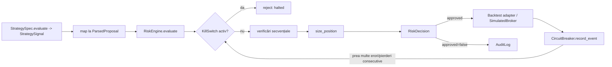

# Risk management — limite globale vs. limite de strategie

**Data:** 2026-09-21. **Domeniu:** [src/risk/](../src/risk/), [config/risk_limits.yaml](../config/risk_limits.yaml).

Regula absolută a proiectului: **nicio strategie și niciun LLM nu poate lărgi o limită de risc.** O strategie poate cel mult *strânge* ce vine din `risk_limits.yaml` (ex.: un `reward_risk_ratio` calculat de strategie e verificat *în plus* față de cap-urile globale, nu în locul lor). Acest document descrie cine verifică ce, în ce ordine, și ce e doar o aproximare declarată ca atare.

---

## 1. Lanțul de decizie



`RiskEngine` ([src/risk/risk_engine.py](../src/risk/risk_engine.py)) e **singura** cale de la un semnal la o cantitate. Nicio strategie nu calculează sau trimite cantitatea direct.

---

## 2. Limite globale (`config/risk_limits.yaml`) — nu pot fi suprascrise

| Limită | Valoare curentă | Ce blochează | Unde e verificată |
|---|---|---|---|
| `max_notional_per_order` | 1000 | Notional maxim al unui singur ordin | `_evaluate_long`, plafon pe `cap_notional` |
| `max_exposure_per_instrument` | 2000 | Expunere cumulată pe un instrument (ex. `ETHUSD`) | `_evaluate_long`, `remaining_instrument` |
| `max_exposure_per_asset_class` | 5000 | Expunere cumulată pe o clasă de active (`crypto`) | `_evaluate_long`, `remaining_class` |
| `max_daily_loss` | 200 | Pierdere realizată/zi | `evaluate` (reject direct) + `risk_budget` |
| `max_drawdown` | 500 | Drawdown curent al contului | `evaluate` (reject direct) + `risk_budget` |
| `max_orders_per_day` | 10 | Nr. ordine/zi | `evaluate` (reject direct) |
| `circuit_breaker.max_consecutive_errors` | 3 | Erori consecutive de execuție | `CircuitBreaker.record_event` |
| `circuit_breaker.max_consecutive_losses` | 3 | Tranzacții pierzătoare consecutive | `CircuitBreaker.record_event` |
| `circuit_breaker.halt_on_unknown_order_result` | `true` (obligatoriu) | Rezultat de ordin neclar → halt imediat | `CircuitBreaker.record_event` |

Kill switch ([src/risk/kill_switch.py](../src/risk/kill_switch.py)): flag pe disc, citit de `RiskEngine.evaluate` la fiecare apel. Reluarea e **manuală** (Risk → Clear halt flag în consolă) — niciun proces nu îl șterge singur.

`load_risk_limits` ([src/risk/config_schema.py](../src/risk/config_schema.py)) validează strict la pornire (`extra="forbid"`, toate cap-urile `> 0`): fișier lipsă sau invalid → aplicația refuză să pornească, nu cade pe default-uri silențioase.

---

## 3. Extensii adăugate în acest commit — tot conservatoare

Toate sunt **opționale** (`None` = verificare dezactivată, pentru compatibilitate cu `risk_limits.yaml` mai vechi) și, când sunt setate, **strâng** limitele de mai sus — nu există câmp care să le lărgească.

| Câmp nou | Valoare curentă | Ce verifică | Motiv respingere (`reject_reason`) |
|---|---|---|---|
| `max_risk_per_trade` | 150 | `risk_budget = min(remaining_daily, remaining_drawdown, max_risk_per_trade)` | (indirect, prin `below_min_notional_or_no_capacity`) |
| `min_reward_risk_ratio` | 1 | R:R al semnalului (dacă strategia îl furnizează) vs. minim | `reward_risk_too_low` |
| `max_spread_bps` | 50 | Spread curent (din cost model / quote) pe instrument | `spread_too_wide`, sau `stale_or_missing_market_data` dacă lipsește |
| `min_bar_volume` | 1000 | Volumul barei curente ca proxy de lichiditate | `insufficient_liquidity`, sau `stale_or_missing_market_data` dacă lipsește |
| `max_correlated_exposure` | 3000 | Expunere pe clasa de active (proxy pentru corelație) | (indirect, prin `below_min_notional_or_no_capacity`) |

**De ce `50 bps` pentru `max_spread_bps`:** cost model-ul de bază are spread 15 bps; la multiplicator 3× (cel mai pesimist scenariu testat) devine 45 bps. 50 bps acoperă exact acel caz fără să blocheze rulările normale la 1×/2×.

**De ce `1000` pentru `min_bar_volume`:** fixture-urile de test au volume 11.000–23.000; bare reale ETHUSD/BTCUSD 1h/1d observate sunt cu ordine de mărime mai mari. 1000 blochează doar bare vizibil anormale (date lipsă/corupte), nu condiții normale de piață — e un prag de siguranță, nu un filtru de lichiditate fin.

**De ce `3000` pentru `max_correlated_exposure`:** între cap-ul per-instrument (2000) și cel per-clasă (5000). Cu doar `ETHUSD` + `BTCUSD` în univers, ambele tratate ca perfect corelate (crypto majors), 3000 înseamnă că poziții simultane pe amândouă nu pot împreună depăși mai mult decât un singur cap per-instrument și jumătate — mai strict decât a lăsa fiecare instrument să-și consume independent cap-ul per-clasă.

### Aproximări declarate (nu măsurători directe)

- **Corelație = 1 pentru toate instrumentele crypto.** `max_correlated_exposure` grupează prin `asset_class_by_instrument`, nu printr-o matrice de corelație calculată din date. Corect pentru un univers de 2 active crypto majore (comportament istoric puternic corelat), **greșit** dacă universul crește cu active necorelate — verificarea trebuie rescrisă (corelație calculată din returns, nu presupusă) înainte de a adăuga active non-crypto sau crypto necorelate.
- **`min_bar_volume` e volumul barei OHLC, nu order-book depth.** E un proxy grosier: o bară cu volum mare poate încă avea o carte de ordine subțire la momentul exact al fill-ului. Nu înlocuiește o verificare L2 reală.
- **`max_spread_bps` compară cu spread-ul din cost model/quote sintetic în backtest**, nu cu spread-ul live de pe Kraken (paper trading citește un spread public OHLC-derivat, nu order-book). E realist ca ordine de mărime, nu exact.
- **Stop-loss intern (`_DEFAULT_STOP_FRACTION = 2%`)** e hardcodat în `RiskEngine`, nu vine din strategie — orice `ParsedProposal` de tip `long` primește aceeași distanță de stop pentru calculul `size_position`. `StrategySpec` (secțiunea următoare) calculează propriul stop/target pentru `reward_risk_ratio`, dar `RiskEngine` folosește tot 2% intern pentru sizing — cele două nu sunt încă unificate. Documentat aici ca limitare cunoscută, nu ascunsă.

---

## 4. Ce poate face o strategie (`StrategySpec`) — și ce nu poate

`StrategySpec.evaluate()` ([src/engine/strategy_spec.py](../src/engine/strategy_spec.py)) produce **doar** `StrategySignal` (`buy`/`sell`/`hold`, `rationale`, `confidence`, `stop_price`, `target_price`, `invalidation`). Nu calculează cantitate, nu apelează brokerul.

- O strategie **poate** cere un stop mai apropiat sau un target mai ambițios — asta afectează `reward_risk_ratio` trimis către `RiskEngine.evaluate(reward_risk_ratio=...)`, care e verificat **suplimentar** față de cap-urile globale (`min_reward_risk_ratio`), nu în locul lor.
- O strategie **nu poate** cere un notional mai mare decât `max_notional_per_order`, nu poate ignora `max_daily_loss`/`max_drawdown`, nu poate dezactiva `max_spread_bps`/`min_bar_volume`. `cap_notional` și `risk_budget` sunt calculate exclusiv din `RiskLimits` + starea curentă a portofoliului — semnalul strategiei nu intră în acel calcul.
- `HOLD` nu trece deloc prin `RiskEngine` — nu generează `ParsedProposal`.

Testul adversarial [tests/adversarial/test_risk_limits_cannot_be_loosened.py](../tests/adversarial/test_risk_limits_cannot_be_loosened.py) verifică explicit acest lucru: propuneri cu stop mai larg / notional cerut mai mare decât plafonul global sunt respinse sau capate, niciodată aprobate peste cap. Extins în acest commit cu cazuri pentru `max_spread_bps`, `min_bar_volume`, `min_reward_risk_ratio`, `max_risk_per_trade`, `max_correlated_exposure`.

---

## 5. Ce NU s-a schimbat

- `src/execution/kraken_live.py` și politica de chei live — neatinse.
- `dry_run: true` rămâne obligatoriu în `config/paper_trading.yaml`; pornirea refuză `dry_run: false`.
- `LIVE_TRADING_ENABLED=false` blochează orice start live la nivel de server de control, independent de risc.
- Universe allowlist (`config/universe.yaml`) — o strategie nu poate propune un instrument care nu e listat acolo (`instrument_not_in_universe`).

---

## 6. Test rapid manual

```bash
uv run pytest tests/adversarial/test_risk_limits_cannot_be_loosened.py -v
```

Toate testele trebuie să arate o respingere sau o cantitate capată, niciodată o aprobare care depășește `config/risk_limits.yaml`.
